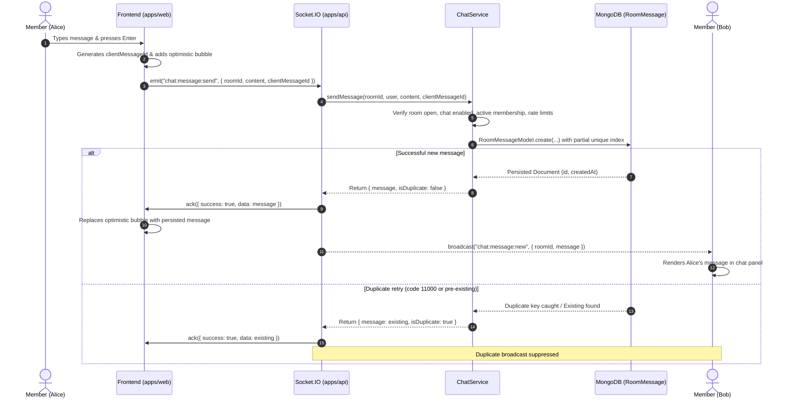

# KTV Online — Realtime Chat Architecture

**Document:** Social Interaction & Chat Architecture  
**Sprint:** Sprint 2.1 (Hardened in Sprint 2.1.1)  
**Status:** CODE COMPLETE — NOT RUNTIME VERIFIED  
**Audience:** Backend Engineers, Frontend Engineers, Infrastructure Architects

---

## 1. Overview

The KTV Online Chat Architecture provides sub-second text communication and emoji reactions for live karaoke rooms. It combines Socket.IO for low-latency broadcast with MongoDB persistence for auditability, history retrieval, idempotency, and reconnection recovery.



---

## 2. Data Models & Schemas

### 2.1 `RoomMessage` Mongoose Schema (`apps/api/src/modules/chat/message.model.ts`)

```typescript
{
  roomId: { type: ObjectId, ref: 'Room', required: true, index: true },
  senderId: { type: ObjectId, ref: 'User', default: null, index: true },
  senderUsername: { type: String, required: true, trim: true },
  senderAvatar: { type: String, default: null },
  senderRole: { type: String, enum: ['host', 'member', 'viewer', 'system'], default: 'member' },
  content: { type: String, required: true, trim: true, maxlength: 1000 },
  messageType: { type: String, enum: ['text', 'system'], default: 'text' },
  clientMessageId: { type: String, default: null },
  deletedAt: { type: Date, default: null },
  deletedBy: { type: ObjectId, ref: 'User', default: null },
  reactions: [
    {
      emoji: { type: String, enum: SUPPORTED_REACTION_EMOJIS, required: true },
      userId: { type: ObjectId, ref: 'User', required: true },
      username: { type: String, required: true },
      createdAt: { type: Date, default: Date.now }
    }
  ],
  createdAt: { type: Date, default: Date.now },
  updatedAt: { type: Date, default: Date.now }
}
```

### 2.2 Indexes, Constraints, and Retention

1. **Compound Index for Cursor Pagination:**
   `{ roomId: 1, createdAt: -1, _id: -1 }`
   Allows fast retrieval of the most recent $N$ messages without sorting large collections.
2. **Partial Unique Compound Index for Idempotency:**
   `{ roomId: 1, senderId: 1, clientMessageId: 1 }`, `{ unique: true, partialFilterExpression: { clientMessageId: { $type: 'string' } } }`
   Enforces database-level uniqueness for messages with a client-supplied identifier. Concurrently sent retries fail the unique constraint with MongoDB code `11000`, returning the previously persisted message without creating duplicate database rows.
3. **TTL Automatic Retention Index:**
   `{ createdAt: 1 }, { expireAfterSeconds: 2592000 }` (30 days)
   Automatically removes room messages older than 30 days asynchronously via MongoDB background TTL cleanup thread (running every 60 seconds).

---

## 3. Emoji Reactions Architecture

Reactions are embedded directly within each message document rather than stored in a separate collection.

### 3.1 Predefined Allowlist

Only 8 curated emojis are accepted:
`['❤️', '😂', '🔥', '👏', '🎉', '😍', '👍', '😮']`

Any other emoji or character string is rejected at the API and Socket boundary via Zod schema validation (`ReactionEmojiSchema`).

### 3.2 Atomic Concurrency Semantics

- **Add Reaction (`chat:reaction:add`):**
  1. Validates active room membership or host status in `RoomMembershipModel`.
  2. Executes an atomic conditional update:
     ```typescript
     await RoomMessageModel.updateOne(
       {
         _id: messageObjectId,
         roomId: roomObjectId,
         deletedAt: null,
         reactions: {
           $not: {
             $elemMatch: { emoji, userId: userObjectId }
           }
         }
       },
       {
         $push: {
           reactions: { emoji, userId: userObjectId, username: user.username, createdAt: new Date() }
         }
       }
     );
     ```
  3. If another concurrent request already added that emoji, `$not: { $elemMatch }` fails to match, preventing duplicate reactions.
  4. Authoritative reaction summaries are fetched and broadcast.
- **Remove Reaction (`chat:reaction:remove`):**
  1. Re-verifies active membership in `RoomMembershipModel`. Kicked or unauthorized users are rejected with `FORBIDDEN_NOT_A_MEMBER`.
  2. Executes atomic `$pull`:
     `{ $pull: { reactions: { emoji, userId: userObjectId } } }`
- **Broadcast (`chat:reaction:updated`):**
  Calculates summarized reaction counts:
  ```json
  [
    { "emoji": "🔥", "count": 3, "userIds": ["user_1", "user_2", "user_3"] },
    { "emoji": "👏", "count": 1, "userIds": ["user_4"] }
  ]
  ```
  Emits `chat:reaction:updated` to the room channel `room:${roomId}`.

---

## 4. History Retrieval & Deterministic Cursor Pagination

### Endpoint: `GET /api/v1/rooms/:roomId/messages`

- **Query Parameters:**
  - `limit`: number (1-100, default: 50)
  - `before`: string (`${createdAt.toISOString()}_${_id.toString()}` or legacy ISO string)
- **Deterministic Compound Cursor:**
  To prevent skipping or duplicating messages that share identical millisecond timestamps, the pagination cursor encodes both `createdAt` and `_id`:
  `nextCursor = "${lastItem.createdAt.toISOString()}_${lastItem._id.toString()}"`
  Queries evaluate:
  ```typescript
  query.$or = [
    { createdAt: { $lt: cursorDate } },
    { createdAt: cursorDate, _id: { $lt: new Types.ObjectId(cursorId) } }
  ];
  ```
- **Authorization:**
  - Public rooms: Open to authenticated users and viewers.
  - Private rooms: Restricted to room host or active members.
- **Soft Deletion Presentation:**
  Messages with `deletedAt !== null` are returned with:
  ```json
  {
    "id": "673000000000000000000099",
    "isDeleted": true,
    "content": "[This message was deleted by the host]",
    "senderUsername": "alex_singer",
    "createdAt": "2026-11-09T22:00:00.000Z"
  }
  ```
  This preserves conversation continuity and timeline position while preventing exposure of purged text.

---

## 5. Security & Abuse Prevention

1. **User-Keyed Token Bucket Rate Limiting:**
   - **Messages:** Max 5 messages per 3-second window per user.
   - **Reactions:** Max 10 reactions per 5-second window per user.
   - Keyed by `user.id` (extracted from authenticated JWT `socket.data.user`).
   - Multiple tabs and sockets belonging to the same user share the exact same bucket.
   - Exceeding the bucket triggers a `RATE_LIMITED` socket error without crashing or disconnecting the socket.
   - Buckets idle for > 60 seconds are purged by a 5-minute memory sweep.
2. **Reconnection & Eviction Protection:**
   - If a member is kicked by the host, `RoomMembership` status is set to `'left'` with `kickedAt != null`.
   - Subsequent `room:join` attempts are rejected with `FORBIDDEN_KICKED`.
   - Message and reaction handlers verify active membership against MongoDB on every socket event, blocking unauthorized stale sockets.
3. **Text Normalization:**
   - Trimmed automatically.
   - Bounded length: 1 to 1000 characters.
   - Rendered using standard React JSX text nodes (zero `dangerouslySetInnerHTML`).
4. **Sender Spoofing Prevention:**
   - Sender identity (`userId`, `username`, `avatar`, `role`) is extracted directly from the verified socket handshake session (`socket.data.user`).
   - Client-supplied sender metadata is disregarded.
