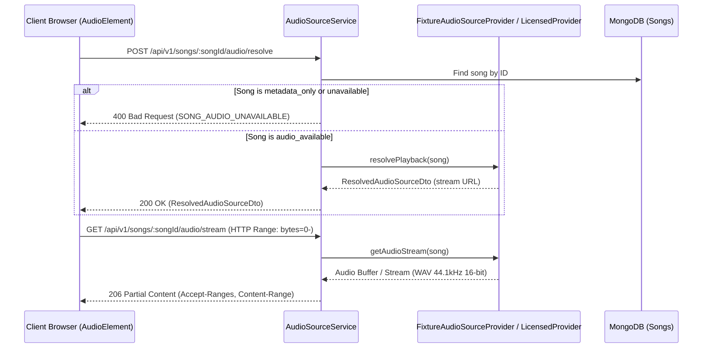

# Karaoke Audio Source Architecture Specification

## 1. Executive Summary & Legal Compliance Boundary

The KTVOnline audio source architecture enforces strict separation between:
1. **Catalog Metadata**: Song title, artist, genre, language, duration, and display artwork.
2. **Backing-Track Audio**: Playable musical accompaniment delivered via authorized media providers.
3. **Timed Lyrics**: Deterministically timed lyric lines synchronized with authoritative playback time.
4. **Live Microphone Audio**: Captured and published through LiveKit WebRTC tracks.

### Mandatory Copyright Compliance Principles

Commercial karaoke backing tracks and musical compositions are intellectual property protected by copyright and performance rights organizations (PROs).

**Prohibited Behaviors:**
- Do not extract or rip audio streams from YouTube, SoundCloud, or streaming services.
- Do not scrape commercial karaoke platforms or file-sharing websites.
- Do not circumvent Digital Rights Management (DRM) or access control mechanisms.
- Do not store or redistribute unauthorized copyrighted MP3s or audio files.
- Do not treat a publicly accessible URL on the internet as proof of a public performance or reproduction license.
- Do not misrepresent sample development fixture tracks as a commercial karaoke library.

---

## 2. Core Provider Abstraction

To support future licensed commercial providers without coupling domain logic to any specific vendor, the system defines an audio source provider interface:

```typescript
export interface IKaraokeAudioSourceProvider {
  readonly providerId: string;
  supports(song: ISongDocument): boolean;
  resolvePlayback(song: ISongDocument): Promise<ResolvedAudioSourceDto>;
  getAudioStream?(song: ISongDocument): Promise<{
    stream: NodeJS.ReadableStream;
    contentLength: number;
    mimeType: string;
    isSeekable: boolean;
  }>;
}
```

### Resolved Audio DTO (`@ktv/contracts`)

```typescript
export interface ResolvedAudioSourceDto {
  songId: string;
  url: string;
  mimeType: string;
  expiresAt?: string;
  licenseClassification: AudioLicenseClassification;
  provider: string;
}
```

---

## 3. Song Availability & Licensing States

Every song entity in KTVOnline carries explicit availability and licensing metadata:

### 3.1 Audio Availability States (`AudioAvailability`)

| State | Semantic | Playback Eligibility |
| :--- | :--- | :--- |
| `metadata_only` | Track details exist for browsing/queuing, but no backing audio file is available. | Ineligible for playback. Cannot be activated by player. |
| `audio_available` | Valid, authorized backing audio stream can be resolved. | Eligible for playback. |
| `audio_unavailable` | Track previously configured or temporarily disabled by provider. | Ineligible for playback. |
| `restricted` | Track restricted by geo-blocking or room licensing policy. | Ineligible for playback. |

### 3.2 License Classifications (`AudioLicenseClassification`)

| Classification | Meaning | Usage Scope |
| :--- | :--- | :--- |
| `licensed_commercial` | Commercial track requiring active licensing contract (ASCAP/BMI/SACEM/etc.). | Production (requires commercial provider). |
| `royalty_free` | Creative Commons or commercially acquired royalty-free performance track. | Permitted under license terms. |
| `public_domain` | Compositions and recordings in the public domain (pre-1929 recordings). | Unrestricted non-commercial/commercial. |
| `user_supplied_authorized` | Track uploaded by room host with confirmed performance authorization. | Room private context only. |
| `development_fixture` | Synthetic procedural audio generated locally for test and development. | Development / Staging only. |

---

## 4. Audio Resolution & Streaming Lifecycle



### Generation Fencing & Race Prevention

When changing tracks rapidly (e.g., host skipping songs in quick succession), client-side asynchronous resolution could result in an older track resolving *after* a newer track has been commanded.

To prevent stale audio substitution:
1. `useKaraokeAudio` increments a local `loadGenerationRef.current` upon every track change.
2. The resolved audio source is accepted only if `currentGeneration === loadGenerationRef.current` and `songId === currentSongIdRef.current`.
3. Stale responses are immediately discarded without mutating the `HTMLAudioElement.src`.

---

## 5. Development Fixtures Implementation

In development and testing environments without a commercial music provider, KTVOnline includes four verified, copyright-compliant development tracks:

1. **Auld Lang Syne** (`fix_auld_lang_syne`): Traditional Scottish folk ballad (Public Domain).
2. **Amazing Grace** (`fix_amazing_grace`): Traditional hymn composed by John Newton (Public Domain).
3. **Scarborough Fair** (`fix_scarborough_fair`): Traditional English folk ballad (Public Domain).
4. **Neon City Synthwave** (`fix_synth_groove`): Procedural synthetic electronic loop (Royalty-Free).

### Procedural Audio Generation (`fixture-audio.generator.ts`)

To guarantee zero dependency on external copyrighted media, KTVOnline implements an in-memory procedural audio generator:
- **Format**: Standard RIFF WAV (stereo, 44,100 Hz, 16-bit signed integer PCM).
- **Structure**: 44-byte canonical RIFF WAV header followed by synthesized audio buffers.
- **Audio Synthesis**: Multi-frequency harmonic chords with ADSR envelopes and gentle stereo panning.
- **Streaming Support**: Full HTTP 206 Partial Content range requests allowing browser native seek and buffering.
