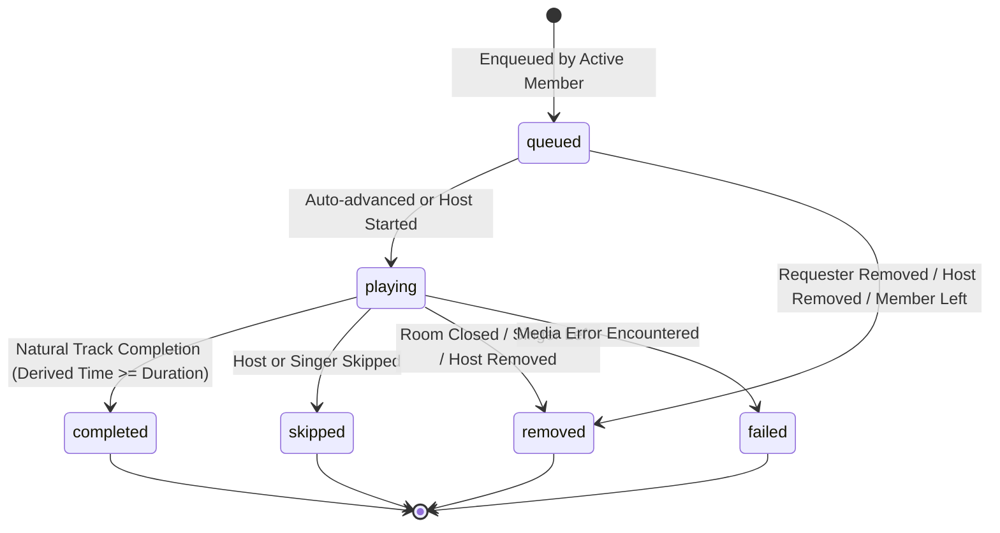
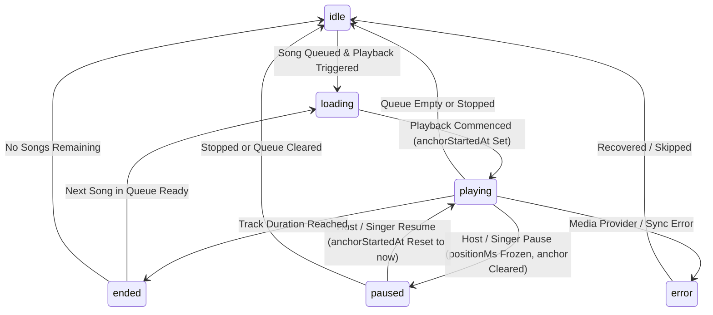

# Karaoke Playback Architecture Specification

## 1. Overview & System Mission

The Karaoke Playback domain upgrades KTVOnline's social voice lounges into full-fledged karaoke rooms. It introduces:
1. **Song Catalog Abstraction**: Separation of track metadata from media transport; modular catalog provider interface.
2. **Persistent Room Song Queue**: Server-ordered, persistent FIFO queue tracking requester, status, and deterministic queue positions.
3. **Server-Authoritative Playback State**: A stable time-anchor engine that calculates continuous playback positions without write-heavy polling.
4. **Realtime Synchronization**: Monotonic versioning (`queueVersion`, `playbackVersion`) broadcast over Socket.IO with recovery.
5. **Interactive Frontend Player**: Rich UI with responsive stage surface, visualizer, queue management, and catalog search.

---

## 2. Core Domain Models & Schemas

### 2.1 Song Catalog (`SongModel`)

Collection: `songs`

| Field | Type | Description |
| :--- | :--- | :--- |
| `_id` | `ObjectId` | Unique song identifier |
| `provider` | `String` | Catalog provider identifier (e.g., `'fixture'`, `'licensed_partner'`) |
| `providerSongId` | `String` | Provider-specific track reference ID |
| `title` | `String` | Song title (text indexed) |
| `artist` | `String` | Performing artist (text indexed) |
| `thumbnailUrl` | `String` (optional) | Album artwork / cover image URL |
| `durationMs` | `Number` | Track duration in milliseconds ($> 0$) |
| `language` | `String` | Language code (e.g. `'en'`, `'vi'`, `'ja'`, `'ko'`) |
| `genre` | `String` | Genre classification (e.g. `'pop'`, `'rock'`, `'ballad'`) |
| `mediaAvailability`| `String` | `'available'`, `'unavailable'`, `'fixture_mock'`, `'licensed_stream'` |
| `metadata` | `Mixed` (optional) | Extensible metadata (key, BPM, licensing tags) |
| `createdAt` / `updatedAt` | `Date` | Mongoose auto-timestamps |

**Indexes**:
- Unique compound: `{ provider: 1, providerSongId: 1 }`
- Text compound: `{ title: 'text', artist: 'text' }`
- Secondary indexes: `{ genre: 1 }`, `{ language: 1 }`

---

### 2.2 Room Song Queue Item (`RoomQueueItemModel`)

Collection: `roomqueueitems`

| Field | Type | Description |
| :--- | :--- | :--- |
| `_id` | `ObjectId` | Queue item ID |
| `roomId` | `ObjectId` | Foreign key referencing `Room` |
| `songId` | `ObjectId` | Foreign key referencing `Song` |
| `requestedBy` | `ObjectId` | Foreign key referencing `User` (the requester/singer) |
| `position` | `Number` | 1-based ordering index for `queued` items; 0 for `playing`/terminal |
| `status` | `String` | `'queued'`, `'playing'`, `'completed'`, `'skipped'`, `'removed'`, `'failed'` |
| `addedAt` | `Date` | Timestamp when item was enqueued |
| `startedAt` | `Date` (optional) | Timestamp when item entered `'playing'` status |
| `completedAt` | `Date` (optional) | Timestamp when item reached terminal state |
| `removedAt` | `Date` (optional) | Timestamp when item was deleted |

**Indexes**:
- Compound queue index: `{ roomId: 1, status: 1, position: 1 }`
- Partial Unique Index enforcing the single-playing invariant at database level:
  `{ roomId: 1, status: 1 }` with `{ partialFilterExpression: { status: 'playing' }, unique: true }`
- Cleanup index: `{ roomId: 1, requestedBy: 1, status: 1 }`

---

### 2.3 Room Playback State (`RoomPlaybackStateModel`)

Collection: `roomplaybackstates`

| Field | Type | Description |
| :--- | :--- | :--- |
| `_id` | `ObjectId` | Primary key |
| `roomId` | `ObjectId` (unique) | Target room |
| `currentQueueItemId` | `ObjectId` (nullable) | Currently playing queue item |
| `status` | `String` | `'idle'`, `'loading'`, `'playing'`, `'paused'`, `'ended'`, `'error'` |
| `positionMs` | `Number` | Base position in ms at time anchor |
| `anchorStartedAt` | `Date` (nullable) | Server timestamp when playback started/resumed |
| `pausedAt` | `Date` (nullable) | Server timestamp when playback was paused |
| `playbackVersion` | `Number` | Monotonically incrementing version integer |
| `queueVersion` | `Number` | Monotonically incrementing queue version integer |
| `playbackExpiresAt` | `Date` (nullable) | Server-computed natural completion timestamp |
| `lastTransitionId` | `String` (nullable) | UUID tracking last logical transition |
| `claimedBy` | `String` (nullable) | Worker instance holding current lease |
| `claimedAt` | `Date` (nullable) | Timestamp lease was acquired |
| `leaseExpiresAt` | `Date` (nullable) | Timestamp lease expires |
| `leaseToken` | `String` (nullable) | Unique token for lease verification |
| `leaseVersion` | `Number` | Monotonic lease version counter |

**Indexes**:
- Unique index: `{ roomId: 1 }`
- Distributed lease query index: `{ status: 1, playbackExpiresAt: 1, leaseExpiresAt: 1 }`

---

## 3. State Machines & Transitions

### 3.1 Queue Item State Transitions



#### Terminal State Safeguards
- Terminal states (`completed`, `skipped`, `removed`, `failed`) can never re-enter `queued` or `playing`.
- Any mutation attempting to transition a terminal item is rejected.

---

### 3.2 Authoritative Playback State Transitions



---

## 4. Server-Authoritative Playback Time Anchor Model

### Why Not 1-Second DB Ticking?
Periodic database writes every second across active rooms would incur extreme I/O overhead and introduce race conditions across horizontally scaled API replicas.

### The Time Anchor Solution
The authoritative playback clock is determined strictly by two persisted values:
1. `positionMs`: The fixed elapsed playback milliseconds when the anchor was set.
2. `anchorStartedAt`: The server UTC timestamp when playback started or resumed.

#### Derived Position Formula
When querying playback state at server time $T_{\text{now}}$:
$$
\text{elapsedMs} = \max(0, T_{\text{now}} - \text{anchorStartedAt})
$$
$$
\text{derivedMs} = \min(\text{song.durationMs}, \text{positionMs} + \text{elapsedMs})
$$

#### State Modifications:
- **Pause**: $\text{positionMs} \leftarrow \text{derivedMs}$, $\text{anchorStartedAt} \leftarrow \text{null}$, $\text{pausedAt} \leftarrow T_{\text{now}}$.
- **Play / Resume**: $\text{anchorStartedAt} \leftarrow T_{\text{now}}$, $\text{pausedAt} \leftarrow \text{null}$.
- **Seek($P_{\text{target}}$)**:
  - If playing: $\text{positionMs} \leftarrow P_{\text{target}}$, $\text{anchorStartedAt} \leftarrow T_{\text{now}}$.
  - If paused: $\text{positionMs} \leftarrow P_{\text{target}}$.
- **Track Auto-Completion**: If $\text{derivedMs} \ge \text{song.durationMs}$, the track completes and advances the queue to the next item automatically.

---

## 5. API & Socket.IO Contract Architecture

### 5.1 REST Endpoints

| Method | Path | Auth | Purpose |
| :--- | :--- | :--- | :--- |
| `GET` | `/api/v1/songs/search` | Optional | Search song catalog by query, genre, language |
| `GET` | `/api/v1/rooms/:roomId/queue` | Optional | Retrieve current room queue snapshot |
| `POST` | `/api/v1/rooms/:roomId/queue` | Required | Enqueue a song (active members only) |
| `DELETE` | `/api/v1/rooms/:roomId/queue/:itemId` | Required | Remove song from queue (owner or host) |
| `POST` | `/api/v1/rooms/:roomId/queue/reorder` | Required | Reorder queued songs (host only) |
| `GET` | `/api/v1/rooms/:roomId/playback` | Optional | Retrieve authoritative playback state snapshot |
| `POST` | `/api/v1/rooms/:roomId/playback/command` | Required | Execute playback control command (`play`, `pause`, etc.) |

---

### 5.2 Realtime Socket.IO Events

#### Client to Server
- `karaoke:queue:add`: `{ roomId, songId, correlationId? }`
- `karaoke:queue:remove`: `{ roomId, itemId, correlationId? }`
- `karaoke:queue:reorder`: `{ roomId, itemIds, expectedQueueVersion?, correlationId? }`
- `karaoke:playback:command`: `{ roomId, command, positionMs?, expectedPlaybackVersion?, correlationId? }`
- `karaoke:state:request`: `{ roomId, correlationId? }`

#### Server to Client (Channel: `room:${roomId}`)
- `karaoke:queue:updated`: `{ roomId, queue, action, affectedItemId?, occurredAt }`
- `karaoke:playback:updated`: `{ roomId, playback, command?, initiatedByUserId?, occurredAt }`
- `karaoke:snapshot`: `{ roomId, playback, queue, serverTimestamp }`
- `karaoke:error`: `{ code, message, correlationId? }`

---

## 6. Security, Authorization & Concurrency Invariants

### 6.1 Authorization Matrix

| Action | Allowed Roles | Validation Rules |
| :--- | :--- | :--- |
| **Add Song to Queue** | Active Room Members | Room must not be closed; max queue size ($50$) enforced |
| **Remove Own Song** | Requester (Owner) | Active membership or host override |
| **Remove Other's Song** | Room Host | Host role verified in `RoomMembershipModel` / `Room.ownerId` |
| **Reorder Queue** | Room Host | Only items in `queued` status can be reordered |
| **Play / Pause / Seek / Skip** | Host OR Current Active Singer | Other room members cannot manipulate playback |
| **State Inspection** | Room Participants | Private room access restricted to members |

---

### 6.2 Concurrency & Monotonicity
1. **Single Playing Track**: MongoDB partial unique index guarantees that two concurrent requests cannot insert or update two queue items to `playing` status in the same room.
2. **Version Checks**:
   - `queueVersion`: Monotonically incremented on additions, removals, reorders, and auto-advances. Clients supply `expectedQueueVersion` to detect concurrent reorders.
   - `playbackVersion`: Monotonically incremented on commands and status transitions. Stale commands with mismatched versions are rejected with HTTP 409 / socket error.
3. **Room Closure**: Closing a room immediately stops playback, sets state to `idle`, marks all active queue items `removed`, and increments versions.
4. **Member Departure**: When a member leaves or is evicted, their queued items are cleanly removed, remaining items are rebalanced, and if their song was playing, playback advances to the next track.

---

## 7. Catalog Provider Abstraction

```typescript
export interface ISongCatalogProvider {
  readonly providerName: string;
  searchSongs(query: SongSearchQuery): Promise<SongSearchResponse>;
  getSongById(providerSongId: string): Promise<SongDto | null>;
  getPlaybackAvailability(providerSongId: string): Promise<MediaAvailability>;
}
```

The system uses `FixtureCatalogProvider` for development and testing with 12 royalty-free mock sample tracks. The domain architecture allows swapping in licensed commercial providers without modifying room queue logic or data models.
