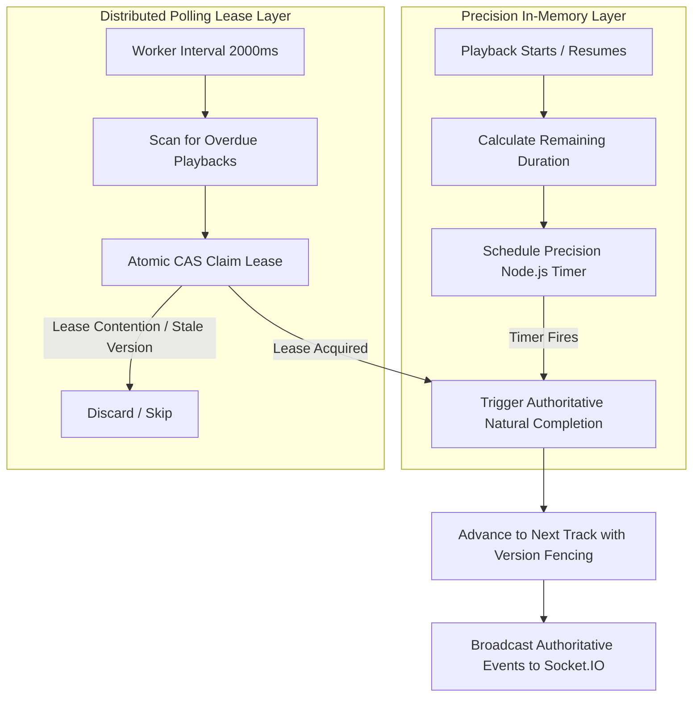

# Karaoke Playback Consistency & Concurrency Architecture

## 1. Overview & Consistency Strategy

Sprint 2.4.1 hardens the karaoke domain against race conditions, split-brain queue/playback states, uncoordinated concurrent host/singer mutations, unauthoritative client completion signals, server restarts, and member/room lifecycle events.

Because standalone MongoDB environments (common in single-node staging, local development, and containerized CI) do not support multi-document replica-set transactions (`session.withTransaction`), the karaoke architecture implements a **Dual-Layer Atomic CAS & Recoverable State Machine Protocol**:

1. **Database-Level Partial Unique Constraints**: Enforces single-playing item per room at the storage layer (`{ roomId: 1, status: 1 }` where `status: 'playing'`).
2. **Optimistic Version Fencing**: Version counters (`queueVersion` and `playbackVersion`) ensure stale mutations are rejected with structured HTTP 409 / Socket errors before state modification.
3. **Atomic Bulk Operations**: Multi-item position rebalancing occurs via `RoomQueueItemModel.bulkWrite` in a single database roundtrip.
4. **Distributed Lease Claiming for Server-Side Completion**: Worker processes acquire atomic, expiring leases on overdue playbacks using single-document `findOneAndUpdate` fencing.
5. **Idempotent Background Reconciliation**: Startup and periodic sweeps detect and repair orphaned references, closed-room state leaks, multiple playing items, or position gaps.

---

## 2. Cross-Collection Invariant Rules

The following core invariants are enforced across `RoomQueueItem` and `RoomPlaybackState`:

| Invariant | Storage Enforcement | Recovery Protocol |
| :--- | :--- | :--- |
| **At most one `playing` track per room** | MongoDB Partial Unique Index on `{ roomId: 1, status: 'playing' }` with `unique: true` | `KaraokeReconciliationService` marks excess playing items as `skipped` |
| **Referential Integrity** | `playbackState.currentQueueItemId` must match a valid, existing `RoomQueueItem` in the same room | If item is missing or belongs to another room, reconciliation clears reference and sets status to `idle` |
| **Playback Status Consistency** | If playback status is `playing`, the referenced queue item must be in `playing` status | If referenced item is terminal (`completed`, `skipped`, `removed`), reconciliation advances to next queued track or resets to `idle` |
| **Idle Playback Invariant** | If playback is `idle`, no queue item in that room may be in `playing` status | Reconciliation transitions any stray `playing` queue items to `completed` |
| **Closed Room Invariant** | A closed room must have zero active queue items (`queued` or `playing`) and playback status must be `idle` | Closure handler and reconciliation purge active items to `removed` and set playback to `idle` |
| **Monotonic Version Advancement** | `queueVersion` and `playbackVersion` only advance on committed state changes | Optimistic CAS rejects stale commands |

---

## 3. Atomic Queue Mutation Protocols

### 3.1 Adding a Song
- **Capacity Guard**: Atomic check ensures room queue does not exceed 50 items (`countDocuments({ roomId, status: { $in: ['queued', 'playing'] } }) < 50`).
- **Initial Playback Trigger**: If playback is currently `idle`, the system attempts to activate the track directly to `playing`. If a concurrent add races to activate, MongoDB duplicate key error `E11000` is caught cleanly, falling back to appending the song at the end of the `queued` list with position $N+1$.
- **Version Increment**: `queueVersion` and `playbackVersion` advance synchronously upon commit.

### 3.2 Removing a Song
- **Authorization Check**: Caller must be an active room member and either the original requester (`requestedBy === userId`) or the room host (`room.ownerId === userId`).
- **Terminal State Lock**: Only items currently in `queued` status can be removed. Items already `playing` or in terminal states cannot be removed via queue removal (they must be skipped or stopped).
- **Position Rebalancing**: An atomic bulk update resets positions of all subsequent queued items to preserve a contiguous 1-based sequence ($1, 2, \dots, N$).

### 3.3 Reordering the Queue
- **Host Authorization**: Strictly host-only.
- **Version Fencing**: Request accepts `expectedQueueVersion`. If `expectedQueueVersion !== playbackState.queueVersion`, the command is rejected with `STALE_QUEUE_VERSION` (HTTP 409).
- **Atomic Bulk Execution**: All items in `dto.itemIds` are validated to belong to the room and reside in `queued` status. A single `RoomQueueItemModel.bulkWrite` updates all item positions atomically, followed by a monotonic increment of `playbackState.queueVersion`.

---

## 4. Server-Authoritative Playback Completion

### 4.1 The Dual-Layer Completion Architecture
Frontend clients are explicitly **never trusted** to authoritatively signal that a track has completed. Playback duration is derived strictly from trusted song catalog metadata (`song.durationMs`).

Natural track completion is orchestrated via two complementary layers:

1. **Precision In-Memory Timer (`schedulePrecisionTimer`)**:
   - Computes exact remaining milliseconds: $\text{delayMs} = \max(0, \text{durationMs} - \text{positionMs})$.
   - Fires an in-memory timer anchored to the exact expected completion millisecond.
   - Provides instant, sub-second natural transition for connected users without polling lag.
2. **Distributed Polling Worker (`KaraokePlaybackWorker`)**:
   - Runs on a 2000ms background interval.
   - Polls MongoDB for any rooms where `status = 'playing'`, `playbackExpiresAt <= now`, and `leaseExpiresAt <= now` (or unleased).
   - Uses `RoomPlaybackStateModel.claimDuePlayback(instanceId, leaseDurationMs)` to acquire an atomic distributed lease via CAS (`findOneAndUpdate`).
   - Acts as a bulletproof safety net: if a process crashes, an in-memory timer is dropped, or server clock drifts, the worker automatically reclaims and completes the track.

### 4.2 Playback Version Fencing
Both the precision timer and background worker pass the `expectedPlaybackVersion` to `karaokeService.advanceToNextTrack()`.
If a host skipped, paused, or stopped the track in the interim, the playback version will have advanced. The completion attempt is detected as stale and discarded idempotently with zero state corruption.

---

## 5. Automatic Next-Track Selection & Requester Eligibility

When a track completes, is skipped, or is stopped, `advanceToNextTrack` executes:
1. Marks the active item as terminal (`completed` or `skipped`) with timestamp `completedAt = new Date()`.
2. Scans for the next eligible item: `status: 'queued'`, sorted by `position: 1, addedAt: 1`.
3. **Requester Eligibility Verification**:
   - Checks `RoomMembershipModel` for the next item's requester.
   - If the requester has left or been kicked (`status !== 'active'`), their track is automatically marked `removed` (`reason: 'requester_departed'`), and the loop proceeds to inspect the subsequent track.
4. **Transition Execution**:
   - If an eligible queued track exists: it atomically transitions to `playing`, `positionMs = 0`, `anchorStartedAt = new Date()`, `playbackExpiresAt = new Date(Date.now() + durationMs)`, and positions are rebalanced.
   - If no eligible tracks remain: playback transitions to `status: 'idle'`, `currentQueueItemId = null`, and room song metadata is cleared.

---

## 6. Lifecycle Integration (Leave, Kick, Closure)

### 6.1 Member Departure & Kick
- When a user leaves (`leaveRoom`) or is removed by the host (`kickMember`):
  1. `karaokeService.handleMemberDeparted(roomId, userId)` is invoked.
  2. All pending items requested by the user in `queued` status are set to `removed` (`position = 0`).
  3. Remaining queue positions are atomically rebalanced.
  4. If the departed user was the active singer (`currentItem.requestedBy === userId`), the track is immediately terminated, in-memory timers are canceled, and playback advances to the next track.
  5. Updated queue and playback snapshots are broadcast to the room channel.

### 6.2 Room Closure
- When a host closes a room (`closeRoom`):
  1. `karaokeService.handleRoomClosed(roomId)` is invoked.
  2. Cancels active precision timers.
  3. Resets playback state to `status: 'idle'`, clears all timestamps and leases, and increments `playbackVersion`.
  4. Marks all active queue items (`queued` and `playing`) as `removed`.
  5. Cleared snapshots are broadcast to connected clients before sockets disconnect.

---

## 7. Startup Recovery & Self-Healing Reconciliation

During API bootstrap (`server.ts`), before incoming HTTP requests or socket connections are accepted:
1. `karaokeReconciliationService.reconcileAllActiveRooms()` scans all active rooms and compares `Room`, `RoomPlaybackState`, and `RoomQueueItem`.
2. Any broken references, multiple playing items, orphaned playbacks, or overdue songs are reconciled into safe deterministic states.
3. `karaokePlaybackWorker.start()` starts the distributed lease polling engine.
4. On graceful shutdown (`SIGTERM`/`SIGINT`), `karaokePlaybackWorker.stop()` cleanly drains in-flight work and cancels in-memory precision timers.
