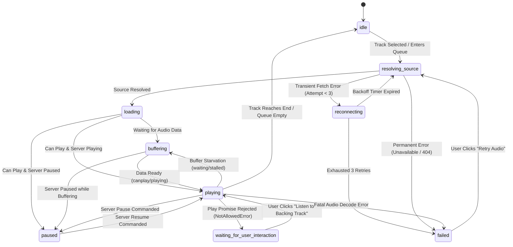

# Karaoke Browser Player & Audio Synchronization Architecture

## 1. System Mission & Core Authority Boundary

The KTVOnline karaoke player provides synchronized backing-track audio playback across distributed browser clients.

### Separation of Concerns: Server vs. Client

| Domain Responsibility | Server Authority | Client Browser Authority |
| :--- | :--- | :--- |
| **Track Selection** | Owns active queue item ID and track progression. | Renders current song metadata. |
| **Playback Status** | Owns authoritative state (`playing`, `paused`, `idle`). | Mirror status in local audio element. |
| **Playback Clock** | Owns time anchor (`positionMs`, `anchorStartedAt`). | Computes continuous elapsed time. |
| **Track Completion** | `KaraokePlaybackScheduler` advances queue. | Reaching `ended` resets local audio; **cannot** advance queue. |
| **Audio Rendering** | None (headless). | Native `HTMLAudioElement` streams and decodes audio. |
| **Audio Volume** | None. | Persisted in local browser `localStorage`. |
| **Microphone Chat** | LiveKit SFU server routes voice tracks. | WebRTC captures microphone stream. |

---

## 2. Server-Authoritative Playback Clock & Offset Estimation

The backend calculates playback position without continuously writing to the database by using a time-anchor model:

$$\text{serverNow} = \text{Date.now}() + \theta$$
$$\text{currentPositionMs} = \text{positionMs} + (\text{serverNow} - \text{anchorStartedAt})$$

Where $\theta$ is the client-server clock offset measured by `ClockSyncService` using lowest-RTT median filtering over HTTP and WebSocket exchanges.

When paused, $\text{positionMs}$ is frozen and $\text{anchorStartedAt}$ is set to `null`.
When stopped or idle, $\text{positionMs} = 0$.

Clients derive their continuous display and synchronization clock at 10 Hz from this authoritative anchor.

---

## 3. Synchronization & Drift Correction Algorithm

Network jitter, tab throttling, and hardware audio buffering cause client audio elements to drift from the server anchor.

`useKaraokeAudio` executes a controlled, three-tier drift correction strategy governed by `PLAYBACK_SYNC_CONFIG`:

```typescript
const driftMs = Math.abs(audioMs - currentPositionMs);

if (driftMs < PLAYBACK_SYNC_CONFIG.DRIFT_TOLERANCE_MS) {
  // Tier 1: Small drift (< 250ms)
  // Imperceptible to human ear — leave playback untouched
  audio.playbackRate = 1.0;
} else if (driftMs <= PLAYBACK_SYNC_CONFIG.DRIFT_NUDGE_MAX_MS) {
  // Tier 2: Moderate drift (250ms - 1500ms)
  // Smooth tempo nudge to eliminate drift without audible glitching
  if (audioMs < currentPositionMs) {
    audio.playbackRate = 1.04; // Local is behind -> gently speed up
  } else {
    audio.playbackRate = 0.96; // Local is ahead -> gently slow down
  }
} else {
  // Tier 3: Large drift (> 1500ms)
  // Hard seek to authoritative anchor with 2000ms minimum cooldown
  if (Date.now() - lastHardSeekAt >= PLAYBACK_SYNC_CONFIG.MIN_SEEK_COOLDOWN_MS) {
    audio.currentTime = currentPositionMs / 1000;
    audio.playbackRate = 1.0;
    lastHardSeekAt = Date.now();
  }
}
```

### Protection Against Seek Loops & Buffering Guards
- **Buffering Guard**: Drift correction is strictly bypassed when `isBuffering === true` or `audio.readyState < 3`. Stalled audio is never misidentified as clock drift.
- **Seek Cooldown**: Programmatic hard seeks enforce a strict minimum cooldown of 2,000 ms to eliminate seek oscillation.
- **Guaranteed Rate Reset**: Playback rate resets to $1.0\times$ on pause, stop, buffering, seek, track transition, tab backgrounding, and unmount.

---

## 4. Autoplay Policy Handling

Modern web browsers (Chrome, Safari, Firefox, Edge) restrict media playback with audio unless the user has actively interacted with the document.

### Rejection Detection & Non-Intrusive Recovery
When the host executes `play`:
1. Non-host listeners may receive the Socket.IO `karaoke:playback_updated` event while their tab has no user interaction token.
2. `HTMLMediaElement.play()` rejects with `NotAllowedError: play() failed because the user didn't interact with the document first`.
3. The player catches this error explicitly:
   - Sets `isAutoplayBlocked = true`.
   - Displays an accessible banner: *"Audio autoplay blocked by browser. Click to unmute backing track."*
   - Renders an interactive button calling `unlockAutoplay()`.
4. When clicked, `unlockAutoplay()` immediately triggers `audio.play()`, unmuting playback and dismissing the banner.
5. The backend playback state remains completely untouched—a participant's local browser restriction never alters the shared room state.

---

## 5. LiveKit Voice & Backing Audio Separation

A critical failure mode in social karaoke applications is audio feedback loops, where backing audio played through the browser is re-captured by the microphone and broadcast to the room.

### Architectural Audio Partitioning

```
+------------------------------------------------------------------------+
| Client Browser Window                                                  |
|                                                                        |
|  [Karaoke Audio Engine]                    [LiveKit WebRTC Engine]     |
|          |                                            |                |
|  HTMLAudioElement                             getUserMedia             |
|  (Streams Backing WAV/MP3)                    (Microphone Input Only)  |
|          |                                            |                |
|          v                                            v                |
|  System Audio Output                     LiveKit Voice Publisher Track |
|  (User Headphones / Speakers)                         |                |
|                                                       v                |
|                                             LiveKit SFU Server         |
|                                                       |                |
|                                                       v                |
|                                            Remote Voice Subscribers    |
+------------------------------------------------------------------------+
```

1. **No Mixed Audio Publishing**: The browser never routes `HTMLAudioElement` into `navigator.mediaDevices.getUserMedia` or LiveKit audio tracks.
2. **Independent Volume Controls**:
   - Karaoke backing audio slider operates strictly on `HTMLAudioElement.volume`.
   - Microphone mute toggles `LiveKitRoom.localParticipant.setMicrophoneEnabled(false)`.
   - Changing backing track volume has zero impact on microphone capture levels.
3. **Lifecycle Teardown & Media Pipeline Reset**:
   - Exiting the room or switching tracks immediately cancels pending retry timers.
   - Resets playback rate to normal ($1.0\times$).
   - Calls `audio.pause()`, clears `audio.src = ''`, and executes `audio.load()`. Calling `audio.load()` explicitly flushes browser hardware media decoders and cached buffer memory.
   - Single backing `HTMLAudioElement` instance owned strictly by `useKaraokeAudio`. Prevents ghost audio or duplicate audio instances after room reconnects.

---

## 6. Audio Execution State Machine



### Playback Promise Handling & AbortError Guard

Calling `HTMLMediaElement.play()` returns a Promise. When track transitions or pause commands occur rapidly, the browser interrupts pending play promises with:
```
AbortError: The play() request was interrupted by a call to pause().
```
KTVOnline explicitly traps `AbortError` and silences it without marking playback as failed:
- Prevents spurious error flashes during rapid skipping or pausing.
- Distinguishes autoplay policy blocks (`NotAllowedError`) from media decoding failures.

---

## 7. Audio Output Device Selection & Dual Pipeline Routing (Sprint 2.6.3)

KTVOnline maintains two completely independent audio playback pipelines:
1. **LiveKit Remote Voice Stream**: Voice communications received over WebRTC from remote singers and audience members.
2. **Karaoke Backing Track**: High-fidelity stereo instrumental backing tracks decoded by `HTMLAudioElement`.

### Dual-Pipeline Sink Management

```
+-----------------------------------------------------------------------------------------+
| Browser Audio Pipeline Routing                                                          |
|                                                                                         |
| [LiveKit Remote Voice] ----> Remote <audio> Elements ----> Voice Output Sink (setSinkId)|
|                                                            (e.g., Headset / Earphones)  |
|                                                                                         |
| [Karaoke Backing Audio] ---> Karaoke HTMLAudioElement ---> Backing Output Sink(setSinkId)|
|                                                            (e.g., Room PA / Soundbar)   |
+-----------------------------------------------------------------------------------------+
```

### Key Architectural Properties:
1. **Independent Sinks**: Users can route backing track music through external room speakers while routing chat or monitor voices through headphones, avoiding acoustic feedback.
2. **Feature Detection & Graceful Degradation**:
   - Audio sink routing relies on `HTMLMediaElement.prototype.setSinkId`.
   - Supported natively in Chromium-based browsers (Chrome, Edge, Brave, Opera) and Safari 17+.
   - When unsupported (e.g., Firefox), the application surfaces an informational badge (*"Default system output only"*), and both streams play via the operating system's default audio output device without playback interruption.
3. **Cross-Component Sink Synchronization**:
   - Backing audio sink preference is persisted in `localStorage` under `ktv_karaoke_audio_sink_id`.
   - When modified inside the audio device settings modal, a custom `ktv_karaoke_sink_changed` event dispatches globally to update the active `HTMLAudioElement` without requiring a page refresh.
4. **Resilience to Device Removal**:
   - If an external output device is disconnected during playback, the browser automatically cascades back to the default audio output device without dropping audio execution or corrupting sync anchors.


