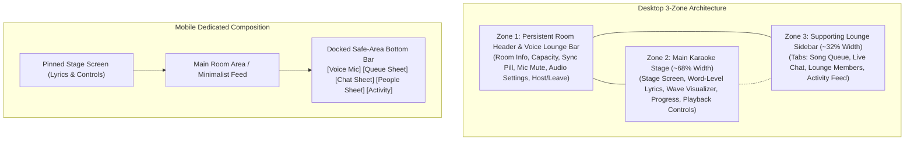

# KTVOnline — Virtual Karaoke Lounge Experience Architecture

## Document Control
- **Document**: `docs/KARAOKE_ROOM_EXPERIENCE.md`
- **Sprint**: Sprint 3.0 (Karaoke Room Experience Redesign)
- **Product Direction**: **`KTVOnline — Your Virtual Karaoke Lounge`**
- **Status**: **`ARCHITECTURE COMPLETE`**
- **Date**: November 2026

---

## 1. Product Vision & Architectural Philosophy

The redesigned virtual room re-centers KTVOnline around its primary entertainment value proposition:
> **The karaoke stage is the central star of the experience.**

In physical karaoke lounges, the room decor, lighting, and ambient seating all point toward the stage monitor and microphone. The UI architecture mirrors this principle:
- **Maximum Visual Weight on the Stage**: The karaoke screen, timed lyrics sweeps, audio wave visualizer, and playback controls occupy the dominant horizontal and vertical space.
- **Supporting Lounge Sidebar**: Song queuing, live chatting, participant rosters, and activity feeds are organized into a dedicated, compact sidebar that supports the stage without competing with it.
- **Persistent Header & Voice Area**: LiveKit voice communication, mic mute states, and audio settings are integrated into a persistent top bar, eliminating confusing stacked control cards.
- **Dedicated Mobile Composition**: On narrow screens, the stage remains pinned at the top while queue and chat slide open as touch-friendly bottom sheets rather than forcing endless vertical scrolling.

---

## 2. Desktop 3-Zone Composition

### Zone 1: Persistent Room Header & Voice Lounge Bar
Positioned at the top of the viewport with a subtle glass-blur background (`#0b0e19`/95):
1. **Lounge Identity & Access**:
   - Exit to lobby button (`LogOut`).
   - Room title, status badge (`open`, `playing`, `closed`), private lock indicator, and genre category.
   - Truncated room description.
2. **Realtime Telemetry**:
   - Occupancy counter (`data-testid="room-capacity-counter"`): Displays `currentParticipantsCount / capacity` with "Full" badge when capacity is reached.
   - Realtime Sync Pill (`data-testid="realtime-status-pill"`): Visual indicator of Socket.IO connection status (`connected`, `reconnecting`, `desynchronized`) and active online presence count.
   - Voice Badge (`data-testid="header-voice-indicator"`): Shows number of singers in the voice lounge.
3. **Integrated Voice Lounge Bar (`VoiceControls variant="bar"`)**:
   - Non-members / disconnected users see a prominent "Join Voice" button (`data-testid="join-voice-button"`).
   - Connected singers get:
     - Mic mute toggle (`data-testid="voice-mute-toggle"`) with pulse animation and "Speaking..." state.
     - Live status badge (`data-testid="voice-status-connected"`).
     - Audio Device & EQ Settings trigger (`data-testid="audio-device-settings-button"`).
     - Leave Voice button (`data-testid="leave-voice-button"`).
4. **Room Controls & Invitations**:
   - Host badge (`data-testid="host-status-indicator"`) and Settings link (`title="Manage Lounge"`).
   - Member Leave Lounge button (`data-testid="leave-room-button"`).
   - Instant invite link copier (`Share2`).

### Zone 2: Main Karaoke Stage (Greatest Visual Weight)
The stage container (`lg:col-span-8`) dominates the screen:
1. **Ambient Backing Atmosphere**:
   - Deep indigo/violet night gradient (`#111425` to `#060810`).
   - Subtle dynamic radial glow when audio is actively playing.
2. **Stage Viewport Header**:
   - Track title, artist, requester attribution, and availability tags (`Backing Audio`, `Timed Lyrics`, `Dev Fixture`).
   - Embedded Singer Turn Spotlight (`SingerTurnIndicator`): Displays glowing alert when the user is currently singing ("You are on stage!"), up next, or highlights the current singer.
   - Stage Display Mode Toggle: Segmented control between `Lyrics` (`data-testid="stage-view-lyrics-button"`) and `Wave` visualizer (`data-testid="stage-view-visualizer-button"`).
3. **Stage Screen Modes**:
   - **Lyrics Mode (`LyricsStage`)**: High-performance $O(1)$ per-tick word-level highlight sweeps, line fallback, automatic scrolling with 4-second manual scroll pause, and `prefers-reduced-motion` compliance.
   - **Visualizer Mode**: Multi-band CSS-animated audio wave bars with glowing center disc and track title.
   - **Empty State**: Welcoming "Stage is Waiting for You" callout with direct "Browse Song Catalog" CTA (`data-testid="stage-open-catalog-button"`).
4. **Stage Bottom & Controls**:
   - High-contrast elapsed time and total duration timestamps.
   - Interactive seekable progress bar (`data-testid="karaoke-progress-bar"`).
   - Authoritative Playback Controls bar (`PlaybackControls`):
     - Role indicator (`Authoritative Controls` vs `Listener Mode`).
     - Rewind -10s, Play/Pause (`data-testid="playback-toggle-button"`), Fast-forward +10s, Stop, and Skip (`data-testid="playback-skip-button"`).
     - Independent backing track volume slider and mute toggle (`Volume2` / `VolumeX`).
     - Direct EQ preset button (`Sliders`) that opens the audio settings modal to the equalizer tab.
5. **Resilience & Error Overlays**:
   - Autoplay blocked banner with `data-testid="autoplay-unlock-button"`.
   - Audio reconnecting spinner banner.
   - Server playback error overlay (`data-testid="playback-error-banner"`) with Skip button.

### Zone 3: Supporting Room Sidebar
Occupies the remaining width (`lg:col-span-4`) with four modular tabs:
1. **Queue Tab (`ListMusic`)**:
   - Labeled `Queue (N)`.
   - Distinguishes "Now Singing" track with vibrant gradient border and glowing disc from "Up Next" queue items.
   - Host reorder controls (`MoveUp` / `MoveDown`) and delete permissions (`Trash2`).
   - "Add Song to Queue" button (`data-testid="add-song-to-queue-button"`).
2. **Chat Tab (`MessageSquare`)**:
   - Labeled `Chat (N)`.
   - Real-time messages with user avatars, host crowns, reaction emojis, host deletion, and auto-scroll.
3. **People Tab (`Users`)**:
   - Labeled `People (N)`.
   - Unified participant roster combining registered room members and LiveKit voice presence:
     - Avatar with online presence dot.
     - LiveKit voice status: Mic active (emerald) or Muted (rose).
     - Dynamic speaking ring (`ring-2 ring-emerald-400 animate-pulse`) when speaking.
     - "Singing" badge when member is the active singer on stage.
     - Multi-tab presence count (`(2 tabs)`).
     - Host moderation kick button (`UserX`).
     - Member refresh button (`data-testid="refresh-members-button"`).
4. **Activity Tab (`Activity`)**:
   - Real-time timeline of room events (joins, leaves, kicks, settings changes).

---

## 3. Mobile Composition & Touch UX

On mobile displays (`< 1024px`):
1. **Stage Focus**: The stage renders full-width at the top of the viewport. Lyrics remain legible without being pushed below the fold.
2. **Docked Navigation Bar**:
   - Positioned fixed at the bottom with safe-area inset padding (`pb-[max(0.5rem,env(safe-area-inset-bottom))]`).
   - Touch targets meet accessibility standards ($\ge 44\times 44\text{px}$).
   - Direct mic toggle button + drawer triggers for Queue, Chat, People, and Activity with live counter badges.
3. **Slide-Over Drawers**:
   - Tapping any tab opens a smooth bottom sheet (`max-h-[85vh]`) with backdrop blur and drag handle.
   - Prevents horizontal overflow (`overflow-x-hidden`) and eliminates confusing multi-column squishing.

---

## 4. Preserved Domain Invariants

The Sprint 3.0 redesign operates strictly as a frontend presentation upgrade, preserving 100% of the underlying system invariants:

| Invariant | Preservation Method |
| :--- | :--- |
| **Occupancy Consistency** | `Room.currentParticipantsCount` matches active memberships. Presence does not alter DB membership counts. |
| **Version Fencing** | `RoomStateSnapshot.version` and `PlaybackState.playbackVersion` are verified on every Socket/REST command. |
| **Server-Authoritative Clock** | Playback position is computed from server timestamps via `ClockSyncService`; 3-tier drift compensation is untouched. |
| **Lyrics $O(1)$ Performance** | `LyricLineRow` memoization comparator prevents non-active lines from re-rendering on 10 Hz position ticks. |
| **LiveKit Voice Isolation** | Microphone capture and remote voice streams never route through Web Audio nodes; backing track EQ is strictly local. |
| **Moderation Boundaries** | Only hosts can kick members, close rooms, reorder queues, or delete chat messages. |
| **Session Revocation** | Replayed refresh tokens and account suspensions trigger immediate socket and voice severance. |

---

## 5. Deferred Runtime Verification Scenarios

Under the code-only constraint, runtime verification in real browser environments is deferred to the verification runner:
1. Touch scroll smoothness in the mobile bottom sheet under active 10 Hz lyric position updates.
2. Cross-browser audio sink routing (`setSinkId`) when switching devices inside the persistent voice bar.
3. Verification of speaking ring animations under high acoustic ambient noise with LiveKit voice detection.
4. Layout verification across ultra-wide monitors ($>2560\text{px}$) and compact mobile devices ($<360\text{px}$).

---

## 6. Known Limitations

1. **Third-Party CDN CORS Restrictions**: If an external music provider is integrated without CORS headers, Web Audio EQ falls back to native un-equalized audio (documented in `BUG-RV-001`).
2. **Mobile Background Throttling**: Mobile Safari throttles timers when the browser tab is hidden; upon returning, `ClockSyncService` executes an immediate catch-up seek (documented in `BUG-RV-003`).

