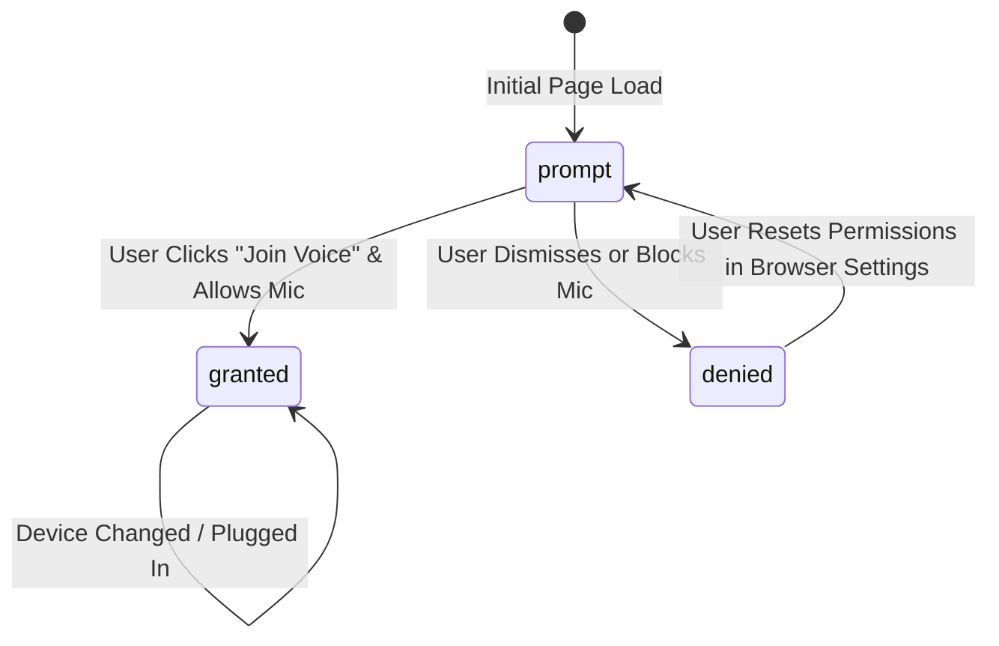

# KTVOnline Audio Device Management Architecture

## 1. Overview & Objectives

Audio device management in KTVOnline enables karaoke room participants to configure their hardware seamlessly:
- Discovers and lists available microphones (`audioinput`) and speakers/headphones (`audiooutput`).
- Tracks browser microphone permissions (`prompt`, `granted`, `denied`).
- Allows switching microphones dynamically without leaving the room or re-authenticating.
- Supports independent output device routing for remote voice chat vs. karaoke backing tracks.
- Recovers gracefully when an active audio device is unplugged or disconnected.
- Persists user hardware preferences locally in the browser without leaking device identifiers to the backend.

---

## 2. Browser Device Discovery & Permission States

### Permission Lifecycle & Label Masking
Modern browsers intentionally hide device labels (e.g. returning `""` or `"Microphone 1"`) until the user has granted microphone permission for privacy reasons.

1. **Permission Querying**:
   - On browsers supporting `navigator.permissions.query({ name: 'microphone' })`, the permission state is proactively tracked.
   - If `permissions.query` is unsupported (e.g. Safari), the state safely defaults to `prompt` until `getUserMedia` resolves or rejects.
2. **Device Enumeration**:
   - Utilizes `Room.getLocalDevices('audioinput')` and `Room.getLocalDevices('audiooutput')` from `livekit-client@2.23.0`.
   - Device list is refreshed on voice connection and whenever the browser fires a `devicechange` event.
3. **Labels Formatting**:
   - If a device label is empty (due to pre-permission masking), a clear fallback label is rendered: `Microphone (device-id-prefix...)` or `Default Output Device`.

---

## 3. Dynamic Device Change Detection (`devicechange`)

When a user plugs in a USB microphone, connects Bluetooth headphones, or unplugs a headset:
1. `navigator.mediaDevices.addEventListener('devicechange', handleDeviceChange)` fires immediately.
2. The application triggers a debounced re-enumeration of input and output devices.
3. **Disconnection Detection**:
   - If the currently active input device is no longer present in the refreshed device list:
     - The application selects the first available microphone device.
     - Automatically switches LiveKit capture to the new device via `switchAudioInputDevice(firstDevice.deviceId)`.
     - Displays an informational warning to the user: *"Active microphone disconnected. Switched to fallback device."*
4. All event listeners are properly detached on component unmount to prevent memory leaks.

---

## 4. Microphone Switching & Track Safety

Switching microphones within an active LiveKit room must never create duplicate tracks, disrupt remote listeners, or mutate room state.

### Execution Safeguards:
1. **Device Validation**: Validates that the requested `deviceId` exists in the enumerated input devices.
2. **In-Place Track Replacement**:
   - Uses `room.switchActiveDevice('audioinput', deviceId)`.
   - The LiveKit SDK replaces the underlying `MediaStreamTrack` on the existing `LocalAudioTrack` publication in-place.
   - Remote subscribers experience zero interruption; no track unsubscribed/re-subscribed cycle occurs.
3. **Mute State Preservation**:
   - If the user was muted prior to switching, the switched track remains muted.
4. **Capture Options Preservation**:
   - The user's active capture preferences (`echoCancellation`, `noiseSuppression`, `autoGainControl`) are passed into the new track constraints.
5. **Rollback on Failure**:
   - If switching to the target device fails (e.g. hardware busy or unreadable), the previous working device ID is preserved, and a user-friendly error message is surfaced:
     *"Could not switch microphone. Your previous microphone is still active."*

---

## 5. Audio Output Device Management & `setSinkId`

KTVOnline provides dual-pipeline audio output routing, allowing singers to route backing music and voice streams to distinct physical devices.

### Browser Compatibility Matrix

| Browser Engine | Platform | `setSinkId` Supported | Capabilities & Limitations |
| :--- | :--- | :---: | :--- |
| **Google Chrome / Chromium** | macOS / Windows / Linux / Android | **Yes** | Full support for independent voice and backing track sinks. |
| **Microsoft Edge / Brave / Opera** | macOS / Windows / Linux | **Yes** | Full support for independent voice and backing track sinks. |
| **Safari 17+** | macOS / iOS 17+ | **Yes** | Supported in secure contexts (`https://` or `localhost`). |
| **Mozilla Firefox** | All Platforms | **No (Disabled by default)** | Falls back gracefully to system default output. |

### Dual Pipeline Routing Architecture

1. **LiveKit Remote Voice Output**:
   - Managed via `room.switchActiveDevice('audiooutput', deviceId)`.
   - Additionally applied directly to all active remote audio elements via `audioEl.setSinkId(deviceId)`.
   - New incoming remote tracks automatically inherit the selected voice sink ID when attached.
2. **Karaoke Backing Audio Output**:
   - Managed by `useKaraokeAudio` on its native `HTMLAudioElement`.
   - When the user selects a karaoke output device in the settings modal, it executes `audioRef.current.setSinkId(deviceId)`.
   - Dispatches a window custom event `ktv_karaoke_sink_changed` to keep all components synchronized.
3. **Unsupported Fallback**:
   - If `'setSinkId' in HTMLMediaElement.prototype` evaluates to `false`, the device selector is replaced by an informational badge: *"Default system output only (Browser does not support output routing)"*.
   - Playback continues seamlessly through the operating system's default audio device without breaking.

---

## 6. Error Classification & User Messaging

Raw browser media exceptions are caught, classified, and translated into actionable human-readable messages:

| Browser DOMException | Root Cause | UI Display Message |
| :--- | :--- | :--- |
| `NotAllowedError` / `PermissionDeniedError` | User blocked microphone access or browser permission was denied. | *"Microphone permission was denied. Please allow microphone access in your browser settings and try again."* |
| `NotFoundError` / `DevicesNotFoundError` | No microphone hardware detected on system. | *"No microphone found. Please connect an audio input device."* |
| `NotReadableError` / `TrackStartError` | Microphone is locked by another OS application (e.g. Zoom, Teams, DAW). | *"Microphone is in use by another application or unavailable."* |
| `OverconstrainedError` | Requested constraints (sample rate, channel count) cannot be satisfied by hardware. | *"Microphone does not satisfy requested audio constraints."* |
| `AbortError` | Asynchronous device acquisition was interrupted. | *"Microphone operation was interrupted. Please retry."* |
| `SecurityError` | Attempted media access from an insecure context (non-HTTPS). | *"Audio devices require a secure HTTPS origin."* |
| Disconnected During Switch | Device was unplugged during initialization. | *"Microphone disconnected. Switched to fallback device."* |

---

## 7. Local Preference Persistence & Privacy

1. **Strictly Local Persistence**:
   Hardware device IDs and capture preferences are stored strictly in browser `localStorage`:
   - `ktv_audio_input_device_id`: Preferred microphone device ID.
   - `ktv_voice_audio_output_device_id`: Preferred voice output device ID.
   - `ktv_karaoke_audio_sink_id`: Preferred backing-track output device ID.
   - `ktv_audio_capture_options`: JSON object of capture constraints.
2. **No Backend Transmission**:
   - Device IDs are never transmitted over WebSocket, HTTP, or stored in PostgreSQL.
   - Device IDs are ephemeral browser tokens that differ across domains and browser restarts, so transmitting them to the server would violate user privacy and provide zero functional utility.
3. **Stale Device Handling**:
   - If a persisted device ID is missing upon initial room entry, the application automatically defaults to the system default device (`""` or the first enumerated device) without throwing errors.
