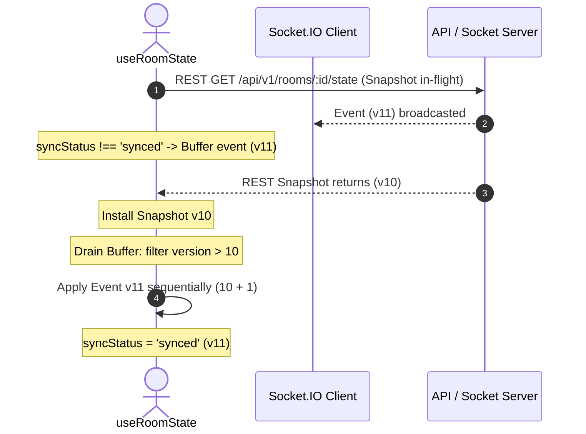

# KTV Online — Realtime Recovery & Consistency Architecture

**Document:** Realtime Recovery & Consistency Architecture  
**Sprint:** Sprint 2.2.1  
**Status:** CODE COMPLETE — NOT RUNTIME VERIFIED  
**Audience:** Backend Engineers, Frontend Engineers, System Architects

---

## 1. Overview & Objective

Sprint 2.2 introduced authoritative room state snapshots and monotonic versioning (`stateVersion`). However, real-world distributed web applications experience packet loss, process crashes, browser tab suspension, mobile reconnect delays, and concurrency races.

Sprint 2.2.1 hardens the realtime architecture with **5 Layers of Defense**:
1. **Durable Event Outbox (`RoomStateOutbox`):** Persists sequenced events with unique `(roomId, version)` idempotency keys.
2. **Version-Fenced Snapshot Generation:** Ensures snapshot reads never mix data across different logical versions and detects/repairs occupancy drift via CAS.
3. **Client Buffer-and-Drain Synchronization:** Buffers incoming WebSocket events during snapshot hydration, applies ordered events, rejects stale snapshots, and coalesces recovery requests.
4. **Lost Final Event Detection:** Background periodic version checking and focus/visibility reconciliation guarantee eventual convergence even if the final event of a room was permanently lost.
5. **Session Revocation Socket Invalidation & Kick Lifecycle Hardening:** Actively disconnects sockets when sessions are revoked, prevents kicked users from bypassing moderation, and provides an explicit host reinstatement pathway.

---

## 2. The 5 Realtime Failure Modes & Defenses

```
+-----------------------------------------------------------------------------------------------+
| FAILURE MODE                    | SYMPTOM                          | DEFENSE MECHANISM        |
+---------------------------------+----------------------------------+--------------------------+
| 1. Process Crash After DB Write | Event never emitted over socket  | Durable Outbox + Liveness|
| 2. Concurrent Snapshot Mutation | Mixed snapshot (V1 room, V2 mem) | Version-Fenced Reads     |
| 3. Snapshot / Event Race        | Event arrives before snapshot    | Buffer-and-Drain Queue   |
| 4. Lost Final Event             | Client stuck at V_N without gap  | Visibility / Focus Check |
| 5. Token Revocation / Kick      | Revoked socket retains channel   | Session Family Disconnect|
+-----------------------------------------------------------------------------------------------+
```

---

## 3. Layer 1 — Durable Event Outbox (`RoomStateOutbox`)

```
   [Domain Mutation in RoomService]
                 |
                 v
   [Atomically Advance stateVersion: N]
                 |
                 v
   [Upsert into RoomStateOutbox (roomId, version: N)]
                 |
                 v
   [Broadcast over Socket.IO]
        |                  |
   (Success)            (Error/Crash)
        |                  |
        v                  v
[Mark publishedAt]   [attemptCount++, pending retry]
```

### 3.1 Schema & Invariants
- `(roomId, version)` has a **unique compound index**. Only one event can ever be recorded for a specific version of a room.
- Events carry a durable `eventId`, `type`, `payload`, `attemptCount`, and `publishedAt`.
- Expired outbox entries are safely pruned by a MongoDB TTL index after 7 days (`expireAfterSeconds: 604800`).
- If an Express process crashes immediately after writing to the database, the event is retained in `RoomStateOutbox`.
- Background sweeps or client replay queries (`getOutboxEventsSince`) can retrieve missing events.

---

## 4. Layer 2 — Version-Fenced Snapshot Generation

A critical concurrency defect in multi-query snapshot assembly is reading `Room` at version $V_1$, followed by an intervening mutation, and reading `RoomMembership[]` at version $V_2$.

### 4.1 The Version Fence Algorithm
```typescript
for (let attempt = 1; attempt <= 3; attempt++) {
  // 1. Read Room metadata at V1
  const r1 = await RoomModel.findById(roomId);
  const v1 = r1.stateVersion;

  // 2. Fetch Active Member Roster
  const members = await RoomMembershipModel.find({ roomId, status: 'active' });

  // 3. Re-read Room version at V2
  const r2 = await RoomModel.findById(roomId).select('stateVersion currentParticipantsCount status');
  const v2 = r2.stateVersion;

  // 4. Verify Version Stability
  if (v1 === v2 && r1.status === r2.status) {
    // 5. Invariant check: stored count must equal roster length
    if (r2.status !== 'closed' && r2.currentParticipantsCount !== members.length) {
      await roomReconciliationService.reconcileRoom(roomId);
      continue; // Re-fence after CAS repair
    }
    return buildAuthoritativeSnapshot(r1, members, v1);
  }
}
```

### 4.2 Properties
- Guarantees that metadata and active roster reflect the exact same database commit.
- Prevents serving desynchronized counts where `room.currentParticipantsCount !== members.length`.
- Bounded to 3 attempts, preventing CPU spin during intense concurrent joins.

---

## 5. Layer 3 — Client Buffer-and-Drain Synchronization



### 5.1 Stale Snapshot Rejection
If a delayed snapshot response arrives after newer events have already been applied, the client compares:
$$\text{snapshot.version} < \text{versionRef.current}$$
If the snapshot is older, it is discarded immediately, preventing state regression.

### 5.2 In-Flight Recovery Coalescing
If a user switches tabs, triggers multiple version gaps, or reconnects in quick succession:
- A boolean flag `isFetchingSnapshotRef` blocks duplicate concurrent requests.
- Additional triggers set `queuedRecoveryRef = true`.
- When the active request finishes, a single follow-up recovery executes, eliminating recovery request storms.

---

## 6. Layer 4 — Lost Final Event Detection

Version-gap detection only triggers when a *subsequent* event ($V + 2$) is received. If a room experiences a mutation from $V_{10} \to V_{11}$ and event 11 is permanently lost (e.g. process crash or network drop) and no further mutations happen, the client never receives $V_{12}$ to observe a gap.

### 6.1 Multi-Trigger Liveness Verification
1. **Periodic Background Liveness:** Every 20 seconds while the room page is open, `useRoomState` fetches lightweight version metadata from `GET /api/v1/rooms/:id/version`.
2. **Window Focus & Tab Visibility:** When the browser window regains focus (`window.onfocus`) or the document becomes visible (`document.onvisibilitychange`), a lightweight version check executes immediately.
3. **Action on Divergence:** If `remoteVersion > versionRef.current`, the client marks `syncStatus = 'desynchronized'` and requests an authoritative snapshot.
4. **Zero Overhead When Inactive:** All timers and listeners are automatically paused when the tab is hidden and cleanly disposed on unmount.

---

## 7. Layer 5 — Session Revocation & Kick Moderation Hardening

### 7.1 Socket Session Invalidation
- Access tokens now embed the session's `familyId`.
- Socket connections register their session `familyId` in `socket.data.user.familyId`.
- When `authService.logout` or refresh token replay revocation executes:
  `disconnectSessionSockets(familyId)` immediately queries active sockets and terminates them with a `SESSION_REVOKED` notice.
- Revoked users cannot continue listening to protected rooms or broadcasting chat.

### 7.2 Kick Rejoin Protection
- In `RoomService.joinRoom`:
  If a user has `RoomMembership` with `status: 'left' && kickedAt != null`, `joinRoom` rejects the request with `403 Forbidden` (`FORBIDDEN_KICKED`).
  Kicked users can no longer bypass host moderation by simply clicking "Join Lounge".
- **Host Reinstatement:**
  The room host can forgive and reinstate a kicked user via `POST /api/v1/rooms/:id/members/:userId/reinstate`.
  Reinstatement clears `kickedAt` and `kickedBy`, allowing the user to rejoin through the normal membership lifecycle.

---

## 8. Summary of Architectural Guarantees

| Guarantee | Enforcement Mechanism |
| :--- | :--- |
| **No Failed Join Version Leaks** | `stateVersion` is incremented only AFTER membership is verified and committed. Failed joins rollback occupancy with zero version advance. |
| **Durable Publication Records** | `RoomStateOutbox` persists events with unique compound key `(roomId, version)`. |
| **Coherent Snapshot Reads** | Version-fenced 3-way read fence eliminates mixed-version data. |
| **Occupancy Reconciliation** | Snapshot generation triggers CAS repair if `storedCount !== activeMembers.length`. |
| **Zero Backward Ordering Inversions** | Client event buffer holds events during sync; older snapshots are rejected. |
| **Eventual Convergence On Lost Broadcasts**| Periodic and focus-driven version checks detect lost final events within 20s. |
| **Instant Revocation Eviction** | Session `familyId` linkage disconnects revoked sockets immediately. |
| **Moderation Integrity** | Active kick blocks rejoin until explicit host reinstatement. |
