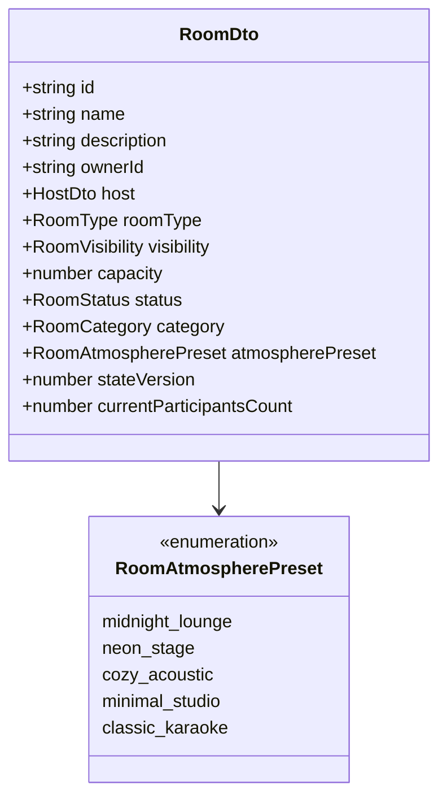
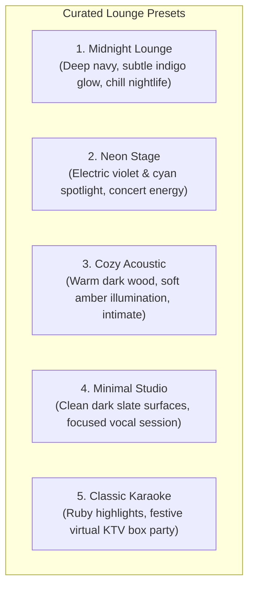
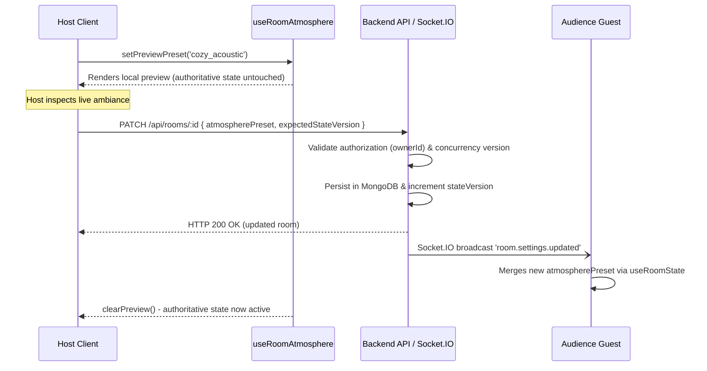

# KTVOnline — Room Atmosphere & Lounge Identity Architecture

**Product Vision**: *"Every lounge has its own vibe. Every night feels different."*  
**Sprint**: 3.2  
**Status**: `CODE COMPLETE — NOT RUNTIME VERIFIED`

---

## 1. Overview & Architectural Goals

Sprint 3.2 establishes the emotional, visual, and identity layer of KTVOnline lounges. While Sprint 3.0 focused on layout geometry and Sprint 3.1 focused on the performance stage, Sprint 3.2 makes each room a distinct social destination where guests want to linger even between karaoke tracks.

### Architecture Principles:
1. **Decoupled Presentation**: Visual atmospheres are strictly a presentation layer. Theme or preset changes must **never** mutate karaoke playback, queue state, clock synchronization, or WebRTC voice state.
2. **Finite, Validated Presets**: No arbitrary custom CSS, untrusted image URLs, or script injection. Atmospheres are referenced solely via finite, type-safe enum identifiers.
3. **Server-Authoritative Synchronization**: Host-selected presets are persisted in MongoDB on the `Room` entity and broadcast in real time to all room participants via monotonic Socket.IO state events (`room.settings.updated`).
4. **Zero-Latency Live Preview**: Hosts can experiment with different atmospheres locally with instantaneous visual feedback without altering the shared room experience until explicitly committed.

---

## 2. Room Identity & Data Model

The room identity is represented across the stack without duplicate models:



### 2.1 Schema Extensions

#### `@ktv/contracts`
- **`RoomAtmospherePresetSchema`**:
  ```typescript
  export const RoomAtmospherePresetSchema = z.enum([
    'midnight_lounge',
    'neon_stage',
    'cozy_acoustic',
    'minimal_studio',
    'classic_karaoke',
  ]);
  ```
- **`RoomDtoSchema` & `RoomSnapshotDtoSchema`**:
  Includes `atmospherePreset: RoomAtmospherePresetSchema.default('midnight_lounge').optional()`.
- **`UpdateRoomSchema`**:
  Includes optional `atmospherePreset` and optional `expectedStateVersion: z.number().int().positive().optional()` for optimistic concurrency control.

#### MongoDB `RoomModel` (`apps/api`)
```typescript
atmospherePreset: {
  type: String,
  enum: ['midnight_lounge', 'neon_stage', 'cozy_acoustic', 'minimal_studio', 'classic_karaoke'],
  default: 'midnight_lounge',
  index: true,
}
```

---

## 3. Curated Atmosphere Presets

Five distinct atmospheres provide varied emotional palettes:



### Detailed Token Mapping

| Preset Key | Swatch (Primary / Secondary) | Stage Backdrop | Ambient Lighting | Panel Styling |
| :--- | :--- | :--- | :--- | :--- |
| `midnight_lounge` | `#6366f1` / `#818cf8` | `from-indigo-950/40 via-[#070914]/90 to-slate-950/90` | Indigo radial ambient glow | `bg-[#080b18]/85`, `border-indigo-500/15` |
| `neon_stage` | `#ec4899` / `#06b6d4` | `from-fuchsia-950/40 via-[#0b0618]/90 to-cyan-950/30` | Magenta/cyan neon spotlight | `bg-[#0f071e]/85`, `border-fuchsia-500/20` |
| `cozy_acoustic` | `#f59e0b` / `#fbbf24` | `from-amber-950/40 via-[#100b06]/90 to-orange-950/30` | Soft amber intimate glow | `bg-[#120c06]/85`, `border-amber-500/20` |
| `minimal_studio` | `#94a3b8` / `#cbd5e1` | `from-slate-900/40 via-[#0a0d12]/90 to-slate-950/90` | Restrained cool slate ambient | `bg-[#0d1017]/85`, `border-slate-700/25` |
| `classic_karaoke` | `#e11d48` / `#fb7185` | `from-rose-950/40 via-[#100509]/90 to-purple-950/30` | Festive ruby/rose warmth | `bg-[#120509]/85`, `border-rose-500/20` |

---

## 4. Theme Resolution & Live Preview Lifecycle

The frontend resolves themes deterministically using `useRoomAtmosphere`:



---

## 5. Host Authorization & Concurrency Fencing

- **Authorization**:
  - Validated exclusively server-side via verified session JWT in `req.user.id`.
  - Non-owners receive HTTP 403 Forbidden.
- **Concurrency Fencing**:
  - `UpdateRoomSchema` accepts optional `expectedStateVersion`.
  - If provided, the update atomically checks `filter.stateVersion = expectedStateVersion`.
  - If another host action updated the room concurrently, an HTTP 409 Conflict is returned, preventing accidental overwrites.
- **Safe Fallback**:
  - Existing rooms with `null` or missing preset default safely to `'midnight_lounge'`.
