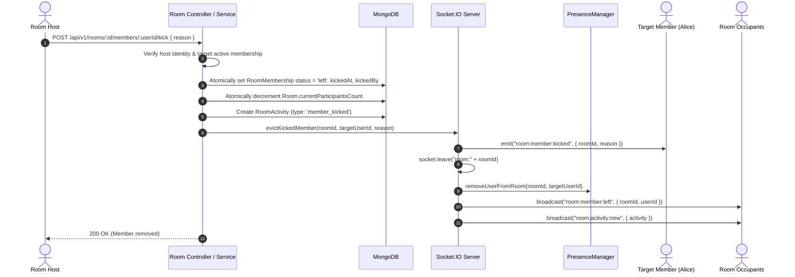

# KTV Online — Room Moderation Architecture & Controls

**Document:** Room Moderation & Host Controls  
**Sprint:** Sprint 2.1  
**Status:** CODE COMPLETE — NOT RUNTIME VERIFIED  
**Audience:** Backend Engineers, Frontend Engineers, Moderation Leads

---

## 1. Overview

Host moderation controls ensure virtual karaoke rooms remain safe, engaging, and enjoyable social environments. KTV Online provides room hosts with authoritative moderation controls over text chat, message deletion, and member presence while preserving domain invariants and audit records.

---

## 2. Moderation Capabilities Matrix

| Action | Permitted Roles | Target Entity | Mechanism | Resulting Realtime Event |
| :--- | :--- | :--- | :--- | :--- |
| **Delete Message** | Room Host | Any room message | REST `DELETE` or Socket `chat:message:delete` | `chat:message:deleted` |
| **Remove Member (Kick)** | Room Host | Active regular member | REST `POST /rooms/:id/members/:userId/kick` | `room:member:kicked`, `room:member:left`, `room:activity:new` |
| **Toggle Room Chat** | Room Host | Entire room | REST `PATCH /rooms/:id` (`isChatEnabled: boolean`) | `room:activity:new` |

---

## 3. Host Member Kick Architecture

When a room host removes a disruptive participant from the room, the operation coordinates database state, occupancy counts, socket channel membership, and ephemeral presence atomically.



### 3.1 Strict Invariant Preservation

- **Persistent Occupancy Count:**
  $$\text{Room.currentParticipantsCount} \equiv \text{Count of active RoomMemberships}$$
  The kick operation decrements `Room.currentParticipantsCount` by exactly 1 in the same transaction/operation, preventing orphaned seat allocations.
- **Eviction from Socket Channels:**
  The target's sockets are removed from `room:${roomId}`. Even if the target attempts to emit chat messages, subsequent operations are rejected with `FORBIDDEN_NOT_A_MEMBER`.

---

## 4. Message Deletion Architecture

### 4.1 Soft Deletion Semantics

Rather than physically removing documents from MongoDB, message deletion performs a soft delete:
- `deletedAt = new Date()`
- `deletedBy = hostObjectId`

### 4.2 Presentation & Audit Integrity

- **Auditability:** Server logs and database records retain the original message text, sender details, and host moderation timestamp for safety reviews.
- **Public API Sanitization:** When queried by clients, deleted messages replace their text content with:
  `"[This message was deleted by the host]"`
- **Realtime Notification:** Connected sockets receive `chat:message:deleted` with `{ roomId, messageId, deletedBy }`, instantly replacing the message bubble on all clients without shifting the scroll position.

---

## 5. Room Chat Controls

Hosts can disable text chat for their room via `PATCH /api/v1/rooms/:roomId` with `{ isChatEnabled: false }`.

### 5.1 Enforcement in `ChatService`

```typescript
// If chat is disabled, only the room host may send messages
if (room.isChatEnabled === false && !isHost) {
  throw new Error('CHAT_DISABLED');
}
```

### 5.2 Frontend UX

- When chat is disabled, regular members see an alert banner:
  *"Chat is currently disabled by the room host."*
- The input field is hidden or disabled for non-hosts.
- Existing message history remains scrollable and readable.
