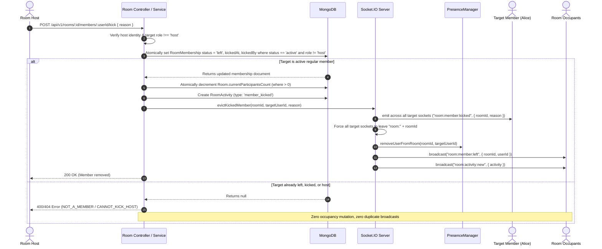

# KTV Online — Room Moderation Architecture & Controls

**Document:** Room Moderation & Host Controls  
**Sprint:** Sprint 2.1 (Hardened in Sprint 2.1.1)  
**Status:** CODE COMPLETE — NOT RUNTIME VERIFIED  
**Audience:** Backend Engineers, Frontend Engineers, Moderation Leads

---

## 1. Overview

Host moderation controls ensure virtual karaoke rooms remain safe, engaging, and enjoyable social environments. KTV Online provides room hosts with authoritative moderation controls over text chat, message deletion, and member presence while preserving domain invariants and audit records.

---

## 2. Moderation Capabilities Matrix

| Action | Permitted Roles | Target Entity | Mechanism | Resulting Realtime Event |
| :--- | :--- | :--- | :--- | :--- |
| **Delete Message** | Room Host | Any room message | REST `DELETE` or Socket `chat:message:delete` | `chat:message:deleted` |
| **Remove Member (Kick)** | Room Host | Active regular member (`role !== 'host'`) | REST `POST /rooms/:id/members/:userId/kick` | `room:member:kicked`, `room:member:left`, `room:activity:new` |
| **Toggle Room Chat** | Room Host | Entire room | REST `PATCH /rooms/:id` (`isChatEnabled: boolean`) | `room:activity:new` |

---

## 3. Host Member Kick Architecture

When a room host removes a disruptive participant from the room, the operation coordinates database state, occupancy counts, socket channel membership, and ephemeral presence atomically.



---

## 4. Strict Invariant & Concurrency Protection

### 4.1 Invariant: Single Decrement & Occupancy Integrity
$$\text{Room.currentParticipantsCount} \equiv \text{Count of active RoomMemberships}$$

- **Atomic Transition Guard:**
  The transition query matches:
  `{ roomId: roomObjectId, userId: targetObjectId, status: 'active', role: { $ne: 'host' } }`.
- **Duplicate & Concurrent Request Safety:**
  If duplicate kick requests arrive simultaneously or sequentially, only the first request matches `{ status: 'active' }`. Subsequent requests find `null` and return `{ success: false, error: 'NOT_A_MEMBER' }`, preventing double occupancy decrements or orphaned counter drift.
- **Concurrent Leave vs. Kick:**
  If the member voluntarily leaves while the host initiates a kick, the atomic status check ensures only the first operation decrements `currentParticipantsCount`.

### 4.2 Host Immunity
- A host cannot kick themselves (`CANNOT_KICK_SELF`).
- A host cannot kick another host or the room owner (`CANNOT_KICK_HOST`).
- Target membership must have `role: { $ne: 'host' }`.

### 4.3 Multi-Tab Socket Eviction
`evictKickedMember` iterates all active sockets across the instance via `ioInstance.fetchSockets()`:
1. Every socket belonging to `targetUserId` receives `room:member:kicked` with the kick reason.
2. Every socket belonging to `targetUserId` leaves the Socket.IO room channel `room:${roomId}`.
3. The user's multi-device presence entries are cleared from `RoomPresenceManager`.
4. A single `room:member:left` event is broadcast to remaining room occupants.

### 4.4 Reconnect Protection
- **Room Subscription Handler (`room:join`):**
  When a socket attempts to join a room via `room:join`, the server queries:
  `RoomMembershipModel.exists({ roomId, userId, status: 'left', kickedAt: { $ne: null } })`.
  If the user was kicked from the room, `room:join` is rejected with `FORBIDDEN_KICKED`. The kicked user cannot reconnect or resubscribe as a viewer to listen to private or public room channels.
- **Message and Reaction Handlers:**
  `chatService.sendMessage`, `chatService.addReaction`, and `chatService.removeReaction` independently check `RoomMembershipModel.exists({ roomId, userId, status: 'active' })`. Even if a client bypasses socket channels, all mutations are blocked at the domain boundary.

---

## 5. Message Deletion Architecture

### 5.1 Soft Deletion Semantics

Rather than physically purging documents from MongoDB, message deletion performs a soft delete:
- `deletedAt = new Date()`
- `deletedBy = hostObjectId`

### 5.2 Presentation & Audit Integrity

- **Auditability:** Server logs and database records retain the original message text, sender details, and host moderation timestamp for safety reviews.
- **Public API Sanitization:** When queried by clients, deleted messages replace their text content with:
  `"[This message was deleted by the host]"`
- **Realtime Notification:** Connected sockets receive `chat:message:deleted` with `{ roomId, messageId, deletedBy }`, instantly replacing the message bubble on all clients without shifting the scroll position.

---

## 6. Room Chat Controls

Hosts can disable text chat for their room via `PATCH /api/v1/rooms/:roomId` with `{ isChatEnabled: false }`.

### 6.1 Enforcement in `ChatService`

```typescript
// If chat is disabled, only the room host may send messages
if (room.isChatEnabled === false && !isHost) {
  throw new Error('CHAT_DISABLED');
}
```

### 6.2 Frontend UX

- When chat is disabled, regular members see an alert banner:
  *"Chat is currently disabled by the room host."*
- The input field is hidden or disabled for non-hosts.
- Existing message history remains scrollable and readable.

---

## 7. Sprint 2.2 Realtime State Synchronization Integration

Starting in Sprint 2.2, all moderation actions that alter persistent room state atomically advance the room's `stateVersion`:
- **Member Kick:** Atomically decrements `currentParticipantsCount`, sets `RoomMembership` status to `left` with kick metadata, advances `stateVersion`, and publishes `room:state:event` with type `member.kicked`. Kicked users are blocked from `GET /api/v1/rooms/:id/state` snapshots and socket subscriptions (`FORBIDDEN_KICKED`).
- **Room Settings & Chat Toggle:** Modifying `isChatEnabled` or room capacity atomically updates the database, advances `stateVersion`, and publishes `room:state:event` with type `room.settings.updated`.
- See [ROOM_STATE_ARCHITECTURE.md](file:///Users/mac/Documents/workspace/workspace_coding/ktvonline/docs/ROOM_STATE_ARCHITECTURE.md) for sequence details and gap recovery semantics.

---

## 8. Sprint 2.2.1 Kick Lifecycle Hardening & Reinstatement

Sprint 2.2.1 hardened the kick lifecycle against moderation bypass:
1. **Join Protection:** In `RoomService.joinRoom`, users with an active kick record (`status: 'left' && kickedAt != null`) are blocked from rejoining (`FORBIDDEN_KICKED`, 403 Forbidden). A kicked user cannot simply click "Join Lounge" on the frontend to clear their kick metadata.
2. **Explicit Host Reinstatement:** Room hosts can forgive/reinstate previously kicked participants via `POST /api/v1/rooms/:id/members/:userId/reinstate`. This clears `kickedAt` and `kickedBy`, allowing the user to rejoin through the normal membership lifecycle.
3. **Session Invalidation:** Socket.IO connections are linked to session `familyId`. Session revocation or logout immediately disconnects associated sockets via `disconnectSessionSockets`.


