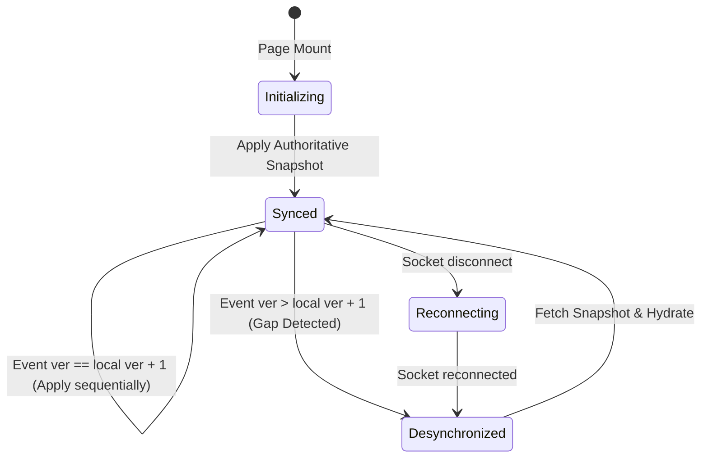

# KTV Online — Realtime Room State & Synchronization Architecture

**Document:** Realtime Room State & Synchronization Architecture  
**Sprint:** Sprint 2.2  
**Status:** CODE COMPLETE — NOT RUNTIME VERIFIED  
**Audience:** Backend Engineers, Frontend Engineers, System Architects

---

## 1. Executive Summary

In multiplayer social applications like KTV Online, multiple clients must continuously view a coherent, consistent room state. Variations in network latency, mobile socket drops, browser tab duplication, and concurrent moderation actions can cause client state desynchronization if clients infer domain state from ephemeral socket events or unversioned broadcasts.

Sprint 2.2 introduces a **Server-Authoritative, Monotonically-Versioned Room State Synchronization Layer**.

### Core Architecture Tenets
1. **Separation of Persistent Domain State from Ephemeral Presence:** Persistent domain state (metadata, active memberships, capacity, roles, settings) is stored exclusively in MongoDB. Ephemeral socket connections are tracked in memory by `RoomPresenceManager`. Sockets connecting or disconnecting never alter persistent membership or `Room.currentParticipantsCount`.
2. **Authoritative Room Snapshots:** Clients obtain a complete, authorized snapshot upon room entry, socket reconnect, and whenever a sequence gap is detected.
3. **Monotonic Version Sequencing:** Every persistent mutation that alters synchronized room state advances a monotonic `stateVersion` counter on the room document.
4. **Deterministic Client Reconciliation:** Clients reject duplicate/stale events (`event.version <= local.version`), apply ordered updates (`event.version === local.version + 1`), and automatically trigger snapshot re-synchronization on gaps (`event.version > local.version + 1`).

---

## 2. Architecture Overview & Component Topology

```
+-----------------------------------------------------------------------------------+
|                                   CLIENT (Next.js)                                |
|                                                                                   |
|  [useRoomState] <-----+ (REST initial / gap recovery)                             |
|       |               | GET /api/v1/rooms/:id/state                               |
|       |               |                                                           |
|       +---------------+ Socket.IO Client                                          |
|       |                 - room:state:snapshot                                     |
|       |                 - room:state:event (versioned)                            |
|       |                 - room:presence:snapshot / member:joined / member:left    |
|       v                                                                           |
|  [Authoritative Store: room, host, members, viewer, onlineUserIds, version]       |
+-----------------------------------------------------------------------------------+
                                         |
                                         | HTTP / WebSocket
                                         v
+-----------------------------------------------------------------------------------+
|                                  API SERVER (Express)                             |
|                                                                                   |
|  [RoomController]                                                                 |
|       |                                                                           |
|       v                                                                           |
|  [RoomService] <--------+ Atomic Mutation ($inc: { stateVersion: 1 })             |
|       |                 |                                                         |
|       +-----------------+-------------------+                                     |
|       |                                     |                                     |
|       v                                     v                                     |
|  [MongoDB]                          [RoomStatePublisher]                          |
|  - Room (stateVersion: N)                   |                                     |
|  - RoomMembership (active/left)             v                                     |
|                                     [Socket.IO Gateway]                           |
|                                     - Room Channel ("room:<id>")                  |
|                                     - Authoritative Snapshot Emit                 |
|                                     - Versioned Event Emit                        |
|                                             |                                     |
|                                     [RoomPresenceManager]                         |
|                                     - In-Memory Multi-Tab Tracking                |
+-----------------------------------------------------------------------------------+
```

---

## 3. Data Contracts (`packages/contracts`)

### 3.1 Room Snapshot DTO (`RoomSnapshotDtoSchema`)

Exposes public room metadata while stripping internal MongoDB fields, session tokens, and sensitive account data:

```typescript
export const RoomSnapshotDtoSchema = z.object({
  id: z.string(),
  name: z.string(),
  description: z.string().nullable().optional(),
  ownerId: z.string(),
  roomType: RoomTypeSchema,
  visibility: RoomVisibilitySchema,
  capacity: z.number().int(),
  status: RoomStatusSchema,
  category: RoomCategorySchema,
  currentParticipantsCount: z.number().int().nonnegative(),
  isChatEnabled: z.boolean().default(true),
  currentSongTitle: z.string().nullable().optional(),
  currentSingerName: z.string().nullable().optional(),
});
```

### 3.2 Viewer State (`RoomViewerStateSchema`)

Encapsulates the requesting client's authorization and membership status:

```typescript
export const RoomViewerStateSchema = z.object({
  isMember: z.boolean(),
  role: z.enum(['host', 'member', 'viewer', 'none']).default('none'),
  isKicked: z.boolean().default(false),
});
```

### 3.3 Authoritative Room State Snapshot (`RoomStateSnapshotSchema`)

The combined atomic representation of room state:

```typescript
export const RoomStateSnapshotSchema = z.object({
  room: RoomSnapshotDtoSchema,
  host: HostDtoSchema,
  members: z.array(RoomMembershipDtoSchema),
  presence: z.array(z.string()), // Array of active online userIds
  viewer: RoomViewerStateSchema,
  version: z.number().int().positive(),
  generatedAt: z.string(),
});
```

### 3.4 Versioned Room State Event (`RoomStateEventSchema`)

Compact, sequenced mutation payloads:

```typescript
export const RoomStateEventTypeSchema = z.enum([
  'room.updated',
  'room.settings.updated',
  'member.joined',
  'member.left',
  'member.kicked',
  'room.closed',
]);

export const RoomStateEventSchema = z.object({
  roomId: z.string(),
  version: z.number().int().positive(),
  eventId: z.string(),
  type: RoomStateEventTypeSchema,
  occurredAt: z.string(),
  payload: z.record(z.any()),
});
```

---

## 4. State Versioning & Publication Mechanism

### 4.1 Monotonic Database Versioning
To eliminate distributed lock overhead and complex external coordination, `stateVersion` is stored directly on the `Room` document as an integer with a default of `1`.

Every persistent mutation uses an atomic MongoDB update:

```typescript
// Atomically advance version and mutate state
const updatedRoom = await RoomModel.findOneAndUpdate(
  { _id: roomId, status: 'open' },
  {
    $inc: { currentParticipantsCount: 1, stateVersion: 1 },
  },
  { new: true }
);
```

### 4.2 Supported Versioned Mutations

| Mutation Type | Trigger | MongoDB Mutation | Emitted Event Type |
| :--- | :--- | :--- | :--- |
| **Settings Updated** | `PATCH /rooms/:id` | `$set: { ...fields }, $inc: { stateVersion: 1 }` | `room.settings.updated` |
| **Member Joined** | `POST /rooms/:id/join` | `$inc: { currentParticipantsCount: 1, stateVersion: 1 }` | `member.joined` |
| **Member Left** | `POST /rooms/:id/leave` | `$inc: { currentParticipantsCount: -1, stateVersion: 1 }` | `member.left` |
| **Member Kicked** | `POST /rooms/:id/members/:userId/kick` | `$inc: { currentParticipantsCount: -1, stateVersion: 1 }` | `member.kicked` |
| **Room Closed** | `DELETE /rooms/:id` | `$set: { status: 'closed' }, $inc: { stateVersion: 1 }` | `room.closed` |

### 4.3 Publication Consistency & Recovery Model
Because Node.js and MongoDB operations can experience unexpected process termination between database write and socket broadcast, the architecture relies on **Self-Healing Snapshot Reconciliation**:
- Events carry the monotonic `version` returned from the atomic database write.
- If an event is dropped due to a process crash or temporary socket disconnect, the client will immediately detect a **Version Gap** (`event.version > local.version + 1`) on the subsequent event or on socket reconnect.
- The client transitions to `desynchronized` and fetches a fresh authoritative snapshot, recovering full consistency without requiring an heavyweight distributed outbox queue.

---

## 5. Ephemeral Presence Separation

A foundational invariant of KTV Online:
$$\text{Room.currentParticipantsCount} \equiv \text{count}(\text{active RoomMemberships})$$

### 5.1 In-Memory Presence Mechanics
- `RoomPresenceManager` tracks active sockets in an in-memory Map: `roomId -> userId -> Set<socketId>`.
- **Multi-Tab Safety:** Opening 3 tabs in the same room creates 3 socket connections under the same `userId`. The user is counted as **1 online user**.
- Closing 1 tab decrements the user's socket count from 3 to 2. No presence leave event is fired.
- Closing the last tab removes the `userId` from the presence map and emits an ephemeral `room:member:left` presence update.
- **Roster Invariant:** Disconnecting from the socket does NOT delete the participant from `RoomMembership`. In the UI roster, the member remains displayed as `Offline (seat reserved)`.
- Ephemeral presence events **NEVER** increment `stateVersion` or touch `currentParticipantsCount`.

---

## 6. Client Synchronization & Reconciliation (`useRoomState`)

The `useRoomState` hook implements the state machine for room synchronization:



### 6.1 Reconciliation Logic

```typescript
const handleRoomStateEvent = (event: RoomStateEventDto) => {
  if (event.roomId !== currentRoomId) return;

  const currentVer = versionRef.current;

  // 1. Stale or duplicate event: discard safely
  if (event.version <= currentVer) {
    return;
  }

  // 2. Expected sequential event: apply state transition
  if (event.version === currentVer + 1) {
    versionRef.current = event.version;
    setVersion(event.version);
    applyDomainMutation(event);
    return;
  }

  // 3. Version gap: client missed events; trigger snapshot recovery
  setSyncStatus('desynchronized');
  refreshSnapshot();
};
```

---

## 7. Moderation, Private Access, and Session Revocation

1. **Private Room Protection:**
   - `GET /api/v1/rooms/:id/state` requires authentication for private rooms.
   - Non-members attempting to access a private room snapshot receive `403 Forbidden (PRIVATE_ROOM_ACCESS_DENIED)`.
   - Socket `room:join` and `room:state:request` re-validate private room membership on the server before granting admission or snapshot delivery.
2. **Kicked Member Protection:**
   - If a member is kicked, `RoomMembership.status` is set to `'left'` with `kickedAt` set.
   - Any attempt to access `GET /api/v1/rooms/:id/state` or socket `room:state:request` by a kicked user is rejected with `403 Forbidden (FORBIDDEN_KICKED)`.
   - Kicked sockets are forcibly removed from `room:<id>` channel (`socket.leave(roomChannel)`).
3. **Session Invalidation:**
   - Handshake authentication establishes identity, but every room entry and snapshot request validates active authorization against current database state.

---

## 8. Verified Architectural Invariants

| Invariant | Enforcement Mechanism |
| :--- | :--- |
| **Zero Presence Contamination** | `RoomPresenceManager` is purely in-memory; presence changes never invoke Mongoose models or increment `stateVersion`. |
| **Occupancy Consistency** | `currentParticipantsCount` is updated exclusively through atomic `$inc` operations bounded by active `RoomMembership` status. |
| **Monotonic Sequence** | `stateVersion` updates are performed atomically on the `Room` document during domain mutations. |
| **Safe Client Recovery** | Version gaps or reconnects always converge by replacing local state with the server-authoritative snapshot. |
| **Clean Channel Separation** | Chat messages and emoji reactions operate on their independent channels without advancing room `stateVersion`. |

---

## 9. Sprint 2.2.1 Hardening & Recovery Enhancements

Sprint 2.2.1 introduced critical hardening layers:
1. **Durable Outbox (`RoomStateOutbox`):** Every versioned event is persisted to MongoDB with unique `(roomId, version)` before or during broadcast, ensuring process crashes do not erase publication records.
2. **Version-Fenced Reads:** Snapshot generation performs a bounded 3-way read fence (`V1 === V2`), guaranteeing coherent room metadata and member rosters.
3. **Event Buffering & In-Flight Coalescing:** Clients buffer incoming websocket events while snapshot synchronization is pending, draining only newer events after snapshot application. Snapshot requests are coalesced to prevent storming.
4. **Lost Final Event Detection:** Background periodic version checks and window focus / visibility change listeners detect committed mutations even if the final event broadcast was dropped.
5. **Session Revocation Invalidation:** Socket.IO links to session `familyId`; logout and refresh replay detection immediately disconnect affected sockets.

