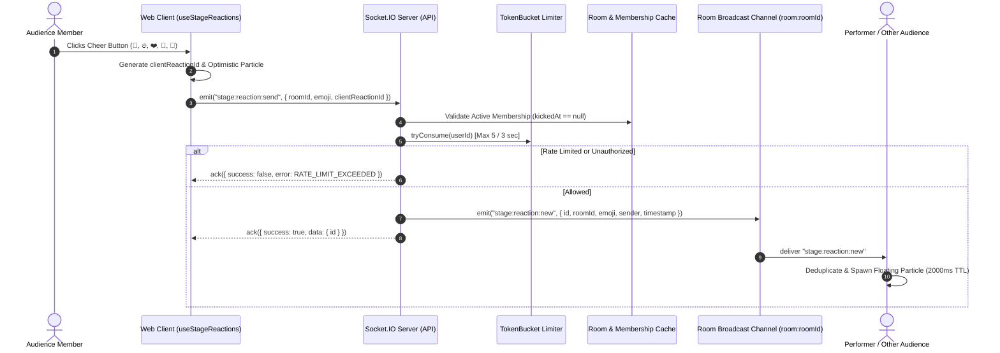

# KTVOnline — Social Reactions & Audience Interaction Architecture

**Version:** 1.0.0  
**Sprint:** 3.3  
**Status:** Approved Architecture  

---

## 1. Executive Summary & Design Principles

KTVOnline is a virtual karaoke lounge where every song is a live performance and every audience member can participate.

Sprint 3.3 upgrades local cheer buttons into a **distributed, low-latency, real-time social reaction system**.

### Core Product Principles:
1. **Audience Agency without Audio Interruption:** Audience members cheer visually without talking over the lead singer's microphone or interfering with backing track playback.
2. **Strictly Ephemeral (Zero Persistence):** Reactions reflect the current moment. They are never written to MongoDB, never replayed on reconnection, and consume zero database storage.
3. **Resilience & Frame Rate Protection:** Reaction animations must not degrade 10 Hz karaoke lyrics timing, RAF loops, or WebRTC voice codecs.
4. **Non-Monetized Social Connection:** Ephemeral social encouragement is free and available to all active room participants.

---

## 2. Real-Time Architecture & Event Flow

### 2.1 Event Sequence Diagram



### 2.2 Event Contracts (`@ktv/contracts`)

#### Supported Emojis
```typescript
export const STAGE_REACTION_EMOJIS = ['👏', '🔥', '❤️', '🎉', '🎤'] as const;
export type StageReactionEmoji = (typeof STAGE_REACTION_EMOJIS)[number];
```

#### Client to Server: `stage:reaction:send`
```typescript
export const SendStageReactionPayloadSchema = z.object({
  roomId: z.string().min(1, 'Room ID is required'),
  emoji: StageReactionEmojiSchema,
  clientReactionId: z.string().optional(),
  correlationId: z.string().optional(),
});
```

#### Server to Client Broadcast: `stage:reaction:new`
```typescript
export const StageReactionNewPayloadSchema = z.object({
  id: z.string(), // Server-generated unique ID (sr_UUID)
  roomId: z.string(),
  emoji: StageReactionEmojiSchema,
  sender: z.object({
    id: z.string(),
    username: z.string(),
    avatar: z.string().nullable().optional(),
  }),
  timestamp: z.string(), // ISO-8601 server authoritative time
  clientReactionId: z.string().optional(),
  correlationId: z.string().optional(),
});
```

---

## 3. Rate Limiting & Abuse Prevention

### 3.1 Token Bucket Algorithm
- **Capacity:** 5 tokens.
- **Refill Rate:** 5 tokens per 3000ms (1 token every 600ms).
- **Key Dimension:** `userId` (derived strictly from authenticated socket session `socket.data.user.id`).
- **Multi-Tab Mitigation:** Opening multiple tabs or devices under the same user account shares the exact same token bucket.
- **Garbage Collection:** Inactive user buckets are automatically pruned after 60 seconds of inactivity to eliminate memory leaks.

### 3.2 Error Handling & Blast Radius
- When rate-limited, the event is dropped immediately.
- The server responds only to the sender via Socket.IO acknowledgment.
- The error is **never** broadcast to the room, preventing cascading message amplification.

---

## 4. Lifecycle & Performance Safeguards

| Concern | Design Safeguard |
|---|---|
| **Database Load** | **Zero DB writes**. Never touches MongoDB `ChatMessageModel` or `RoomStateModel`. |
| **Reconnection Storms** | Reactions are strictly ephemeral. No snapshot replay on reconnect. |
| **DOM Pollution** | Maximum 20 active particles rendered simultaneously. Strict 2000ms cleanup timeout. |
| **Deduplication** | Client maintains a bounded FIFO queue of 50 recent reaction IDs to prevent duplicate particle rendering on network retries. |
| **Lyrics Synchronization** | Floating stage particles render inside a `pointer-events-none` container with isolated hardware-accelerated transforms (`translateY`, `opacity`), preventing layout recalculations during 10 Hz lyrics rendering. |
| **Voice & Backing Audio** | Complete isolation from LiveKit WebRTC peer connections and Web Audio EQ nodes. |

---

## 5. Accessibility & UX Architecture

### 5.1 Touch Targets
- Mobile buttons are sized to at least **44x44px** (`min-w-[44px] min-h-[44px]` on mobile touch viewports) to satisfy WCAG 2.5.5 and Apple Human Interface Guidelines.
- Desktop layout scales to 32x32px with appropriate hover padding.

### 5.2 Reduced Motion Support
- Queries `prefers-reduced-motion: reduce`.
- In reduced motion mode:
  - Vertical drift transforms (`translateY(-80px)`) are disabled.
  - Reactions transition with a gentle stationary opacity pulse (`animate-pulse-fade`).

### 5.3 Assistive Technology & Screen Readers
- The cheer bar is marked with `role="toolbar"` and `aria-label="Audience cheer reactions"`.
- Each button features descriptive `aria-label` (e.g., `aria-label="Cheer with 👏"`).
- An `aria-live="polite"` region informs screen reader users of incoming cheers without interrupting audio speech.
