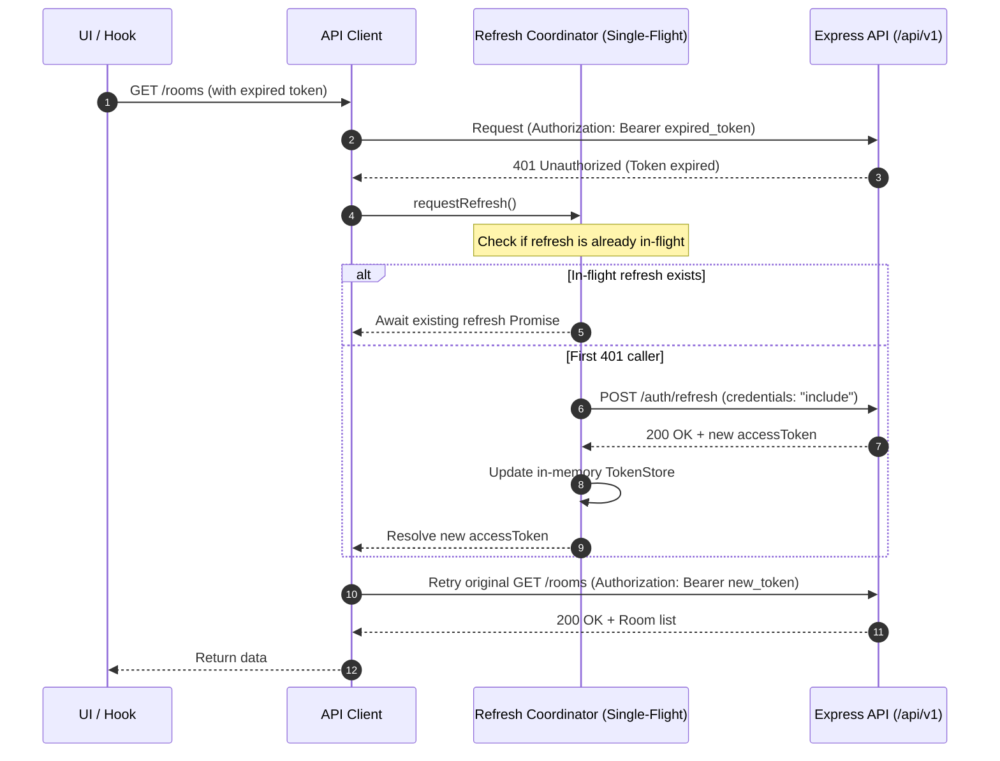

# KTV Online – Sprint 1.1 Architecture & Implementation Audit

**Date:** November 6, 2026  
**Author:** Senior Full-Stack Architect & Frontend Lead  
**Scope:** Frontend API Integration Layer (`apps/web`, `packages/contracts`, `apps/api`)  
**Status:** Audit Completed – Implementation Plan Approved  

---

## 1. Executive Summary

Sprint 0 established the project foundation, and Sprint 0.2 completed critical security remediation on the Express backend (eliminating `x-user-id` spoofing, enforcing `requireAuth`, implementing HTTP-only refresh cookies with rotation and replay attack detection, and introducing atomic room capacity reservation).

Sprint 1.1 focuses exclusively on building the **production-ready frontend API integration layer** in `apps/web`. This layer bridges the Next.js 15 App Router frontend with the Express backend before implementing authentication UI, room creation modals, or WebRTC/realtime features.

This audit evaluates the current implementation in `apps/web`, maps the existing backend API contracts, identifies architecture gaps, and defines a robust, test-driven implementation plan.

---

## 2. Current Architecture Review

### 2.1 Workspace Structure
- **`apps/web`**: Next.js 15 (App Router), React 19, Tailwind CSS v4, Zustand 5, TanStack React Query 5.
- **`apps/api`**: Express 4, Node.js 22, Mongoose 8, JWT, cookie-based session tracking.
- **`packages/contracts`**: Shared TypeScript types and Zod schemas (`ApiResponse<T>`, `ApiErrorResponse`, `RoomDto`, `UserDto`, `AuthSessionResponseDto`, etc.).

### 2.2 Frontend State & Query Status
1. **Query Provider**: `apps/web/src/providers/query-provider.tsx` currently wraps the app in a basic `AppQueryProvider` with naive defaults (`retry: 1`, `staleTime: 60s`). It does not filter out 4xx authentication or validation errors from retries, nor does it establish an isolated browser-lifecycle singleton.
2. **State Management**: `apps/web/src/stores/use-app-store.ts` tracks UI state (sidebar open, volume, mute, active room ID). It currently contains no authentication state.
3. **Data Consumption**: Pages (`/`, `/rooms`, `/rooms/[roomId]`) import and consume static mock objects from `apps/web/src/features/rooms/mock-rooms.ts`. No network calls to the backend are currently made by UI components.
4. **Environment Variables**: `.env` and `.env.example` define `NEXT_PUBLIC_API_URL=http://localhost:5001/api/v1`. However, there is no runtime validation for this variable.
5. **Shared Contracts**: Contracts package defines standard response envelopes:
   - Success: `ApiResponse<T> { success: true, message: string, data: T }`
   - Error: `ApiErrorResponse { success: false, message: string, errors?: ApiErrorDetail[] }`

---

## 3. Backend API Contract Mapping (Source of Truth)

The Express backend exposes the following endpoints (verified against `apps/api/src`):

### 3.1 Authentication Routes (`/api/v1/auth`)
- `POST /api/v1/auth/login`: Accepts `{ email, password }`. Returns `ApiResponse<{ user: UserDto, tokens: { accessToken: string, expiresIn: string } }>`. Sets HTTP-only refresh token cookie (`Path=/api/v1/auth; HttpOnly; SameSite=lax; Max-Age=7d`).
- `POST /api/v1/auth/refresh`: Expects refresh token via HTTP-only cookie (with fallback to request body). Rotates token and returns `ApiResponse<{ accessToken: string, expiresIn: string }>`. Sets rotated cookie.
  - **Replay Alert**: If a previously revoked refresh token is sent, backend responds with `401 Unauthorized` (`Refresh token replay detected. All sessions in this family have been revoked.`) and revokes all family sessions.
- `POST /api/v1/auth/logout`: Clears HTTP-only cookie and revokes session in MongoDB. Returns `ApiResponse<null>`.
- `GET /api/v1/auth/me`: Requires `Authorization: Bearer <accessToken>`. Returns `ApiResponse<{ id: string, username: string, role: string }>`.

### 3.2 User Routes (`/api/v1/users`)
- `POST /api/v1/users/register`: Accepts `CreateUserDto` (`username`, `email`, `password`, `avatar`). Returns `ApiResponse<UserDto>` with HTTP 201.
- `GET /api/v1/users/:id`: Returns `ApiResponse<UserDto>`.

### 3.3 Room Routes (`/api/v1/rooms`)
- `GET /api/v1/rooms`: Accepts query parameters (`page`, `limit`, `category`, `status`, `roomType`, `visibility`, `search`). Returns `ApiResponse<{ items: RoomDto[], pagination: PaginationMeta }>`.
- `GET /api/v1/rooms/:id`: Returns `ApiResponse<RoomDto>`.
- `GET /api/v1/rooms/:id/members`: Returns `ApiResponse<RoomMembershipDto[]>`.
- `POST /api/v1/rooms`: Requires `Authorization: Bearer <accessToken>`. Accepts `CreateRoomDto`. Returns `ApiResponse<RoomDto>` with HTTP 201.
- `POST /api/v1/rooms/:id/join`: Requires `Authorization: Bearer <accessToken>`. Atomically increments participant count. Returns `ApiResponse<RoomMembershipDto>`.
- `POST /api/v1/rooms/:id/leave`: Requires `Authorization: Bearer <accessToken>`. Decrements count. Returns `ApiResponse<null>`.

### 3.4 Health Probes (`/api/v1/health`)
- `GET /api/v1/health/live`: Fast process liveness (HTTP 200).
- `GET /api/v1/health/ready`: Database readiness (HTTP 200 or 503).
- `GET /api/v1/health`: Consolidated status.

---

## 4. Identified Gaps & Deficiencies

1. **Missing HTTP Client**: No centralized `fetch` abstraction with base URL configuration, query string formatting, typed response parsing, and standard headers.
2. **Missing Token Management & In-Memory Store**: In accordance with SEC-03, refresh tokens are never accessible to client JS. Access tokens must be stored strictly in-memory (not in `localStorage` or `sessionStorage` to mitigate XSS exposure). No in-memory token store exists yet.
3. **Missing Single-Flight Refresh Handler**: If multiple parallel requests trigger 401 Unauthorized, sending concurrent refresh requests will trigger the backend's **Refresh Token Replay Detection**, destroying the user's active session family! A single-flight mutex/promise queue is strictly required.
4. **Missing Typed Error Hierarchy**: No unified `ApiError` class that unpacks `ApiErrorResponse` (`status`, `code`, `message`, `errors`).
5. **TanStack Query Default Misconfigurations**: Current query client blindly retries failed queries. It should never retry `401 Unauthorized`, `403 Forbidden`, `404 Not Found`, or `400 Validation` errors.
6. **No Query Key Factories**: Lack of structured, centralized query key factories causes cache collision and brittle query invalidation.
7. **Mock Data Coupling**: Discovery page (`/rooms`) and room detail page (`/rooms/[roomId]`) still import and compute metrics using `MOCK_ROOMS` instead of TanStack Query hooks.

---

## 5. Proposed Architecture & Implementation Plan

### 5.1 Architecture Overview
```text
apps/web/src/
├── lib/
│   ├── env.ts                    <- Validated runtime client environment (NEXT_PUBLIC_API_URL)
│   └── api/
│       ├── types.ts              <- HTTP options, ApiResult, RequestConfig
│       ├── errors.ts             <- ApiError with status, code, details, network error detection
│       ├── token-store.ts        <- In-memory access token storage & listener callbacks
│       ├── auth-refresh.ts       <- Single-flight mutex refresh coordinator with replay protection
│       ├── client.ts             <- Core apiClient (fetch wrapper with interceptors & auto-refresh)
│       └── endpoints/
│           ├── auth.ts           <- login, refresh, logout, getMe
│           ├── users.ts          <- register, getProfile
│           └── rooms.ts          <- getRooms, getRoomById, createRoom, joinRoom, leaveRoom, getMembers
├── hooks/
│   ├── queries/
│   │   ├── query-keys.ts         <- Centralized type-safe query key factory
│   │   ├── use-current-user.ts   <- TanStack query for current auth user
│   │   ├── use-rooms.ts          <- TanStack query for paginated/filtered room list
│   │   └── use-room.ts           <- TanStack query for single room details & room members
│   └── use-auth.ts               <- High-level auth hook (token, user, status, logout)
├── stores/
│   └── use-auth-store.ts         <- Client-side auth initialization & session state
├── providers/
│   └── query-provider.tsx        <- Hardened QueryClient provider with browser singleton
```

### 5.2 Single-Flight Refresh Token Coordination


### 5.3 Error Handling Specification
The `ApiError` class maps backend response status codes:
- **400 Validation**: Contains `details: ApiErrorDetail[]` (`field`, `message`).
- **401 Authentication**: Differentiates missing token from expired token; triggers single-flight refresh.
- **403 Forbidden**: Account suspended or insufficient permission.
- **404 Not Found**: Entity does not exist.
- **409 Conflict**: Duplicate room membership or capacity reached (`ROOM_FULL`).
- **429 Rate Limited**: Client requested too frequently.
- **500 Server Error**: Internal system error.
- **Network / Abort**: Distinguishes timeout and offline network errors from HTTP response errors.

---

## 6. Files Expected to Change / Be Created

### Created:
- `apps/web/src/lib/env.ts`
- `apps/web/src/lib/api/types.ts`
- `apps/web/src/lib/api/errors.ts`
- `apps/web/src/lib/api/token-store.ts`
- `apps/web/src/lib/api/auth-refresh.ts`
- `apps/web/src/lib/api/client.ts`
- `apps/web/src/lib/api/endpoints/auth.ts`
- `apps/web/src/lib/api/endpoints/users.ts`
- `apps/web/src/lib/api/endpoints/rooms.ts`
- `apps/web/src/hooks/queries/query-keys.ts`
- `apps/web/src/hooks/queries/use-current-user.ts`
- `apps/web/src/hooks/queries/use-rooms.ts`
- `apps/web/src/hooks/queries/use-room.ts`
- `apps/web/src/stores/use-auth-store.ts`
- `apps/web/src/__tests__/api-client.test.ts`
- `apps/web/src/__tests__/auth-refresh.test.ts`
- `apps/web/src/__tests__/query-hooks.test.tsx`
- `docs/SPRINT_1_1_AUDIT.md`
- `docs/SPRINT_1_1_IMPLEMENTATION_REPORT.md`

### Modified:
- `apps/web/src/providers/query-provider.tsx` (hardened retry configuration & browser singleton)
- `apps/web/src/app/(platform)/rooms/page.tsx` (connected to `useRooms` with graceful fallback)
- `apps/web/src/app/(platform)/rooms/[roomId]/page.tsx` (connected to `useRoom` with graceful fallback)

---

## 7. Risks & Mitigation Strategies

| Risk | Impact | Mitigation Strategy |
|---|---|---|
| **Refresh Token Replay Storm** | Severe (family invalidation logs out user everywhere) | Centralized single-flight mutex (`auth-refresh.ts`). All concurrent 401s latch onto a single pending refresh promise. Retry count hard-capped at 1. |
| **XSS Token Theft** | Critical | Refresh token stays strictly in HTTP-only cookie. Access token stays strictly in memory in `token-store.ts`. |
| **Infinite 401 Loops** | High | Refresh and logout endpoints are marked with `skipAuthRefresh: true`. Requests retried once are marked `isRetry: true` and will never recurse. |
| **Query Cache Bleed across Users** | Medium | Browser-scoped QueryClient singleton with `queryClient.clear()` invoked on logout or session reset. |
| **Backend Unreachable in Dev/Demo** | Low | UI gracefully presents standard error / empty states if API is offline, with fallback mock preview if explicit toggle is provided. |

---

## 8. Audit Conclusion & Next Steps

The repository is well-structured and primed for this integration layer. 
We proceed immediately to Phase 1 (API Client Architecture & Environment Validation), followed by Phase 2 (Authentication & Single-Flight Refresh), Phase 3 (Error Handling), Phase 4 (TanStack Query Integration), Phase 5 (Auth State), Phase 6 (Replacing Mock API in UI), and Phase 7 (Testing).
