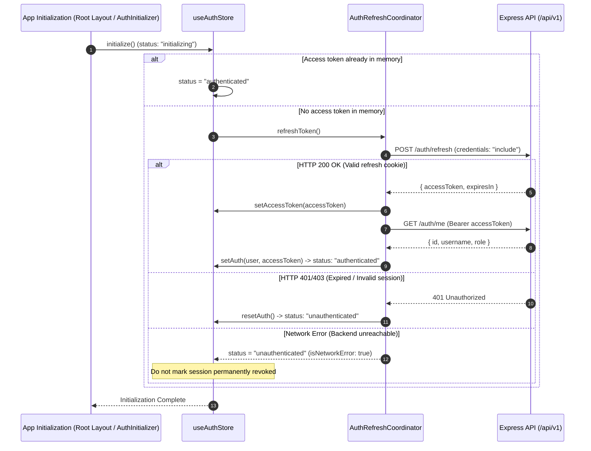

# KTV Online – Sprint 1.2 Architecture & Implementation Audit: Authentication UI & Session Management

**Date:** November 6, 2026  
**Author:** Senior Full-Stack Architect, Security Engineer & Frontend Lead  
**Scope:** Frontend Authentication UI, Session Restoration, Route Guards (`apps/web`, `packages/contracts`, `apps/api`)  
**Status:** Audit Completed – Implementation Plan Approved  

---

## 1. Executive Summary

Sprint 0.2 remediated critical backend vulnerabilities by eliminating `x-user-id` spoofing, enforcing verified JWT Bearer tokens in `requireAuth`, issuing HTTP-only refresh token cookies with rotation and family-based replay attack detection, and rejecting suspended accounts.

Sprint 1.1 established the frontend API foundation:
- Native, zero-dependency `ApiClient` with typed parameter serialization and `credentials: "include"`.
- Ephemeral in-memory `tokenStore` (access tokens are never written to `localStorage` or `sessionStorage` to mitigate XSS exposure).
- Single-flight `AuthRefreshCoordinator` preventing concurrent refresh race conditions.
- Normalized `ApiError` class.
- Reusable TanStack Query hooks (`useRooms`, `useRoom`, `useRoomMembers`, `useCurrentUser`).

However, the user-facing authentication experience remains incomplete:
1. There are **no login or registration pages/forms**.
2. **Session restoration is missing**: Reloading the browser clears the in-memory access token, resetting the app to a blank state because no startup session restoration calls `/api/v1/auth/refresh`.
3. **No route protection guards**: The `/profile` route does not check for authentication or redirect unauthenticated visitors.
4. **Header navigation is static**: `AppHeader` displays an avatar unconditionally instead of distinguishing between authenticated and unauthenticated states.

Sprint 1.2 addresses these gaps by delivering a complete authentication lifecycle, robust session restoration, client-side route guards, and responsive authentication UI.

---

## 2. Backend Authentication Architecture Inspection

The Express backend (`apps/api/src/modules/auth` and `apps/api/src/modules/users`) implements the following contracts and behaviors:

### 2.1 Registration (`POST /api/v1/users/register`)
- **Payload (`CreateUserDto`)**:
  - `username`: string (3-30 chars, alphanumeric + `_` + `-`)
  - `email`: string (valid email format)
  - `password`: string (min 8, max 100 chars)
  - `avatar`: optional URL
- **Behavior**:
  - Validates uniqueness of `email` (returns `409 Conflict` with `'Email is already registered'`).
  - Validates uniqueness of `username` (returns `409 Conflict` with `'Username is already taken'`).
  - Returns `201 Created` with `ApiResponse<UserDto>`.
  - **Crucial finding**: Registration creates the user document but **does not issue access or refresh tokens**. The frontend must handle registration by prompting the user to log in or automatically logging them in with their submitted credentials.

### 2.2 Login (`POST /api/v1/auth/login`)
- **Payload (`LoginDto`)**:
  - `email`: string (email format)
  - `password`: string (min 8 chars)
- **Behavior**:
  - Rejects invalid credentials with `401 Unauthorized` (`'Invalid email or password'`).
  - Rejects suspended or inactive accounts with `403 Forbidden` (`'Account is suspended or inactive'`).
  - On success: sets HTTP-only refresh token cookie (`Path=/api/v1/auth; HttpOnly; SameSite=lax; Max-Age=7d; Secure in prod`) and returns `ApiResponse<{ user: UserDto, tokens: { accessToken: string, expiresIn: string } }>`. Refresh tokens are omitted from the response body.

### 2.3 Refresh (`POST /api/v1/auth/refresh`)
- **Payload**: Reads `refreshToken` from the HTTP-only cookie (transmitted via `credentials: "include"`).
- **Behavior**:
  - If cookie is missing or invalid: returns `401 Unauthorized` (`'Invalid or expired refresh token'`).
  - If session is suspended: returns `403 Forbidden` (`'Account is suspended or inactive'`).
  - If refresh token was previously revoked: detects a replay attack, invalidates all sessions in the family, and returns `401 Unauthorized` (`'Refresh token replay detected. All sessions in this family have been revoked.'`).
  - On success: issues a rotated refresh cookie and returns `ApiResponse<{ accessToken: string, expiresIn: string }>`.

### 2.4 Logout (`POST /api/v1/auth/logout`)
- **Payload**: Reads `refreshToken` from HTTP-only cookie.
- **Behavior**:
  - Revokes session family in MongoDB and clears the HTTP-only cookie via `res.clearCookie('refreshToken')`.
  - Returns `200 OK` with `ApiResponse<null>`.

### 2.5 Current User Profile (`GET /api/v1/auth/me`)
- **Headers**: Requires `Authorization: Bearer <accessToken>`.
- **Behavior**:
  - Returns `ApiResponse<{ id: string, username: string, role: string }>`.

---

## 3. Frontend Architecture Inspection & Identified Gaps

### 3.1 Session Restoration Gap
In accordance with zero-trust token storage, access tokens are held exclusively in memory (`tokenStore.accessToken`). When a user refreshes the page:
1. Memory is cleared; `tokenStore.getAccessToken()` returns `null`.
2. `useCurrentUser` query is disabled (`enabled: tokenStore.hasToken()`).
3. `useAuthStore.isAuthenticated` defaults to `false`.
4. Currently, **no initialization routine attempts to call `/api/v1/auth/refresh` on application startup**. Consequently, valid users with active refresh cookies appear logged out upon browser reload.

### 3.2 Authentication State Machine Gap
The current store only tracks a boolean `isAuthenticated`. To avoid flash-of-unauthenticated-content (FOUC) and premature redirects on protected routes, the frontend requires a 3-state state machine:
```typescript
type AuthStatus = "initializing" | "authenticated" | "unauthenticated";
```
Protected route guards and navigation items must delay redirection and button rendering until `status !== "initializing"`.

### 3.3 Route Guard Gap
Next.js App Router server middleware cannot read the in-memory access token (it is stored in client memory, and the refresh cookie is scoped to `/api/v1/auth`). Implementing fake JWT decoding in Edge middleware without cryptographic secrets is insecure.
Therefore, route protection must be handled cleanly via client-side layout/component guards:
- `ProtectedRoute`: Wraps protected routes (e.g., `/profile`), renders a loading screen during `initializing`, redirects unauthenticated users to `/login?redirect=<target>`, and renders children only when `authenticated`.
- `GuestOnlyRoute`: Wraps authentication pages (`/login`, `/register`), redirecting authenticated users to the requested destination or `/`.

### 3.4 Navigation Bar Gap
`apps/web/src/components/layout/app-header.tsx` unconditionally displays a profile avatar. It must be updated to conditionally render:
- `initializing`: Skeleton placeholder / neutral pill.
- `unauthenticated`: "Sign In" and "Get Started" buttons.
- `authenticated`: User avatar, username, profile link, and "Sign Out" dropdown/button.

---

## 4. Session Restoration Strategy



---

## 5. Protected Route & Navigation Strategy

### Route Classification
1. **Public Routes** (Unrestricted):
   - `/`: Home landing page
   - `/rooms`: Karaoke lounge discovery
   - `/rooms/[roomId]`: Stage and live lounge viewer
2. **Protected Routes** (Require authenticated session):
   - `/profile`: User's karaoke studio, statistics, and session history
   - Future `/settings`, `/my-rooms`
3. **Guest-Only Routes** (Redirect authenticated users away):
   - `/login`: User login form
   - `/register`: New user registration form

### Redirection & Destination Memory
When an unauthenticated user visits `/profile`:
1. `ProtectedRoute` observes `status === "initializing"` and displays a branded full-page loading skeleton.
2. If `status === "unauthenticated"`, `ProtectedRoute` performs `router.replace('/login?redirect=%2Fprofile')`.
3. Upon successful login on `/login`, the login handler reads `searchParams.get('redirect')` and navigates back to `/profile`.

---

## 6. Security Considerations

1. **Token Storage**:
   - Access tokens remain strictly in-memory (`tokenStore`).
   - Refresh tokens remain strictly in HTTP-only, `SameSite=lax` cookies.
   - Neither token type is ever written to `localStorage` or `sessionStorage`.
2. **Replay Attack Safety**:
   - Startup session restoration utilizes the existing single-flight mutex (`AuthRefreshCoordinator`), ensuring React 18/19 Strict Mode double-mounts never fire concurrent duplicate refresh requests.
3. **CSRF Protection**:
   - Refresh and logout endpoints use `SameSite=lax` cookies. Native fetch requests from the browser transmit cookies with `credentials: "include"` exclusively on requests to the authorized API origin.
4. **Cache Partitioning**:
   - On logout or definitive session failure, `queryClient.clear()` purges all cached user data, preventing cache leakage across accounts on shared computers.
5. **No Spoofed Identity**:
   - The user profile is retrieved exclusively via the verified claims of the access token on `/auth/me`.

---

## 7. Implementation Plan

### Phase 1: Authentication State Architecture
- Update [use-auth-store.ts](file:///Users/mac/Documents/workspace/workspace_coding/ktvonline/apps/web/src/stores/use-auth-store.ts) to manage `status: AuthStatus` (`initializing`, `authenticated`, `unauthenticated`), `networkError`, and `initializeSession()`.
- Update [use-auth.ts](file:///Users/mac/Documents/workspace/workspace_coding/ktvonline/apps/web/src/hooks/use-auth.ts) to expose `status`, `isAuthenticated`, `isInitializing`, `login`, `register`, and `logout`.

### Phase 2: Session Restoration
- Create `AuthInitializer` component mounted in root layout to trigger `initializeSession()` once on browser mount.
- Connect to `authRefreshCoordinator` so that browser reload silently restores the session without flashing login buttons.

### Phase 3: Registration UI
- Create `apps/web/src/app/(auth)/register/page.tsx` with:
  - Split-screen layout on desktop, responsive single-column on mobile.
  - React Hook Form + Zod schema validation (username, email, password, confirm password).
  - Password visibility toggle.
  - Loading spinner and error alerts for 409 duplicate email/username.
  - Automatic seamless login upon registration or redirect to login.

### Phase 4: Login UI
- Create `apps/web/src/app/(auth)/login/page.tsx` with:
  - Form validation for email and password.
  - Show/hide password button.
  - Handling for 401 invalid credentials and 403 suspended accounts.
  - Respecting `redirect` query parameter.

### Phase 5: Protected Route Guards & Navigation
- Create `ProtectedRoute` component in `apps/web/src/components/auth/protected-route.tsx`.
- Create `GuestOnlyRoute` component in `apps/web/src/components/auth/guest-only-route.tsx`.
- Update `apps/web/src/app/(platform)/profile/page.tsx` wrapped in `ProtectedRoute`.
- Update `apps/web/src/components/layout/app-header.tsx` with conditional authentication buttons and user dropdown.

### Phase 6: Testing
- Unit and integration tests for `useAuthStore`, `AuthInitializer`, `login`, `register`, `ProtectedRoute`, and session restoration.

---

## 8. Files Expected to Change / Be Created

### Created:
- `docs/SPRINT_1_2_AUDIT.md`
- `apps/web/src/components/auth/auth-initializer.tsx`
- `apps/web/src/components/auth/protected-route.tsx`
- `apps/web/src/components/auth/guest-only-route.tsx`
- `apps/web/src/components/auth/auth-layout.tsx`
- `apps/web/src/app/(auth)/login/page.tsx`
- `apps/web/src/app/(auth)/register/page.tsx`
- `apps/web/src/__tests__/auth-session.test.tsx`
- `apps/web/src/__tests__/auth-forms.test.tsx`
- `apps/web/src/__tests__/route-guards.test.tsx`
- `docs/SPRINT_1_2_IMPLEMENTATION_REPORT.md`

### Modified:
- `apps/web/src/stores/use-auth-store.ts`
- `apps/web/src/hooks/use-auth.ts`
- `apps/web/src/app/layout.tsx`
- `apps/web/src/components/layout/app-header.tsx`
- `apps/web/src/app/(platform)/profile/page.tsx`

---

## 9. Conclusion

The architecture is thoroughly mapped and the path to implementation is clear. We proceed immediately to Phase 1 (Authentication State Architecture) and Phase 2 (Session Restoration).
