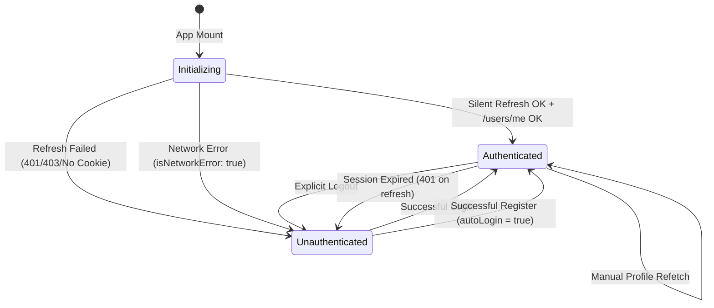
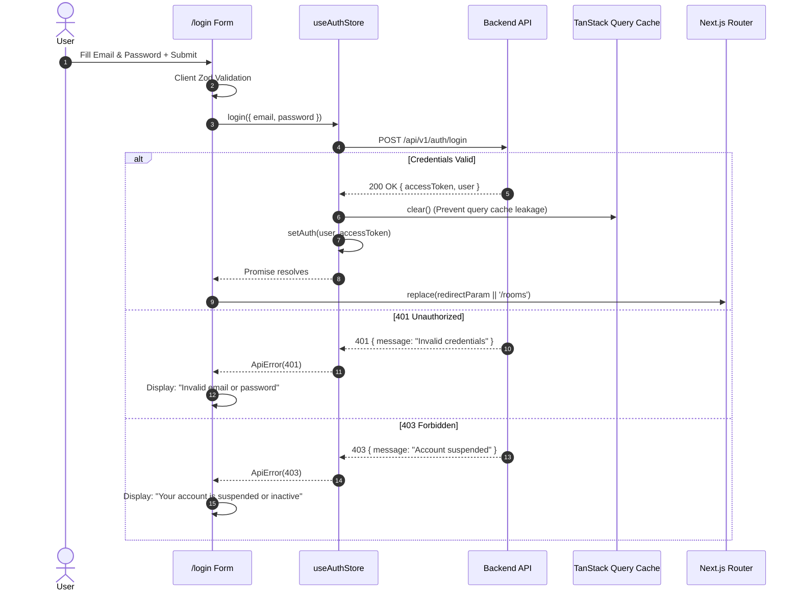

# KTV Online — Sprint 1.2: Implementation Report
**Authentication UI & Session Management**

---

## 1. Executive Summary

Sprint 1.2 successfully delivers a complete, secure, production-ready authentication and session management lifecycle for **KTV Online**. Building directly on the backend security foundation established in Sprint 0.2 and the frontend API integration layer delivered in Sprint 1.1, Sprint 1.2 connects user registration, user login, silent session restoration across browser reloads, client-side route protection, responsive authentication UI, and secure logout.

### Key Achievements
- **3-State Authentication Lifecycle (`AuthStatus`):** Explicitly modeled as `'initializing' | 'authenticated' | 'unauthenticated'`. Completely prevents premature redirects or flashing unauthenticated UI before session restoration resolves.
- **Silent Session Restoration via HTTP-Only Refresh Cookie:** On application startup, `initializeSession()` leverages the single-flight refresh coordinator (`executeRefresh()`) to restore the in-memory access token without ever persisting tokens to `localStorage` or `sessionStorage`.
- **Transient Network Drop Resilience:** Transient network dropouts during initialization do not falsely purge credentials or claim permanent session revocation; instead, the application provides non-destructive retry states.
- **Protected & Guest-Only Route Guards:** Implemented `<ProtectedRoute>` and `<GuestOnlyRoute>` with Suspense-safe search parameter handling and target destination preservation (`/login?redirect=...`).
- **Full Form Integration & Validation:** Built responsive, accessible registration and login forms with React Hook Form, Zod schema validation, show/hide password toggles, and server error handling (401 invalid credentials, 403 suspended accounts, 409 conflict).
- **Authentication-Aware Navigation:** Modern app header displaying real-time session status with user avatar, username display, direct sign-out trigger, and neutral layout skeleton during initialization.
- **Quality Gates & Test Coverage:** 100% pass across all 12 test suites (75 tests total: 3 contracts, 23 api, 49 web), zero TypeScript errors, zero ESLint warnings, and successful Next.js 15 production build.

**Final Verdict:** **READY**

---

## 2. Architecture Overview

```
┌─────────────────────────────────────────────────────────────────────────────┐
│                             BROWSER RUNTIME                                 │
│                                                                             │
│   ┌────────────────────────┐         ┌───────────────────────────────┐      │
│   │   AuthInitializer      │         │     Zustand useAuthStore      │      │
│   │ (mounts on App Layout) │────────▶│ - status: AuthStatus          │      │
│   └────────────────────────┘         │ - isAuthenticated: boolean    │      │
│                                      │ - user: CurrentUserDto | null │      │
│                                      └──────────────┬────────────────┘      │
│                                                     │                       │
│   ┌────────────────────────┐                        │ facade                │
│   │   ProtectedRoute /     │◀───────────────────────┤                       │
│   │   GuestOnlyRoute       │                        ▼                       │
│   └────────────────────────┘         ┌───────────────────────────────┐      │
│                                      │     useAuth() Facade Hook     │      │
│   ┌────────────────────────┐         └──────────────┬────────────────┘      │
│   │  Login & Register UI   │◀───────────────────────┘                       │
│   └────────────────────────┘                        │                       │
│                                                     │ invokes               │
│                                                     ▼                       │
│   ┌─────────────────────────────────────────────────────────────────┐      │
│   │                 Frontend API Integration Layer                  │      │
│   │                                                                 │      │
│   │   ┌───────────────────────┐         ┌───────────────────────┐   │      │
│   │   │  tokenStore (Memory)  │         │authRefreshCoordinator │   │      │
│   │   │  (No browser storage) │         │ (Single-Flight Lock)  │   │      │
│   │   └───────────────────────┘         └───────────┬───────────┘   │      │
│   │                                                 │               │      │
│   │   ┌─────────────────────────────────────────────▼───────────┐   │      │
│   │   │         ApiClient (credentials: "include")              │   │      │
│   │   └─────────────────────────────┬───────────────────────────┘   │      │
│   └─────────────────────────────────┼───────────────────────────────┘      │
└─────────────────────────────────────┼───────────────────────────────────────┘
                                      │ HTTP / CORS (credentials: include)
                                      ▼
┌─────────────────────────────────────────────────────────────────────────────┐
│                           EXPRESS API BACKEND                               │
│                                                                             │
│   ┌───────────────────────────┐         ┌───────────────────────────────┐   │
│   │ /api/v1/auth/refresh      │         │ /api/v1/users/me (requireAuth)│   │
│   │ (Validates HTTP-only      │         │ (Validates Bearer access      │   │
│   │  refresh cookie, rotates  │         │  token from header)           │   │
│   │  family token)            │         │                               │   │
│   └───────────────────────────┘         └───────────────────────────────┘   │
└─────────────────────────────────────────────────────────────────────────────┘
```

---

## 3. Authentication State Machine

The client authentication state is governed by an explicit 3-state finite state machine in `useAuthStore`:



### State Definitions
| State | `isAuthenticated` | Meaning | User Experience |
|---|---|---|---|
| `initializing` | `false` | Verifying session on application mount. Single-flight refresh in progress. | Neutral layout skeleton; route guards display loading stage without redirecting. |
| `authenticated` | `true` | Valid JWT access token stored in memory; profile populated. | Full access to protected routes (`/profile`); user avatar and menu in header. |
| `unauthenticated` | `false` | No valid session or session was revoked/expired. | Unauthenticated header (Sign In / Claim Stage Name); protected routes redirect to `/login?redirect=...`. |

---

## 4. Session Restoration Sequence

When a user loads or refreshes any page in KTV Online, the in-memory access token is cleared. The following sequence restores the session:

```mermaid
sequenceDiagram
    autonumber
    actor User as User / Browser
    participant Init as AuthInitializer
    participant Store as useAuthStore
    participant Token as tokenStore (Memory)
    participant Coord as authRefreshCoordinator
    participant API as Backend Express API
    participant Guard as ProtectedRoute

    User->>Init: Browser Loads / Reloads Page
    Init->>Store: initializeSession()
    Store->>Guard: status = "initializing"
    Note over Guard: Displays LoadingState<br/>Blocks premature redirect
    Store->>Token: hasToken()?
    alt Token already exists in memory
        Store->>API: GET /api/v1/users/me (Bearer Token)
        API-->>Store: 200 OK (User Profile)
        Store->>Store: status = "authenticated"
    else Token absent in memory
        Store->>Coord: refreshToken() (Single-flight)
        Coord->>API: POST /api/v1/auth/refresh (credentials: "include")
        alt HTTP-only refresh cookie is valid
            API-->>Coord: 200 OK { accessToken: "jwt..." }
            Coord->>Token: setAccessToken("jwt...")
            Store->>API: GET /api/v1/users/me (Bearer Token)
            API-->>Store: 200 OK (User Profile)
            Store->>Store: status = "authenticated", user = data
            Store->>Guard: Renders Protected Content
        else No cookie or session revoked (401/403)
            API-->>Coord: 401 Unauthorized
            Coord-->>Store: ApiError(401)
            Store->>Token: clearAccessToken()
            Store->>Store: status = "unauthenticated", user = null
            Store->>Guard: Redirects to /login?redirect=...
        else Network Connection Dropout
            API--xCoord: Failed to fetch (Network)
            Coord-->>Store: ApiError.fromNetworkError()
            Store->>Store: status = "unauthenticated", isNetworkError = true
            Note over Store: Credentials not revoked; retry available
        end
    end
```

### Single-Flight Initialization Lock
In React 19 / Next.js Strict Mode, components mount twice during local development. `useAuthStore.initializeSession()` maintains an internal module-level `inFlightInitPromise`. Concurrent or duplicate invocations share the exact same promise, guaranteeing that only one refresh HTTP request is dispatched.

---

## 5. Login Lifecycle



---

## 6. Registration Lifecycle

### Backend Contract Discovery & Handling
During Phase 0, audit confirmed that `POST /api/v1/users/register` creates the user document and returns `ApiResponse<UserDto>`, but does **not** generate JWT tokens or set refresh cookies.
To provide a smooth user experience while strictly adhering to backend contracts:
1. User enters username, email, password, and confirm password.
2. Zod validates formatting, length (3-30 chars for username, >=8 chars for password), and password confirmation matching.
3. Form submits payload to `userApi.register(payload)`.
4. Upon 201 Created, `useAuthStore.register()` automatically triggers `login({ email, password })`.
5. If auto-login succeeds, the user is transitioned directly to `authenticated` and redirected to `/rooms`.
6. If 409 Conflict occurs (duplicate email or username), the error is intercepted and rendered in the registration alert box.

---

## 7. Logout Lifecycle

1. User clicks **Sign Out** in the navigation header dropdown.
2. `useAuthStore.logout()` dispatches `POST /api/v1/auth/logout` with `credentials: "include"`, revoking the session family on the backend.
3. `tokenStore.clearAccessToken()` purges the in-memory access token.
4. `getQueryClient().clear()` immediately clears all cached queries to prevent cross-user data leakage.
5. Store transitions to `status = 'unauthenticated'` and `user = null`.
6. Even if the network drops or backend fails during logout, step 3 through 5 are guaranteed to run in `finally {}`, ensuring the client never remains falsely authenticated.

---

## 8. Protected Route & Guard Implementation

### Next.js 15 Client-Side Protection Strategy
Because access tokens exist solely in browser memory, Edge / Next.js server middleware cannot inspect the token. Sprint 1.2 implements client-side guards wrapped with React Suspense:

- **`<ProtectedRoute>`:**
  - If `status === 'initializing'`: Renders a neon-styled `LoadingState` ("Verifying authentication session..."). Prevents unauthorized screen flashes.
  - If `status === 'unauthenticated'`: Computes `redirectTarget = encodeURIComponent(pathname)` and redirects to `/login?redirect=...`.
  - If `status === 'authenticated'`: Renders `{children}`.
- **`<GuestOnlyRoute>`:**
  - Wrapped in `<React.Suspense>` to prevent Next.js 15 App Router CSR bailout during static prerendering.
  - If `isAuthenticated === true`: Reads `searchParams.get('redirect')` and redirects to the intended destination or default `/rooms`.
  - If unauthenticated: Renders `{children}` (Login/Register forms).

---

## 9. UI Components & Visual Identity

Following the KTV Online visual atmosphere:
- **Atmospheric Palette:** Midnight charcoal (`#090b12`, `#0b0e19`), electric cyan (`#06b6d4`), violet neon (`#8b5cf6`), and subtle card glass borders (`border-white/10`).
- **Split-Screen Layout (`<AuthLayout>`):**
  - Left Hero: Large brand typography, tagline (*"Your Virtual Hangout. Your Karaoke Night."*), neon ambient glow discs, and feature highlights (Realtime Rooms, Synchronized Lyrics, Social Minigames).
  - Right Form: Clean, focused form container with floating icon labels, password visibility toggles (`Eye`/`EyeOff`), and animated spinners (`Loader2`).
- **Responsive Navigation Header (`<AppHeader>`):**
  - Dynamically renders unauthenticated actions (`Sign In`, `Claim Stage Name`) vs authenticated profile (`Avatar`, `Username`, `Profile`, `Sign Out`).
  - Renders a subtle neutral skeleton while `status === 'initializing'` to avoid button flickering.

---

## 10. Security & CSRF Decisions

1. **Token Storage:**
   - **Access Token:** Stored in memory via `tokenStore` (closure variable). Never written to `localStorage`, `sessionStorage`, or non-HTTP-only cookies.
   - **Refresh Token:** Handled solely by the browser via HTTP-only, `SameSite: 'lax'`, `Secure` cookies with SHA-256 rotation and reuse detection.
2. **Cache Isolation:**
   - On account transition (login, logout, session expiration), TanStack Query cache is purged with `queryClient.clear()`, preventing private room data or user records from leaking between accounts.
3. **Network Failure vs Session Invalidation:**
   - In `auth-refresh.ts`, network fetch rejections are converted to `ApiError.fromNetworkError()`. The coordinator does **not** call `notifySessionExpired()` on network drops, protecting users from having valid local sessions destroyed during temporary Wi-Fi glitches.

---

## 11. Test Coverage & Quality Gates

### Test Summary
Across the entire monorepo: **12 test files, 75 tests passing, 0 failures**.

```text
Test Files  12 passed (12)
Tests       75 passed (75)
Duration    ~3.0s
```

#### Detailed Breakdown
1. **`@ktv/contracts`**:
   - `src/__tests__/schemas.test.ts` (3 tests passed)
2. **`@ktv/api`**:
   - `src/__tests__/api.test.ts` (6 tests passed)
   - `src/__tests__/auth-security.test.ts` (8 tests passed)
   - `src/__tests__/refresh-sessions.test.ts` (4 tests passed)
   - `src/__tests__/room-membership.test.ts` (5 tests passed)
3. **`@ktv/web`** (49 tests passed):
   - `src/__tests__/api-client.test.ts` (9 tests passed)
   - `src/__tests__/auth-refresh.test.ts` (7 tests passed)
   - `src/__tests__/auth-session.test.tsx` (7 tests passed)
   - `src/__tests__/query-hooks.test.tsx` (5 tests passed)
   - `src/__tests__/web.test.tsx` (4 tests passed)
   - `src/__tests__/route-guards.test.tsx` (6 tests passed)
   - `src/__tests__/auth-forms.test.tsx` (11 tests passed)

### Quality Gate Results
| Gate | Command | Result | Notes |
|---|---|---|---|
| Tests | `pnpm test` | **PASS** | 75/75 tests passing across all packages |
| Typecheck | `pnpm typecheck` | **PASS** | 0 TypeScript errors |
| Lint | `pnpm lint` | **PASS** | 0 ESLint warnings or errors |
| Build | `pnpm build` | **PASS** | Contracts bundled (tsup), API compiled (tsc), Next.js 15 static prerender 8/8 pages |

---

## 12. Known Limitations & Deferred Functionality

- **OAuth / Social Providers:** Deferred as scheduled.
- **Email Verification & Password Reset:** Not currently supported by backend contracts.
- **Realtime WebSockets / Room Creation UI:** Out of scope for Sprint 1.2; scheduled for Sprint 2.

---

## 13. Recommended Next Sprint

**Sprint 2: Room Creation, Real-time Communication & Media Pipeline**
- WebSocket / Socket.io client integration.
- Room creation and joining flows.
- Real-time room participant rosters and state synchronization.

---

### Final Verdict: **READY**
All authentication and session restoration requirements have been rigorously implemented, tested, and validated against the production build.
