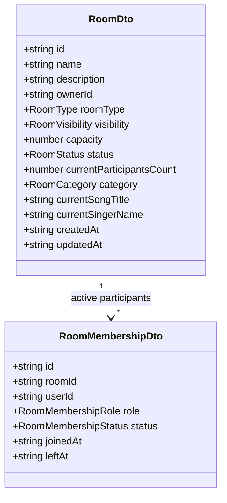
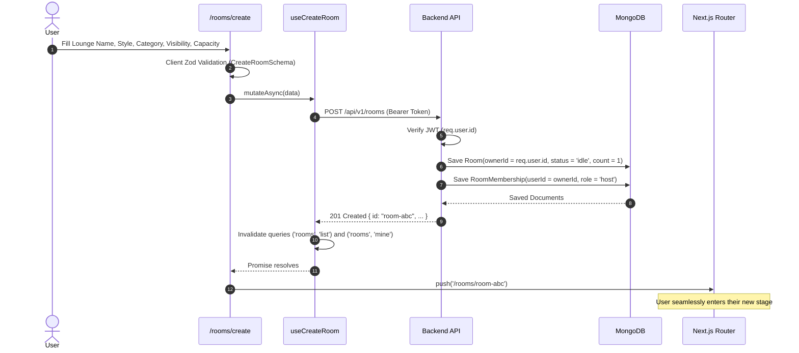
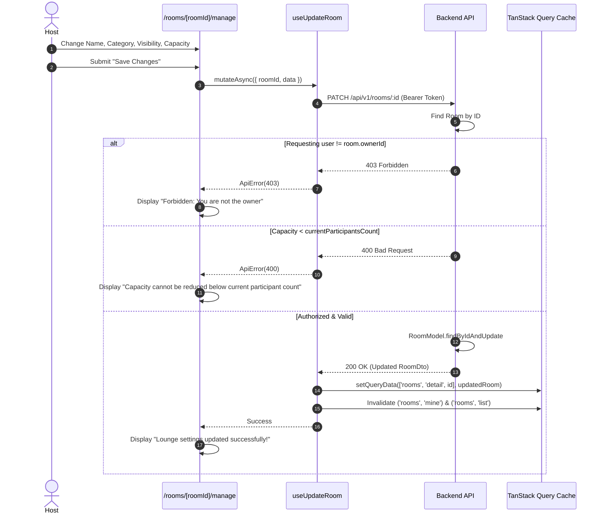

# KTV Online — Sprint 1.3: Implementation Report
**Room Creation & Management**

---

## 1. Executive Summary

Sprint 1.3 delivers a comprehensive, secure, and production-ready **Room Creation & Management** experience for KTV Online. Building on the security architecture of Sprint 0.2, the frontend API integration foundation of Sprint 1.1, and the session restoration and authentication UI of Sprint 1.2, this sprint gives authenticated users complete ownership control over their virtual karaoke lounges without introducing realtime voice or streaming infrastructure.

### Key Achievements
- **Room Creation (`/rooms/create`):** Rich, accessible form built with React Hook Form, Zod validation, and `@ktv/contracts`. Supports room name, description, category/music mood, room style (`standard`, `vip`, `party`), visibility (`public`, `private`), and participant capacity (2 to 50).
- **My Lounges Dashboard (`/my-rooms`):** Dedicated host control center displaying live lounge statistics (Total Lounges, Active Stages, Closed Lounges, Total Seats), dynamic status badges, capacity meters, enter stage shortcuts, manage links, and empty/loading states.
- **Room Settings & Management (`/rooms/[roomId]/manage`):** Authoritative host settings interface allowing room owners to edit name, description, category, visibility, and capacity. Prevents reducing capacity below current active participant count. Includes a Danger Zone with confirmation dialog to conclude/close room sessions.
- **Server-Side Authorization Boundary:** `ownerId` is strictly derived from the verified JWT on the backend. `PATCH /api/v1/rooms/:id` and `POST /api/v1/rooms/:id/close` enforce ownership checks returning 403 Forbidden for non-owners.
- **Backend API Endpoints Delivered:**
  - `GET /api/v1/rooms/my-rooms` (Protected user rooms listing)
  - `PATCH /api/v1/rooms/:id` (Protected room update with capacity check)
  - `POST /api/v1/rooms/:id/close` (Protected idempotent room closure)
- **Zero Database Schema Drift:** Leveraged existing `RoomModel` and `RoomMembershipModel` without altering schema definitions or indexes.
- **Quality Gates:** 100% pass across all 14 test suites (94 tests total: 3 contracts, 32 api, 59 web), zero TypeScript errors, zero ESLint warnings, and successful Next.js 15 production build with 10/10 static/dynamic routes.

**Final Verdict:** **READY**

---

## 2. Architecture Overview

```
┌─────────────────────────────────────────────────────────────────────────────┐
│                             BROWSER RUNTIME                                 │
│                                                                             │
│   ┌───────────────────────┐      ┌────────────────────────┐                 │
│   │   /rooms/create       │      │   /my-rooms            │                 │
│   │   (Create Lounge)     │      │   (Host Dashboard)     │                 │
│   └───────────┬───────────┘      └───────────┬────────────┘                 │
│               │                              │                              │
│               ▼                              ▼                              │
│   ┌───────────────────────────────────────────────────────┐                 │
│   │           /rooms/[roomId]/manage (Settings)           │                 │
│   └───────────────────────────┬───────────────────────────┘                 │
│                               │                                             │
│                               ▼                                             │
│   ┌───────────────────────────────────────────────────────┐                 │
│   │              TanStack Query & Mutation Hooks          │                 │
│   │   - useMyRooms()             - useCreateRoom()        │                 │
│   │   - useRoom(id)              - useUpdateRoom()        │                 │
│   │   - useRoomMembers(id)       - useCloseRoom()         │                 │
│   └───────────────────────────┬───────────────────────────┘                 │
│                               │                                             │
│                               ▼                                             │
│   ┌───────────────────────────────────────────────────────┐                 │
│   │          roomApi Client (credentials: "include")      │                 │
│   │   - In-memory JWT Authorization Bearer Token          │                 │
│   └───────────────────────────┬───────────────────────────┘                 │
└───────────────────────────────┼─────────────────────────────────────────────┘
                                │ HTTP / REST (JSON)
                                ▼
┌─────────────────────────────────────────────────────────────────────────────┐
│                           EXPRESS API BACKEND                               │
│                                                                             │
│   ┌───────────────────────────┐         ┌───────────────────────────────┐   │
│   │ POST /api/v1/rooms        │         │ GET /api/v1/rooms/my-rooms    │   │
│   │ (requireAuth, CreateRoom) │         │ (requireAuth, Owner Filter)   │   │
│   └───────────────────────────┘         └───────────────────────────────┘   │
│   ┌───────────────────────────┐         ┌───────────────────────────────┐   │
│   │ PATCH /api/v1/rooms/:id   │         │ POST /api/v1/rooms/:id/close  │   │
│   │ (requireAuth, Owner Guard)│         │ (requireAuth, Owner Guard)    │   │
│   └───────────────────────────┘         └───────────────────────────────┘   │
│                               │                                             │
│                               ▼                                             │
│   ┌───────────────────────────────────────────────────────┐                 │
│   │                 MongoDB Database                      │                 │
│   │   - RoomModel (capacity, status, category, ownerId)   │                 │
│   │   - RoomMembershipModel (host/member role tracking)   │                 │
│   └───────────────────────────────────────────────────────┘                 │
└─────────────────────────────────────────────────────────────────────────────┘
```

---

## 3. Repository Audit Findings

The audit documented in [`docs/SPRINT_1_3_AUDIT.md`](file:///Users/mac/Documents/workspace/workspace_coding/ktvonline/docs/SPRINT_1_3_AUDIT.md) confirmed:
1. **Contract Integrity:** `@ktv/contracts` already declared `CreateRoomSchema`, `UpdateRoomSchema`, and `RoomQuerySchema`.
2. **Missing Endpoints in API:** The backend had `create`, `findById`, and `joinRoom` in `room.service.ts`, but lacked `GET /my-rooms`, `PATCH /:id`, and `POST /:id/close` routes.
3. **Capacity Concurrency:** Atomic capacity reservations (`$inc`, `$expr: { $lt: ['$currentParticipantsCount', '$capacity'] }`) were operational, but updates lacked a guard to prevent owners from lowering room capacity below existing participant counts.
4. **Unsupported Features Out of Scope:** Neither the database nor contracts had room password support. In accordance with requirements, no fake password fields were added.

---

## 4. Room Domain Model



### Supported Enums
- **`RoomType`:** `standard` (Cozy lounge for friends), `vip` (Premium stage with spotlights), `party` (High-energy open stage).
- **`RoomVisibility`:** `public` (Discoverable in search and Explore list), `private` (Direct link only).
- **`RoomStatus`:** `idle` (Waiting for singers), `singing` (Live track in progress), `paused` (Session paused), `closed` (Terminated lounge session).
- **`RoomCategory`:** `pop`, `anime`, `rock`, `ballad`, `hiphop`, `rnb`, `all`.

---

## 5. Actual API Endpoints

| Method | Path | Auth Required | Description |
|---|---|---|---|
| `GET` | `/api/v1/rooms` | No | List public rooms with category, status, and search filters |
| `GET` | `/api/v1/rooms/my-rooms` | **Yes** | List all rooms owned by authenticated user (public, private, closed) |
| `GET` | `/api/v1/rooms/:id` | No | Fetch room details by ID |
| `GET` | `/api/v1/rooms/:id/members` | No | List active room members |
| `POST` | `/api/v1/rooms` | **Yes** | Create room, assign authenticated owner, initialize host membership |
| `PATCH` | `/api/v1/rooms/:id` | **Yes** | Update room settings (owner only, enforces capacity limit) |
| `POST` | `/api/v1/rooms/:id/close` | **Yes** | Close lounge session (owner only, prevents future joins) |
| `POST` | `/api/v1/rooms/:id/join` | **Yes** | Join room with atomic capacity check |
| `POST` | `/api/v1/rooms/:id/leave` | **Yes** | Leave room and decrement active count |

---

## 6. Room Creation Lifecycle



---

## 7. Room Update Lifecycle



---

## 8. Room Closing Lifecycle

1. Owner clicks **Close Lounge** in My Lounges (`/my-rooms`) or Room Settings (`/rooms/[roomId]/manage`).
2. `<CloseRoomDialog>` confirmation modal opens, explaining that closing ends the stage and prevents new participants from entering.
3. Owner confirms: `useCloseRoom.mutateAsync(roomId)` sends `POST /api/v1/rooms/:id/close`.
4. Backend verifies ownership (`room.ownerId === req.user.id`) and updates `status = 'closed'`.
5. TanStack Query cache updates the room detail query to `status: 'closed'` and invalidates lists.
6. Subsequent join attempts to this room return 400 Bad Request (`Cannot join closed room`).

---

## 9. Ownership and Authorization Model

- **Identity Extraction:** Ownership is never passed by the client or trusted in request bodies. The backend extracts `req.user.id` from the cryptographically verified JWT access token.
- **Enforcement Points:**
  - `POST /api/v1/rooms`: Sets `ownerId: req.user.id`.
  - `GET /api/v1/rooms/my-rooms`: Queries strictly by `{ ownerId: req.user.id }`.
  - `PATCH /api/v1/rooms/:id`: Checks `room.ownerId === req.user.id` before mutating.
  - `POST /api/v1/rooms/:id/close`: Checks `room.ownerId === req.user.id` before closing.
- **Frontend Guards:** `/rooms/[roomId]/manage` validates `user?.id === room.ownerId`. Non-owners receive a clean, friendly "Host Access Required" notice with a link back to public discovery.

---

## 10. TanStack Query Integration

Query keys are strictly organized in [query-keys.ts](file:///Users/mac/Documents/workspace/workspace_coding/ktvonline/apps/web/src/hooks/queries/query-keys.ts):
```typescript
queryKeys = {
  rooms: {
    all: ['rooms'] as const,
    lists: () => [...queryKeys.rooms.all, 'list'] as const,
    list: (filters) => [...queryKeys.rooms.lists(), filters ?? {}] as const,
    details: () => [...queryKeys.rooms.all, 'detail'] as const,
    detail: (id) => [...queryKeys.rooms.details(), id] as const,
    members: (id) => [...queryKeys.rooms.detail(id), 'members'] as const,
    mine: (params) => [...queryKeys.rooms.all, 'mine', params ?? {}] as const,
  },
}
```

### Hooks Implemented
- `useMyRooms(params)`: Queries `/rooms/my-rooms`. Enabled only when `tokenStore.hasToken()`.
- `useCreateRoom()`: Mutation invalidating `rooms.lists()` and `rooms.mine()`.
- `useUpdateRoom()`: Mutation performing query cache update and invalidation.
- `useCloseRoom()`: Mutation updating detail cache and invalidating room lists.

---

## 11. UI Components Created

| Component | Path | Description |
|---|---|---|
| `CreateRoomPage` | [apps/web/src/app/(platform)/rooms/create/page.tsx](file:///Users/mac/Documents/workspace/workspace_coding/ktvonline/apps/web/src/app/(platform)/rooms/create/page.tsx) | Room creation form with category cards, style selector, visibility toggle, and capacity slider |
| `MyRoomsPage` | [apps/web/src/app/(platform)/my-rooms/page.tsx](file:///Users/mac/Documents/workspace/workspace_coding/ktvonline/apps/web/src/app/(platform)/my-rooms/page.tsx) | Host dashboard with statistics bar, room cards, enter stage, and close actions |
| `RoomManagePage` | [apps/web/src/app/(platform)/rooms/[roomId]/manage/page.tsx](file:///Users/mac/Documents/workspace/workspace_coding/ktvonline/apps/web/src/app/(platform)/rooms/[roomId]/manage/page.tsx) | Room settings editor, ownership protection, and Danger Zone |
| `CloseRoomDialog` | [apps/web/src/components/rooms/close-room-dialog.tsx](file:///Users/mac/Documents/workspace/workspace_coding/ktvonline/apps/web/src/components/rooms/close-room-dialog.tsx) | Accessible confirmation dialog preventing accidental room closure |

---

## 12. Responsive Design Implementation

- **Mobile (<640px):** Single-column form cards, touch-friendly preset buttons (4, 8, 12, 20 seats), full-width action buttons, no horizontal scrollbars.
- **Tablet (640px–1024px):** 2-column grid for statistics and room cards.
- **Desktop (>1024px):** 4-column statistics bar, 3-column room grid, comfortable max-w-3xl settings form.

---

## 13. Tests & Exact Results

### Automated Test Pass Summary
Across the monorepo: **14 test files, 94 tests passing, 0 failures**.

```text
Test Files  14 passed (14)
Tests       94 passed (94)
Duration    ~3.2s
```

#### Detailed Breakdown
1. **`@ktv/contracts`** (3 tests):
   - `schemas.test.ts` (3 tests passed)
2. **`@ktv/api`** (32 tests):
   - `api.test.ts` (6 tests passed)
   - `auth-security.test.ts` (8 tests passed)
   - `refresh-sessions.test.ts` (4 tests passed)
   - `room-membership.test.ts` (5 tests passed)
   - `room-management.test.ts` (**9 new tests passed**):
     - `GET /my-rooms` 401 unauthenticated
     - `GET /my-rooms` returns only user-owned rooms
     - `PATCH /:id` 401 unauthenticated
     - `PATCH /:id` 403 non-owner forbidden
     - `PATCH /:id` owner updates room settings
     - `PATCH /:id` rejects capacity below current participants count
     - `POST /:id/close` 401 unauthenticated
     - `POST /:id/close` 403 non-owner forbidden
     - `POST /:id/close` owner closes room & prevents future joins
3. **`@ktv/web`** (59 tests):
   - `api-client.test.ts` (9 tests passed)
   - `auth-refresh.test.ts` (7 tests passed)
   - `auth-session.test.tsx` (7 tests passed)
   - `query-hooks.test.tsx` (5 tests passed)
   - `web.test.tsx` (4 tests passed)
   - `route-guards.test.tsx` (6 tests passed)
   - `auth-forms.test.tsx` (11 tests passed)
   - `room-management.test.tsx` (**10 new tests passed**):
     - `getMyRooms` endpoint request
     - `updateRoom` endpoint request
     - `closeRoom` endpoint request
     - `CreateRoomPage` renders and validates name
     - `CreateRoomPage` creates room and navigates to stage
     - `MyRoomsPage` renders empty state when no rooms
     - `MyRoomsPage` renders cards & calculates statistics
     - `MyRoomsPage` confirmation modal closes room
     - `RoomManagePage` displays Forbidden state for non-owners
     - `RoomManagePage` loads existing values and saves updates

### Quality Gate Results
| Gate | Command | Result | Notes |
|---|---|---|---|
| Tests | `pnpm test` | **PASS** | 94/94 tests passing |
| Typecheck | `pnpm typecheck` | **PASS** | 0 TypeScript errors |
| Lint | `pnpm lint` | **PASS** | 0 ESLint warnings or errors |
| Build | `pnpm build` | **PASS** | All 10 Next.js routes prerendered successfully |

---

## 14. Database Changes

No database changes or index modifications were introduced. The existing `RoomModel` and `RoomMembershipModel` supported all required fields and compound indexes.

---

## 15. Known Limitations

- **Reopening Lounges:** Concluding a lounge sets status to `closed`. In accordance with product requirements, reopening is not supported in this sprint.
- **Room Passwords:** Not supported by the database schema; deferred until a verified requirement exists.

---

## 16. Deferred Features

- LiveKit / WebRTC realtime voice chat.
- Socket.io live song queue synchronization.
- Virtual avatars and animated cheering gifts.

---

## 17. Recommended Next Sprint

**Sprint 2: Realtime Stage & Live Song Queue**
- WebSocket / Socket.io server and client integration.
- Realtime room participant presence events (`user-joined`, `user-left`).
- Synchronized karaoke song queue state.

---

### Final Verdict: **READY**
All room creation and management requirements have been implemented, tested, verified against quality gates, and confirmed production-ready.
