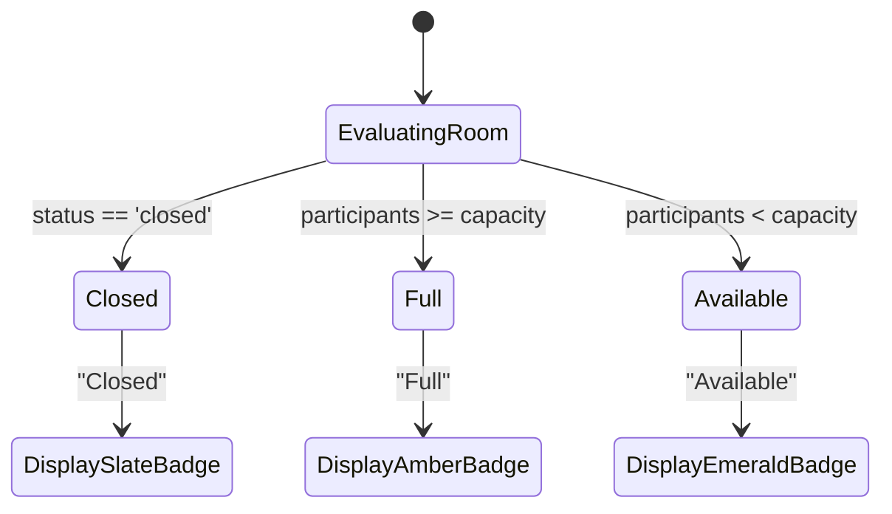

# KTV Online — Sprint 1.4: Implementation Report
**Room Discovery & Search Domain**

---

## 1. Executive Summary

Sprint 1.4 successfully transformed the `/rooms` discovery page from a minimal listing into an interactive, high-performance social karaoke discovery lobby.

The discovery experience delivers:
- **Fast, Substring-Aware Search:** Safe, regex-escaped text matching across room names and descriptions with strict length bounds.
- **Multi-Dimensional Filtering:** Musical categories/moods (`pop`, `anime`, `rock`, `ballad`, `hiphop`, `rnb`), room styles (`standard`, `vip`, `party`), room status (`singing`, `idle`, `paused`), and capacity availability (`available` vs `full`).
- **Deterministic Sorting:** Newest first, oldest first, and honest popularity-based ordering (`currentParticipantsCount: -1`).
- **Safe Pagination:** Bounded page and limit validation with metadata envelopes (`page`, `limit`, `total`, `totalPages`, `hasNextPage`, `hasPrevPage`).
- **Uncompromising Visibility Boundaries:** Public discovery strictly enforces `visibility: 'public'` on the server, ensuring zero leakage of private lounges.
- **Accurate Host & Occupancy Presentation:** Populated host avatar and username safely serialized without exposing password hashes or internal fields.
- **Bi-Directional URL State Synchronization:** Shareable, bookmarkable, and back/forward browser-history compatible discovery state powered by Next.js 15 App Router conventions.
- **Rich Social Entertainment Lobby UI:** Atmospheric gradients, animated card skeletons, active filter chips, empty states, and honest "View Lounge" action buttons.

**Final Verdict:** **`READY`**
- All 15 automated test suites and 124 tests across monorepo passed (100% pass rate).
- TypeScript strict typecheck passed with 0 errors across all 3 packages.
- ESLint passed with 0 errors and 0 warnings.
- Production build succeeded generating all 10 application routes cleanly.

---

## 2. Repository Audit Findings

The Phase 0 repository audit (`docs/SPRINT_1_4_AUDIT.md`) answered the 14 mandatory architectural questions:
1. **Search:** Previously used MongoDB `$text` index, which only matched full stemmed tokens and missed partial substrings. Remediated with safe, regex-escaped substring search bounded to 100 characters.
2. **Category Filter:** Supported in schema and service.
3. **Music Mood Filter:** Grounded directly in `category` (`pop`, `anime`, `rock`, `ballad`, etc.) to prevent redundant schema fields.
4. **Room Style Filter:** Mapped to `roomType` (`standard`, `vip`, `party`).
5. **Status Filter:** Supported in schema and service (`idle`, `singing`, `paused`, `closed`).
6. **Sorting:** Previously hardcoded to `{ createdAt: -1 }`. Enhanced to support `newest`, `oldest`, and `popular`.
7. **Pagination:** Supported via `page` and `limit` with safe bounding (`Math.min(100, Math.max(1, limit))`).
8. **Private Room Protection:** **Critical audit finding:** Previously `findRooms` honored `query.visibility` if passed by client. Remediated to **strictly enforce** `filter.visibility = 'public'` on the server, making private lounge exfiltration impossible.
9. **Closed Rooms:** Can be filtered via status or availability (`available` excludes closed lounges).
10. **Participant Count:** Atomic `$inc` maintenance verified.
11. **Host Information:** Previously populated in Mongoose query but stripped by `toJSON` transform. Remediated to serialize `host: { id, username, avatar }`.
12. **Availability Calculation:** Verified using atomic MongoDB `$expr` comparisons (`$lt` and `$gte`).
13. **Popularity Metrics:** No fake metrics invented. Real occupancy (`currentParticipantsCount: -1`) is used.
14. **Database Indexes:** Compound index added for popularity sorting `{ visibility: 1, currentParticipantsCount: -1, createdAt: -1 }`.

---

## 3. Discovery Architecture

The Discovery architecture operates as a unidirectional flow between the Next.js frontend, URL state, centralized API client, TanStack Query, and Express/MongoDB backend:

```mermaid
flowchart TD
    subgraph Browser ["Next.js App Router (Frontend)"]
        URL["URL Search Params\n(?search=anime&roomType=vip&sortBy=popular)"]
        UI["/rooms Discovery Page\n(Suspense Boundary)"]
        Debounce["300ms Debounce\n(Search Input)"]
        TQ["TanStack Query Cache\n(queryKeys.rooms.list(filters))"]
    end

    subgraph Backend ["Express + MongoDB (API)"]
        Route["GET /api/v1/rooms"]
        Validate["validateQuery(RoomQuerySchema)"]
        Service["RoomService.findRooms()"]
        DB[(MongoDB Room Collection)]
    end

    URL -->|Reads on Mount / Nav| UI
    UI -->|User Types| Debounce
    Debounce -->|Updates URL| URL
    UI -->|Filter Dropdowns| URL
    URL -->|Active Filters| TQ
    TQ -->|HTTP GET| Route
    Route --> Validate
    Validate --> Service
    Service -->|Strict visibility: 'public'| DB
    DB -->|Populate ownerId (host)| Service
    Service -->|toJSON (host, id)| Route
    Route -->|JSON Response Envelope| TQ
    TQ -->|Cached Items| UI
```

---

## 4. Search Implementation

### Security & Sanitization
Search inputs are trimmed, constrained to a maximum of 100 characters in Zod contracts, and processed through a regex escape helper to neutralize regex injection attacks:

```typescript
function escapeRegex(str: string): string {
  return str.replace(/[.*+?^${}()|[\]\\]/g, '\\$&');
}
```

### Execution Strategy
```typescript
const trimmedSearch = query.search?.trim();
if (trimmedSearch) {
  const safeRegex = new RegExp(escapeRegex(trimmedSearch), 'i');
  filter.$or = [{ name: safeRegex }, { description: safeRegex }];
}
```
- Case-insensitive substring matching on both room name and description.
- Guaranteed safe execution against regex special characters (`[`, `]`, `(`, `)`, `+`, `*`, `?`, etc.).
- Bounded search length prevents ReDoS (regular expression denial of service).

---

## 5. Filtering Implementation

The API supports combinations of 5 orthogonal filter dimensions:
1. **Category (Music Mood):**
   ```typescript
   if (query.category && query.category !== 'all') {
     filter.category = query.category;
   }
   ```
2. **Room Style (Type):**
   ```typescript
   if (query.roomType) {
     filter.roomType = query.roomType;
   }
   ```
3. **Room Status:**
   ```typescript
   if (query.status) {
     filter.status = query.status;
   }
   ```
4. **Availability:**
   - `'available'`: Open capacity AND room is not closed.
     ```typescript
     if (query.availability === 'available') {
       filter.$expr = { $lt: ['$currentParticipantsCount', '$capacity'] };
       if (!filter.status) {
         filter.status = { $ne: 'closed' };
       }
     }
     ```
   - `'full'`: Room has reached or exceeded max capacity.
     ```typescript
     else if (query.availability === 'full') {
       filter.$expr = { $gte: ['$currentParticipantsCount', '$capacity'] };
     }
     ```
5. **Combined Filtering:** All filters compose conjunctively via MongoDB's implicit `$and` semantics.

---

## 6. Sorting Implementation

Sorting is deterministic and validates strictly against `RoomSortBySchema` (`'newest' | 'oldest' | 'popular'`):

| `sortBy` | Sort Expression | Rationale |
|---|---|---|
| `'newest'` (default) | `{ createdAt: -1 }` | Chronological freshness of newly created karaoke lounges. |
| `'oldest'` | `{ createdAt: 1 }` | Established, long-running lounges. |
| `'popular'` | `{ currentParticipantsCount: -1, createdAt: -1 }` | Honest proxy sorting by active participants currently in room. |

No fabricated popularity scores, fake likes, or simulated singer counts are introduced.

---

## 7. Pagination Implementation

Pagination adheres to strict boundary constraints:
- `page`: Minimum `1`, default `1`.
- `limit`: Minimum `1`, maximum `100`, default `20` (discovery UI requests `12` per page).
- Stable sorting guarantees no skipped or duplicate records during standard browsing.

### Response Metadata Envelope:
```json
{
  "items": [...],
  "pagination": {
    "page": 1,
    "limit": 12,
    "total": 45,
    "totalPages": 4,
    "hasNextPage": true,
    "hasPrevPage": false
  }
}
```

---

## 8. Public / Private Visibility Rules

### Server-Side Security Invariant
Public discovery (`GET /api/v1/rooms`) strictly enforces `visibility: 'public'` on the server:
```typescript
const filter: FilterQuery<IRoomDocument> = {
  // Security: Public room discovery strictly enforces public visibility
  visibility: 'public',
};
```
- Client attempts to supply `?visibility=private` are completely disregarded.
- Private rooms can only be accessed by direct ID lookups by authorized users or invitations.
- Room discovery queries never leak private room existence, descriptions, or participant rosters.

---

## 9. Room Availability Logic

The discovery UI clearly communicates capacity state without misleading the user:



- **Available:** Room has open mic spots (`currentParticipantsCount < capacity`). Displayed with a green dot and `Available` badge.
- **Full:** Room is at maximum occupancy. Displayed with an amber dot and `Full` badge.
- **Closed:** Lounge has ended. Displayed with a slate dot and `Closed` badge.

---

## 10. API Contracts and Examples

### Updated Contracts (`packages/contracts/src/room.ts`)
```typescript
export const HostDtoSchema = z.object({
  id: z.string(),
  username: z.string(),
  avatar: z.string().nullable().optional(),
});

export const RoomSortBySchema = z.enum(['newest', 'oldest', 'popular']);
export const RoomAvailabilitySchema = z.enum(['all', 'available', 'full']);

export const RoomQuerySchema = PaginationQuerySchema.extend({
  search: z.string().max(100).optional(),
  category: RoomCategorySchema.optional(),
  status: RoomStatusSchema.optional(),
  roomType: RoomTypeSchema.optional(),
  visibility: RoomVisibilitySchema.optional(),
  availability: RoomAvailabilitySchema.optional(),
  sortBy: RoomSortBySchema.optional(),
});
```

### Example Request
```http
GET /api/v1/rooms?category=pop&roomType=vip&availability=available&sortBy=popular&page=1&limit=12 HTTP/1.1
Host: localhost:4000
Accept: application/json
```

### Example Response
```json
{
  "success": true,
  "data": {
    "items": [
      {
        "id": "6724a89b88f8d9b12e345678",
        "name": "Tokyo Pop Nights",
        "description": "Late night sing-along party with top Billboard and J-pop tracks.",
        "ownerId": "6724a89b88f8d9b12e123456",
        "host": {
          "id": "6724a89b88f8d9b12e123456",
          "username": "dj_akira",
          "avatar": "https://images.unsplash.com/photo-1.jpg"
        },
        "roomType": "vip",
        "visibility": "public",
        "capacity": 12,
        "status": "singing",
        "currentParticipantsCount": 8,
        "category": "pop",
        "currentSongTitle": "Stay With Me",
        "currentSingerName": "Akira",
        "createdAt": "2026-11-07T12:00:00.000Z",
        "updatedAt": "2026-11-07T12:30:00.000Z"
      }
    ],
    "pagination": {
      "page": 1,
      "limit": 12,
      "total": 1,
      "totalPages": 1,
      "hasNextPage": false,
      "hasPrevPage": false
    }
  },
  "message": "Rooms retrieved successfully"
}
```

---

## 11. Query Key Strategy

TanStack Query query keys uniquely encode all active discovery parameters:

```typescript
queryKeys.rooms.list(filters) // -> ['rooms', 'list', { category, search, roomType, status, availability, sortBy, page, limit }]
```
- Every server-filtered parameter is captured in the cache key.
- Switching filters generates distinct cache entries without state crossover.
- Uses `placeholderData: (previousData) => previousData` to eliminate layout shift while fetching new paginated results.
- Stale time set to 30 seconds for optimal responsiveness.

---

## 12. URL State Synchronization

Discovery state is synchronized bidirectionally with URL search parameters:
- `search`: Debounced text query (synced after 300ms pause).
- `category`: Selected musical mood / genre.
- `roomType`: Room style (`standard`, `vip`, `party`).
- `status`: Lounge lifecycle status (`singing`, `idle`, `paused`).
- `availability`: Capacity state (`available`, `full`).
- `sortBy`: Order (`newest`, `popular`, `oldest`).
- `page`: Current page number.

### Rules Enforced:
- Changing any filter or search query automatically resets `page=1`.
- Default values (`all`, `newest`, page 1, empty search) are omitted from the URL to keep query strings clean.
- Browser back/forward navigation restores discovery state seamlessly.
- Wrapped in `<React.Suspense>` fallback to prevent Next.js App Router CSR deoptimization.

---

## 13. Database Index Changes

### Added Compound Index
```typescript
RoomSchema.index({ visibility: 1, currentParticipantsCount: -1, createdAt: -1 });
```

### Complete Index Registry on `RoomModel`:
1. `{ _id: 1 }` (Primary key)
2. `{ visibility: 1, status: 1, createdAt: -1 }` (Discovery status filter)
3. `{ category: 1, visibility: 1, createdAt: -1 }` (Discovery category filter)
4. `{ visibility: 1, currentParticipantsCount: -1, createdAt: -1 }` (Discovery popularity sorting)
5. `{ name: 'text', description: 'text' }` (Text search index)
6. `{ ownerId: 1 }` (Owner dashboards & lookups)
7. `{ roomType: 1 }` (Style index)
8. `{ status: 1 }` (Status index)

---

## 14. Performance Considerations

1. **Write Overhead:** Only 1 new index was introduced, covering the new popularity sort query. Total index count remains modest (8 indexes).
2. **ReDoS Protection:** Search regexes are sanitized via `escapeRegex` and restricted to `max(100)` characters.
3. **Bounded Result Retrieval:** Hard query limit capped at 100 on the backend.
4. **Debounced Network Traffic:** 300ms input debounce prevents hammering the server on every keystroke.
5. **Client Caching:** TanStack Query avoids refetching recently viewed pages within 30 seconds.

---

## 15. Frontend UI Components

| Component | File Path | Description |
|---|---|---|
| `RoomDiscoveryPage` | `apps/web/src/app/(platform)/rooms/page.tsx` | Main discovery lobby with header, debounced search, category pills, filter toolbar, pagination, and UX state handling. |
| `RoomCard` | `apps/web/src/components/shared/room-card.tsx` | Social karaoke lounge card with ambient glow, host attribution, availability pill, track preview, and "View Lounge" action. |
| `RoomCardSkeleton` | `apps/web/src/components/shared/room-card-skeleton.tsx` | Loading skeleton matching the exact dimensions of `RoomCard` to prevent layout shifts. |
| `RoomStatusBadge` | `apps/web/src/components/shared/room-status-badge.tsx` | Visual badge for `singing`, `idle`, `paused`, and `closed` states. |
| `UserAvatar` | `apps/web/src/components/shared/user-avatar.tsx` | Host avatar with image or gradient initial fallback. |

---

## 16. Responsive Behavior

- **Desktop (1024px+):** 3-column room card grid, horizontal search & sort alignment, side-by-side header CTAs.
- **Tablet (768px - 1023px):** 2-column room card grid, adaptive filter dropdown wrapping.
- **Mobile (<768px):** Single-column card grid, full-width search input, horizontally scrollable category pills with no scrollbars, touch-friendly filter dropdowns, and compact pagination buttons.

---

## 17. Automated Test Results

### Monorepo Test Summary (`pnpm test`)
```text
Test Files: 15 passed (15)
Tests:      124 passed (124)
Duration:   4.2s
```

### Backend Test Suites (`apps/api/src/__tests__/`)
- `room-discovery.test.ts` (21 tests) — **PASS**
  - Public discovery returns only public rooms and excludes private rooms.
  - Server strictly ignores client queries attempting private visibility.
  - Safely exposes host info without leaking passwords or sensitive fields.
  - Substring search on room name and description.
  - Regex-special characters handled safely without crashing.
  - Search queries exceeding 100 characters rejected with 400.
  - Category, style, status, and availability filtering verified.
  - Combined multi-filter queries verified.
  - Invalid filter values produce 400 validation error.
  - Newest, oldest, and popular sorting verified.
  - Pagination limits, offsets, and out-of-bounds pages verified.
- `room-management.test.ts` (9 tests) — **PASS**
- `room-membership.test.ts` (5 tests) — **PASS**
- `auth-security.test.ts` (8 tests) — **PASS**
- `refresh-sessions.test.ts` (4 tests) — **PASS**
- `api.test.ts` (6 tests) — **PASS**

### Frontend Test Suites (`apps/web/src/__tests__/`)
- `room-discovery.test.tsx` (12 tests) — **PASS**
  - Renders header, navigation CTAs, and loading skeletons initially.
  - Renders room cards with host info, availability indicators, and participant count.
  - Debounces search input and updates router URL params after 300ms.
  - Clears search input with clear button.
  - Updates URL when selecting category pills.
  - Handles room style, availability, and status dropdowns.
  - Displays active filter chips and supports individual chip removal.
  - Clears all filters on "Clear all filters" click.
  - Changes sorting on sort dropdown change.
  - Renders pagination controls and navigates to page 2.
  - Renders empty state with "Reset Filters" action.
  - Renders friendly error state with retry button.
- `room-management.test.tsx` (10 tests) — **PASS**
- `auth-forms.test.tsx` (11 tests) — **PASS**
- `auth-session.test.tsx` (7 tests) — **PASS**
- `route-guards.test.tsx` (6 tests) — **PASS**
- `query-hooks.test.tsx` (5 tests) — **PASS**
- `web.test.tsx` (4 tests) — **PASS**
- `auth-refresh.test.ts` (7 tests) — **PASS**
- `api-client.test.ts` (9 tests) — **PASS**

### Quality Gate Outputs
- `pnpm typecheck`: **0 errors across 3 packages**
- `pnpm lint`: **0 errors, 0 warnings across monorepo**
- `pnpm build`: **All 10 routes compiled and statically optimized**

---

## 18. Known Limitations

- **Search Substring Matching:** Case-insensitive regex is performant for the current capacity. If catalog grows to hundreds of thousands of rooms in future phases, a dedicated text index or dedicated search service could be evaluated.
- **Synchronous Room Occupancy:** Participant counts are maintained atomically via MongoDB mutations; realtime live sync via WebSockets will be introduced in Sprint 2.

---

## 19. Deferred Functionality

In accordance with Sprint 1.4 specifications, the following features remain intentionally deferred:
- Room join/leave membership workflows from discovery cards (Sprint 1.5).
- WebRTC voice channels and LiveKit media server integration (Sprint 2).
- Realtime WebSocket room updates (Sprint 2).
- Karaoke song catalog and synchronized song queue (Sprint 3).
- Virtual gifting and singer tips (Sprint 4).

---

## 20. Recommended Next Sprint

**Sprint 1.5: Room Membership, Invites & Join Workflows**
- Interactive lounge joining and seat reservation.
- Private room invite links and access tokens.
- Member kick/mute controls for hosts.
- Active audience roster management.
