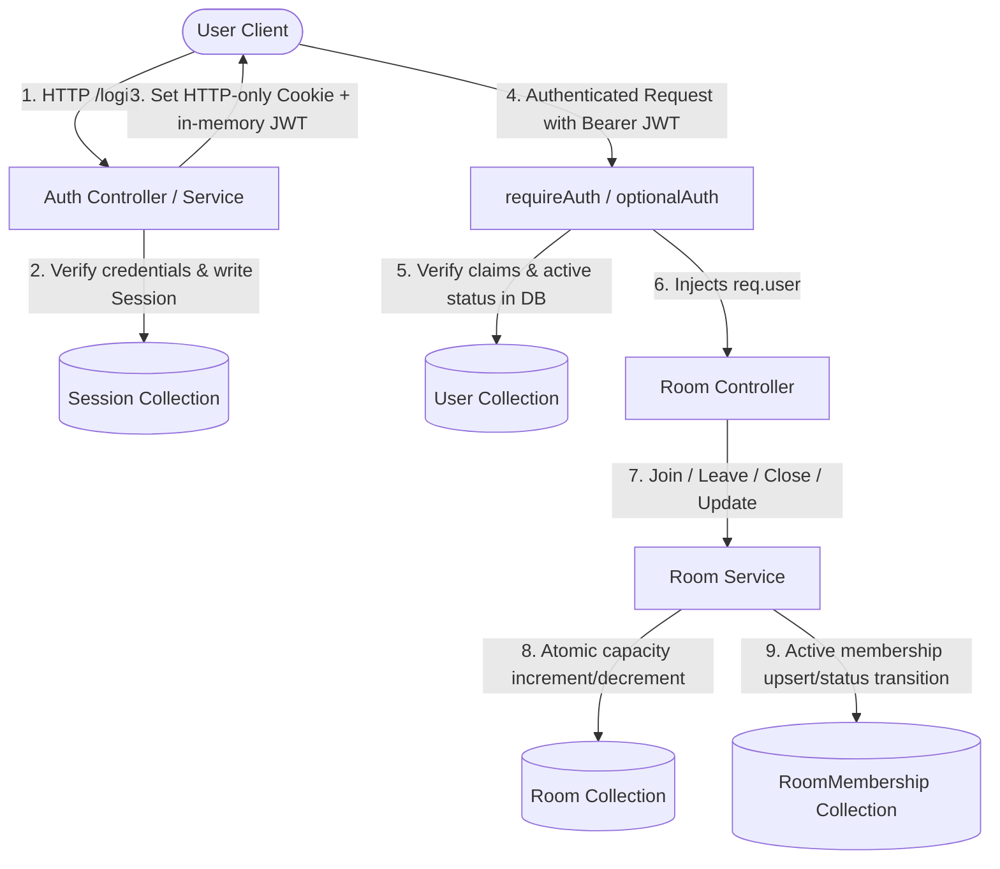

# KTV Online — Sprint 1.6 System Audit
## Integration Testing & System Hardening Review

**Date:** 2026-11-09  
**Auditor:** Senior Software Architect, Backend Engineer, Frontend Engineer & QA Engineer  
**Status:** COMPLETE  

---

## 1. Executive Summary

As KTV Online prepares for its core social entertainment differentiators—realtime voice communication (Sprint 2.0 LiveKit) and synchronized karaoke playback (Sprint 3.0)—a rigorous stabilization and hardening audit was conducted.

The audit verified actual implementations across Sprints 0 through 1.5 against architectural specifications. The audit confirmed strong foundations in monorepo setup, JWT access/refresh token rotation, atomic capacity reservation via MongoDB `$inc` and `$expr`, and frontend cache isolation.

However, several critical and high-priority cross-module race conditions, consistency edge cases, and security gaps were discovered that must be remediated in this stabilization sprint before realtime infrastructure can be safely introduced.

---

## 2. Existing Architecture & Module Boundaries

The KTV Online monorepo is structured under `pnpm`:

```
ktvonline/
├── packages/
│   └── contracts/           # Shared Zod schemas, TypeScript types, DTO contracts
├── apps/
│   ├── api/                 # Express 4, Node 22, Mongoose 8, Pino logging
│   └── web/                 # Next.js 15 App Router, React 19, TanStack Query 5, Zustand 5, Tailwind CSS v4
```

### Module Boundaries
1. **API (`apps/api`):**
   - **`modules/auth`**: User credential authentication, password hashing (`bcrypt`), session persistence with refresh token family tracking, refresh token rotation.
   - **`modules/users`**: User registration, profile retrieval, user lifecycle status (`active`, `suspended`, `offline`, `online`).
   - **`modules/rooms`**: Room creation, lifecycle management (close, update), discovery search/filtering, atomic membership join/leave, member roster queries, user participation history.
   - **`middlewares`**: `requireAuth`, `requireRole`, `optionalAuth`, `cookieParserMiddleware`, `globalRateLimiter`, `validateBody`, `validateQuery`, `errorHandler`.
   - **`routes`**: `/api/v1/auth`, `/api/v1/users`, `/api/v1/rooms`, `/api/v1/health`.
2. **Web (`apps/web`):**
   - **`lib/api`**: Centralized `ApiClient` with single-flight `AuthRefreshCoordinator` and memory-only token store (`tokenStore`).
   - **`hooks/queries`**: Typed TanStack Query hooks (`useRoom`, `useRooms`, `useRoomMembers`, `useMyRoomMembership`, `useJoinedRooms`, `useMyRooms`, `useCurrentUser`).
   - **`stores`**: `useAuthStore` (session lifecycle, user state, cache-clearing on logout), `useAppStore` (audio controls, studio state).
   - **App Router Pages**: `/` (landing), `/login`, `/register`, `/rooms` (discovery), `/rooms/[roomId]` (social lounge lobby & stage), `/rooms/[roomId]/manage` (settings), `/rooms/create`, `/my-rooms` (hosted vs joined lounges), `/profile`.
3. **Contracts (`packages/contracts`):**
   - Single source of truth for schemas: `UserDto`, `CreateUserDto`, `RoomDto`, `CreateRoomDto`, `UpdateRoomDto`, `RoomMembershipDto`, `RoomMyMembershipDto`, pagination envelopes, and error envelopes.

---

## 3. Domain Ownership & Data Flow



### Key Invariant
`Room.currentParticipantsCount === count(RoomMembership where status == 'active')`

Host inclusion rule: In KTV Online, the lounge host is considered an active participant from room creation. At room creation, `currentParticipantsCount = 1` and a `RoomMembership` record with `role: 'host'`, `status: 'active'` is created immediately.

---

## 4. Workstream Analysis & Identified Risks

### 4.1 Workstream A: Membership Consistency & Crash Recovery

#### Finding A1: Concurrent Duplicate Join Double-Increment Risk
- **Issue:** If a user submits two concurrent Join requests before either completes:
  1. Both requests query `findOne({ roomId, userId, status: 'active' })` and find nothing.
  2. Both execute `RoomModel.findOneAndUpdate({ $expr: { $lt: ['$currentParticipantsCount', '$capacity'] } }, { $inc: { currentParticipantsCount: 1 } })`.
  3. `currentParticipantsCount` is incremented **twice** (+2) for the same user.
  4. Both then execute `RoomMembershipModel.findOneAndUpdate({ roomId, userId }, { status: 'active' }, { upsert: true })`.
  5. Because the filter `{ roomId, userId }` matches the newly created document on the second execution, no duplicate key error is thrown—it simply updates the existing record again!
  6. **Result:** The user is active once, but the room participant count is inflated by 1!
- **Severity:** High
- **Remediation:** In `joinRoom`, conditionally upsert or verify membership state, and catch MongoDB unique constraint conflicts to rollback redundant increments and return `alreadyJoined: true`.

#### Finding A2: Leave Operation Crash-Consistency
- **Issue:** In `leaveRoom`, the membership status is atomically updated from `'active'` to `'left'`, and then `RoomModel.findOneAndUpdate({ $inc: { currentParticipantsCount: -1 } })` is executed.
  If the process crashes or network disconnects between these two statements, the membership is `'left'`, but `currentParticipantsCount` is never decremented.
  Retrying `leaveRoom` returns `NOT_A_MEMBER`, leaving the count permanently leaked.
- **Severity:** Medium
- **Remediation:** Implement an idempotent `RoomReconciliationService` that compares `currentParticipantsCount` against actual active memberships and restores invariant consistency.

#### Finding A3: Lack of Room Invariant Reconciliation Tooling
- **Issue:** No administrative or background mechanism exists to verify or heal drift between `currentParticipantsCount` and active memberships.
- **Severity:** Medium
- **Remediation:** Build `RoomReconciliationService` with:
  1. `reconcileRoom(roomId, dryRun)`
  2. `reconcileAllRooms(dryRun)`
  3. Administrative endpoint `POST /api/v1/rooms/reconcile` protected by `requireRole('admin')`.

---

### 4.2 Workstream B: Room Lifecycle Race Conditions

#### Finding B1: Join versus Room Closure Race Condition
- **Issue:** In `joinRoom`, step 1 checks `room.status === 'closed'`. If `closeRoom` is called right after step 3 (capacity reservation), step 4 will create an active membership in a closed room. Furthermore, when `closeRoom` executes, it marks active memberships as `'left'` but does **not** reset `currentParticipantsCount` to 0.
- **Severity:** High
- **Remediation:**
  1. In `closeRoom`, set `status: 'closed'` and `currentParticipantsCount: 0`.
  2. In `joinRoom`, verify that the room remains open during reservation; if the room was closed concurrently, rollback the reservation and return `ROOM_CLOSED`.

#### Finding B2: Join versus Capacity Reduction Race Condition
- **Issue:** In `updateRoom`, the controller validates `updateData.capacity >= room.currentParticipantsCount` in memory. If participants join concurrently between this check and `RoomModel.findByIdAndUpdate`, the update unconditionally sets the lower capacity, causing `currentParticipantsCount > capacity` (overbooking).
- **Severity:** High
- **Remediation:** The database update in `roomService.update` must conditionally update `{ _id: id, currentParticipantsCount: { $lte: newCapacity } }`. If the condition fails, return a 409 capacity conflict.

#### Finding B3: Host Departure Restriction Invariant
- **Verification:** Verified that hosts cannot leave active lounges (`HOST_CANNOT_LEAVE`, HTTP 400). Host must close room to leave.

---

### 4.3 Workstream C: Authentication & Session Hardening

#### Finding C1: Refresh Token Rotation Concurrency Gap
- **Issue:** In `auth.service.ts:refreshToken`, the service reads `session = await SessionModel.findOne({ tokenHash })` and then executes `session.isRevoked = true; await session.save()`.
  If two refresh requests with the same token arrive simultaneously (e.g. parallel 401 triggers before the first finishes), both can read `isRevoked: false`, causing duplicate active session branches in the same token family.
- **Severity:** High
- **Remediation:** Atomically revoke the session with `findOneAndUpdate({ tokenHash, isRevoked: false }, { $set: { isRevoked: true } })`. If null, check if `tokenHash` exists with `isRevoked: true` and trigger replay detection.

#### Finding C2: Cookie Security & CSRF Defense
- **Configuration:**
  - `path: '/api/v1/auth'`
  - `httpOnly: true`
  - `sameSite: 'lax'`
  - `secure: true` in production
- **Assessment:** Because the refresh cookie is restricted to `/api/v1/auth`, normal data API endpoints are not vulnerable to CSRF cookie submission. Furthermore, `SameSite: 'lax'` prevents cross-site POST requests from transmitting the cookie.

---

### 4.4 Workstream D: API Contract & Error Consistency

#### Finding D1: User Email Disclosure via Public Profile Endpoint
- **Issue:** `GET /api/v1/users/:id` executes `user.toJSON()`. In `user.model.ts`, `toJSON` deletes `passwordHash`, `_id`, and `__v`, but retains `email`.
  As a result, any unauthenticated visitor can query any user's private email address by user ID.
- **Severity:** High
- **Remediation:** Exclude `email` from public user responses unless `req.user?.id === user.id`. Public user profiles should only expose `{ id, username, avatar, role, status, createdAt }`.

#### Finding D2: Consistent Error Responses & Safe Stack Traces
- **Verification:** Verified that `errorHandler` in `error.middleware.ts` masks 500 error messages to `'Internal Server Error'` in production without leaking internal database stack traces.

---

### 4.5 Workstream E: Frontend Integration Reliability

#### Finding E1: TanStack Query Cache Isolation
- **Verification:** Verified that `getQueryClient().clear()` is invoked during `logout()` and `login()` in `useAuthStore`. This ensures that cached private lounge details, member rosters, and user profiles are completely cleared upon session termination.

#### Finding E2: Single-Flight Refresh Coordinator
- **Verification:** Verified that `authRefreshCoordinator` coalesces concurrent 401 refresh triggers into a single in-flight promise and avoids clearing sessions on transient network errors.

---

### 4.6 Workstream F: Security Review

#### Finding F1: Private Room Information Disclosure via `GET /api/v1/rooms/:id`
- **Issue:** `GET /api/v1/rooms/:id` is currently accessible without authentication. While private rooms are hidden from public discovery (`GET /api/v1/rooms`) and private member lists are protected (`GET /api/v1/rooms/:id/members`), direct access via room ID (`GET /api/v1/rooms/:id`) returns the full private room document to unauthorized users.
- **Severity:** High
- **Remediation:** Apply `optionalAuth` to `GET /api/v1/rooms/:id`. If `room.visibility === 'private'`, verify that the requester is either the room owner or an active member. If unauthorized, return `403 Forbidden` (`FORBIDDEN_PRIVATE_ROOM`).

---

### 4.7 Workstream G: Operational Readiness

#### Finding G1: Missing Request Correlation ID
- **Issue:** Incoming requests lack correlation IDs (`x-request-id`), making cross-service tracing between frontend errors and backend server logs difficult.
- **Severity:** Medium
- **Remediation:** Add a correlation ID middleware setting `req.id` from `x-request-id` header or generating a UUID, returning it in `x-request-id` response header, and logging it.

#### Finding G2: Missing Process Error Handlers in Server Bootstrap
- **Issue:** `server.ts` handles `SIGTERM` and `SIGINT`, but does not attach listeners for `unhandledRejection` and `uncaughtException`.
- **Severity:** Medium
- **Remediation:** Attach process-level handlers in `server.ts` to log fatal errors via Pino and initiate clean shutdown.

---

## 5. Prioritized Remediation Plan

| Priority | Issue | Module | Workstream |
|---|---|---|---|
| **P0 (Critical)** | Concurrent Duplicate Join Double-Increment | `apps/api/src/modules/rooms/room.service.ts` | A1 |
| **P0 (Critical)** | Private Room Information Disclosure (`GET /:id`) | `apps/api/src/modules/rooms/room.controller.ts` | F1 |
| **P1 (High)** | Join vs Capacity Reduction Race Condition | `apps/api/src/modules/rooms/room.service.ts` | B2 |
| **P1 (High)** | Join vs Room Closure Race Condition & Count Reset | `apps/api/src/modules/rooms/room.service.ts` | B1 |
| **P1 (High)** | Refresh Token Rotation Concurrency Gap | `apps/api/src/modules/auth/auth.service.ts` | C1 |
| **P1 (High)** | User Email Disclosure via Public Profile | `apps/api/src/modules/users/user.controller.ts` | D1 |
| **P2 (Medium)** | Room Invariant Reconciliation Service | `apps/api/src/modules/rooms/room-reconciliation.service.ts` | A3 |
| **P2 (Medium)** | Request Correlation ID Middleware | `apps/api/src/middlewares/correlation.middleware.ts` | G1 |
| **P2 (Medium)** | Process Unhandled Exception & Rejection Handlers | `apps/api/src/server.ts` | G2 |

---

## 6. Audit Verdict

The architecture is sound, but the identified P0 and P1 issues must be resolved and tested across the comprehensive integration test matrix before KTV Online can be declared **READY** for realtime communications.
