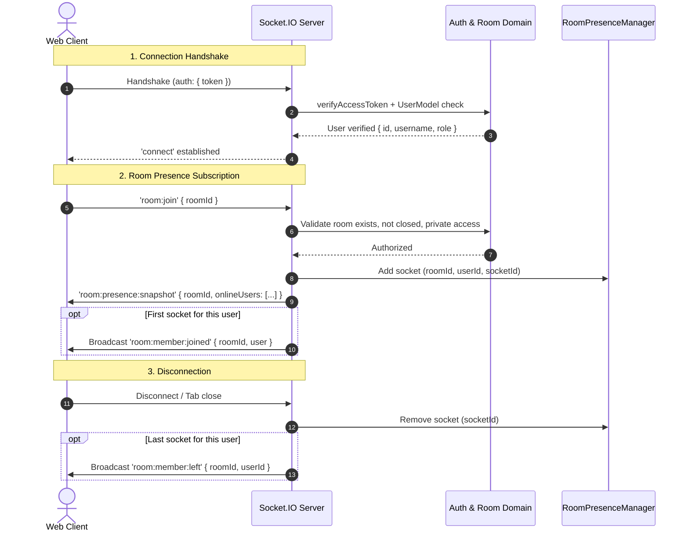

# KTV Online — Sprint 2.0 Realtime Foundation Architecture Audit

**Author:** Antigravity Architect & Senior Engineering Team  
**Date:** November 9, 2026  
**Status:** COMPLETE — ARCHITECTURE GATE REVIEW  
**Scope:** Realtime Foundation (Socket.IO) Infrastructure, Ephemeral Presence & Room Events

---

## 1. Executive Summary

Sprint 2.0 establishes the first realtime infrastructure for KTV Online using **Socket.IO**. The objective is to provide sub-second room-related event delivery, live member appearance/disappearance, ephemeral presence tracking, and resilient connection lifecycle handling without violating existing domain invariants or compromising security boundaries.

In accordance with strict system boundaries:
- **Zero Realtime Voice or Media Streaming:** WebRTC, LiveKit, audio streaming, voice chat, microphone controls, karaoke playback, song queues, and lyrics synchronization are **strictly excluded** from this sprint.
- **Zero Database Pollution:** Realtime presence is purely **ephemeral**. Sockets never write persistent presence records to MongoDB.
- **Strict Invariant Preservation:** Persistent room occupancy (`Room.currentParticipantsCount`) and persistent room membership (`RoomMembershipModel`) must **never** be modified or derived from Socket.IO connection counts or transport drop events.
- **Single Authentication Authority:** Handshake authentication and socket authorization directly leverage existing JWT tokens, verification algorithms, and domain models. No alternative tokens or secondary secrets are introduced.

This audit assesses the existing codebase, answers all nine architectural questions mandated by the sprint directive, identifies necessary modifications, and establishes the blueprint for implementation.

---

## 2. Codebase Baseline & Relevant Artifacts

### 2.1 Backend Modules Inspected (`apps/api`)
- [server.ts](file:///Users/mac/Documents/workspace/workspace_coding/ktvonline/apps/api/src/server.ts): Express server bootstrap, HTTP server instantiation (`http.createServer(app)`), and graceful shutdown coordination (`SIGTERM`, `SIGINT`, bounded 10s exit).
- [app.ts](file:///Users/mac/Documents/workspace/workspace_coding/ktvonline/apps/api/src/app.ts): Express application middleware stack, CORS whitelist (`FRONTEND_URL`, `localhost:3000`, `localhost:3001`), helmet headers, rate limiter, and error handlers.
- [config/env.ts](file:///Users/mac/Documents/workspace/workspace_coding/ktvonline/apps/api/src/config/env.ts): Strict Zod environment validation for `JWT_ACCESS_SECRET`, `JWT_REFRESH_SECRET`, `FRONTEND_URL`, and `PORT`.
- [utils/jwt.ts](file:///Users/mac/Documents/workspace/workspace_coding/ktvonline/apps/api/src/utils/jwt.ts): [`verifyAccessToken`](file:///Users/mac/Documents/workspace/workspace_coding/ktvonline/apps/api/src/utils/jwt.ts#L31) and [`signAccessToken`](file:///Users/mac/Documents/workspace/workspace_coding/ktvonline/apps/api/src/utils/jwt.ts#L17) enforcing standard payload claims (`sub`, `username`, `role`).
- [middlewares/auth.middleware.ts](file:///Users/mac/Documents/workspace/workspace_coding/ktvonline/apps/api/src/middlewares/auth.middleware.ts): [`requireAuth`](file:///Users/mac/Documents/workspace/workspace_coding/ktvonline/apps/api/src/middlewares/auth.middleware.ts#L7) verifying JWT signature and active user state in MongoDB via `UserModel.findById(sub).select('status role username')`.
- [modules/rooms/room.service.ts](file:///Users/mac/Documents/workspace/workspace_coding/ktvonline/apps/api/src/modules/rooms/room.service.ts): Room access rules, ownership validation, private room permission gates, join capacity reservation, and cleanup logic.
- [modules/rooms/membership.model.ts](file:///Users/mac/Documents/workspace/workspace_coding/ktvonline/apps/api/src/modules/rooms/membership.model.ts) and [room.model.ts](file:///Users/mac/Documents/workspace/workspace_coding/ktvonline/apps/api/src/modules/rooms/room.model.ts): Persistent data models.
- [utils/lifecycle.ts](file:///Users/mac/Documents/workspace/workspace_coding/ktvonline/apps/api/src/utils/lifecycle.ts): Application shutdown state tracker (`isAppShuttingDown`).

### 2.2 Frontend Modules Inspected (`apps/web`)
- [token-store.ts](file:///Users/mac/Documents/workspace/workspace_coding/ktvonline/apps/web/src/lib/api/token-store.ts): In-memory singleton `tokenStore` managing access token lifecycle and subscriber callbacks without `localStorage`/`sessionStorage` leaks.
- [use-auth-store.ts](file:///Users/mac/Documents/workspace/workspace_coding/ktvonline/apps/web/src/stores/use-auth-store.ts): Zustand authentication store managing `initializeSession`, `login`, `logout`, silent cookie refresh coordination, and cache clearance.
- [use-room.ts](file:///Users/mac/Documents/workspace/workspace_coding/ktvonline/apps/web/src/hooks/queries/use-room.ts): TanStack Query hooks (`useRoom`, `useRoomMembers`, `useMyRoomMembership`).
- [room-member-list.tsx](file:///Users/mac/Documents/workspace/workspace_coding/ktvonline/apps/web/src/components/shared/room-member-list.tsx): UI member roster rendering currently relying on polled/refetched HTTP snapshots.
- [page.tsx](file:///Users/mac/Documents/workspace/workspace_coding/ktvonline/apps/web/src/app/%28platform%29/rooms/%5BroomId%5D/page.tsx): Main social karaoke room view.

### 2.3 Shared Contracts Inspected (`packages/contracts`)
- [room.ts](file:///Users/mac/Documents/workspace/workspace_coding/ktvonline/packages/contracts/src/room.ts): Shared DTOs (`RoomDto`, `RoomMembershipDto`, `HostDto`) and Zod schemas.

---

## 3. Detailed Audit Findings & Core Questions

### Question 1: Where Socket.IO Should Be Initialized and Why

**Decision:**  
Socket.IO must be initialized in a dedicated backend module (`apps/api/src/realtime/socket.server.ts` or `apps/api/src/realtime/index.ts`) and bound directly to the Node.js `http.Server` created in `apps/api/src/server.ts`.

**Technical Rationale:**
1. **Transport Layer Attachment:** Socket.IO requires an underlying HTTP server instance to handle both HTTP long-polling handshakes (`GET /socket.io/?EIO=4&transport=polling`) and WebSocket connection upgrade requests (`UPGRADE /socket.io/?EIO=4&transport=websocket`).
2. **Unified Lifecycle Management:** In `apps/api/src/server.ts`, the application already implements a graceful shutdown sequence. Initializing the Socket.IO server alongside HTTP bootstrap allows `io.close()` to be cleanly invoked during `handleShutdown`:
   - It sends an engine-level disconnect packet to active sockets.
   - It stops accepting incoming socket connections.
   - It closes active transport channels before MongoDB connection teardown (`disconnectDatabase()`).
3. **Test Isolation:** Exposing a factory function `createSocketServer(httpServer, options)` enables Vitest integration tests to bind Socket.IO to ephemeral HTTP test servers on dynamic ports (`port 0`), running deterministic end-to-end socket tests against real socket clients without interfering with running development processes.

---

### Question 2: How Socket Authentication Reuses Existing JWT Verification Logic

**Decision:**  
Socket authentication will reuse the identical JWT verification and database user validation rules used by `requireAuth` in `apps/api/src/middlewares/auth.middleware.ts`, rejecting any client-supplied claims that are not cryptographically proven.

**Flow:**
1. **Handshake Auth Payload:** The client transmits the JWT access token in `socket.handshake.auth.token` (with fallback to `socket.handshake.headers.authorization`).
2. **Token Verification:**
   - A Socket.IO connection middleware (`io.use(...)`) intercepts the handshake.
   - Extracts the token and invokes `verifyAccessToken(token)` from `apps/api/src/utils/jwt.ts`.
   - Rejection cases:
     - Missing token $\rightarrow$ Error `'AUTH_TOKEN_REQUIRED'`.
     - Expired token (`TokenExpiredError`) $\rightarrow$ Error `'AUTH_TOKEN_EXPIRED'`.
     - Invalid signature/tampered token $\rightarrow$ Error `'AUTH_INVALID_TOKEN'`.
3. **Database Existence & Status Check:**
   - Queries `UserModel.findById(payload.sub).select('status role username')`.
   - If user not found $\rightarrow$ Error `'AUTH_USER_NOT_FOUND'`.
   - If `user.status !== 'active'` (suspended or inactive) $\rightarrow$ Error `'AUTH_USER_SUSPENDED'`.
4. **Context Injection:**
   - Attaches verified user context directly to `socket.data.user`:
     ```typescript
     socket.data.user = {
       id: user._id.toString(),
       username: user.username,
       role: user.role as UserRole,
     };
     ```
   - Client-provided identifiers in query parameters or handshake payloads are completely ignored.
5. **Mid-Connection Token Expiry / Revocation:**
   - Privileged socket events (`room:join`, `room:leave`) re-verify active user authorization.
   - An intentional token refresh mechanism allows clients to update their token in-flight without tearing down the underlying TCP connection unnecessarily.

---

### Question 3: How Socket Authorization Reuses Existing Room-Domain Policies

**Decision:**  
Socket subscription to room channels must not be an open broadcast subscription. Every room subscription request (`room:join`) must pass through the domain authorization gates defined in `RoomService` ([room.service.ts](file:///Users/mac/Documents/workspace/workspace_coding/ktvonline/apps/api/src/modules/rooms/room.service.ts)).

**Authorization Invariants:**
1. **Room Validity & Status:**
   - Room ID must be a valid MongoDB ObjectId.
   - Room must exist in `RoomModel`.
   - If `room.status === 'closed'`, subscription is rejected with `'ROOM_CLOSED'`.
2. **Private Room Access Control:**
   - If `room.visibility === 'public'`, any authenticated user may subscribe to room presence and public lifecycle updates.
   - If `room.visibility === 'private'`, the user **must** either be:
     - The room owner (`room.ownerId.toString() === userId`), or
     - An active member confirmed in `RoomMembershipModel` (`status: 'active'`).
   - If neither, subscription is rejected with `'FORBIDDEN_PRIVATE_ROOM'`. Knowing the room ID grants zero access.
3. **Internal Channel Isolation:**
   - Sockets join internal channel names formatted as `room:${roomId}`.
   - Clients cannot specify arbitrary Socket.IO room names or enumerate other active channels.

---

### Question 4: How Presence Is Separated from Persistent Membership

**Core Domain Principle:**  
*Presence describes active network connectivity. Membership describes authorized seat occupancy.*

```
┌────────────────────────────────────────────────────────┐
│                   MongoDB Database                     │
│  RoomModel.currentParticipantsCount (Atomic Capacity)  │
│  RoomMembershipModel (role: host/member, status: active)│
└──────────────────────────┬─────────────────────────────┘
                           │ Persistent Truth
                           │ (Mutated ONLY via REST API)
┌──────────────────────────▼─────────────────────────────┐
│                 Ephemeral Socket Presence              │
│       In-Memory RoomPresenceManager (Single Instance)  │
│       roomId -> Map<userId, Set<socketId>>             │
│       socketId -> { userId, username, roomId }         │
└────────────────────────────────────────────────────────┘
```

**Key Separations:**
- **No Count Derivation:** `Room.currentParticipantsCount` is **never** derived from Socket.IO connection counts or presence sets.
- **No Automatic Leave on Disconnect:** If a user loses internet connectivity, closes their laptop, or reloads their browser, their socket disconnects, but their `RoomMembership` record remains `status: 'active'`. They do not lose their reserved seat in the room.
- **Explicit Lifecycle:** Only an explicit user action via `POST /api/v1/rooms/:id/leave` or host action via `POST /api/v1/rooms/:id/close` updates persistent membership in the database.
- **Presence Payload:** Presence snapshots contain `{ userId, username, isOnline: boolean, deviceCount: number }`.

---

### Question 5: How Multiple Tabs and Devices Are Represented

**Design:**  
A single user may have multiple active sockets simultaneously (e.g., 2 browser tabs in the same room, or a desktop browser and mobile device).

**Data Structure in `RoomPresenceManager`:**
```typescript
// Room -> User -> Set of Socket IDs
roomUsers: Map<string, Map<string, Set<string>>>;
// Socket -> Metadata
socketMetadata: Map<string, { userId: string; username: string; roomId: string }>;
```

**Transition Semantics:**
1. **First Connection (User enters room on Tab 1):**
   - Socket `s1` joins `room:${roomId}`.
   - User's socket set in `roomUsers[roomId][userId]` transitions from `undefined` to `{ s1 }` (size 0 $\rightarrow$ 1).
   - Server emits `room:member:joined` (or `presence:updated`) to the room: user is now **online**.
2. **Subsequent Connection (User opens Tab 2 in the same room):**
   - Socket `s2` joins `room:${roomId}`.
   - User's socket set in `roomUsers[roomId][userId]` becomes `{ s1, s2 }` (size 1 $\rightarrow$ 2).
   - Server sends initial presence snapshot to Tab 2.
   - Room-wide `joined` event is **not** re-emitted because user is already marked online.
3. **Tab 1 Closes (`s1` disconnects):**
   - Socket `s1` is removed from `roomUsers[roomId][userId]`.
   - Remaining sockets: `{ s2 }` (size $\ge 1$).
   - User remains **online**. No offline notification is broadcast.
4. **Last Disconnection (Tab 2 Closes, `s2` disconnects):**
   - Socket `s2` is removed.
   - Socket set for `userId` in `roomId` is now empty and pruned from the map.
   - Server emits `room:member:left` (or `presence:updated` with `isOnline: false`) to the room.

---

### Question 6: How Reconnect and Stale Connection Cleanup Work

**1. Transport Heartbeats & Stale Socket Detection:**
- Socket.IO engine heartbeats (`pingInterval: 25000`, `pingTimeout: 20000`) automatically detect dead TCP connections (e.g., mobile device entering a tunnel or dropped WiFi).
- When a heartbeat fails or socket closes, the `disconnect` event triggers immediately.
- The `RoomPresenceManager` purges the socket ID from all room presence registries.

**2. Client Reconnection & State Recovery:**
- Upon network restoration, `socket.io-client` reconnects automatically using exponential backoff.
- The client re-executes the handshake, supplying the current access token from `tokenStore`.
- Once reconnected, the client emits `room:join` for the active room.
- The server validates room authorization, updates presence, and sends a fresh `room:presence:snapshot` back to the client.
- The client reconciles its local presence state with the authoritative server snapshot.

**3. Server Restart Behavior:**
- In-memory presence is ephemeral and will reset upon process restart.
- Upon reconnection after server restart, clients automatically rejoin rooms and repopulate the server's presence registry seamlessly within seconds.

---

### Question 7: How Frontend Socket Lifecycle Integrates with Existing Authentication

**Integration Pattern:**  
We introduce a centralized `RealtimeClient` / `SocketManager` in `apps/web/src/lib/socket/` and wire it into the authentication lifecycle:

1. **Session Initialization & Login:**
   - In `useAuthStore` ([use-auth-store.ts](file:///Users/mac/Documents/workspace/workspace_coding/ktvonline/apps/web/src/stores/use-auth-store.ts)), when `setAuth(user, token)` is called, the socket client connects with `auth: { token }`.
   - `tokenStore.subscribe((token) => ...)`: When a token is refreshed silently by `authRefreshCoordinator`, the socket's `auth.token` is updated for subsequent handshakes and reconnects.
2. **Logout & Session Expiration:**
   - In `useAuthStore.logout()` and `resetAuth()`, the socket is explicitly disconnected: `socket.disconnect()`.
   - All room listeners are unbound to prevent memory leaks and zombie event handlers.
3. **React Component Lifecycle (`RoomDetailPage`):**
   - When the user visits `/rooms/[roomId]`, a React hook (`useRoomSocket(roomId)`) emits `room:join { roomId }` once authentication is ready.
   - On unmount or route change, the hook emits `room:leave { roomId }`.
   - **Strict Mode Guard:** In development, React 19 mounts, unmounts, and remounts components. The hook must debounce or track active subscription state to avoid redundant join/leave thrashing.

---

### Question 8: Whether Any Existing Implementation Needs Modification

| Module | Location | Required Modification | Rationale |
|---|---|---|---|
| `packages/contracts` | `packages/contracts/src/` | Add `realtime.ts` (exporting event names, Zod schemas, payload types) | Shared type-safety across backend and frontend |
| `apps/api/package.json` | `apps/api/` | Add dependency `socket.io` (v4.8+) | Backend WebSocket/Engine.IO server |
| `apps/web/package.json` | `apps/web/` | Add dependency `socket.io-client` (v4.8+) | Frontend realtime client |
| `apps/api/src/server.ts` | `apps/api/src/server.ts` | Attach `initSocketServer(server)` and add `await closeSocketServer()` to `handleShutdown` | Unified process lifecycle and graceful teardown |
| `apps/api/src/config/env.ts` | `apps/api/src/config/env.ts` | Support CORS origin configuration aligned with Socket.IO requirements | Secure cross-origin socket connections |
| `apps/web/src/components/shared/room-member-list.tsx` | `apps/web/src/components/shared/` | Accept `onlineUserIds` set from presence hook to display green "Online" indicator vs grey "Offline" for active room members | Seamless visual presence integration |
| `apps/web/src/app/(platform)/rooms/[roomId]/page.tsx` | `apps/web/src/app/(platform)/rooms/[roomId]/` | Connect to room socket events, update presence, and display live room notifications | Live participant awareness |

*Note:* No database schema, Mongoose models, or database indexes require modification.

---

### Question 9: Architectural Risks & Deployment Constraints

1. **Single-Instance In-Memory Presence Limitation:**  
   - *Risk:* In-memory presence tracking is strictly single-node. If horizontal scaling is introduced (multiple API pods behind a load balancer), sockets connected to Pod A would not see events from Pod B without a shared pub/sub layer.  
   - *Mitigation:* We design `RoomPresenceManager` behind a clean interface (`IPresenceAdapter`). When multi-pod scaling is required in future sprints, a Redis adapter (`@socket.io/redis-adapter`) can replace the in-memory adapter without modifying room domain services or event handlers.
2. **Reverse Proxy & WebSocket Upgrades:**  
   - *Risk:* Production reverse proxies (NGINX, Cloudflare, AWS ALB) drop WebSocket upgrades if `Upgrade` and `Connection` headers are not passed. If HTTP long-polling is used without sticky sessions, requests from the same client may hit different nodes.  
   - *Mitigation:* Document deployment configuration; default Socket.IO client to prefer `transports: ['websocket', 'polling']`; ensure reverse proxy forwards `$http_upgrade`.
3. **Payload Spoofing & Denial of Service:**  
   - *Risk:* Malicious clients emitting oversized payloads or rapid-fire event floods.  
   - *Mitigation:* Set `maxHttpBufferSize: 1e6` (1MB max), validate all incoming socket payloads with Zod schemas, and enforce an event rate limiter on socket messages.

---

## 4. Proposed Socket Event Architecture

### 4.1 Event Names & Payloads



### 4.2 Shared Event Catalog (`packages/contracts`)

1. **Client $\rightarrow$ Server:**
   - `room:join`: `{ roomId: string }`
   - `room:leave`: `{ roomId: string }`
   - `room:presence:request`: `{ roomId: string }`
2. **Server $\rightarrow$ Client:**
   - `room:presence:snapshot`: `{ roomId: string, members: Array<{ userId: string, username: string, isOnline: boolean }> }`
   - `room:member:joined`: `{ roomId: string, user: { id: string, username: string, avatar?: string | null } }`
   - `room:member:left`: `{ roomId: string, userId: string }`
   - `room:closed`: `{ roomId: string, reason: string }`
   - `error`: `{ code: string, message: string }`

---

## 5. Audit Conclusion & Implementation Plan

The architecture audit confirms that:
1. The existing authentication, room service, and error-handling modules provide an exceptional foundation that can be extended to Socket.IO without architectural compromises.
2. The domain invariants established in Sprints 1.5, 1.6, and 1.6.1 are fully respected by keeping presence ephemeral and separating transport connection from persistent seat reservation.
3. Socket.IO integration is technically sound, feasible, and ready for immediate implementation.

### Implementation Phases:
- **Phase 1: Dependencies & Contracts** — Install `socket.io` in API, `socket.io-client` in Web, and declare typed contracts and Zod schemas in `@ktv/contracts`.
- **Phase 2: Backend Realtime Infrastructure** — Implement `RoomPresenceManager`, Socket.IO authentication middleware, room authorization handlers, and HTTP server lifecycle binding.
- **Phase 3: Frontend Realtime Client** — Implement socket connection manager, authentication synchronization, and `useRoomPresence` hook.
- **Phase 4: UI Integration** — Integrate live presence badges and realtime member updates into `/rooms/[roomId]`.
- **Phase 5: Automated Testing & Verification** — Deterministic unit/integration test suites for all 20 required backend scenarios and frontend client behaviors.
- **Phase 6: Quality Gates & Documentation** — Pass `test`, `typecheck`, `lint`, `build` and create `docs/SPRINT_2_0_IMPLEMENTATION_REPORT.md`.
