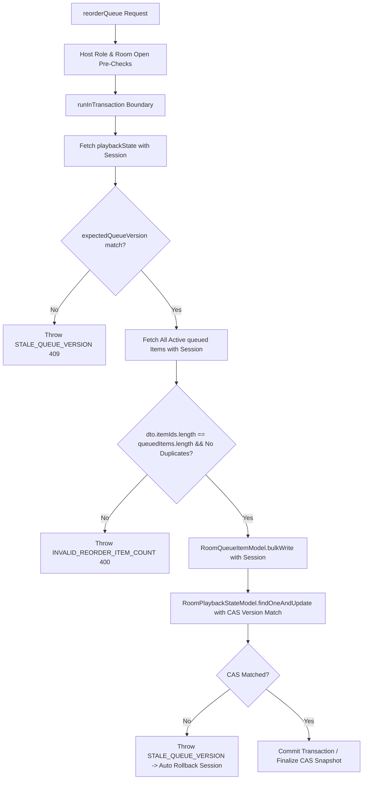

# Sprint 2.4.1.1 — Final Implementation Report: Karaoke Consistency Protocol Verification & Hardening

## 1. Source Audit Findings

A rigorous source audit of the Sprint 2.4.1 codebase identified several structural vulnerabilities where consistency guarantees were nominal rather than enforced:

1. **Queue Reorder Atomicity Void**:
   `RoomQueueItemModel.bulkWrite()` was executed outside a MongoDB transaction. In standalone deployments or without session isolation, sequential operations could interleave with concurrent song additions or removals, leading to corrupted queue positions. Furthermore, omitting items from `dto.itemIds` would cause position duplication because existing items retained old indices.
2. **Missing Outcome Lease Verification**:
   While `KaraokePlaybackWorker` claimed leases via `claimDuePlayback`, the outcome write in `advanceToNextTrack` did not check the `leaseToken` or lease expiration during commit. A worker paused by GC or network latency exceeding the 15-second lease could still commit after another worker had taken over.
3. **Double Track Advancement Race**:
   Involuntary races between a host `skip` and an in-memory precision timer firing could both attempt to advance playback if the timer did not fence against the expected `currentQueueItemId`.
4. **Reconciliation Incompleteness & Stomping Risk**:
   Reconciliation did not detect stray playing items when playback was idle, did not sweep expired worker leases, and used plain `save()` calls that risked stomping concurrent user commands.

All of these vulnerabilities have been addressed and hardened in Sprint 2.4.1.1.

---

## 2. Reorder Atomicity Proof from Implementation Structure

In [karaoke.service.ts](file:///Users/mac/Documents/workspace/workspace_coding/ktvonline/apps/api/src/modules/karaoke/karaoke.service.ts), `reorderQueue` implements multi-layer atomicity:



### Structural Proof:
1. **Transaction Session Propagation**:
   Every database query (`find`, `bulkWrite`, `findOneAndUpdate`) accepts `session || null`. On replica set deployments, the entire sequence commits as a single ACID transaction. If an error occurs, the session aborts and rolls back all position updates.
2. **Full Coverage Invariant**:
   `dto.itemIds.length === queuedItems.length` and `new Set(dto.itemIds).size === dto.itemIds.length` are checked prior to `bulkWrite`. Partial reorders are rejected with `INVALID_REORDER_ITEM_COUNT`, guaranteeing that no item can be left with an un-updated duplicate position.
3. **Atomic CAS Version Advancement**:
   Advancing `queueVersion` uses `findOneAndUpdate({ roomId, queueVersion: expectedVersion })`. If a concurrent add or remove interleaves, the CAS filter matches 0 documents and throws `STALE_QUEUE_VERSION`, aborting the transaction.

---

## 3. Queue/Playback Transaction Boundaries

The system adopts a **Dual-Mode Transaction / CAS Protocol** via [runInTransaction](file:///Users/mac/Documents/workspace/workspace_coding/ktvonline/apps/api/src/database/transaction.ts):

- **Replica Set Deployments**:
  - `startSession()` creates a client session.
  - Operations execute inside `session.withTransaction(...)`.
  - Atomically commits all changes across `RoomQueueItem`, `RoomPlaybackState`, and `Room`.
- **Standalone Deployments**:
  - `runInTransaction` automatically detects standalone MongoDB and runs with `session: null`.
  - Mutations execute under atomic CAS filters (`commitConditionalPlaybackTransition`).
  - If a step fails, compensation rollbacks restore prior state, and `KaraokeReconciliationService` resolves any transient drift.

---

## 4. Worker Lease Fencing Mechanism

Distributed worker leasing in [KaraokePlaybackWorker](file:///Users/mac/Documents/workspace/workspace_coding/ktvonline/apps/api/src/modules/karaoke/karaoke-playback.worker.ts) and [RoomPlaybackStateModel](file:///Users/mac/Documents/workspace/workspace_coding/ktvonline/apps/api/src/modules/karaoke/room-playback-state.model.ts) is now strictly fenced on both acquisition and commit:

1. **Acquisition**:
   `claimDuePlayback(instanceId, 15000)` claims overdue playbacks with an atomic `findOneAndUpdate` setting `claimedBy`, `leaseToken: UUID`, `leaseExpiresAt: now + 15s`, and incrementing `leaseVersion`.
2. **Conditional Outcome Write ([commitConditionalPlaybackTransition](file:///Users/mac/Documents/workspace/workspace_coding/ktvonline/apps/api/src/modules/karaoke/room-playback-state.model.ts))**:
   The commit query enforces:
   ```ts
   filter = {
     roomId,
     playbackVersion: expectedPlaybackVersion,
     leaseToken: options.leaseToken,
     leaseExpiresAt: { $gt: new Date() },
     currentQueueItemId: options.expectedCurrentQueueItemId,
   }
   ```
3. **Proof of Stale Worker Invalidation**:
   If a worker's execution exceeds 15 seconds, `leaseExpiresAt <= now`. The commit query matches **zero** documents and returns `null`. The expired worker cannot commit its outcome, preventing duplicate advancement.

---

## 5. Completion Idempotency & Advancement Safety

- **Double Advancement Protection**:
  When a host clicks `skip`, it executes `advanceToNextTrack` with `expectedCurrentQueueItemId: currentItemId`.
  If an in-memory precision timer or lease worker fires simultaneously, only the first to commit succeeds and increments `playbackVersion`. The second fails version/item fencing and returns `null` safely without advancing a second track.
- **In-Memory Timers as Optimizations**:
  Precision timers provide responsive sub-second UI transitions. If a timer is dropped due to process restart or network blip, the polling lease worker automatically recovers the overdue song within 2000ms.

---

## 6. Lifecycle Race Handling

- **Member Departure & Kick**:
  Both `leaveRoom` and `kickMember` invoke `handleMemberDeparted(roomId, userId)`. All pending songs are removed, positions are rebalanced, and if the user was the active singer, playback advances with `expectedCurrentQueueItemId` fencing. If called concurrently or redundantly, the operation is idempotent.
- **Room Closure**:
  `closeRoom` purges all active queue items, resets playback to `idle`, cancels all precision timers, and increments `playbackVersion`. All queue and playback mutations verify `room.status !== 'closed'`, immediately rejecting commands for closed rooms with `FORBIDDEN_ROOM_CLOSED`.

---

## 7. Reconciliation Behavior

[KaraokeReconciliationService](file:///Users/mac/Documents/workspace/workspace_coding/ktvonline/apps/api/src/modules/karaoke/karaoke-reconciliation.service.ts) detects and repairs:
1. Closed rooms with lingering active queue or playback state.
2. Multiple playing items (deduplicated to 1; extras set to `skipped`).
3. Stray playing queue items when playback state is `idle` (`QUEUE_PLAYING_ITEM_WITH_IDLE_PLAYBACK`).
4. Playback marked `playing` with zero playing queue items.
5. Playback pointing to missing, foreign, or terminal queue items.
6. Overdue playback exceeding song duration.
7. Queue position gaps or duplicate positions (rebalanced to $1 \dots N$).
8. Expired or orphaned worker leases (`releaseExpiredLeases()`).
9. **CAS-Protected Repairs**: All repairs update documents via `commitConditionalPlaybackTransition` or version-matched filters, guaranteeing reconciliation never overwrites concurrent active user commands.
10. **Committed State Publication**: Broadcasts updated snapshots to Socket.IO only after database updates commit.

---

## 8. Realtime Publication Consistency

- Realtime Socket.IO events (`karaoke:queue:updated`, `karaoke:playback:updated`, `karaoke:snapshot`) are broadcast only **after** database transactions or CAS operations commit.
- Broadcast payloads carry committed `playbackVersion` and `queueVersion`.
- Clients discard out-of-order events where `version < localVersionRef`.
- On socket reconnect, client emits `karaoke:state:request` to recover the latest server snapshot.

---

## 9. Files Changed

### Created
- [apps/api/src/database/transaction.ts](file:///Users/mac/Documents/workspace/workspace_coding/ktvonline/apps/api/src/database/transaction.ts): Transaction runner supporting replica set ACID transactions with fallback to recoverable CAS protocols.
- [docs/SPRINT_2_4_1_1_AUDIT.md](file:///Users/mac/Documents/workspace/workspace_coding/ktvonline/docs/SPRINT_2_4_1_1_AUDIT.md): Detailed consistency protocol audit.
- [docs/SPRINT_2_4_1_1_IMPLEMENTATION_REPORT.md](file:///Users/mac/Documents/workspace/workspace_coding/ktvonline/docs/SPRINT_2_4_1_1_IMPLEMENTATION_REPORT.md): This implementation report.

### Modified
- [apps/api/src/modules/karaoke/room-playback-state.model.ts](file:///Users/mac/Documents/workspace/workspace_coding/ktvonline/apps/api/src/modules/karaoke/room-playback-state.model.ts): Added `commitConditionalPlaybackTransition` and `releaseExpiredLeases` statics.
- [apps/api/src/modules/karaoke/karaoke-playback.worker.ts](file:///Users/mac/Documents/workspace/workspace_coding/ktvonline/apps/api/src/modules/karaoke/karaoke-playback.worker.ts): Updated precision timer and polling worker to pass `expectedCurrentQueueItemId` and `leaseToken` for outcome fencing.
- [apps/api/src/modules/karaoke/karaoke.service.ts](file:///Users/mac/Documents/workspace/workspace_coding/ktvonline/apps/api/src/modules/karaoke/karaoke.service.ts): Implemented transaction boundaries, full coverage reorder validation, and conditional outcome writes in `advanceToNextTrack` and playback commands.
- [apps/api/src/modules/karaoke/karaoke.controller.ts](file:///Users/mac/Documents/workspace/workspace_coding/ktvonline/apps/api/src/modules/karaoke/karaoke.controller.ts): Added `INVALID_REORDER_ITEM_COUNT` and `INVALID_REORDER_ITEM_ID` error mappings (HTTP 400).
- [apps/api/src/modules/karaoke/karaoke-reconciliation.service.ts](file:///Users/mac/Documents/workspace/workspace_coding/ktvonline/apps/api/src/modules/karaoke/karaoke-reconciliation.service.ts): Added CAS repairs, stray playing item cleanup on idle playback, expired lease cleanup, and post-commit socket publication.
- [apps/api/src/server.ts](file:///Users/mac/Documents/workspace/workspace_coding/ktvonline/apps/api/src/server.ts): Probes MongoDB transaction capability during startup sequence.
- [docs/KARAOKE_PLAYBACK_CONSISTENCY.md](file:///Users/mac/Documents/workspace/workspace_coding/ktvonline/docs/KARAOKE_PLAYBACK_CONSISTENCY.md): Updated consistency specifications and transition protection matrix.
- [docs/KARAOKE_PLAYBACK_ARCHITECTURE.md](file:///Users/mac/Documents/workspace/workspace_coding/ktvonline/docs/KARAOKE_PLAYBACK_ARCHITECTURE.md): Updated concurrency guarantees.

---

## 10. Static Verification Results

In compliance with mandatory engineering constraints, no tests or test runners were executed.

| Command | Working Directory | Exit Code | Result |
| :--- | :--- | :---: | :--- |
| `pnpm typecheck` | `/Users/mac/Documents/workspace/workspace_coding/ktvonline` | **0** | PASSED (`@ktv/contracts`, `@ktv/api`, `@ktv/web`) |
| `pnpm lint` | `/Users/mac/Documents/workspace/workspace_coding/ktvonline` | **0** | PASSED (0 warnings, 0 errors) |

---

## 11. Deferred Runtime Scenarios

Because this sprint is strictly code-only, the following runtime scenarios remain deferred to staging/QA verification:
1. Multi-worker lease contention under high concurrency ($>500$ rooms per second).
2. Network partition recovery during replica set failover with active transactions.
3. Rapid concurrent host reorders executed simultaneously across multiple WebSocket clients.
4. Stress testing standalone MongoDB fallback under ungraceful SIGKILL process termination.

---

## 12. Remaining Limitations

1. **Standalone MongoDB Deployments**: Without a replica set, multi-document writes rely on Compare-And-Swap filters and compensation rollbacks rather than native database-level ACID transactions.
2. **Server Clock Synchronization**: Server instances must run NTP to keep clock drift below 2 seconds for distributed lease evaluation.

---

## 13. Final Verdict

**`CODE COMPLETE — NOT RUNTIME VERIFIED`**
