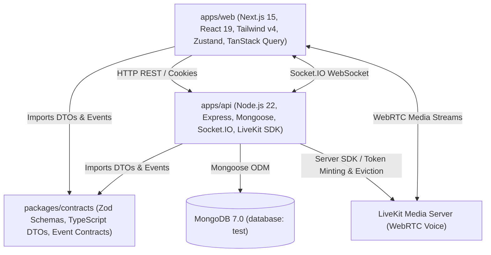
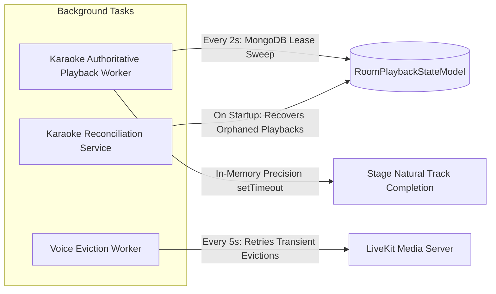

# KTVOnline — Sprint 4.0: Architecture Baseline

**Audit Date:** November 2026  
**Repository Baseline Commit:** `7cdb1195669b7f58993c3b0eb6886e00cfbe3170` (Sprint 3.10 Completion)  
**Working-Tree Status:** Clean  
**Database Name:** `test` (Preserved)

---

## 1. System Overview & Monorepo Topology

KTVOnline is architected as a pnpm workspace monorepo consisting of two application tiers and a shared contract package:

### Directory Structure & Responsibilities

| Package | Path | Runtime / Framework | Primary Responsibility |
| :--- | :--- | :--- | :--- |
| **`@ktv/contracts`** | `packages/contracts` | TypeScript (ESM/CJS) | Single source of truth for Zod schemas, REST DTOs, Socket.IO event names, presence contracts, and shared domain types. |
| **`@ktv/api`** | `apps/api` | Node.js 22, Express | Authoritative domain logic, authentication, room lifecycle, karaoke queue and playback scheduling, moderation, and WebRTC token issuance. |
| **`@ktv/web`** | `apps/web` | Next.js 15 App Router, React 19 | Client application, room discovery, lounge stage, audio visualizer, synchronized lyrics, voice controls, chat, and audience interaction overlays. |

---

## 2. Module Boundaries & Entry Points

### 2.1 Backend (`apps/api`)

- **Server Entry Point:** [`apps/api/src/server.ts`](file:///Users/mac/Documents/workspace/workspace_coding/ktvonline/apps/api/src/server.ts)
  - Creates HTTP server and mounts Express app ([`createApp()`](file:///Users/mac/Documents/workspace/workspace_coding/ktvonline/apps/api/src/app.ts)).
  - Binds Socket.IO server ([`createSocketServer()`](file:///Users/mac/Documents/workspace/workspace_coding/ktvonline/apps/api/src/realtime/socket.server.ts)).
  - Connects to MongoDB (`connectDatabase()`) and verifies transaction support.
  - Seeds fixture song catalog ([`songService.ensureSeedSongs()`](file:///Users/mac/Documents/workspace/workspace_coding/ktvonline/apps/api/src/modules/karaoke/song.service.ts)).
  - Executes initial room playback state reconciliation ([`karaokeReconciliationService.reconcileAllActiveRooms()`](file:///Users/mac/Documents/workspace/workspace_coding/ktvonline/apps/api/src/modules/karaoke/karaoke-reconciliation.service.ts)).
  - Launches background workers:
    - [`voiceEvictionWorker.start()`](file:///Users/mac/Documents/workspace/workspace_coding/ktvonline/apps/api/src/modules/voice/voice-eviction.worker.ts)
    - [`karaokePlaybackWorker.start()`](file:///Users/mac/Documents/workspace/workspace_coding/ktvonline/apps/api/src/modules/karaoke/karaoke-playback.worker.ts)
  - Handles graceful shutdown (`SIGTERM`, `SIGINT`) with bounded 10-second timeout.

- **Modular Domain Services:**
  1. **`auth`:** Session management, refresh token rotation, bcrypt password hashing, JWT access/refresh token signing.
  2. **`users`:** User model, profile customization, display names, bios, karaoke preferences.
  3. **`rooms`:** Lounge creation, update, closure, membership transitions, host transfers, lock status, state outbox, and version-fenced snapshot reads.
  4. **`karaoke`:** Song catalog, audio availability, queue management, performer assignment, precision timers, distributed playback leases, and song transitions.
  5. **`voice`:** LiveKit WebRTC access token generation, participant session registry, server-side mute enforcement, and participant eviction.
  6. **`chat`:** Persistent chat messaging, domain activity feed, message reactions, and moderation audit trail.
  7. **`realtime`:** Socket authentication handshake, presence manager, room channels, stage cheer reactions, and virtual gifting.

### 2.2 Frontend (`apps/web`)

- **Root Layout & Providers:** [`apps/web/src/app/layout.tsx`](file:///Users/mac/Documents/workspace/workspace_coding/ktvonline/apps/web/src/app/layout.tsx)
  - TanStack Query provider ([`query-provider.tsx`](file:///Users/mac/Documents/workspace/workspace_coding/ktvonline/apps/web/src/providers/query-provider.tsx)).
  - Authentication initializer ([`auth-initializer.tsx`](file:///Users/mac/Documents/workspace/workspace_coding/ktvonline/apps/web/src/components/auth/auth-initializer.tsx)).
- **Primary Routes:**
  - `/` — Landing page with featured lounges and quick entry.
  - `/rooms` — Lounge discovery, search, category filters, and preview modals.
  - `/rooms/[roomId]` — Live virtual karaoke lounge: full stage, synchronized lyrics, audio visualizer, LiveKit voice mesh, queue management, chat, and audience interaction.
  - `/profile` — Identity customization, preferences, and account overview.
  - `/my-rooms` — Hosted and joined lounge management.

---

## 3. Configuration & Environment Variables

| Variable | Package | Default Value | Purpose |
| :--- | :--- | :--- | :--- |
| `NODE_ENV` | `api`, `web` | `development` | Runtime environment mode (`development`, `production`, `test`, `staging`). |
| `PORT` | `api` | `5001` | Express & Socket.IO HTTP listening port. |
| `MONGODB_URI` | `api` | `mongodb://127.0.0.1:27017/ktv_online` | MongoDB connection string. Tests preserve database `test`. |
| `JWT_ACCESS_SECRET` | `api` | Dev Default (min 16 chars) | Secret for 15-minute access JWTs. |
| `JWT_REFRESH_SECRET` | `api` | Dev Default (min 16 chars) | Secret for 7-day refresh JWTs. |
| `FRONTEND_URL` | `api` | `http://localhost:3000` | Allowed CORS origin and redirection base. |
| `LIVEKIT_URL` | `api`, `web` | `ws://localhost:7880` | LiveKit media server connection URL. |
| `LIVEKIT_API_KEY` | `api` | `devkey` | LiveKit server SDK API key. |
| `LIVEKIT_API_SECRET` | `api` | `secret` | LiveKit server SDK API secret. |
| `NEXT_PUBLIC_API_URL` | `web` | `http://localhost:5001/api/v1` | Backend REST API endpoint for frontend client. |
| `NEXT_PUBLIC_SOCKET_URL`| `web` | Derived from API URL | Socket.IO connection origin. |

---

## 4. Background Processes & Timers

1. **Authoritative Playback Worker:**
   - Evaluates active playbacks every 2,000ms using distributed leases (`claimDuePlayback`) in MongoDB.
   - Maintains node-local precision in-memory timers (`setTimeout`) to trigger sub-second track transitions exactly when duration expires.
2. **Voice Eviction Worker:**
   - Polls `VoiceEvictionTaskModel` every 5,000ms.
   - Retries transient failures when revoking LiveKit tokens or disconnecting kicked/departed participants.
3. **Karaoke Startup Reconciliation:**
   - Runs once during server bootstrap. Resets expired playbacks, recovers stuck tracks, and aligns queue states.
