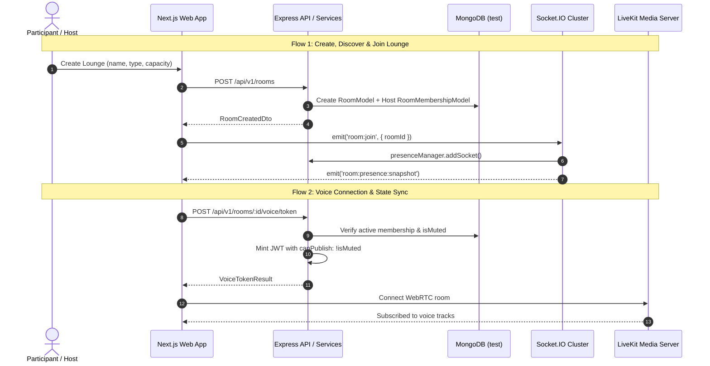
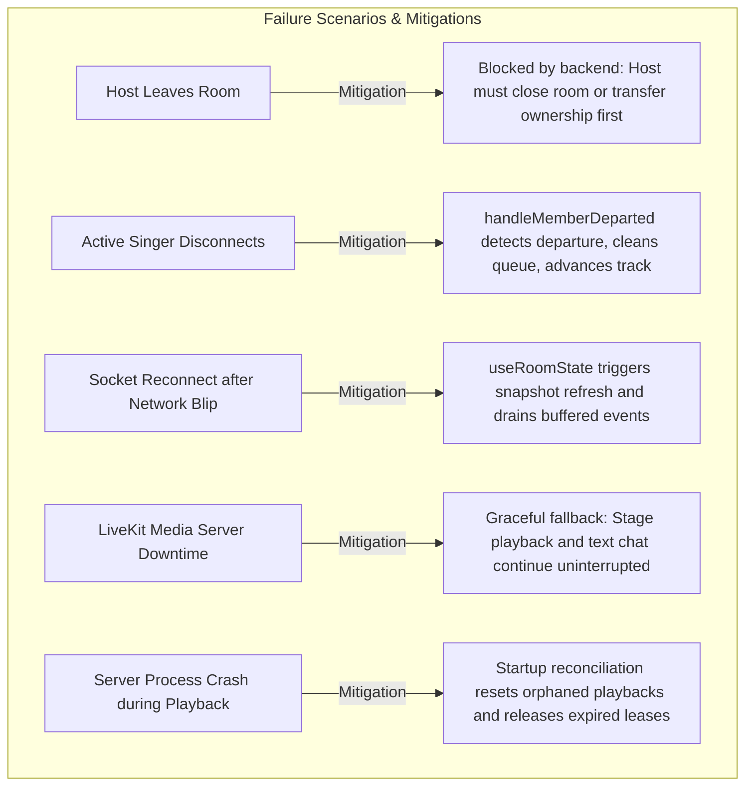

# KTVOnline — Sprint 4.0: Comprehensive Integration & Architecture Audit

**Audit Date:** November 2026  
**Baseline Commit:** `7cdb1195669b7f58993c3b0eb6886e00cfbe3170`  
**Scope:** Cross-subsystem integration, state consistency, failure recovery, resource lifecycles, and deployment scalability.

---

## 1. End-to-End Flow Tracing



### Flow 1: Create and Join Room
1. **User Action:** Host initiates lounge creation via form.
2. **Frontend State:** TanStack Query `useCreateRoom()` mutates `/api/v1/rooms` and navigates to `/rooms/[roomId]`.
3. **Backend Service:** [`room.service.ts:create()`](file:///Users/mac/Documents/workspace/workspace_coding/ktvonline/apps/api/src/modules/rooms/room.service.ts) creates `RoomModel` (`currentParticipantsCount: 1, stateVersion: 1`) and `RoomMembershipModel` (`role: 'host', status: 'active'`).
4. **Client Join:** Visitor clicks "Join Lounge".
   - `POST /api/v1/rooms/:id/join` executes atomic CAS capacity reservation on `RoomModel`.
   - Creates or reactivates `RoomMembershipModel` (`status: 'active'`).
   - Increments `stateVersion` (+1) and publishes versioned `member.joined` via `publishRoomStateEvent()`.
   - Records `member_joined` activity in chat timeline.
5. **Realtime Handshake:** Client connects Socket.IO, emits `room:join`, registers in `presenceManager`, and receives initial `presence:snapshot`.
6. **Voice Entry:** Client requests voice token (`POST /api/v1/rooms/:id/voice/token`), verifies active membership, and connects to LiveKit room.
- **Identified Failure Point:** If socket reconnects before membership is committed, socket join is accepted as viewer rather than member until snapshot refresh.
- **Recovery:** `useRoomState` detects version mismatch and refreshes authoritative snapshot.

### Flow 2: Leave and Rejoin Room
1. **Normal Departure:** Member confirms leave in dialog.
   - Client calls `voice.leaveVoice()` (disconnects LiveKit).
   - Calls `POST /api/v1/rooms/:id/leave`.
   - Backend atomically transitions `RoomMembershipModel` status to `'left'`, decrements `currentParticipantsCount`, advances `stateVersion`, and publishes `member.left`.
   - Backend non-blockingly triggers `voiceService.evictLiveKitParticipant()` and advances stage playback if leaving user was singer.
2. **Unexpected Disconnection:**
   - Network drop disconnects Socket.IO: `presenceManager.removeSocket()` decrements online count and emits `room:member:left` (ephemeral presence notification). Membership remains active in database.
   - When socket reconnects: `useRoomState` handles `connect` event, re-joins room channel, and calls `getRoomStateSnapshot()`.
- **Identified Integration Defect (INT-01):** In `apps/web/src/hooks/use-room-state.ts`, the `useEffect` cleanup function removes event listeners but **does NOT emit `SOCKET_EVENTS.CLIENT.ROOM_LEAVE`** to the server. When a user navigates away from a room, their socket remains in the server room channel until the tab is closed, keeping backend presence counts artificially inflated.

### Flow 3: Queue and Singer Handoff
1. **Track Addition:** User selects song from catalog dialog.
   - `POST /api/v1/rooms/:id/queue` validates active membership.
   - If room playback is idle and audio is available: activates immediately to stage, creates `RoomQueueItemModel` with `status: 'playing'`, sets `RoomPlaybackStateModel` to `status: 'playing'`, schedules precision timer, and updates `room.currentSingerName`.
   - Otherwise: appends to queue (`status: 'queued'`).
   - Broadcasts `karaoke:queue:updated`.
2. **Track Completion & Handoff:**
   - When duration expires, `karaokePlaybackWorker` precision timer triggers `advanceToNextTrack()`.
   - Atomically transitions current item to `status: 'completed'`.
   - Finds candidate item with lowest position.
   - **Active Membership Verification:** Verifies candidate singer or requester is still an active member. If departed/kicked, marks candidate `removed` and moves to next song.
   - Atomically claims candidate to `status: 'playing'`, updates playback anchor, and broadcasts `karaoke:playback:updated`.

### Flow 4: Playback Synchronization
1. **Server Anchor Authority:**
   - Server stores `anchorStartedAt` (Date) and `positionMs` on `RoomPlaybackStateModel`.
2. **Client Clock Alignment:**
   - Client calculates expected position: `currentPositionMs = (Date.now() + clockSync.offsetMs) - anchorStartedAt`.
   - `clock-sync.service.ts` continuously samples round-trip times and maintains median offset against server time.
   - If audio element drift exceeds 250ms, client performs corrective seek.
3. **Late Joiner Recovery:**
   - Client fetches `GET /api/v1/rooms/:id/playback`, initializes audio source at calculated offset, and highlights active lyric line.

### Flow 5: Room Moderation (Role Update, Mute, Kick)
1. **Role Update:** Host promotes member to moderator (`PATCH /api/v1/rooms/:id/members/:userId/role`). `stateVersion` advances, `room.member.role.updated` broadcast, activity logged.
2. **Mute Enforcement:** Moderator mutes participant (`POST /api/v1/rooms/:id/members/:userId/mute`).
   - `RoomMembershipModel.isMuted` set to `true`.
   - `voiceService.muteLiveKitParticipant()` calls LiveKit SDK: sets `canPublish: false` and calls `mutePublishedTrack()`.
   - Client `VoiceControls` receives `isServerMuted: true` and disables microphone toggle.
   - If muted participant attempts to refresh or request new token, backend embeds `canPublish: false` in the signed JWT.
3. **Kick Enforcement:** Moderator removes member (`POST /api/v1/rooms/:id/members/:userId/kick`).
   - Membership set to `status: 'left', kickedAt: Date.now()`.
   - LiveKit participant evicted immediately.
   - Queued tracks removed; if active singer, stage advances to next song.
   - Subsequent socket or API join requests rejected with `FORBIDDEN_KICKED`.

### Flow 6: Host Transfer
1. **Ownership Handover:** Current host selects active member (`POST /api/v1/rooms/:id/transfer-host`).
2. **Atomic Transition:**
   - `RoomModel.ownerId` reassigned to target user.
   - Old host membership updated to `role: 'moderator'`.
   - New host membership updated to `role: 'host'`.
   - `stateVersion` incremented (+1) and `room.host.transferred` published.
3. **Client Refresh:** Frontend updates host badge, transfers room control actions, and refreshes permission checks.

### Flow 7: Realtime Audience Interaction
1. **Stage Cheer Reactions:** Ephemeral, sliding-window rate-limited (max 5 per 2s). Validates active room membership. Broadcast to all clients; zero database writes.
2. **Virtual Appreciation Gifts:** Ephemeral animation, sliding-window rate-limited (max 3 per 5s). Validates recipient is current performer or room host. Recorded in chat timeline. Zero monetization.

---

## 2. Source-of-Truth & Consistency Matrix

| State Entity | Authoritative Owner | Replicas / Consumers | Synchronization Mechanism | Known Risk & Resolution |
| :--- | :--- | :--- | :--- | :--- |
| **Room Ownership** | `RoomModel.ownerId` | `RoomMembershipModel.role`, `useRoomState.host` | Versioned `room.host.transferred` event | Cache desync on transfer -> Handled via `stateVersion` invalidation. |
| **Room Membership** | `RoomMembershipModel` (`status: 'active'`) | `useRoomState.members` | Versioned `member.joined` / `member.left` / `member.kicked` | Stale membership -> Handled via version-fenced read loop. |
| **Participant Count** | `RoomModel.currentParticipantsCount` | Discovery cards, Header badge | Atomically updated on join/leave/kick | **Counter drift** -> Repaired via CAS reconciliation in `getRoomStateSnapshot`. |
| **Online Presence** | `RoomPresenceManager` (Memory) | Socket.IO rooms, `useRoomState.onlineUserIds` | `room:presence:snapshot`, `room:member:joined/left` | **Leaked presence** -> Clients navigating away without emitting `room:leave` linger in memory. |
| **Voice Connection** | LiveKit Media Server | `useVoiceClient.connectionState` | LiveKit WebRTC signaling events | WebRTC disconnect while Socket.IO remains online -> Decoupled cleanly. |
| **Server Mute State** | `RoomMembershipModel.isMuted` | LiveKit JWT (`canPublish`), `VoiceControls` | `room.member.muted/unmuted`, LiveKit track muting | Reconnect bypass -> Backend embeds `canPublish: !isMuted` in all minted tokens. |
| **Queue Ordering** | `RoomQueueItemModel` (`position, status`) | `useKaraoke.queueQuery` | `karaoke:queue:updated` with monotonic `queueVersion` | Concurrent reordering -> Fenced by atomic `queueVersion` increment. |
| **Current Singer** | `RoomQueueItemModel` (`status: 'playing'`) | `RoomModel.currentSingerName`, `SingerTurnIndicator` | `karaoke:playback:updated`, `karaoke:queue:updated` | Singer departure -> `handleMemberDeparted` automatically advances stage. |
| **Playback Status** | `RoomPlaybackStateModel.status` | `useKaraoke.playbackQuery`, `KaraokePlayer` | Authoritative background worker leases & Socket events | Idle/ended desync -> Authoritative worker forces transition upon duration expiry. |
| **Playback Position** | `RoomPlaybackStateModel.anchorStartedAt` | HTML5 `<audio>`, Lyrics timer | NTP-style `clock-sync.service.ts` offset calculation | Clock skew -> Median offset compensation with drift correction threshold. |
| **Lyrics Position** | Client derived from `currentPositionMs` | `LyricsStage.tsx` | Line index derived from track timestamp array | Tab background throttling -> Re-syncs immediately on `visibilitychange`. |
| **Room Atmosphere** | `RoomModel.atmospherePreset` | `useRoomAtmosphere`, Stage CSS styling | Versioned `room.settings.updated` event | Stale theme -> Hydrated from authoritative room snapshot. |
| **Reactions** | Ephemeral memory broadcast | `FloatingReactionsOverlay` | `reaction:received` Socket.IO event | Screen clutter -> Capped at 30 concurrent DOM nodes. |
| **Virtual Gifts** | Ephemeral memory broadcast | `GiftAnimationOverlay`, Chat activity feed | `gift:received` Socket.IO event, `chatService.recordActivity` | Spam flooding -> Enforced by sliding-window rate limiter (3 / 5s). |

---

## 3. Failure Mode & Boundary Analysis



### Detailed Failure Mode Classifications

1. **Concurrent Joins at Capacity:**
   - *Status:* **Correctly Handled.**
   - *Mechanism:* `RoomModel.findOneAndUpdate({ currentParticipantsCount: { $lt: capacity } }, { $inc: { currentParticipantsCount: 1 } })` ensures strict reservation before membership persistence. Excess requests receive `ROOM_FULL`.
2. **Duplicate Join Requests:**
   - *Status:* **Correctly Handled.**
   - *Mechanism:* Unique compound partial index on `{ roomId: 1, userId: 1, status: 'active' }` rejects duplicates with idempotency return.
3. **Host Departure Policy:**
   - *Status:* **Correctly Handled.**
   - *Mechanism:* `room.service.ts:leaveRoom()` explicitly throws `HOST_CANNOT_LEAVE` unless room is closed or ownership transferred.
4. **Current Singer Leaves Lounge:**
   - *Status:* **Correctly Handled.**
   - *Mechanism:* `karaokeService.handleMemberDeparted()` detects active singer departure, marks current song `removed`, cancels precision timer, and advances to next queued track.
5. **Client Navigation Away Without Socket Leave (INT-01):**
   - *Status:* **Partially Handled (Integration Defect).**
   - *Mechanism:* Listener cleanup removes DOM events, but socket remains subscribed to room channel on server until socket disconnects.
6. **LiveKit Reconnection Mute Enforcement:**
   - *Status:* **Correctly Handled.**
   - *Mechanism:* Token generation always reads database `isMuted` and issues tokens with `canPublish: false`. LiveKit SDK track mute is also authoritatively invoked via server SDK.
7. **Playback State Recovery on Refresh:**
   - *Status:* **Correctly Handled.**
   - *Mechanism:* Client calculates current audio position using `(serverNow - anchorStartedAt)` and seeks audio element to exact elapsed millisecond.

---

## 4. Database & Resource Lifecycle Audit

### 4.1 MongoDB Collections & Retention Analysis

| Collection | Model Name | Primary Indexes | Retention / Cleanup Status | Assessment |
| :--- | :--- | :--- | :--- | :--- |
| `rooms` | `RoomModel` | `ownerId`, `name`, `status`, `roomType` | Retained indefinitely (permanent record) | Healthy. |
| `roommemberships` | `RoomMembershipModel` | `{ roomId, userId }` (unique partial), `{ userId, status }` | Soft delete (`status: 'left'`) | Healthy. Required for audit history. |
| `roomplaybackstates` | `RoomPlaybackStateModel`| `roomId` (unique), `playbackExpiresAt` | 1 document per room (reused) | Zero bloat. |
| `roomqueueitems` | `RoomQueueItemModel` | `{ roomId, status, position }` | Status transitions (`queued -> playing -> completed/removed`) | Accumulates over time; completed items should be archived in Sprint 4.0. |
| `messages` | `RoomMessageModel` | `roomId, createdAt` | No retention policy / no TTL | **Architectural Risk:** Unbounded growth over long-term operations. |
| `roomactivities` | `RoomActivityModel` | `roomId, createdAt` | No retention policy / no TTL | **Architectural Risk:** Unbounded growth over long-term operations. |
| `roomstateoutboxes` | `RoomStateOutboxModel` | `{ roomId, version }` (unique), `publishedAt` | No TTL index | **Architectural Risk:** Outbox records accumulate indefinitely. |
| `voiceevictiontasks`| `VoiceEvictionTaskModel`| `status, nextAttemptAt` | Processed by eviction worker | Self-cleaning upon resolution. |

### 4.2 Non-Database Resource Lifecycle

- **Socket.IO Subscriptions:** Leaked when clients navigate away from room without calling `room:leave` (INT-01).
- **LiveKit Tracks & Audio Elements:** Cleaned up properly in `useVoiceClient.ts` via `audioElementsRef` and `room.disconnect()`.
- **Playback Timers:** In-memory timers stored in `Map<roomId, NodeJS.Timeout>` and cleared whenever a track finishes, skips, or when the worker stops.
- **Clock Sync Interval:** Cleared on tab close / window teardown.

---

## 5. Deployment & Scalability Assessment

### Single-Instance vs. Multi-Instance Evaluation

```mermaid
flowchart TD
  subgraph Current Deployment: Single Node
    API1[API Instance 1]
    Mem1[In-Memory Socket.IO Adapter]
    Pres1[In-Memory Presence Manager]
    Worker1[Authoritative Playback Worker]
    API1 --- Mem1
    API1 --- Pres1
    API1 --- Worker1
  end

  subgraph Clustered Deployment: Multi-Node (Future)
    APIA[API Replica A]
    APIB[API Replica B]
    RedisPub[(Redis Pub/Sub Adapter)]
    APIA <-->|Realtime State Events| RedisPub
    APIB <-->|Realtime State Events| RedisPub
  end
```

1. **Current Reality:**
   - The application runs on a single Node.js 22 container or process in development and staging.
   - Redis is **NOT deployed, assumed, or required** in the current environment.
   - The in-memory Socket.IO adapter and in-memory `RoomPresenceManager` are lightweight, have zero operational dependencies, and operate reliably for single-instance workloads.
2. **Multi-Instance Bottlenecks (If scaled without Redis):**
   - Socket broadcasts in `room-state.publisher.ts` would only reach clients connected to the same container replica.
   - `RoomPresenceManager` would only report local socket connections.
   - **Crucial Positive Finding:** `RoomPlaybackStateModel`'s distributed lease mechanism (`claimDuePlayback`) is ALREADY multi-instance safe! It uses atomic MongoDB document locks with `leaseToken` and `leaseExpiresAt`.
3. **Recommendation:**
   - **Do NOT introduce Redis in Sprint 4.0.** Preserve the zero-infrastructure-dependency simplicity.
   - Document Redis adapter configuration for horizontal cloud scaling in Milestone 5.0.

---

## 6. Comprehensive Findings & Classification

| Finding ID | Subsystem | Severity | Risk | Classification | Description & Recommended Resolution |
| :--- | :--- | :---: | :---: | :--- | :--- |
| **INT-01** | Frontend / Realtime | **P1** | **Low** | **Confirmed Defect** | **`useRoomState` Missing Socket Room Leave:** The cleanup hook removes event listeners but fails to emit `SOCKET_EVENTS.CLIENT.ROOM_LEAVE`. Emitting `room:leave` on unmount prevents presence ghosting and memory leaks. |
| **INT-02** | Database / Lifecycle | **P2** | **Medium** | **Architectural Risk** | **Unbounded Growth in Outbox & Chat Tables:** `RoomStateOutboxModel`, `RoomMessageModel`, and `RoomActivityModel` lack automated TTL indexing or scheduled archiving. Implement 30-day TTL index. |
| **INT-03** | Frontend / Ergonomics | **P2** | **Low** | **UX Inconsistency** | **Queue Completion Notice Delay:** When a song reaches the end of its duration, the client display remains on `00:00` for 1-2 seconds while waiting for authoritative server advance. Add immediate client transition state. |
| **INT-04** | Voice / LiveKit | **P2** | **Medium** | **Runtime Requirement** | **WebRTC Media Reconnection Token Invalidation:** Requires live multi-client verification under network packet drop to confirm participant media state re-syncs cleanly. |
| **INT-05** | Infrastructure | **P3** | **High** | **Architectural Risk** | **Socket.IO Cross-Instance Scaling:** In-memory adapter prevents multi-container horizontal scale-out. Documented for Milestone 5.0. |
