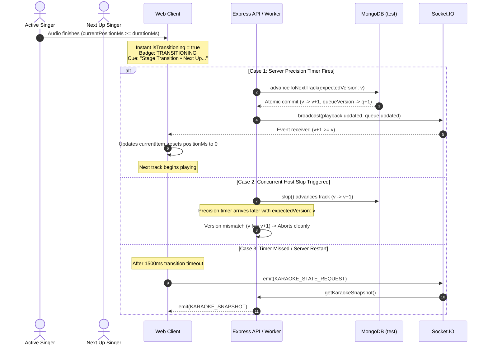

# KTVOnline — Sprint 4.0 Phase 2: Implementation Report
## Playback Transition & Singer Handoff Synchronization (INT-03)

**Date:** November 2026  
**Baseline Commit:** `d3bf005fed03fd675e7cd7f573804f46f19b581a`  
**Milestone:** Sprint 4.0 — Phase 2: Playback Transition & Singer Handoff Synchronization  
**Status:** Code Complete — Not Runtime Verified  

---

## 1. Baseline & Objective

### 1.1 Context
In Sprint 4.0 Phase 0 Architecture & Integration Audit, finding **INT-03** documented a noticeable latency during song transitions:
When a track reaches its full duration, the client timeline displays `00:00` remaining while the stage remains in an apparent "frozen" or "stuck" state for approximately 1–2 seconds before the backend advances the queue and broadcasts the new stage state.

### 1.2 Objective
Resolve INT-03 by improving transition responsiveness and visual feedback across the complete transition lifecycle:
**Current Track → Track Completion → Queue Advancement → Singer Handoff → Next Track Preparation → Playback**
while strictly preserving backend authority over playback, queue ordering, and singer state.

---

## 2. Root Cause Analysis

Investigation of `apps/api/src/modules/karaoke/` and `apps/web/src/features/karaoke/` confirmed the exact root causes:

1. **Dual-Tier Server Advancement Architecture:**
   - The backend utilizes node-local in-memory precision timers (`schedulePrecisionTimer` via `setTimeout(..., songDurationMs)`) for sub-second transitions.
   - For multi-instance resilience and crash recovery, it runs a periodic distributed lease worker (`processDuePlaybacks` polling every 2,000ms via `claimDuePlayback`).
2. **Audio Track Duration Discrepancies:**
   - HTML5 `<audio>` element playback duration occasionally ends slightly earlier or later than the database `song.durationMs` value due to variable bitrate encoding or audio header variances.
3. **Event Loop & Network Latency Window:**
   - Even on a healthy server, atomic MongoDB transaction commits, queue position rebalancing, and Socket.IO broadcast latency introduce a natural 100–350ms window.
   - If an API instance restarted or an in-memory timer was missed, advancement relies on the 2,000ms distributed poller, leading to an average 1,000ms (and up to 2,000ms) delay.
4. **Missing Client Transition Phase:**
   - In `apps/web/src/features/karaoke/components/KaraokePlayer.tsx`, client position was clamped at `durationMs` (`00:00`), but `playback.status` remained `'playing'`.
   - The UI continued displaying `ON AIR` or `ENDING SOON`, with no visual cue indicating that the song had completed and handoff was in progress.
   - In `apps/web/src/features/karaoke/components/SingerTurnIndicator.tsx`, the active singer continued seeing "Sing with the backing track", and the next singer saw "Get Ready", creating confusion as to whether playback was frozen or loading.

---

## 3. Preserved Architectural Invariants

| Invariant | Requirement | Implementation Enforcement |
| :--- | :--- | :--- |
| **Invariant A (Backend Authority)** | The backend remains the sole authority for track advancement, singer assignment, queue ordering, and status. | Frontend never speculatively switches songs, alters versions, or claims playback locally. |
| **Invariant B (Single Advancement)** | A song must advance exactly once regardless of natural completion or manual skip races. | `advanceToNextTrack` uses monotonic `playbackVersion` CAS checks; concurrent skips or duplicate timers fail version matching safely. |
| **Invariant C (Version Monotonicity)** | Client caches must ignore out-of-order socket events. | `queueVersionRef` and `playbackVersionRef` in `use-karaoke.ts` enforce strict monotonicity (`payload.version >= ref.current`). |
| **Invariant D (Singer Integrity)** | Disconnected, departed, or kicked users must not take the stage. | `advanceToNextTrack` queries `RoomMembershipModel` with `status: 'active'` before claiming any queued item. |
| **Invariant E (Clock Synchronization)** | Playback progress must be synchronized against server time, not local client clock drift. | `clockSyncService` estimates round-trip offset and derives `currentPositionMs` from `anchorStartedAt`. |

---

## 4. Remediation Implementation Details

### 4.1 Frontend Transition State (`KaraokePlayer.tsx`)
1. **Derived Non-Destructive State:**
   - Calculated `isTransitioning` without mutating server-authoritative state:
     ```typescript
     const isTransitioning = Boolean(
       currentItem &&
         ((isPlaying && durationMs > 1 && currentPositionMs >= durationMs) ||
           (isEnded && Boolean(nextUpItem)))
     );
     ```
2. **Visual Status Badge:**
   - Added `stage-status-transitioning` badge with animated loader:
     - Displays `TRANSITIONING` in cyan (`bg-cyan-500/20 text-cyan-300 border-cyan-500/40 animate-pulse`).
     - Replaces misleading `ON AIR` badge during track completion.
     - Suppresses `ENDING SOON` badge during transition.
3. **Stage Transition Overlay Banner:**
   - Added an animated glass overlay on `karaoke-stage-surface`:
     - Highlights: `"Song Concluded • Stage Transition"`.
     - Displays upcoming performer and track title: `"Next Up: [Title] • [Singer]"`.
     - Displays `"Authoritative Sync"` pill.
4. **Progress Bar Pulse:**
   - Progress bar at 100% shifts from static color to pulsing cyan-to-violet gradient (`bg-gradient-to-r from-cyan-500 to-violet-500 animate-pulse`).

### 4.2 Performer & Audience Handoff Experience (`SingerTurnIndicator.tsx`)
1. **Current Singer View:**
   - Replaces `Wrapping Up` badge with `Performance Complete` (`Loader2` spinner + cyan accent).
   - Replaces subtitle with praise and handoff context: `"Great performance! Wrapping up stage for [Next Song Title]."`
2. **Next Singer View:**
   - Header shifts to `"Step Up to the Stage!"`.
   - Badge shifts to `"Stage Handoff"` (`animate-pulse` with `Loader2`).
   - Subtitle cues singer: `"Get ready! [Song Title] is taking the spotlight right now!"`
3. **Audience / Lounge View:**
   - Badge shifts to `"Stage Handoff"`.
   - Subtitle clearly announces track conclusion and name of upcoming singer.

### 4.3 Proactive Client Reconciliation Fallback (`use-karaoke.ts`)
- Added an automatic fallback timer:
  - If `currentPositionMs >= durationMs` and server playback status remains `'playing'` for >1,500ms, the client emits `KARAOKE_STATE_REQUEST` via Socket.IO.
  - Guarantees immediate state reconciliation without waiting for the next poller cycle in the event of dropped socket events or in-memory timer eviction.

---

## 5. Concurrency & Race Condition Safeguards



---

## 6. Files Changed

| File Path | Type | Modifications |
| :--- | :--- | :--- |
| `apps/web/src/features/karaoke/components/KaraokePlayer.tsx` | Component | Added `isTransitioning` state, `TRANSITIONING` badge, stage overlay banner, and pulsing handoff progress bar. |
| `apps/web/src/features/karaoke/components/SingerTurnIndicator.tsx` | Component | Added transition awareness to current singer, upcoming singer, and audience view modes. |
| `apps/web/src/features/karaoke/hooks/use-karaoke.ts` | Hook | Added 1,500ms fallback state reconciliation on track completion. |
| `docs/SPRINT_4_0_INTEGRATION_AUDIT.md` | Documentation | Appended complete `INT-03 — Playback Transition & Singer Handoff Remediation` section. |
| `docs/SPRINT_4_0_PHASE_2_IMPLEMENTATION_REPORT.md` | Documentation | Created this comprehensive implementation report. |

---

## 7. Static Validation Results

In accordance with the Code-Only Development Policy, only non-runtime static verification commands were executed:

### 7.1 TypeScript Type Checking (`pnpm typecheck`)
```bash
$ pnpm --recursive run typecheck
Scope: 3 of 4 workspace projects
packages/contracts typecheck$ tsc --noEmit (Done in 1.1s)
apps/api typecheck$ tsc --noEmit (Done in 2.1s)
apps/web typecheck$ tsc --noEmit (Done in 2.6s)
Result: SUCCESS (0 errors across all workspaces)
```

### 7.2 Code Style & Linting (`pnpm lint`)
```bash
$ pnpm --recursive run lint
Scope: 3 of 4 workspace projects
packages/contracts lint$ eslint src/ (Done in 739ms)
apps/api lint$ eslint src/ (Done in 1.0s)
apps/web lint$ next lint (Done in 2.0s)
Result: SUCCESS (✔ No ESLint warnings or errors)
```

---

## 8. Deferred Runtime Verification Scenarios

Under the Code-Only Development Policy, live browser testing and runtime execution are deferred. The following 12 runtime verification scenarios must be executed during human staging or automated E2E runs:

1. **Natural Track Completion with Next Queued Track:** Verify that when song ends, stage transitions smoothly to next track without remaining frozen on `00:00`.
2. **Natural Track Completion with Empty Queue:** Verify that after the last song finishes, the stage cleanly enters transition and then reverts to `STANDBY` / idle empty stage.
3. **Active Singer Visual Experience:** Verify outgoing singer sees "Performance Complete" and handoff message while stage transition takes place.
4. **Next Singer Visual Experience:** Verify incoming singer receives "Step Up to the Stage!" alert with pulsing stage handoff badge.
5. **Audience / Spectator Visual Experience:** Verify non-singing participants see the transition overlay banner with accurate upcoming track and performer names.
6. **Concurrent Host Skip at Track End:** Verify that clicking "Skip" during the 1–2 second transition window does not cause double-advancement or corrupt `playbackVersion`.
7. **Departed Singer Queue Auto-Purge:** Verify that if the upcoming singer leaves the room before handoff, their track is removed and the next eligible song plays.
8. **Song with Missing Audio Track:** Verify that if the next queued song has `audioAvailability !== 'audio_available'`, it is marked failed and skipped automatically.
9. **Single-Track Queue Re-order during Transition:** Verify that modifying queue order while a song is transitioning maintains monotonic `queueVersion` integrity.
10. **Reconciliation Fallback Trigger:** Verify that in the event of an artificially delayed worker (simulated 3-second delay), the client emits `KARAOKE_STATE_REQUEST` at 1.5 seconds and recovers state.
11. **Tab Hidden During Transition:** Verify that backgrounded tabs receive the socket broadcast and sync position immediately upon returning to foreground (`visibilitychange`).
12. **High Latency Network Simulation (500ms RTT):** Verify that high network latency displays the animated `TRANSITIONING` badge continuously until new playback metadata arrives.

---

## 9. Final Verdict

**`CODE COMPLETE — NOT RUNTIME VERIFIED`**
