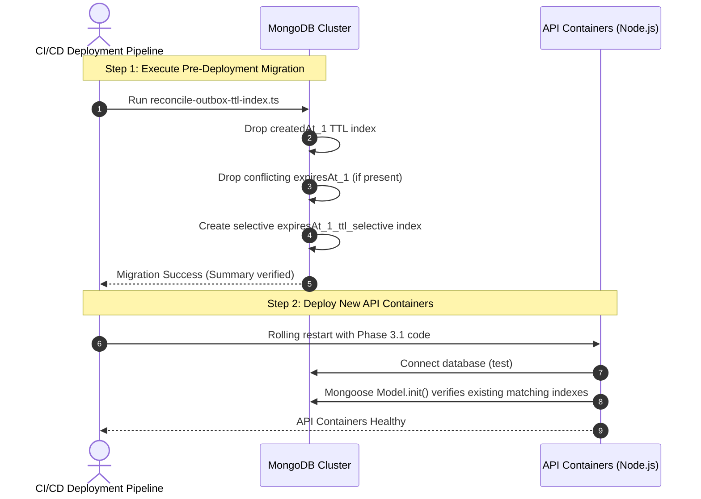

> [!NOTE]
> **Subsequent Correction (Sprint 4.0 Phase 3.2):**
> In Phase 3.2, the TTL index was corrected from using `partialFilterExpression` to a standard single-field TTL index (`{ expiresAt: 1 }`, `expireAfterSeconds: 0`, `name: 'expiresAt_1_ttl'`). Regular MongoDB collections do not support partial TTL indexes, and standard MongoDB TTL indexes naturally skip documents where `expiresAt` is `null` or missing. See [`docs/SPRINT_4_0_PHASE_3_2_IMPLEMENTATION_REPORT.md`](file:///Users/mac/Documents/workspace/workspace_coding/ktvonline/docs/SPRINT_4_0_PHASE_3_2_IMPLEMENTATION_REPORT.md) for details.

# KTVOnline — Sprint 4.0 Phase 3.1: Implementation Report
## Outbox TTL Index Safety Reconciliation

**Date:** November 2026  
**Baseline Commit:** `dcd255e3962b323114bf5be4a991f81d1136c1e9` (Phase 3 HEAD)  
**Milestone:** Sprint 4.0 — Phase 3.1: Outbox TTL Index Safety Reconciliation  
**Status:** Code Complete — Not Runtime Verified  
**Database Name:** `test` (Preserved)

---

## 1. Executive Summary & Objective

In Sprint 4.0 Phase 3, the `RoomStateOutboxModel` was audited and updated to introduce an explicit `expiresAt` field with a selective partial-filter TTL index (`expireAfterSeconds: 0`, `partialFilterExpression: { expiresAt: { $type: 'date' } }`), designed to replace the legacy unconditional `{ createdAt: 1 }` TTL index.

Phase 3.1 conducted a critical follow-up audit to address two essential lifecycle concerns:
1. **Existing Database Index Persistence:** Does removing `{ createdAt: 1 }` from Mongoose schema automatically remove it from an existing MongoDB database?
2. **Duplicate Index Conflict:** Did declaring `index: true` at the field level on `expiresAt` create a conflicting/duplicate index against the schema-level TTL index declaration?

---

## 2. Critical Investigation: Existing Database TTL Index

### 2.1 Mongoose Index Lifecycle Realities
- **Index Creation Mechanism:** KTVOnline connects Mongoose using standard options. On boot, Mongoose calls `Model.init()`, which executes `createIndexes()` under the hood.
- **Index Removal Mechanism:** Mongoose **never** calls `syncIndexes()` automatically during startup or deployment.
- **MongoDB Engine Invariant:** MongoDB does **not** drop existing indexes when an application deployment stops referencing them.

### 2.2 Answers to Critical Questions
1. **Does the application use `autoIndex`, `syncIndexes`, `createIndexes`, or an explicit index migration?**
   - The application relies on Mongoose's default `autoIndex` via `createIndexes()`. It does **not** use `syncIndexes()` or an automated migration framework.
2. **Does deployment automatically remove indexes no longer declared in the schema?**
   - **No.** Existing indexes in MongoDB remain active permanently until explicitly dropped via `db.collection.dropIndex()` or an administrative command.
3. **Is there any existing migration that drops the old Outbox TTL index?**
   - **No.** Prior to Phase 3.1, zero database migration scripts existed in the repository.
4. **Could the old TTL index remain active after deploying the new application version?**
   - **Yes.** In any deployed database (staging or production) where `RoomStateOutbox` was initialized under Sprints 2.2.1 through 4.0, the index `{ createdAt: 1 }` (`expireAfterSeconds: 604800`) remains active in MongoDB!
5. **What happens if both old and new indexes coexist?**
   - **Critical Hazard:** If both indexes coexist in MongoDB, the background TTL monitor will continue evaluating `{ createdAt: 1 }` and **will delete pending or failed outbox records 7 days after creation**, regardless of `expiresAt: null` in the document!
   - Coexistence completely defeats the Phase 3 safety remediation.
6. **What is the safest production deployment sequence?**
   - An explicit, safe, idempotent migration script must be executed during the deployment pipeline prior to or alongside starting the new application instances.

---

## 3. Critical Investigation: Duplicate Index Definition

### 3.1 Finding
In Phase 3, `apps/api/src/modules/rooms/outbox.model.ts` declared:
```typescript
    expiresAt: {
      type: Date,
      default: null,
      index: true, // <-- Field-level single index declaration
    },
...
RoomStateOutboxSchema.index(
  { expiresAt: 1 },
  {
    expireAfterSeconds: 0,
    partialFilterExpression: { expiresAt: { $type: 'date' } },
  }
);
```
### 3.2 Impact
- Mongoose registers **two separate index specifications** for the exact same key `{ expiresAt: 1 }`:
  1. An un-filtered index: `{ expiresAt: 1 }` with default options (name `expiresAt_1`).
  2. A selective TTL index: `{ expiresAt: 1 }` with `expireAfterSeconds: 0` and `partialFilterExpression`.
- During `createIndexes()`, MongoDB can throw `IndexKeySpecsConflict` or fail to apply the TTL and partial filter options.

### 3.3 Resolution Implemented
- Removed `index: true` from the field definition in `outbox.model.ts`.
- Retained exclusively the schema-level index definition with `partialFilterExpression: { expiresAt: { $type: 'date' } }`.

---

## 4. Final Intended Outbox Index Contract

The final schema in [`outbox.model.ts`](file:///Users/mac/Documents/workspace/workspace_coding/ktvonline/apps/api/src/modules/rooms/outbox.model.ts) establishes the following exact indexes:

| Index Name / Key | Options | Purpose |
| :--- | :--- | :--- |
| `{ _id: 1 }` | Default (unique) | MongoDB primary key. |
| `{ eventId: 1 }` | `unique: true` | Global outbox event idempotency. |
| `{ roomId: 1, version: 1 }` | `unique: true` | Strict per-room monotonic versioning constraint. Exactly one event per room version. |
| `{ publishedAt: 1, createdAt: 1 }` | Default | Worker sweep index for `retryPendingOutboxEvents()` (`publishedAt: null, attemptCount: { $lt: 5 }`). |
| `{ expiresAt: 1 }` | `expireAfterSeconds: 0`<br/>`partialFilterExpression: { expiresAt: { $type: 'date' } }` | **Selective Safe TTL:** Prunes ONLY successfully published outbox events after their explicit expiration date. |

### Protected Document States:
- **Pending Events (`publishedAt === null`):** `expiresAt` is `null` -> Excluded from TTL index scan; **never deleted**.
- **Failed / Dead-Letter Events (`lastError !== null`, `attemptCount >= 5`):** `expiresAt` is `null` -> Excluded; **never deleted**.
- **Actively Retrying Events:** `expiresAt` is `null` -> Excluded; **never deleted**.
- **Successfully Emitted Events:** `expiresAt` set to `publishedAt + 7 days` -> Eligible for TTL deletion only 7 days after confirmed broadcast.

---

## 5. Deployment Migration Script & Production Procedure

### 5.1 Idempotent Migration Script
Authored [`apps/api/src/database/migrations/reconcile-outbox-ttl-index.ts`](file:///Users/mac/Documents/workspace/workspace_coding/ktvonline/apps/api/src/database/migrations/reconcile-outbox-ttl-index.ts).

Key safety properties:
1. **Precise Discovery:** Scans collection indexes using `collection.listIndexes().toArray()`.
2. **Strict Verification:** Matches keys `{ createdAt: 1 }` with an active `expireAfterSeconds` property. Verifies index name before dropping.
3. **Conflicting Index Cleanup:** Identifies any un-filtered `{ expiresAt: 1 }` index without a partial filter and drops it safely.
4. **Ensures Selective TTL Index:** Builds `expiresAt_1_ttl_selective` with `expireAfterSeconds: 0` and `partialFilterExpression: { expiresAt: { $type: 'date' } }`.
5. **Zero Data Modification:** Drops and creates indexes only; zero document reads or writes.
6. **Non-Destructive & Idempotent:** Safe to run repeatedly; missing old indexes log cleanly as no-ops.

### 5.2 Recommended Production Deployment Sequence


---

## 6. Publish Semantics & Precise Terminology

In [`room-state.publisher.ts`](file:///Users/mac/Documents/workspace/workspace_coding/ktvonline/apps/api/src/realtime/room-state.publisher.ts), delivery semantics were audited and clarified:

- **What `publishedAt` Guarantees:**
  - Guarantees the application successfully formatted the `RoomStateEventDto` and emitted it via `io.to(channel).emit(...)` without encountering an unhandled runtime error.
  - Guarantees the Socket.IO server engine accepted the frame for room channel distribution.
- **What `publishedAt` Does NOT Guarantee:**
  - It does **not** guarantee TCP receipt by connected web clients.
  - It does **not** guarantee client application-level processing or acknowledgment.
- **Client Recovery Mechanism:**
  - Any client that drops a WebSocket frame or reconnects after network latency recovers missed state via version-fenced snapshot reconciliation (`getRoomStateSnapshot` / `useRoomState`).
  - Storing the outbox event for 7 days post-broadcast ensures clients can replay or reconcile version gaps during their active session.

---

## 7. Files Changed

| File Path | Nature | Description |
| :--- | :--- | :--- |
| [`apps/api/src/modules/rooms/outbox.model.ts`](file:///Users/mac/Documents/workspace/workspace_coding/ktvonline/apps/api/src/modules/rooms/outbox.model.ts) | Model / Index | Removed duplicate `index: true` on `expiresAt` field; preserved schema-level selective TTL index. |
| [`apps/api/src/realtime/room-state.publisher.ts`](file:///Users/mac/Documents/workspace/workspace_coding/ktvonline/apps/api/src/realtime/room-state.publisher.ts) | Service | Refined comments and terminology to accurately describe Socket.IO channel emission semantics. |
| [`apps/api/src/database/migrations/reconcile-outbox-ttl-index.ts`](file:///Users/mac/Documents/workspace/workspace_coding/ktvonline/apps/api/src/database/migrations/reconcile-outbox-ttl-index.ts) | Migration Script | Created idempotent migration script to safely drop old `createdAt` TTL index and build selective `expiresAt` index. |
| [`docs/SPRINT_4_0_INTEGRATION_AUDIT.md`](file:///Users/mac/Documents/workspace/workspace_coding/ktvonline/docs/SPRINT_4_0_INTEGRATION_AUDIT.md) | Documentation | Appended Phase 3.1 Outbox TTL Index Safety Reconciliation audit findings. |
| [`docs/SPRINT_4_0_PHASE_3_1_IMPLEMENTATION_REPORT.md`](file:///Users/mac/Documents/workspace/workspace_coding/ktvonline/docs/SPRINT_4_0_PHASE_3_1_IMPLEMENTATION_REPORT.md) | Documentation | Authored this comprehensive Phase 3.1 report. |

---

## 8. Static Validation Results

In accordance with the Code-Only Development Policy, non-runtime static verification was executed across the monorepo:

### 8.1 TypeScript Type Checking (`pnpm typecheck`)
```bash
$ pnpm --recursive run typecheck
Scope: 3 of 4 workspace projects
packages/contracts typecheck$ tsc --noEmit (Done in 989ms)
apps/api typecheck$ tsc --noEmit (Done in 2.0s)
apps/web typecheck$ tsc --noEmit (Done in 2.5s)
Result: SUCCESS (0 errors across all workspaces)
```

### 8.2 Code Style & Linting (`pnpm lint`)
```bash
$ pnpm --recursive run lint
Scope: 3 of 4 workspace projects
packages/contracts lint$ eslint src/ (Done in 727ms)
apps/api lint$ eslint src/ (Done in 1.1s)
apps/web lint$ next lint (Done in 1.8s)
Result: SUCCESS (✔ No ESLint warnings or errors)
```

---

## 9. Deferred Operational Verification

Under the Code-Only Development Policy, database migrations were not executed against live data. The following scenarios are deferred to staging operations:

1. **Migration Execution Verification:** Run `reconcile-outbox-ttl-index.ts` against a MongoDB test instance with pre-seeded `createdAt_1` TTL index and verify clean drop and creation.
2. **Idempotent Re-Run:** Run `reconcile-outbox-ttl-index.ts` a second time; verify no errors or index conflicts occur.
3. **Mongoose Boot Compatibility:** Start the API server against the migrated collection and verify no index warning or conflict is logged.
4. **MongoDB Explain Plan:** Confirm via `explain('executionStats')` that queries on `{ publishedAt: null }` utilize `{ publishedAt: 1, createdAt: 1 }`.
5. **Selective Expiration Behavior:** Seed an event with `expiresAt: new Date(Date.now() - 1000)` and another with `expiresAt: null`; confirm MongoDB TTL thread only removes the dated document.

---

## 10. Remaining Deployment Risks

1. **Unmigrated Database Risk:** If the deployment pipeline deploys the Phase 3.1 API application without running `reconcile-outbox-ttl-index.ts`, the old `createdAt_1` index will remain active in MongoDB and continue deleting pending records.
   - *Mitigation:* Documented clear deployment pipeline sequence in Section 5.2.
2. **MongoDB Replica Set Index Build Lag:** In large clustered databases, building new indexes in the foreground can briefly block writes.
   - *Mitigation:* The `roomstateoutboxes` collection is pruned to 7 days of data, keeping total document counts low and index creation near-instantaneous.

---

## 11. Final Verdict

**`CODE COMPLETE — NOT RUNTIME VERIFIED`**
