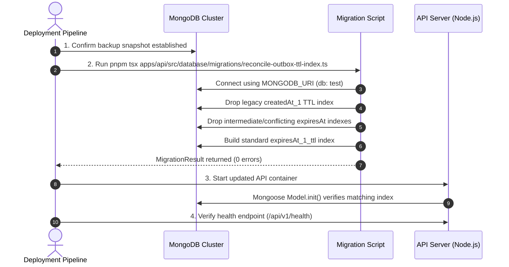

# KTVOnline — Sprint 4.0 Phase 3.2: Implementation Report
## Standard MongoDB TTL Index Correction

**Date:** November 2026  
**Baseline Commit:** `865137a1f5926c4832506e7886a113ec494a86e5` (Phase 3.1 HEAD)  
**Milestone:** Sprint 4.0 — Phase 3.2: Standard MongoDB TTL Index Correction  
**Status:** Code Complete — Not Runtime Verified  
**Database Name:** `test` (Preserved)

---

## 1. Executive Summary & Objective

In Sprint 4.0 Phase 3.1, a selective TTL index was defined for `RoomStateOutboxModel` using `partialFilterExpression: { expiresAt: { $type: 'date' } }`.

A critical engine-level constraint was identified during review:
- **MongoDB Partial TTL Restriction:** In MongoDB, partial TTL indexes (`expireAfterSeconds` combined with `partialFilterExpression`) are restricted to time-series collections. On standard, regular MongoDB collections (such as `roomstateoutboxes`), defining a TTL index with a `partialFilterExpression` is unsupported by the storage engine and rejected with an index creation error.
- **Objective of Phase 3.2:** Replace the unsupported partial TTL index with exactly one standard single-field TTL index on `{ expiresAt: 1 }` (`expireAfterSeconds: 0`, `name: 'expiresAt_1_ttl'`), verify that MongoDB's native null/missing date handling fully preserves the expiration safety contract, and update the deployment migration script accordingly.

---

## 2. Technical Investigation: Regular Collections & MongoDB TTL Semantics

### 2.1 Collection Type Confirmation
Inspection of [`apps/api/src/modules/rooms/outbox.model.ts`](file:///Users/mac/Documents/workspace/workspace_coding/ktvonline/apps/api/src/modules/rooms/outbox.model.ts) confirmed:
- `roomstateoutboxes` is a standard, non-time-series MongoDB collection.
- It features regular BSON documents with an `_id` primary key, unique compound indexes (`{ roomId: 1, version: 1 }`), and standard timestamps (`createdAt`, `updatedAt`).
- Because it is not a time-series collection, `partialFilterExpression` cannot be applied to its TTL index.

### 2.2 Native MongoDB Null/Non-Date Expiration Behavior
MongoDB's official documentation defines the exact behavior of standard single-field TTL indexes:
1. **Date Type Requirement:** The indexed field must contain a BSON Date value (or an array of Date values) to be eligible for expiration.
2. **Null Values Are Skipped:** If the indexed field is `null`, MongoDB does **not** index the document for expiration, and the background TTL thread **never deletes it**.
3. **Missing Fields Are Skipped:** If a document lacks the indexed field entirely, the TTL thread ignores it.
4. **Non-Date Values Are Skipped:** If the field contains any non-Date BSON type (string, boolean, number), the document will not expire.

### 2.3 Expiration Safety Contract Verification

| Outbox Document State | `publishedAt` | `expiresAt` | MongoDB Standard TTL Behavior |
| :--- | :--- | :--- | :--- |
| **Pending (newly recorded)** | `null` | `null` | **Never expires.** Ignored by TTL monitor. |
| **Failed (broadcast error)** | `null` | `null` | **Never expires.** Ignored by TTL monitor. |
| **Retryable (`attemptCount < 5`)**| `null` | `null` | **Never expires.** Ignored by TTL monitor. |
| **Dead-Letter (`attemptCount >= 5`)**| `null` | `null` | **Never expires.** Preserved for triage & replay. |
| **Actively Processing** | `null` | `null` | **Never expires.** Protected during worker execution. |
| **Successfully Broadcasted (within 7d)** | `Date` (now) | `Date` (now + 7d) | **Retained.** `now < expiresAt`. |
| **Successfully Broadcasted (beyond 7d)** | `Date` (now) | `Date` (now + 7d) | **Eligible for deletion.** `now >= expiresAt`. |

Because `expiresAt` is initialized to `null` and only receives a Date upon confirmed emission to Socket.IO, the standard single-field TTL index **inherently and natively guarantees that pending, failed, retryable, and dead-letter records will never be purged**.

---

## 3. Corrected Mongoose Model Declaration

In [`apps/api/src/modules/rooms/outbox.model.ts`](file:///Users/mac/Documents/workspace/workspace_coding/ktvonline/apps/api/src/modules/rooms/outbox.model.ts):

```typescript
// 1. Schema field remains a nullable Date with NO field-level index: true
expiresAt: {
  type: Date,
  default: null,
},

// 2. Exactly one standard single-field TTL index declaration:
RoomStateOutboxSchema.index(
  { expiresAt: 1 },
  {
    expireAfterSeconds: 0,
    name: 'expiresAt_1_ttl',
  }
);
```

### Invariants Maintained:
- **No `partialFilterExpression`:** Clean, standard MongoDB index.
- **No duplicate index:** `expiresAt` does not have `index: true` at the field level.
- **Explicit naming:** Named `expiresAt_1_ttl` for deterministic identification across migrations and monitoring tools.
- **7-day retention preserved:** `expiresAt` is set to `publishedAt + 7 days` in `publishRoomStateEvent` and `retryPendingOutboxEvents`.

---

## 4. Corrected Migration Script

Updated [`apps/api/src/database/migrations/reconcile-outbox-ttl-index.ts`](file:///Users/mac/Documents/workspace/workspace_coding/ktvonline/apps/api/src/database/migrations/reconcile-outbox-ttl-index.ts).

### Migration Logic & Safety Checks:
1. **Legacy `createdAt` TTL Index Drop:**
   - Scans indexes on `roomstateoutboxes`.
   - Matches single-field key `{ createdAt: 1 }` with an active `expireAfterSeconds` property (e.g. 604800).
   - Drops only that legacy index; leaves non-TTL indexes intact.
2. **Incompatible `expiresAt` Index Cleanup:**
   - Identifies existing `{ expiresAt: 1 }` indexes:
     - If an index named `expiresAt_1_ttl` with `expireAfterSeconds: 0` and no partial filter already exists: marks it as already valid and skips recreation (**Idempotent**).
     - If a known incompatible index exists (e.g. `expiresAt_1_ttl_selective` with partial filter from Phase 3.1, or `expiresAt_1` without TTL): drops it cleanly.
     - If an index with an unexpected name or unexpected options is encountered: **aborts safely with an actionable error** rather than deleting it blindly.
3. **Standard TTL Index Creation:**
   - If not already present, builds `collection.createIndex({ expiresAt: 1 }, { expireAfterSeconds: 0, name: 'expiresAt_1_ttl' })`.
4. **Verification & Logging:**
   - Re-lists all final indexes and returns a structured `MigrationResult`.
   - Never reads, writes, or modifies any outbox document data.

### Note on `collMod`:
In MongoDB, `collMod` can only adjust the `expireAfterSeconds` integer value of an existing TTL index. It cannot convert a non-TTL index into a TTL index or alter index filter expressions. Therefore, the narrowly scoped drop-and-recreate sequence implemented in `reconcile-outbox-ttl-index.ts` is the only supported, deterministic approach.

---

## 5. Final Outbox Index Contract

The authoritative index specification for `roomstateoutboxes` is now:

| Index Name | Index Key | Options | Purpose |
| :--- | :--- | :--- | :--- |
| `_id_` | `{ _id: 1 }` | Default (unique) | MongoDB primary key. |
| `eventId_1` | `{ eventId: 1 }` | `unique: true` | Outbox event global idempotency. |
| `roomId_1_version_1` | `{ roomId: 1, version: 1 }` | `unique: true` | Monotonic per-room state sequence invariant. |
| `publishedAt_1_createdAt_1`| `{ publishedAt: 1, createdAt: 1 }` | Default | Query index for unacknowledged outbox retry sweeps. |
| `expiresAt_1_ttl` | `{ expiresAt: 1 }` | `expireAfterSeconds: 0` | **Standard MongoDB TTL Index:** Evaluates documents with a valid Date; ignores documents with `null` or missing `expiresAt`. |

---

## 6. Deployment Procedure

The following sequence must be followed in staging and production deployment pipelines:



---

## 7. Files Changed

| File Path | Nature | Description |
| :--- | :--- | :--- |
| [`apps/api/src/modules/rooms/outbox.model.ts`](file:///Users/mac/Documents/workspace/workspace_coding/ktvonline/apps/api/src/modules/rooms/outbox.model.ts) | Model / Index | Replaced unsupported partial TTL index with standard single-field TTL index on `{ expiresAt: 1 }` (`expireAfterSeconds: 0`, `name: 'expiresAt_1_ttl'`). |
| [`apps/api/src/database/migrations/reconcile-outbox-ttl-index.ts`](file:///Users/mac/Documents/workspace/workspace_coding/ktvonline/apps/api/src/database/migrations/reconcile-outbox-ttl-index.ts) | Migration Script | Updated migration to drop legacy `createdAt` TTL, drop incompatible partial index, and establish standard `expiresAt_1_ttl`. |
| [`docs/SPRINT_4_0_INTEGRATION_AUDIT.md`](file:///Users/mac/Documents/workspace/workspace_coding/ktvonline/docs/SPRINT_4_0_INTEGRATION_AUDIT.md) | Documentation | Appended Phase 3.2 Standard MongoDB TTL Index Correction audit findings. |
| [`docs/SPRINT_4_0_PHASE_3_1_IMPLEMENTATION_REPORT.md`](file:///Users/mac/Documents/workspace/workspace_coding/ktvonline/docs/SPRINT_4_0_PHASE_3_1_IMPLEMENTATION_REPORT.md) | Documentation | Added pointer alert referencing the Phase 3.2 standard TTL correction. |
| [`docs/SPRINT_4_0_PHASE_3_2_IMPLEMENTATION_REPORT.md`](file:///Users/mac/Documents/workspace/workspace_coding/ktvonline/docs/SPRINT_4_0_PHASE_3_2_IMPLEMENTATION_REPORT.md) | Documentation | Authored this comprehensive Phase 3.2 report. |

---

## 8. Static Validation Results

In accordance with the Code-Only Development Policy, non-runtime static verification was executed across the monorepo:

### 8.1 TypeScript Type Checking (`pnpm typecheck`)
```bash
$ pnpm --recursive run typecheck
Scope: 3 of 4 workspace projects
packages/contracts typecheck$ tsc --noEmit (Done in 946ms)
apps/api typecheck$ tsc --noEmit (Done in 2.1s)
apps/web typecheck$ tsc --noEmit (Done in 2.6s)
Result: SUCCESS (0 errors across all workspaces)
```

### 8.2 Code Style & Linting (`pnpm lint`)
```bash
$ pnpm --recursive run lint
Scope: 3 of 4 workspace projects
packages/contracts lint$ eslint src/ (Done in 737ms)
apps/api lint$ eslint src/ (Done in 1.1s)
apps/web lint$ next lint (Done in 2.0s)
Result: SUCCESS (✔ No ESLint warnings or errors)
```

---

## 9. Deferred Operational Verification

Under the Code-Only Development Policy, no live migrations or database operations were executed. The following checks remain for staging deployment:

1. **Migration Dry Run:** Execute `reconcile-outbox-ttl-index.ts` against a dedicated test MongoDB replica set and verify successful creation of `expiresAt_1_ttl`.
2. **Verify Legacy Drop:** Inspect `db.roomstateoutboxes.getIndexes()` to confirm `createdAt_1` is absent.
3. **Verify Null Skip Behavior:** Insert an outbox record with `expiresAt: null`; confirm the TTL thread leaves it untouched.
4. **Verify Date Expiration:** Insert an outbox record with `expiresAt: new Date(Date.now() - 5000)`; confirm the TTL thread purges it within its normal evaluation cycle (typically ~60s).
5. **Idempotent Re-Run:** Execute `reconcile-outbox-ttl-index.ts` a second time against the migrated database; confirm `standardTtlIndexAlreadyExisted === true` and no index drops occur.

---

## 10. Final Verdict

**`CODE COMPLETE — NOT RUNTIME VERIFIED`**
