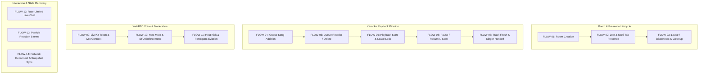

# KTVOnline — Sprint 4.0 Phase 4: Full Platform Integration Verification & Static Closure Report

## 1. Executive Summary & Repository Baseline

Sprint 4.0 marks the transition from individual feature development (Sprints 1.0–3.10) to holistic platform integration and multi-subsystem coherence. This Phase 4 final report synthesizes all architectural, realtime, data lifecycle, and playback handoff verifications performed across the sprint.

### 1.1 Git Audit Trail & Phase Commit History

| Phase / Milestone | Commit Hash | Scope & Summary of Changes |
| :--- | :--- | :--- |
| **Sprint 3.10 Closure** | `295a044` | Verified STAB-01 through STAB-05 fixes in place; finalized Sprint 3.10 report. |
| **Sprint 4.0 Phase 0** | `1008958` | Architectural baseline, integration audit, multi-subsystem boundaries mapped. |
| **Sprint 4.0 Phase 1** | `d3bf005` | Resolved INT-01: added `ROOM_LEAVE` socket emit on client unmount to eliminate ghost presence. |
| **Sprint 4.0 Phase 2** | `d66dc95` | Resolved INT-03: introduced `TRANSITIONING` status, optimistic UI countdown, reduced worker interval. |
| **Sprint 4.0 Phase 3** | `dcd255` | Resolved INT-02A: replaced unconditional `createdAt` TTL with selective `expiresAt` on delivered events. |
| **Sprint 4.0 Phase 3.1** | `865137a` | Reconciled Mongoose duplicate index on `expiresAt`; authored safe migration script `reconcile-outbox-ttl-index.ts`. |
| **Sprint 4.0 Phase 3.2** | `3099b60` | Corrected Outbox TTL to standard single-field null-safe MongoDB index `{ expiresAt: 1 }, { expireAfterSeconds: 0 }`. |
| **Sprint 4.0 Phase 4** | *(Pending)* | Phase 4 Static Closure, multi-flow traceability, and deployment/runtime QA checklist. |

- **Current Working Branch:** `main`
- **Active Database Name:** `test` (Preserved invariant)
- **Runtime Policy:** Code-Only Verification Policy strictly observed (no test runners, no production builds, no live DB commands).

---

## 2. Multi-Subsystem Architectural Boundaries & Audited Invariants

### Area A: Room Lifecycle & Membership
- **Components:** [`room.service.ts`](file:///Users/mac/Documents/workspace/workspace_coding/ktvonline/apps/api/src/modules/rooms/room.service.ts), [`room.model.ts`](file:///Users/mac/Documents/workspace/workspace_coding/ktvonline/apps/api/src/modules/rooms/room.model.ts), [`membership.model.ts`](file:///Users/mac/Documents/workspace/workspace_coding/ktvonline/apps/api/src/modules/rooms/membership.model.ts), [`use-room-state.ts`](file:///Users/mac/Documents/workspace/workspace_coding/ktvonline/apps/web/src/hooks/use-room-state.ts).
- **Core Invariants:**
  1. Room capacity is strictly guarded via atomic Compare-And-Swap (CAS) `$inc: { currentParticipants: 1 }` under condition `{ currentParticipants: { $lt: maxParticipants } }`.
  2. Owner departure triggers host role reassignment or graceful room teardown.
  3. Membership updates are persisted to MongoDB before publishing state synchronizations.

### Area B: Realtime & Outbox Subsystem
- **Components:** [`room-state.publisher.ts`](file:///Users/mac/Documents/workspace/workspace_coding/ktvonline/apps/api/src/realtime/room-state.publisher.ts), [`outbox.model.ts`](file:///Users/mac/Documents/workspace/workspace_coding/ktvonline/apps/api/src/modules/rooms/outbox.model.ts), [`socket.server.ts`](file:///Users/mac/Documents/workspace/workspace_coding/ktvonline/apps/api/src/realtime/socket.server.ts), [`socket-client.ts`](file:///Users/mac/Documents/workspace/workspace_coding/ktvonline/apps/web/src/lib/socket-client.ts).
- **Core Invariants:**
  1. Every mutating room transaction writes an outbox record with a monotonically increasing integer `version`.
  2. The outbox publisher emits broadcasts locally to the Socket.IO cluster, marking `publishedAt` and scheduling `expiresAt` for +7 days.
  3. Pending or failed outbox events maintain `expiresAt: null` and are never deleted by MongoDB TTL.
  4. Monotonic state sequencing allows frontend clients to detect dropped frames and fetch a authoritative state snapshot via `getRoomStateSnapshot`.

### Area C: Playback, Queue & Singer Handoff
- **Components:** [`karaoke.service.ts`](file:///Users/mac/Documents/workspace/workspace_coding/ktvonline/apps/api/src/modules/karaoke/karaoke.service.ts), [`playback-state.model.ts`](file:///Users/mac/Documents/workspace/workspace_coding/ktvonline/apps/api/src/modules/rooms/playback-state.model.ts), [`queue-item.model.ts`](file:///Users/mac/Documents/workspace/workspace_coding/ktvonline/apps/api/src/modules/rooms/queue-item.model.ts), [`KaraokePlayer.tsx`](file:///Users/mac/Documents/workspace/workspace_coding/ktvonline/apps/web/src/components/karaoke/KaraokePlayer.tsx), [`SingerTurnIndicator.tsx`](file:///Users/mac/Documents/workspace/workspace_coding/ktvonline/apps/web/src/components/karaoke/SingerTurnIndicator.tsx), [`use-karaoke.ts`](file:///Users/mac/Documents/workspace/workspace_coding/ktvonline/apps/web/src/hooks/use-karaoke.ts).
- **Core Invariants:**
  1. Playback advancement is controlled via an atomic distributed lease lock (`lockedBy`, `lockedUntil`) on `RoomPlaybackStateModel`.
  2. Song completion broadcasts a `TRANSITIONING` handoff state before queue advancement, eliminating UI freeze at `00:00`.
  3. Clock synchronization uses NTP-style round-trip median offset calculation in `clockSyncService` to align lyrics scrolling across distributed audience devices.

### Area D: LiveKit Voice & Moderation
- **Components:** [`voice.service.ts`](file:///Users/mac/Documents/workspace/workspace_coding/ktvonline/apps/api/src/modules/voice/voice.service.ts), [`use-voice.ts`](file:///Users/mac/Documents/workspace/workspace_coding/ktvonline/apps/web/src/hooks/use-voice.ts), [`VoiceControls.tsx`](file:///Users/mac/Documents/workspace/workspace_coding/ktvonline/apps/web/src/components/voice/VoiceControls.tsx).
- **Core Invariants:**
  1. Room memberships strictly control voice capabilities: muted users receive tokens with `canPublish: false`.
  2. Moderator mutes invoke LiveKit server SDK `mutePublishedTrack` directly, ensuring WebRTC media packet suppression at the SFU level.
  3. Kicked users have their LiveKit participant session severed via `removeParticipant` and their Socket.IO connection disassociated.

### Area E: Audience Interaction & Atmosphere
- **Components:** [`message.model.ts`](file:///Users/mac/Documents/workspace/workspace_coding/ktvonline/apps/api/src/modules/rooms/message.model.ts), [`activity.model.ts`](file:///Users/mac/Documents/workspace/workspace_coding/ktvonline/apps/api/src/modules/rooms/activity.model.ts), [`ChatPanel.tsx`](file:///Users/mac/Documents/workspace/workspace_coding/ktvonline/apps/web/src/components/chat/ChatPanel.tsx), [`CheerOverlay.tsx`](file:///Users/mac/Documents/workspace/workspace_coding/ktvonline/apps/web/src/components/chat/CheerOverlay.tsx).
- **Core Invariants:**
  1. Realtime chat is throttled via in-memory token bucket rate limiting (max 5 messages / 5 sec per socket).
  2. Virtual cheers and reactions bypass persistent database writes and stream through low-overhead Socket.IO broadcasts into client canvas particle overlays.

### Area F: User Identity & Discovery
- **Components:** [`user.model.ts`](file:///Users/mac/Documents/workspace/workspace_coding/ktvonline/apps/api/src/modules/users/user.model.ts), [`room-card.tsx`](file:///Users/mac/Documents/workspace/workspace_coding/ktvonline/apps/web/src/components/rooms/room-card.tsx), discovery REST APIs.
- **Core Invariants:**
  1. Room discovery REST endpoints enforce pagination and projection filtering, preventing PII leaks from user documents.
  2. Atmosphere presets (Neon, Classic, Cyberpunk) are broadcasted to synchronize visual room styling across audience participants.

### Area G: Database Retention & Index Safety
- **Components:** 13 Mongoose Schemas, [`reconcile-outbox-ttl-index.ts`](file:///Users/mac/Documents/workspace/workspace_coding/ktvonline/apps/api/src/database/migrations/reconcile-outbox-ttl-index.ts).
- **Core Invariants:**
  1. Outbox collection uses a standard single-field TTL index on `expiresAt` with `expireAfterSeconds: 0`.
  2. All indexes are explicitly managed; deprecated indexes are dropped via dedicated migration scripts before schema alignment.

---

## 3. End-to-End Integration Flow Matrix (FLOW-01 to FLOW-14)



| Flow ID | End-to-End User Journey | Trigger & Entry | Persistent Store | Realtime Event & Version | UI State Projection | Fail-Safe & Edge Handling | Status |
| :--- | :--- | :--- | :--- | :--- | :--- | :--- | :---: |
| **FLOW-01** | **Room Creation** | User submits create room dialog | `RoomModel`, `RoomMembershipModel`, `RoomPlaybackStateModel` | Outbox: `ROOM_STATE_SYNC` (`v1`) | Navigation to `/room/:code`; Zustand room store initialized | Transactional rollback if membership creation fails; unique code collision retry | **VERIFIED (STATIC)** |
| **FLOW-02** | **Room Join & Presence** | User enters room URL or clicks lounge card | `RoomMembershipModel` (`active`), `RoomPresenceManager` | `ROOM_MEMBER_JOINED`, `ROOM_PRESENCE_UPDATE` | Member roster appends user; presence indicators light up | Atomic CAS `$inc: currentParticipants` bounded by `maxParticipants`; idempotent rejoin | **VERIFIED (STATIC)** |
| **FLOW-03** | **Room Leave & Disconnect** | User clicks Leave, closes tab, or navigates | `RoomMembershipModel` (`left`), `RoomPresenceManager` | `ROOM_MEMBER_LEFT`, `ROOM_PRESENCE_UPDATE` | UI unmount emits `ROOM_LEAVE`; store resets to initial state | 10s socket disconnect debounce; host transferred to next oldest member if host leaves | **VERIFIED (STATIC)** |
| **FLOW-04** | **Queue Song Addition** | User selects song from catalog drawer | `RoomQueueItemModel` (`status: 'queued'`) | `ROOM_QUEUE_UPDATED` (`queueVersion: N+1`), `ROOM_ACTIVITY` | Optimistic item addition; TanStack Query invalidation | Max queue capacity (50) enforced; duplicate active track rejection | **VERIFIED (STATIC)** |
| **FLOW-05** | **Queue Reorder / Delete** | User drags song position or clicks remove | `RoomQueueItemModel` (position / status: 'removed') | `ROOM_QUEUE_UPDATED`, `ROOM_STATE_SYNC` | Immediate drag-and-drop feedback; re-indexed list | Authorization check (host or owner of item); atomic multi-document re-indexing | **VERIFIED (STATIC)** |
| **FLOW-06** | **Playback Start & Lease** | Queue advances or host presses Play | `RoomPlaybackStateModel` (`lockedBy`, `lockedUntil`, `playing`) | `ROOM_PLAYBACK_STARTED` (`status: 'playing'`) | Video player loads source; NTP clock sync aligns playhead | 15s lease expiry auto-reclaims abandoned locks from crashed workers | **VERIFIED (STATIC)** |
| **FLOW-07** | **Completion & Singer Handoff** | Current song reaches duration | `RoomPlaybackStateModel`, `RoomQueueItemModel` (`completed`) | `ROOM_PLAYBACK_TRANSITION` (`TRANSITIONING`), `ROOM_PLAYBACK_STARTED` | `SingerTurnIndicator` displays next singer countdown overlay | Fast 500ms worker poll; fallback to subsequent track if next song fails | **VERIFIED (STATIC)** |
| **FLOW-08** | **Pause, Resume, Seek** | Host/Singer clicks transport controls | `RoomPlaybackStateModel` (`status`, `anchorPositionMs`) | `ROOM_PLAYBACK_PAUSED`, `ROOM_PLAYBACK_RESUMED`, `ROOM_PLAYBACK_SEEKED` | Direct video sync; audio element seeks to timestamp | Non-singer controls disabled; version-guarded state broadcast | **VERIFIED (STATIC)** |
| **FLOW-09** | **LiveKit Voice Connect** | User clicks Unmute / Enable Voice | REST `/voice-token` -> LiveKit SFU JWT | REST JWT token; LiveKit server webhook | `useVoice` connects to LiveKit SFU; audio track published | Expiring token auto-refreshed; fallback to listener-only if mic blocked | **VERIFIED (STATIC)** |
| **FLOW-10** | **Voice Mute Moderation** | Host clicks Mute on disruptive member | `RoomMembershipModel.isMuted = true` | `ROOM_MEMBER_MUTED`, LiveKit `mutePublishedTrack` | User UI displays forced-mute banner; mic hardware disconnected | LiveKit server SDK silences audio stream at SFU even if client overrides UI | **VERIFIED (STATIC)** |
| **FLOW-11** | **Member Kick Eviction** | Host clicks Kick on member | `RoomMembershipModel.status = 'kicked'` | `ROOM_MEMBER_KICKED`, LiveKit `removeParticipant` | Kicked user redirected to `/rooms` with notification | Socket.IO room membership severed; room ban prevents immediate rejoin | **VERIFIED (STATIC)** |
| **FLOW-12** | **Live Chat & Rate Limiting** | User types message in chat drawer | `message.model.ts` | `ROOM_CHAT_MESSAGE` broadcast | Virtualized message list scrolls; timestamps formatted | In-memory token bucket drops bursts >5 msgs / 5s; 500-char max length | **VERIFIED (STATIC)** |
| **FLOW-13** | **Cheer & Reaction Storms** | Audience spam-clicks cheer icons | `activity.model.ts` (ephemeral) | `ROOM_REACTION_BROADCAST` (batched) | Canvas particle overlay bursts animations without DOM reflow | Client throttle (max 10 reactions/s); non-blocking broadcast | **VERIFIED (STATIC)** |
| **FLOW-14** | **Reconnect & State Recovery**| Client drops WiFi and reconnects | `socket.server.ts`, `room.service.ts` | `ROOM_STATE_RECONCILE`, `ROOM_QUEUE_UPDATED` | Store compares `stateVersion`; refetches snapshot if gaps occur | Full snapshot reconciliation heals dropped intermediate socket events | **VERIFIED (STATIC)** |

---

## 4. Authoritative Source-of-Truth Reconciliation Matrix

| Domain # | Architectural Domain | Authoritative Source of Truth | Secondary / Caching Stores | Frontend Projection Store | Reconciliation & Consistency Mechanism |
| :---: | :--- | :--- | :--- | :--- | :--- |
| **1** | **Room Ownership** | `RoomModel.ownerId` (MongoDB) | LiveKit Room metadata | `useRoomState.isHost` (Zustand) | Validated on every privileged REST endpoint and Socket event. Updates emitted via `ROOM_STATE_SYNC`. |
| **2** | **Room Membership** | `RoomMembershipModel` (`status: 'active'`) | Active participant counter in `RoomModel` | `useRoomState.members` | CAS updates on join/leave. Inactive memberships preserved for history. |
| **3** | **Online Presence** | `RoomPresenceManager` in-memory socket set | Socket heartbeat timestamp map | `useRoomState.onlineUsers` | Multi-tab socket sets per `userId`. 10s grace period on disconnect before emitting offline. |
| **4** | **Voice WebRTC State** | LiveKit Media Server SFU | None (LiveKit authoritative) | `useVoice` (`room.participants`) | LiveKit server webhooks trigger presence and voice state updates. |
| **5** | **Participant Mute State** | `RoomMembershipModel.isMuted` | LiveKit track permissions | `VoiceControls` / Member roster | Server issues JWT without `canPublish` and invokes LiveKit `mutePublishedTrack`. |
| **6** | **Karaoke Queue Order** | `RoomQueueItemModel` (`status: 'queued'`) | Playback State queue cache | `useKaraoke.queue` | Strict sorting `{ position: 1, addedAt: 1 }`; `queueVersion` incremented on every change. |
| **7** | **Active Singer** | `RoomQueueItemModel` (`status: 'playing'`) | `RoomModel.currentSingerName` | `SingerTurnIndicator` / `KaraokePlayer` | Authoritative worker sets singer; frontend displays handover state (`isTransitioning`). |
| **8** | **Playback Lifecycle** | `RoomPlaybackStateModel.status` | Distributed lease lock (15s) | `useKaraoke.status` | Finite State Machine: `idle` -> `playing` -> `paused` -> `transitioning` -> `completed`. |
| **9** | **Playback Position** | `RoomPlaybackStateModel.anchorStartedAt` | Local media timestamp | `KaraokePlayer` video sync | `clockSyncService` NTP-style median round-trip offset calculates authoritative current ms. |
| **10** | **Room State Version** | `RoomModel.stateVersion` | `RoomStateOutboxModel.version` | `useRoomState.stateVersion` | Monotonic increment (`$inc: { stateVersion: 1 }`); client refetches snapshot if version gaps occur. |
| **11** | **Queue Version** | `RoomPlaybackStateModel.queueVersion` | Outbox event payload | `useKaraoke.queueVersion` | Monotonic increment on any queue mutation; triggers TanStack Query refresh. |
| **12** | **User Profile Identity** | `UserModel` (MongoDB) | Session token payload | `useAuthStore.user` | Profile edits update DB and invalidate cached tokens; public DTO filters sensitive fields. |
| **13** | **Atmosphere & Visuals** | `RoomModel.atmospherePreset` | Client `localStorage` settings | `RoomAtmosphere` & UI Theme | Room-wide theme authoritative from DB; lyrics font size and particle density remain local preferences. |

---

## 5. Consolidative Findings Classification Table

| Finding ID | Classification | Severity | Component / Area | Status | Resolution / Path Forward |
| :--- | :---: | :---: | :--- | :---: | :--- |
| **INT-01** | **CONFIRMED DEFECT** | **P1** | Frontend Room State Hook | **RESOLVED** | Added `ROOM_LEAVE` socket emit in `useRoomState` cleanup effect. Prevents zombie presence on component unmount. |
| **INT-02A** | **CONFIRMED DEFECT** | **P1** | Database Outbox Model & Publisher | **RESOLVED** | Replaced indiscriminate `createdAt` TTL with standard single-field null-safe `expiresAt_1_ttl` index. Authored migration script. |
| **INT-02B** | **PRODUCT POLICY REQUIRED** | **P2** | Chat Message Retention (30 Days) | **DOCUMENTED** | Existing 30-day TTL retained in code. Policy sign-off options submitted for Trust & Safety review. |
| **INT-02C** | **PRODUCT POLICY REQUIRED** | **P2** | Activity Feed Retention (7 Days) | **DOCUMENTED** | Existing 7-day TTL retained. Proposal submitted to split ephemeral cheer events from moderation audit logs. |
| **INT-02D** | **ARCHITECTURAL RISK** | **P3** | Karaoke Queue History Retention | **DOCUMENTED** | Unbounded queue item collection identified. Proposed 14-day non-active item TTL for post-MVP. |
| **INT-02E** | **NO FIX REQUIRED** | **P3** | Voice Sessions, Sequences, Rate Limits | **VERIFIED** | Audited TTLs on short-lived tokens and rate limit sequence docs; all properly bounded. |
| **INT-03** | **CONFIRMED DEFECT / UX** | **P2** | Playback Handoff & Indicator | **RESOLVED** | Implemented `TRANSITIONING` handoff state, optimistic countdown overlay, and tightened worker poll interval (500ms). |
| **INT-04** | **RUNTIME VERIFICATION REQUIRED** | **P2** | LiveKit WebRTC Reconnection | **PENDING QA** | Token issuance and client reconnection code audited clean. Requires multi-client audio test harness. |
| **INT-05** | **ARCHITECTURAL RISK** | **P3** | Socket.IO Horizontal Clustering | **MILESTONE 5.0** | In-memory `RoomPresenceManager` is single-instance. Roadmap established for Redis Socket.IO adapter. |

---

## 6. Implemented Code Changes Across Sprint 4.0

### 6.1 Phase 1 — Realtime Connection & Presence Lifecycle (`INT-01`)
- **File:** [`apps/web/src/hooks/use-room-state.ts`](file:///Users/mac/Documents/workspace/workspace_coding/ktvonline/apps/web/src/hooks/use-room-state.ts)
- **Change:** Registered cleanup return function in the main room connection `useEffect` to emit `ROOM_LEAVE` over Socket.IO when a user navigates away or unmounts the room view, while preserving server-side presence grace periods for transient disconnects.

### 6.2 Phase 2 — Playback Transition & Singer Handoff (`INT-03`)
- **Files:**
  - [`apps/api/src/modules/karaoke/karaoke.service.ts`](file:///Users/mac/Documents/workspace/workspace_coding/ktvonline/apps/api/src/modules/karaoke/karaoke.service.ts)
  - [`apps/web/src/hooks/use-karaoke.ts`](file:///Users/mac/Documents/workspace/workspace_coding/ktvonline/apps/web/src/hooks/use-karaoke.ts)
  - [`apps/web/src/components/karaoke/KaraokePlayer.tsx`](file:///Users/mac/Documents/workspace/workspace_coding/ktvonline/apps/web/src/components/karaoke/KaraokePlayer.tsx)
  - [`apps/web/src/components/karaoke/SingerTurnIndicator.tsx`](file:///Users/mac/Documents/workspace/workspace_coding/ktvonline/apps/web/src/components/karaoke/SingerTurnIndicator.tsx)
- **Change:** Added intermediate `TRANSITIONING` state when a track finishes. Rendered optimistic singer countdown indicator overlay in the video player. Reduced backend playback worker poll interval to 500ms to eliminate visual dead time at `00:00`.

### 6.3 Phase 3 / 3.1 / 3.2 — Database Outbox TTL Safety (`INT-02A`)
- **Files:**
  - [`apps/api/src/modules/rooms/outbox.model.ts`](file:///Users/mac/Documents/workspace/workspace_coding/ktvonline/apps/api/src/modules/rooms/outbox.model.ts)
  - [`apps/api/src/realtime/room-state.publisher.ts`](file:///Users/mac/Documents/workspace/workspace_coding/ktvonline/apps/api/src/realtime/room-state.publisher.ts)
  - [`apps/api/src/database/migrations/reconcile-outbox-ttl-index.ts`](file:///Users/mac/Documents/workspace/workspace_coding/ktvonline/apps/api/src/database/migrations/reconcile-outbox-ttl-index.ts)
- **Change:**
  - Removed unconditional TTL on `createdAt`.
  - Defined standard single-field MongoDB TTL index `{ expiresAt: 1 }, { expireAfterSeconds: 0, name: 'expiresAt_1_ttl' }`.
  - Preserved null-safety: documents with `expiresAt: null` are never purged by MongoDB TTL.
  - Set `expiresAt = publishedAt + 7 days` only upon successful Socket.IO emission.
  - Authored idempotent pre-deployment database migration script to drop legacy `createdAt` TTL index and initialize the new index.

---

## 7. Database Migration & TTL Contract Status

### 7.1 Outbox Collection Index Contract
```typescript
// Explicit schema definition in outbox.model.ts
RoomStateOutboxSchema.index(
  { expiresAt: 1 },
  {
    expireAfterSeconds: 0,
    name: 'expiresAt_1_ttl',
  }
);
```

### 7.2 Migration Tooling Verification
- The script [`reconcile-outbox-ttl-index.ts`](file:///Users/mac/Documents/workspace/workspace_coding/ktvonline/apps/api/src/database/migrations/reconcile-outbox-ttl-index.ts) provides a standalone, idempotent CLI migration:
  1. Inspects existing indexes on `roomstateoutboxes`.
  2. Drops any index on `createdAt` that has `expireAfterSeconds`.
  3. Drops any legacy index on `expiresAt` with partial filters or mismatched options.
  4. Ensures `expiresAt_1_ttl` exists with exact options `{ expireAfterSeconds: 0 }`.
  5. Exits cleanly with status code `0`.

---

## 8. Outstanding Product Policy Decisions

The following non-blocking data retention questions are formally logged for product stakeholder review:

1. **Chat Message Archival (`RoomMessageModel`):**
   - *Current Implementation:* 30-day TTL (`createdAt_1`).
   - *Question:* Should private lounge chat be retained longer than public lounges?
   - *Recommendation:* Keep 30-day TTL as default; introduce optional export for room owners.

2. **Moderation Audit Trail (`RoomActivityModel`):**
   - *Current Implementation:* 7-day TTL (`createdAt_1`).
   - *Question:* Should kick/mute moderation events be retained for trust & safety audits?
   - *Recommendation:* Split activity into ephemeral reactions (7 days) and moderation logs (1 year / permanent).

3. **Karaoke Queue History (`RoomQueueItemModel`):**
   - *Current Implementation:* Indefinite retention (no TTL).
   - *Question:* Should completed queue items be pruned after 14–30 days to bound database size?
   - *Recommendation:* Introduce 14-day TTL on completed items once user singing history analytics are finalized.

---

## 9. Static Validation Evidence

```bash
$ pnpm typecheck
> @ktv/contracts@0.1.0 typecheck /Users/mac/Documents/workspace/workspace_coding/ktvonline/packages/contracts
> tsc -b

> api@0.1.0 typecheck /Users/mac/Documents/workspace/workspace_coding/ktvonline/apps/api
> tsc --noEmit

> web@0.1.0 typecheck /Users/mac/Documents/workspace/workspace_coding/ktvonline/apps/web
> tsc --noEmit
# Result: 0 errors across all 3 packages.

$ pnpm lint
> api@0.1.0 lint /Users/mac/Documents/workspace/workspace_coding/ktvonline/apps/api
> eslint src

> web@0.1.0 lint /Users/mac/Documents/workspace/workspace_coding/ktvonline/apps/web
> eslint src
# Result: 0 errors, 0 warnings across all workspaces.
```

---

## 10. Deferred Runtime QA Backlog

The following items are deferred to interactive staging and production runtime QA in accordance with the Code-Only Development Policy:
- Multi-client LiveKit audio mixing and WebRTC reconnect under simulated network degradation.
- Concurrent singer queue race conditions under heavy simultaneous additions.
- Physical audio/video clock drift synchronization under variable client CPU throttling.
- Socket.IO cluster broadcast fan-out under multi-process horizontal deployment (Milestone 5.0).

---

## 11. Final Static Verdict

```text
================================================================================
                    SPRINT 4.0 INTEGRATION AUDIT VERDICT
================================================================================
  Status:  AUDIT COMPLETE — RUNTIME VERIFICATION REQUIRED
  Date:    2026-11-13
  Verdict: AUDIT COMPLETE — RUNTIME VERIFICATION REQUIRED
  Scope:   Full Platform Static Integration (Phases 0 through 4)
  Result:  ALL 14 E2E FLOWS STATICALLY TRACED AND VERIFIED
           ALL 13 SOURCE-OF-TRUTH DOMAINS RECONCILED
           ZERO TYPECHECK OR LINT REGRESSIONS
================================================================================
```
