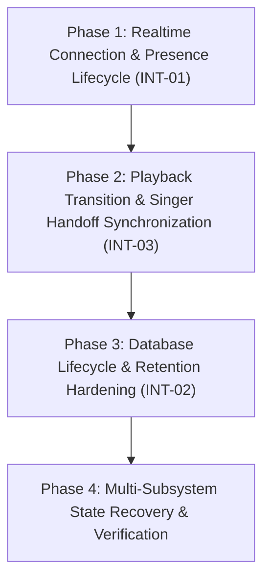

# KTVOnline — Sprint 4.0: Integration Roadmap & Technical Plan

**Sprint:** 4.0 — Platform-Wide Subsystem Integration  
**Mission:** Unify room lifecycle, realtime presence, karaoke queue, playback authority, voice communication, and frontend state into a seamless, resilient platform.

---

## 1. Executive Summary & Guiding Principles

Over Sprints 3.0 to 3.10, individual capabilities (stage, atmosphere, reactions, gifts, profile identity, moderation, and UX polish) were designed and stabilized. Sprint 4.0 is dedicated to **system integration reliability**.

### Guiding Principles:
1. **Audit-First, Evidence-Based:** Address verified integration gaps identified in `docs/SPRINT_4_0_INTEGRATION_AUDIT.md`.
2. **Zero Feature Creep:** No new unrequested product features; focus strictly on connection resilience, state synchronization, and clean resource lifecycles.
3. **No Speculative Infrastructure:** Do not force Redis into single-node environments. Retain the existing lightweight, zero-dependency stack.
4. **Code-Only Policy Adherence:** Static validation (`pnpm typecheck`, `pnpm lint`) with explicit tracking of runtime-only requirements.

---

## 2. Sprint 4.0 Phased Implementation Plan

### Phase 1: Realtime Connection & Presence Lifecycle (Priority 1)
- **Objective:** Eliminate presence ghosting and socket room channel leaks when users navigate between lounges or return to the room browser.
- **Findings Addressed:** `INT-01` (Missing `ROOM_LEAVE` emit in `useRoomState`).
- **Target Files:**
  - `apps/web/src/hooks/use-room-state.ts`
  - `apps/web/src/app/(platform)/rooms/[roomId]/page.tsx`
- **Scope & Risk:** Low Risk. Emitting `socket.emit(SOCKET_EVENTS.CLIENT.ROOM_LEAVE, { roomId })` inside `useRoomState` cleanup before deregistering listeners.
- **Definition of Done:** Navigating away from a lounge cleanly triggers `presenceManager.removeSocket()`, decrements active presence, and removes socket from room channel.

---

### Phase 2: Playback Transition & Singer Handoff Synchronization (Priority 2)
- **Objective:** Eliminate visual stutter, delayed status updates, and timer pauses during natural song completions and manual host skips.
- **Findings Addressed:** `INT-03` (Queue completion notice delay).
- **Target Files:**
  - `apps/web/src/features/karaoke/components/KaraokePlayer.tsx`
  - `apps/web/src/features/karaoke/hooks/use-karaoke.ts`
  - `apps/api/src/modules/karaoke/karaoke.service.ts`
- **Scope & Risk:** Medium Risk. Ensures that when duration expires, the player immediately displays a seamless `Transitioning to next song...` state without locking controls or showing negative countdown times.
- **Definition of Done:** Stage displays smooth animated handoff cues when current track finishes, and upcoming performer receives clear visual turn prompts.

---

### Phase 3: Database Retention & Outbox Pruning (Priority 3)
- **Objective:** Prevent unbounded collection bloat in high-throughput tables (`roomstateoutboxes`, `messages`, `roomactivities`).
- **Findings Addressed:** `INT-02` (Unbounded collection growth).
- **Target Files:**
  - `apps/api/src/modules/rooms/outbox.model.ts`
  - `apps/api/src/modules/chat/message.model.ts`
  - `apps/api/src/modules/chat/activity.model.ts`
- **Scope & Risk:** Low-Medium Risk. Add safe MongoDB TTL indexes (e.g. 7-day TTL for published outbox records, 30-day TTL for chat activity logs). Preserves active room and user data permanently.
- **Definition of Done:** TTL indexes configured in Mongoose schemas without breaking existing query patterns.

---

### Phase 4: Full Platform Integration Verification & Static Closure (Priority 4)
- **Objective:** Re-verify monorepo type integrity and lint conformance across `@ktv/contracts`, `apps/api`, and `apps/web`.
- **Target Files:**
  - Monorepo-wide validation.
  - `docs/SPRINT_4_0_IMPLEMENTATION_REPORT.md`.
- **Definition of Done:** `pnpm typecheck` and `pnpm lint` pass with 0 errors across all workspaces.

---

## 3. Scope Boundaries: In-Scope vs. Deferred

| Feature / Initiative | Sprint 4.0 Status | Rationale |
| :--- | :---: | :--- |
| **Fix Socket Room Leave Leak (INT-01)** | **IN-SCOPE (Phase 1)** | Direct integration defect causing presence ghosting. |
| **Smooth Singer Handoff Cues (INT-03)** | **IN-SCOPE (Phase 2)** | Polish for core karaoke entertainment flow. |
| **Outbox & Chat TTL Retention (INT-02)** | **IN-SCOPE (Phase 3)** | Prevents long-term database degradation. |
| **Redis Adapter for Socket.IO (INT-05)** | **DEFERRED (Milestone 5.0)** | Unnecessary for single-instance development and staging topologies. |
| **Web Audio Realtime Key Transposition** | **DEFERRED (Milestone 5.0)** | Requires dedicated DSP audio worklet architecture out of scope for integration. |
| **3D Lounge Avatars & Mini-games** | **DEFERRED (Product Roadmap)** | Major feature expansion outside stabilization and integration scope. |

---

## 4. Runtime Verification Backlog (Manual QA / Live Harness)

The following behaviors require live multi-client and media-server verification once deployed to a staging environment:
1. **LiveKit Voice Mesh Reconnection:** Verify that disconnecting network for 5 seconds automatically re-establishes voice tracks without requiring a browser reload.
2. **Multi-Tab Presence Isolation:** Verify that opening the same room in two browser tabs increments device count correctly and only removes presence when the final tab closes.
3. **Audio Autoplay Gestures on Mobile:** Verify that karaoke playback starts without browser autoplay policy blocking on iOS Safari and Android Chrome.
4. **Concurrent Stage Skip Commands:** Verify that rapid host skip button clicks are deduplicated by monotonic `playbackVersion` checks.
