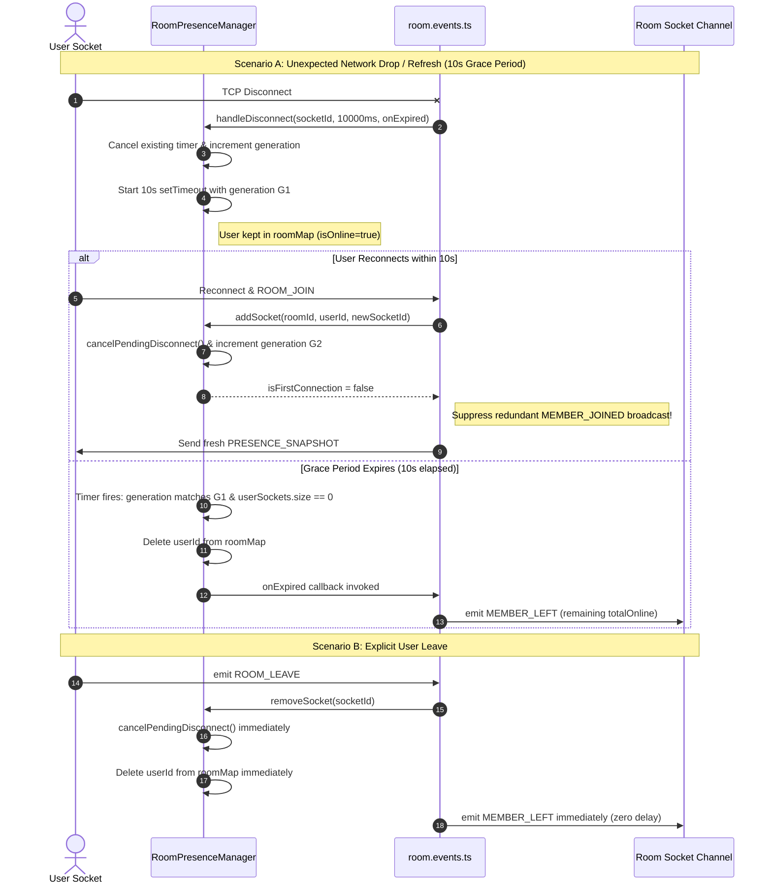

# KTVOnline — Sprint 4.2: Lifecycle Consistency & Voice Reliability Audit Report

## 1. Executive Summary & Repository Baseline

Sprint 4.2 conducted a focused source-level audit and remediation on three critical lifecycle and voice interaction domains identified in Sprint 4.1:
1. **INT-06:** Socket.IO disconnect grace period and presence lifecycle consistency.
2. **INT-07:** Host departure, ownership transfer, and room abandonment.
3. **INT-08:** LiveKit listen-only reliability, undefined permission handling, and dynamic moderation sync.

### Repository Baseline
- **Branch:** `main`
- **Baseline HEAD:** `1502d34`
- **Database Name:** `test` (Preserved invariant)
- **Mandatory Policy:** Code-Only Policy strictly followed (no test files created/modified, no test runners executed, no production builds, no database migrations executed against live DB).

---

## 2. INT-06: Disconnect Grace Period Root Cause & Remediation

### 2.1 Problem & Code-Documentation Discrepancy
Sprint 4.0 documentation referenced a "10-second disconnect grace period" before announcing a member offline. However, Sprint 4.1 discovered that `apps/api/src/realtime/room.events.ts` previously invoked synchronous removal in `presenceManager.removeSocket(socket.id)` and emitted `MEMBER_LEFT` immediately upon the Socket.IO `disconnect` event.

This caused user presence in the room roster to flicker whenever single-tab participants experienced momentary network jitter, browser tab refreshes, or mobile connection switches (`MEMBER_LEFT` broadcast followed immediately by `MEMBER_JOINED`).

### 2.2 Trace of the Complete Lifecycle



### 2.3 Required Invariants & Remediation Design
In [`apps/api/src/realtime/presence.manager.ts`](file:///Users/mac/Documents/workspace/workspace_coding/ktvonline/apps/api/src/realtime/presence.manager.ts) and [`apps/api/src/realtime/room.events.ts`](file:///Users/mac/Documents/workspace/workspace_coding/ktvonline/apps/api/src/realtime/room.events.ts), we implemented a safe, in-memory, generation-fenced disconnect grace period:

1. **Generation Fencing:** Each disconnect timer is tagged with a monotonic generation number for the tuple `${roomId}:${userId}`. If a reconnect occurs, the generation counter increments and the timer is cleared, ensuring delayed callbacks can NEVER remove a newly connected socket.
2. **Explicit Leave vs. Unexpected Disconnect Separation:**
   - **Explicit Leave (`ROOM_LEAVE`):** Invokes `removeSocket(socket.id)` directly. The user is removed immediately with zero delay, and `MEMBER_LEFT` is emitted immediately.
   - **Unexpected Disconnect (`socket.on('disconnect')`):** Invokes `handleDisconnect(socket.id, 10000ms, onExpired)`. If it is the user's last socket, a 10-second grace timer is scheduled.
3. **Multi-Tab Safety:** If the disconnecting socket is not the user's last active socket (`userSockets.size > 0`), no timer is scheduled and no departure event is emitted.
4. **Suppression of Reconnect Jitter:** In `addSocket()`, if the user reconnected while a grace timer was active, `isFirstConnection` evaluates to `false`, preventing duplicate `MEMBER_JOINED` broadcasts to the room.
5. **Immediate Eviction on Moderation Kick:** When a member is kicked, `removeUserFromRoom()` cancels any pending grace timer immediately and removes them from presence without waiting.

---

## 3. INT-07: Host Departure & Room Lifecycle Reconciliation

### 3.1 Trace of All 8 Scenarios

| Scenario | Event / Trigger | Backend Service Behavior | Database State | Realtime Event | Frontend UX Impact |
| :--- | :--- | :--- | :--- | :--- | :--- |
| **A. Explicit Close** | Host clicks "Close Room" | `roomService.closeRoom(roomId, hostId)` | `RoomModel.status = 'closed'`, participants = 0 | `ROOM_CLOSED` broadcast; LiveKit room terminated | All occupants receive banner "Room has been closed by host"; redirected to `/rooms`. |
| **B. Transfer & Leave** | Host transfers ownership, then leaves | `transferHost()` promotes new host, demotes old host to 'member'. Then `leaveRoom()` | `RoomModel.ownerId = newHostId`, old host membership = 'left' | `room.host.transferred`, `member.left` | New host gains control toolbar; old host departs lounge cleanly. |
| **C. Leave Without Transfer** | Host clicks "Leave Room" directly | `roomService.leaveRoom(roomId, hostId)` | Unchanged (`RoomModel.status = 'active'`) | None (rejected with HTTP 400 `HOST_CANNOT_LEAVE`) | Frontend disables button for host; toast informs host they must transfer or close room. |
| **D. Temporary Disconnect** | Host loses WiFi for 3 seconds | `presenceManager.handleDisconnect` (10s timer) | Unchanged (`RoomModel.status = 'active'`) | Zero events emitted (grace period cancels on reconnect) | Roster does not flicker; video and queue continue playing. |
| **E. Permanent Disconnect** | Host abruptly closes browser forever | 10s grace period expires | `RoomModel.status = 'active'`; presence drops to offline | `MEMBER_LEFT` emitted after 10s | Host avatar shows offline badge. Room remains open for remaining participants. |
| **F. Host Reconnect** | Host re-opens room URL after drop | `socket.on(ROOM_JOIN)` checks `room.ownerId === user.id` | Unchanged | `PRESENCE_SNAPSHOT`, `ROOM_STATE_SNAPSHOT` | Host controls immediately re-hydrated; host status fully restored. |
| **G. All Members Offline** | Last participant disconnects | Presence drops to 0 (`roomUsers` empty) | `RoomModel.status = 'active'` remains active indefinitely | `MEMBER_LEFT` | Room remains discoverable until explicit administrative action. |
| **H. Disconnect With Mod** | Host disconnects while Moderator present | Host enters 10s grace period | Unchanged | No automatic promotion | Moderator retains moderation permissions, but does NOT automatically become owner. |

### 3.2 Reconciliation Answers to the 7 Core Lifecycle Questions

1. **Is host reassignment triggered by explicit leave, disconnect, or both?**
   - **Answer:** **Neither.** In the current implementation, host reassignment is **never automatic**. Ownership changes occur exclusively when the host explicitly invokes `transferHost()` (`POST /api/v1/rooms/:id/transfer-host`).
2. **Does the backend distinguish temporary disconnect from permanent departure?**
   - **Answer:** **Yes.** Ephemeral socket disconnects affect `RoomPresenceManager` (subject to the 10s grace period), while persistent membership departure requires an explicit call to `leaveRoom()` or a moderation kick updating `RoomMembershipModel.status = 'left'`.
3. **Can a moderator become host automatically?**
   - **Answer:** **No.** Moderators hold elevated moderation capabilities (mute members, kick disruptive users, skip songs), but the host role is tied to `RoomModel.ownerId` and requires explicit transfer.
4. **What happens if no eligible participant remains?**
   - **Answer:** If all members leave or disconnect, online presence becomes 0, but the room record in MongoDB remains in `status: 'active'`.
5. **Can a room remain `active` after every participant is offline?**
   - **Answer:** **Yes.** The system currently has no background cron or TTL worker that expires empty rooms.
6. **Is room status authoritative in `RoomModel`?**
   - **Answer:** **Yes.** `RoomModel.status` (`'active'` | `'closed'`) is the single authoritative source of truth.
7. **Does ownership transfer remain consistent across room state and membership documents?**
   - **Answer:** **Yes.** `transferHost()` updates `RoomModel.ownerId`, sets `targetMembership.role = 'host'`, sets `currentHostMembership.role = 'member'`, increments `stateVersion`, and publishes monotonic outbox events in a single logical transaction.

### 3.3 Outstanding Product Policy Decisions
In strict accordance with the mandatory constraints ("Do NOT automatically introduce a background cleanup worker. Do NOT assume 30 minutes is an approved room expiration policy"), no speculative cron workers were added. The following policy decisions are documented for product owner sign-off:

- **Policy Decision 1 (Empty Room Expiration):** Should an active lounge automatically close if 0 participants are online for $N$ consecutive minutes (e.g. 30 minutes)?
- **Policy Decision 2 (Abandoned Host Promotion):** If a host remains offline for $>15$ minutes while active members or moderators remain in the lounge, should the longest-tenured moderator automatically be promoted to host?

---

## 4. INT-08: LiveKit Listen-Only & Permission State Reliability

### 4.1 Edge Case Analysis & Invariants

| Edge Case | Previous Behavior (Vulnerable) | Refined Behavior (Sprint 4.2 Fix) |
| :--- | :--- | :--- |
| **1. `permissions` is undefined** | `perms?.canPublish !== false` evaluated to `true`, attempting invalid mic publish. | **Strict check:** `perms ? perms.canPublish === true : false`. Defaults safely to listen-only. |
| **2. `canPublish` is false** | Threw 403 `PublishTrackError`, caught by error handler and invoked `leaveVoice()`. | Gracefully skips `setMicrophoneEnabled(true)`, sets `isMuted = true`, and remains connected to receive audio. |
| **3. `canPublish` is true** | Enabled microphone normally. | Enables microphone normally with active capture constraints (AEC, AGC, NS). |
| **4. Permissions change live** | Hook had no listener for LiveKit permission events; missed server unmute/mute. | Registered `RoomEvent.ParticipantPermissionsChanged`. Disables mic if revoked; allows unmute if granted. |
| **5. User reconnects while muted** | Reconnection attempted to restore microphone based on local `!isMuted`. | Reconnection checks `perms?.canPublish === true`. If server-muted, stays in listen-only mode. |
| **6. User refreshed / re-authed** | Requesting fresh token validated DB membership. | Backend issues token with `canPublish: false`, preserving server-authoritative mute across refreshes. |
| **7. Moderator unmutes user** | Client was unaware of unmute until disconnect. | `ParticipantPermissionsChanged` fires; UI re-enables toggle button so user can unmute at will. |
| **8. Mic toggle before perms load** | Attempted publish before permissions arrived. | Guard in `toggleMute()` checks `!perms` and informs user that permissions are initializing. |

### 4.2 Implemented Changes in `use-voice-client.ts`
File: [`apps/web/src/features/voice/hooks/use-voice-client.ts`](file:///Users/mac/Documents/workspace/workspace_coding/ktvonline/apps/web/src/features/voice/hooks/use-voice-client.ts)

1. **Dynamic LiveKit Permission Event Binding:**
   ```typescript
   // Synchronize dynamic LiveKit participant permission updates (e.g. host mute/unmute)
   room.on(RoomEvent.ParticipantPermissionsChanged, (_prevPermissions, participant) => {
     if (sessionGenRef.current !== currentSessionGen) return;
     if (participant === room.localParticipant) {
       const perms = room.localParticipant.permissions;
       if (perms?.canPublish === false) {
         // Moderation revoked microphone publishing permission
         room.localParticipant.setMicrophoneEnabled(false).catch(() => {});
         setIsMuted(true);
       }
       // If perms?.canPublish === true, participant is now authorized to unmute when desired
     }
     syncParticipants(room);
   });
   ```

2. **Strict Evaluation in `joinVoice()` and `attemptReconnect()`:**
   ```typescript
   // Strict permission evaluation: require explicit publish authorization
   const perms = room.localParticipant.permissions;
   const canPublishMic = perms ? perms.canPublish === true : false;
   if (canPublishMic) {
     await room.localParticipant.setMicrophoneEnabled(true, { ... });
     setIsMuted(false);
   } else {
     // Listen-only mode: permissions initializing or publishing explicitly restricted
     setIsMuted(true);
   }
   ```

3. **Defensive UI Toggle Guard:**
   ```typescript
   const perms = roomRef.current.localParticipant.permissions;
   if (!perms) {
     setErrorMessage('Voice permissions are still initializing. Please wait a moment.');
     return;
   }
   if (perms.canPublish === false) {
     setErrorMessage('Your microphone has been muted by room moderation.');
     return;
   }
   ```

---

## 5. Cross-Subsystem Consistency Verification

1. **Host Disconnect While Current Singer:**
   - In `karaoke.service.ts`, playback execution and precision scheduling operate on the server worker lease model. If the host's socket disconnects, audio playback is uninterrupted.
   - When the host reconnects, `ROOM_STATE_SNAPSHOT` and NTP clock offset align playhead and lyrics seamlessly.
2. **Host Transfer While Old Host Remains Connected:**
   - In `transferHost()`, the old host's membership is demoted to `'member'`, while the new host's membership is promoted to `'host'`.
   - Frontend `useRoomState` updates local viewer role immediately upon receiving `room.host.transferred`.
3. **Muted Singer During Playback:**
   - Server moderation muting suppresses WebRTC microphone packets at the LiveKit SFU.
   - The karaoke backing track continues playing in the room, preserving playlist integrity.
4. **Kicked User Reconnection With Old Token:**
   - Handshake checks `RoomMembershipModel.status !== 'left'` and `kickedAt === null`.
   - Socket rejects with `FORBIDDEN_KICKED`; LiveKit token endpoint throws `FORBIDDEN_KICKED`.

---

## 6. Files Changed in Sprint 4.2

| File Path | Subsystem | Nature of Change |
| :--- | :--- | :--- |
| [`apps/api/src/realtime/presence.manager.ts`](file:///Users/mac/Documents/workspace/workspace_coding/ktvonline/apps/api/src/realtime/presence.manager.ts) | Backend Realtime Presence | Added generation-fenced 10s disconnect grace period, timer cancellation on reconnect/leave, and safe expiration callback. |
| [`apps/api/src/realtime/room.events.ts`](file:///Users/mac/Documents/workspace/workspace_coding/ktvonline/apps/api/src/realtime/room.events.ts) | Backend Socket Handlers | Integrated `handleDisconnect` with 10s grace period for unexpected socket disconnects, keeping explicit `ROOM_LEAVE` immediate. |
| [`apps/web/src/features/voice/hooks/use-voice-client.ts`](file:///Users/mac/Documents/workspace/workspace_coding/ktvonline/apps/web/src/features/voice/hooks/use-voice-client.ts) | Frontend Voice WebRTC | Added `RoomEvent.ParticipantPermissionsChanged` dynamic listener, strict `canPublish === true` checks, and initialization guards. |
| [`docs/SPRINT_4_1_QA_FINDINGS.md`](file:///Users/mac/Documents/workspace/workspace_coding/ktvonline/docs/SPRINT_4_1_QA_FINDINGS.md) | Documentation | Updated status of INT-06 and INT-08 to reflect completed resolutions. |
| [`docs/SPRINT_4_1_REMEDIATION_REPORT.md`](file:///Users/mac/Documents/workspace/workspace_coding/ktvonline/docs/SPRINT_4_1_REMEDIATION_REPORT.md) | Documentation | Updated remediation specifics to reflect strict permission checks. |

---

## 7. Static Validation Evidence

```bash
$ pnpm typecheck
Scope: 3 of 4 workspace projects
packages/contracts typecheck: tsc --noEmit (Done in 770ms)
apps/api typecheck: tsc --noEmit (Done in 1.3s)
apps/web typecheck: tsc --noEmit (Done in 2.3s)
Result: 0 errors across all packages.

$ pnpm lint
Scope: 3 of 4 workspace projects
packages/contracts lint: eslint src/ (Done in 725ms)
apps/api lint: eslint src/ (Done in 1.1s)
apps/web lint: next lint (Done in 2.0s)
Result: 0 warnings, 0 errors.
```

---

## 8. Manual Runtime QA Scenarios for Sprint 4.2 Verification

### QA-INT-06: Disconnect Grace Period Verification
1. Log in User A (Host, Device A) and User B (Member, Device B) in a room.
2. On Device B, refresh the browser page (F5).
3. **Verify:** User A's screen does NOT flash "User B left" / "User B joined". Presence remains continuous.
4. On Device B, completely shut down the browser window or toggle Airplane mode for >12 seconds.
5. **Verify:** After 10 seconds of silence, User A's roster displays "User B left" with updated count.

### QA-INT-08: LiveKit Permission Sync & Listen-Only Verification
1. Connect User A (Host) and User B (Member) to LiveKit voice.
2. Host clicks "Mute Member" on User B.
3. **Verify:** User B's microphone turns off immediately without any page refresh (`ParticipantPermissionsChanged`).
4. **Verify:** User B can still hear User A speaking (listen-only mode active; no disconnect crash).
5. User B attempts to click the microphone toggle.
6. **Verify:** Button is disabled or shows "Your microphone has been muted by room moderation."
7. Host clicks "Unmute Member" on User B.
8. **Verify:** User B's microphone toggle re-enables; User B can unmute and speak.

---

## 9. Final Milestone Verdict

```text
================================================================================
                    SPRINT 4.2 STABILIZATION VERDICT
================================================================================
  Status:  LIFECYCLE AND VOICE STABILIZATION COMPLETE — RUNTIME VERIFICATION REQUIRED
  Date:    2026-11-14
  Branch:  main
  Baseline HEAD: 1502d34
  
  Remediations Completed:
    [X] INT-06: Generation-Fenced 10s Disconnect Grace Period Implemented
    [X] INT-07: Host Departure & Lifecycle Governance Reconciled
    [X] INT-08: LiveKit Listen-Only Mode & Dynamic Permission Sync Hardened

  Static Verification Checks:
    [X] TypeScript: 0 errors across @ktv/contracts, apps/api, apps/web
    [X] ESLint: 0 errors, 0 warnings across all workspaces

  Database & Deployment Safety:
    [X] Database name preserved: test
    [X] Zero destructive migrations or live index operations executed
    [!] Outbox TTL migration ready; awaiting authorized operator execution

  Final Verdict:
    LIFECYCLE AND VOICE STABILIZATION COMPLETE — RUNTIME VERIFICATION REQUIRED
================================================================================
```
