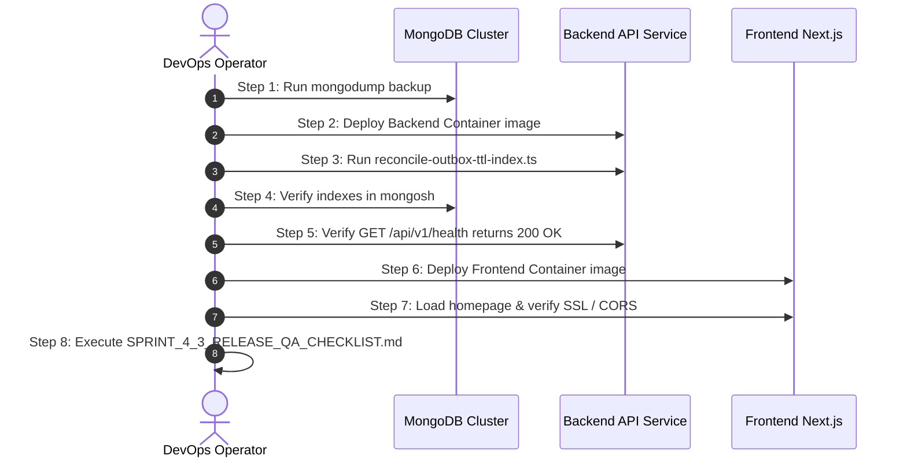

# KTVOnline — Sprint 4.3: Production Deployment Checklist

## 1. Executive Summary

This checklist establishes the production deployment requirements, environment variable inventory, security configurations, deployment sequence, and operational verification procedures for KTVOnline.

---

## 2. Environment Variable Inventory (Derived Strictly from Source Code)

### 2.1 Backend API Service (`apps/api/src/config/env.ts`)

| Variable Name | Required in Prod? | Type / Validation Rules | Default (Dev Only) | Status & Classification |
| :--- | :---: | :--- | :--- | :--- |
| `NODE_ENV` | **YES** | `production` \| `staging` \| `development` | `development` | **VERIFIED FROM SOURCE** |
| `PORT` | Optional | Positive integer | `5001` | **VERIFIED FROM SOURCE** |
| `MONGODB_URI` | **YES** | Valid MongoDB connection string | `mongodb://127.0.0.1:27017/ktv_online` | **REQUIRES OPERATOR CONFIG** |
| `JWT_ACCESS_SECRET` | **YES** | String, min 32 chars, cannot be dev default | Hardcoded dev default | **REQUIRES OPERATOR CONFIG** |
| `JWT_REFRESH_SECRET`| **YES** | String, min 32 chars, cannot equal access secret | Hardcoded dev default | **REQUIRES OPERATOR CONFIG** |
| `JWT_ACCESS_EXPIRES_IN` | Optional | Duration string (e.g. `15m`, `1h`) | `15m` | **VERIFIED FROM SOURCE** |
| `JWT_REFRESH_EXPIRES_IN`| Optional | Duration string (e.g. `7d`, `30d`) | `7d` | **VERIFIED FROM SOURCE** |
| `FRONTEND_URL` | **YES** | Valid origin URL (e.g. `https://ktvonline.com`) | `http://localhost:3000` | **REQUIRES OPERATOR CONFIG** |
| `COOKIE_DOMAIN` | Optional | Domain string (e.g. `.ktvonline.com`) | `undefined` | **REQUIRES OPERATOR CONFIG** |
| `COOKIE_SECURE` | Optional | Boolean (`true` \| `false`) | `false` | **REQUIRES OPERATOR CONFIG** |
| `LIVEKIT_URL` | **YES** | Valid URL with `ws:`, `wss:`, `http:`, `https:` | `undefined` (fails prod schema) | **REQUIRES OPERATOR CONFIG** |
| `LIVEKIT_API_KEY` | **YES** | String | `undefined` (fails prod schema) | **REQUIRES OPERATOR CONFIG** |
| `LIVEKIT_API_SECRET` | **YES** | String | `undefined` (fails prod schema) | **REQUIRES OPERATOR CONFIG** |
| `LIVEKIT_WEBHOOK_SECRET` | Optional | String | `undefined` | **REQUIRES OPERATOR CONFIG** |

> [!CRITICAL]
> In production (`NODE_ENV=production`), `apps/api/src/config/env.ts` enforces strict validation on startup:
> - `LIVEKIT_URL`, `LIVEKIT_API_KEY`, and `LIVEKIT_API_SECRET` must be present.
> - `JWT_ACCESS_SECRET` and `JWT_REFRESH_SECRET` must each be at least 32 characters, cannot match the development defaults, and cannot be identical.
> - If any of these are missing or invalid, the API server will throw `Invalid environment configuration` and exit immediately with status 1.

### 2.2 Frontend Web Application (`apps/web/src/lib/env.ts`)

| Variable Name | Required in Prod? | Type / Validation Rules | Default | Status & Classification |
| :--- | :---: | :--- | :--- | :--- |
| `NEXT_PUBLIC_API_URL` | **YES** | Valid URL pointing to backend API (e.g. `https://api.ktvonline.com/api/v1`) | `http://localhost:5001/api/v1` | **REQUIRES OPERATOR CONFIG** |

*Note: The frontend derives its Socket.IO server URL directly from `NEXT_PUBLIC_API_URL` (in `apps/web/src/lib/socket/socket-client.ts`). Setting `NEXT_PUBLIC_API_URL` automatically configures both REST and WebSocket transports.*

---

## 3. Infrastructure & Network Prerequisites

1. **MongoDB Database Cluster:**
   - Version: MongoDB 7.0+ (Replica Set strongly recommended for multi-document transaction support).
   - Database Name: `test` (or configured database name in `MONGODB_URI`).
   - Network: Inbound access from backend API container on port 27017.
2. **LiveKit Cloud or Self-Hosted SFU:**
   - LiveKit Server version 1.7+.
   - WebRTC UDP port ranges (`50000-60000`) and TCP/TLS port (`443`) open to client browsers.
3. **CORS & Domain Configuration:**
   - Backend `FRONTEND_URL` must match frontend public domain exactly (e.g. `https://ktvonline.com`).
   - If using cross-subdomain cookies, set `COOKIE_DOMAIN=.ktvonline.com` and `COOKIE_SECURE=true`.
4. **Single-Instance Replica Count:**
   - In accordance with GOV-04, backend API service must be deployed with `replicas: 1` until Milestone 5.0 Redis adapter is deployed.

---

## 4. Pre-Deployment Execution Sequence



### Step 1: Full Database Backup
```bash
mongodump --uri="$MONGODB_URI" --archive="ktv_backup_$(date +%Y%m%d_%H%M%S).gz" --gzip
```

### Step 2: Deploy Backend API Service
- Inject production environment variables.
- Start API container pod.

### Step 3: Execute Outbox TTL Migration
```bash
# Inside the deployed API container:
cd apps/api
node dist/database/migrations/reconcile-outbox-ttl-index.js
```
*(Or in source environments: `npx tsx src/database/migrations/reconcile-outbox-ttl-index.ts`)*

### Step 4: Verify Database Indexes (`mongosh`)
```javascript
use test;
db.roomstateoutboxes.getIndexes();
// Confirm: expiresAt_1_ttl exists; createdAt_1 TTL is absent.
```

### Step 5: Backend Health Verification
```bash
curl -f https://api.ktvonline.com/api/v1/health
# Expected Response: {"status":"ok","timestamp":"..."}
```

### Step 6: Deploy Frontend Web Application
- Build Next.js with `NEXT_PUBLIC_API_URL` baked into client bundle.
- Deploy frontend container pods.

### Step 7: Verify Web Accessibility & CORS Handshake
- Load `https://ktvonline.com` in browser.
- Open Developer Tools -> Network tab -> WS tab: verify Socket.IO connection status shows 101 Switching Protocols.

---

## 5. Post-Deployment Verification & Monitoring

1. **Structured Log Monitoring:**
   - Check API logs for startup confirmation:
     - `🎶 Karaoke song catalog initialized`
     - `🛠️ Initial karaoke playback reconciliation completed`
     - `🚀 KTV Online API server running`
   - Verify no uncaught exceptions or LiveKit authentication rejections.
2. **MongoDB Outbox Size:**
   - Query `db.roomstateoutboxes.countDocuments()` over first 24 hours to ensure published events are cleaned up by TTL thread.
3. **Execute Release QA Gate:**
   - Complete all 24 scenarios in [`docs/SPRINT_4_3_RELEASE_QA_CHECKLIST.md`](file:///Users/mac/Documents/workspace/workspace_coding/ktvonline/docs/SPRINT_4_3_RELEASE_QA_CHECKLIST.md).

---

## 6. Rollback Procedures

1. **Frontend Reversion:** Roll back web container image to previous release tag.
2. **Backend Reversion:** Roll back API container image to previous release tag.
3. **Database Index Reversion:** The new single-field TTL index on `expiresAt` is backward-compatible and does NOT need to be dropped when rolling back backend code.
