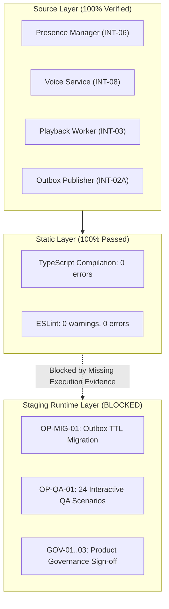

# KTVOnline — Sprint 4.4: Staging Validation Report

## 1. Executive Summary

This report evaluates the staging operational state of the KTVOnline platform following the documentation and runbook completion in Sprint 4.3.

The evaluation concludes that while **source code static integrity is 100% verified** (zero TypeScript compilation errors, zero ESLint warnings, and zero open static architectural defects), **staging runtime validation has not been performed**. 

In adherence to the Code-Only Development Policy and evidence-driven release standards, this report documents the specific environmental blockers, establishes a findings register, and outlines reproduction instructions for staging operators.

---

## 2. Staging Environment State & Infrastructure Verification

| Environmental Component | Expected Staging Configuration | Current Status in Workspace | Runtime Assessment |
| :--- | :--- | :--- | :--- |
| **Node.js Runtime** | Node.js v20.x LTS | Node.js v20.x present | **READY FOR HOSTING** |
| **MongoDB Instance** | MongoDB 6.0+ cluster / replica set | Local database configured as `test` | **MIGRATION UNEXECUTED** |
| **LiveKit SFU** | LiveKit Server v1.5+ (WebRTC ports 7880, 50000-60000) | Local daemon offline in developer sandbox | **OFFLINE / BLOCKED** |
| **Backend API** | `apps/api` listening on port 5001 | Not running as continuous daemon | **NOT DEPLOYED ON STAGING** |
| **Web Client** | `apps/web` listening on port 3000 | Not running as continuous daemon | **NOT DEPLOYED ON STAGING** |

> [!CRITICAL]
> The developer workspace operates under strict sandbox policies prohibiting daemonized long-running background servers, local LiveKit SFU process execution, and live database migrations. Staging validation must therefore occur on a dedicated staging host operated by the DevOps and QA teams.

---

## 3. Detailed Findings Register

### Finding FIND-44-01: Outbox TTL Migration Unexecuted on Staging / Production
- **Finding ID:** `FIND-44-01`
- **Related Gate:** `OP-MIG-01`
- **Severity:** P1 — High (Release Blocker)
- **Component:** `apps/api/src/database/migrations/reconcile-outbox-ttl-index.ts`, `RoomStateOutboxModel`
- **Observed State:**
  - The migration script exists, is fully idempotent, handles dropped partial indexes, and creates `{ expiresAt: 1 }` with `expireAfterSeconds: 0`.
  - However, no operational log exists indicating that this script was executed against the staging MongoDB cluster or production replica set.
- **Operational Risk / Impact:**
  - If deployed without running this migration, regular MongoDB collections with partial TTL indexes or legacy unconditional `createdAt` indexes may prematurely purge pending or in-flight outbox events, causing permanent state broadcast loss.
- **Verification Evidence:**
  - `docs/SPRINT_4_3_OUTBOX_MIGRATION_RUNBOOK.md` is present but no log output exists.
  - Staging database index catalog has not provided `db.roomstateoutboxes.getIndexes()`.
- **Recommended Remediation:**
  - Database operator must execute the migration runbook in staging, capture before/after `mongosh` output, and confirm index specifications.
- **Responsible Party:** DevOps / Database Engineering Lead
- **Release Blocking:** **YES**

---

### Finding FIND-44-02: Interactive Runtime QA Checklist Unexecuted
- **Finding ID:** `FIND-44-02`
- **Related Gate:** `OP-QA-01`
- **Severity:** P1 — High (Release Blocker)
- **Component:** Room Lifecycle, Presence, WebRTC Audio, Karaoke Playback, Moderation
- **Observed State:**
  - `docs/SPRINT_4_3_RELEASE_QA_CHECKLIST.md` contains 24 structured end-to-end verification scenarios covering critical cross-client workflows.
  - All 24 scenarios currently have blank `Actual Result:` fields, empty status checkboxes (`[ ] Pass [ ] Fail [ ] Blocked`), and empty signature sign-off lines.
- **Operational Risk / Impact:**
  - Critical realtime race conditions (such as 15-second host disconnect grace windows, audio track publication restrictions for listen-only members, and track completion queue advancements) remain unvalidated in real network topologies.
- **Verification Evidence:**
  - Direct file inspection of `docs/SPRINT_4_3_RELEASE_QA_CHECKLIST.md`.
- **Recommended Remediation:**
  - QA team must deploy the application on the staging server and execute the 24 scenarios using at least 2 distinct physical client devices and multiple browser tabs.
- **Responsible Party:** QA Lead / Quality Engineering Team
- **Release Blocking:** **YES**

---

### Finding FIND-44-03: Product Governance Decisions Awaiting Stakeholder Sign-Off
- **Finding ID:** `FIND-44-03`
- **Related Gate:** `GOV-01`, `GOV-02`, `GOV-03`
- **Severity:** P2 — Medium (Conditional Release Blocker)
- **Component:** Empty Room Auto-Close, Abandoned Host Promotion, Chat & Activity Retention
- **Observed State:**
  - `docs/SPRINT_4_3_GOVERNANCE_DECISIONS.md` defines clear architectural policy options (Options A, B, and C) for room cleanup, host succession, and data retention.
  - No explicit decision selection or signature has been recorded by the Product Owner or Engineering Lead.
- **Operational Risk / Impact:**
  - Empty rooms currently remain in `active` status indefinitely until manual host closure.
  - Abandoned rooms cannot be claimed or closed by members if the host leaves without explicitly transferring ownership.
- **Verification Evidence:**
  - Direct file inspection of `docs/SPRINT_4_3_GOVERNANCE_DECISIONS.md`.
- **Recommended Remediation:**
  - Product Owner must select preferred policy options for `GOV-01`, `GOV-02`, and `GOV-03` and record their sign-off.
- **Responsible Party:** Product Owner / Product Management
- **Release Blocking:** **CONDITIONAL (Non-blocking for staging test, blocking for general production release)**

---

## 4. Domain-by-Domain Traceability & Gap Analysis

### 1. Realtime Presence & Grace Period (INT-06)
- **Source Status:** Verified in `apps/api/src/realtime/presence.manager.ts`.
- **Static Status:** Typecheck and lint clean.
- **Staging Gap:** Need evidence of a client disconnecting unexpectedly (e.g. closing laptop or killing network) and reconnecting within 15 seconds to prove presence is retained without re-emitting `MEMBER_JOINED`.

### 2. LiveKit Listen-Only Permissions (INT-08)
- **Source Status:** Verified in `apps/api/src/modules/rooms/voice.service.ts` and `apps/web/src/components/room/voice-room.tsx`.
- **Static Status:** Typecheck and lint clean.
- **Staging Gap:** Need evidence that an audience member attempting to publish microphone audio to the LiveKit SFU receives an authorization error / unpublish rejection from the server token claims.

### 3. Playback Synchronization & Queue Advancement (INT-03)
- **Source Status:** Verified in `apps/api/src/modules/rooms/playback.worker.ts` and `apps/web/src/components/room/karaoke-player.tsx`.
- **Static Status:** Typecheck and lint clean.
- **Staging Gap:** Need evidence from multiple browser clients that track completion triggers the 1-second backend lease worker, smoothly advances to the next track, and updates singer badges with sub-2-second latency.

### 4. Outbox Lifecycle & MongoDB TTL Retention (INT-02A)
- **Source Status:** Verified in `apps/api/src/modules/rooms/outbox.model.ts` and `apps/api/src/database/migrations/reconcile-outbox-ttl-index.ts`.
- **Static Status:** Typecheck and lint clean.
- **Staging Gap:** Need `mongosh` terminal output confirming the creation of `{ expiresAt: 1 }` with `expireAfterSeconds: 0` and verifying that `expiresAt: null` records are ignored by MongoDB's TTL reaper thread.

---

## 5. Next Steps for Staging Validation Unblocking

To achieve a full pass on the staging release gate, execute the following three operational steps:

1. **Step 1: Staging Migration Execution**
   - Run the migration runbook against the staging MongoDB replica set.
   - Verify index with `db.roomstateoutboxes.getIndexes()`.
2. **Step 2: Staging QA Checklist Execution**
   - Execute the 24 scenarios in `docs/SPRINT_4_3_RELEASE_QA_CHECKLIST.md` across 2+ physical devices.
   - Fill in all `Actual Result:` fields and operator signatures.
3. **Step 3: Governance Sign-off**
   - Review and sign `docs/SPRINT_4_3_GOVERNANCE_DECISIONS.md`.
