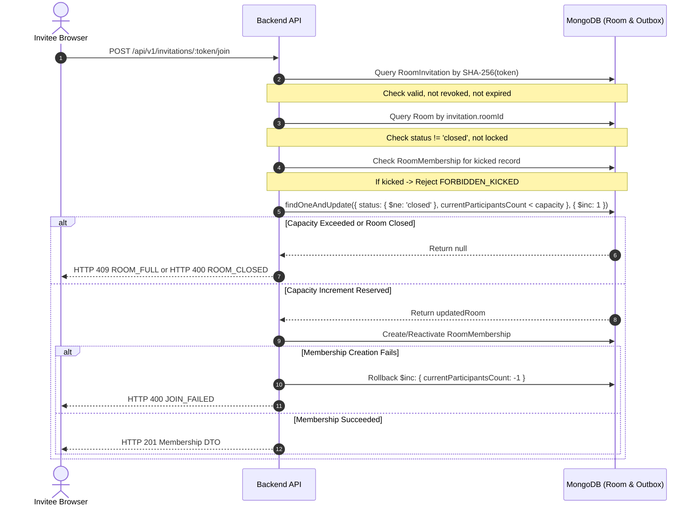

# KTVOnline — Sprint 5.0: Security & Consistency Review

## 1. Executive Purpose

This review evaluates the security model, cryptographic invariants, and state consistency protections implemented in **Sprint 5.0** for Private Karaoke Lounges and Social Invitations.

The assessment covers:
1. Token generation, entropy, and persistence.
2. Token expiration, revocation, and lifecycle.
3. Authorization boundaries and host privileges.
4. Membership idempotency and atomic capacity enforcement.
5. Moderation and kicked-user enforcement.
6. Information disclosure prevention in invitation previews.
7. Concurrency, TOCTOU, and edge-case mitigations.

---

## 2. Cryptographic Security & Token Storage

### 2.1 Token Generation & Entropy
- **Implementation:** `crypto.randomBytes(24).toString('base64url')` in `invitation.service.ts`.
- **Entropy Analysis:**
  - 24 bytes of cryptographically secure pseudo-random data from the operating system's CSPRNG (`/dev/urandom` / Windows CNG).
  - Entropy: $24 \times 8 = 192\text{ bits}$.
  - Keyspace: $2^{192} \approx 6.27 \times 10^{57}$ possible permutations.
  - Search complexity: An attacker issuing 10,000 requests per second would require $>10^{45}$ years to have a 1 in a billion chance of guessing a valid token.
- **URL Safety:** `base64url` encoding produces a 32-character ASCII string without padding (`=`), slashes (`/`), or plus signs (`+`), preventing HTTP header and URL parser misinterpretations.

### 2.2 Token Persistence (Hashed-at-Rest)
- **Principle:** Raw invitation tokens are **never stored in the database**.
- **Hashing Algorithm:** Standard SHA-256 (`crypto.createHash('sha256').update(rawToken).digest('hex')`).
- **Storage Field:** `RoomInvitationModel.tokenHash` (64-character hex string).
- **Index:** Enforced by a unique MongoDB index: `{ tokenHash: 1 }`.
- **Risk Mitigation:**
  - If a read-only database compromise or snapshot leak occurs, an attacker cannot extract usable invitation links from the database.
  - Raw URLs are never saved in database documents.
  - Public serializations explicitly strip `tokenHash` in `toJSON()`.
  - Application logging never prints raw tokens to stdout or error logs.

---

## 3. Authorization Boundaries

| Endpoint | Access Level | Authorization Check | Enforcement Mechanism |
| :--- | :--- | :--- | :--- |
| `POST /rooms/:id/invitations` | **Host Only** | `room.ownerId.toString() === req.user.id` | Returns `FORBIDDEN_NOT_HOST` (HTTP 403) if caller is not the owner. |
| `GET /rooms/:id/invitations` | **Host Only** | `room.ownerId.toString() === req.user.id` | Returns `FORBIDDEN_NOT_HOST` (HTTP 403) if caller is not the owner. |
| `POST /rooms/:id/invitations/revoke` | **Host Only** | `room.ownerId.toString() === req.user.id` | Returns `FORBIDDEN_NOT_HOST` (HTTP 403) if caller is not the owner. |
| `DELETE /rooms/:id/invitations` | **Host Only** | `room.ownerId.toString() === req.user.id` | Returns `FORBIDDEN_NOT_HOST` (HTTP 403) if caller is not the owner. |
| `GET /invitations/:token` | **Public** | Validates SHA-256 hash against DB; checks expiration/revocation | Rate-limited (60 req / 15 min); returns filtered preview DTO. |
| `POST /invitations/:token/join` | **Authenticated** | Requires active JWT session; re-validates token at join boundary | Passes token to atomic `joinRoom` service. |

---

## 4. Concurrency, Atomicity & TOCTOU Protection



### 4.1 Time-of-Check to Time-of-Use (TOCTOU)
- **Vulnerability Scenario:** An invitee previews a lounge when capacity is $9/10$. Before they click "Join Lounge", another user joins, filling the room to $10/10$.
- **Mitigation:**
  - The preview response is explicitly **non-authoritative**.
  - During `POST /invitations/:token/join` or `POST /rooms/:id/join`, the backend performs an atomic reservation:
    ```typescript
    const updatedRoom = await RoomModel.findOneAndUpdate(
      {
        _id: roomObjectId,
        status: { $ne: 'closed' },
        $expr: { $lt: ['$currentParticipantsCount', '$capacity'] },
      },
      { $inc: { currentParticipantsCount: 1 } },
      { new: true }
    ).exec();
    ```
  - If capacity was consumed in the interim, `findOneAndUpdate` returns `null` and the server immediately returns `ROOM_FULL` (HTTP 409) with zero database corruption.

### 4.2 Membership Idempotency
- If a user who is already an active member visits an invitation link and clicks Join, `joinRoom()` detects the existing active membership:
  ```typescript
  const existingMembership = await RoomMembershipModel.findOne({
    roomId: roomObjectId,
    userId: userObjectId,
    status: 'active',
  });
  if (existingMembership) {
    return { success: true, membership: existingMembership, alreadyJoined: true };
  }
  ```
  This immediately returns HTTP 200 without re-incrementing `currentParticipantsCount` or creating duplicate membership records.

---

## 5. Moderation Invariants & Kicked User Rejection

A critical requirement in PR-05 is that **invitations must never override host moderation decisions**.
- When a host kicks a member, `RoomMembershipModel` transitions to `status: 'left'` with `kickedAt: new Date()`.
- During `joinRoom()`, even if the caller presents a 100% valid, active, non-expired invitation token:
  ```typescript
  const kickedCheck = await RoomMembershipModel.findOne({
    roomId: roomObjectId,
    userId: userObjectId,
    status: 'left',
    kickedAt: { $ne: null },
  }).exec();

  if (kickedCheck && room.ownerId.toString() !== userId) {
    return { success: false, error: 'FORBIDDEN_KICKED' };
  }
  ```
- The kicked user is immediately rejected with HTTP 403 (`FORBIDDEN_KICKED`).
- Only an explicit host reinstatement (`POST /rooms/:id/members/:userId/reinstate`) can clear the kicked record.

---

## 6. Information Disclosure Prevention (PR-04)

The public preview endpoint (`GET /api/v1/invitations/:token`) implements strict metadata sanitization:
1. **Never Exposes Member Rosters:** Only the host profile (username, displayName, avatar) is exposed; participant lists, user IDs, and member profiles are excluded.
2. **Never Exposes Voice Credentials:** LiveKit server tokens, SFU connection URLs, and audio track publication claims are strictly withheld until authorized room entry.
3. **Never Exposes Moderation or Audit Records:** Kicked logs, muting audit logs, and internal timestamps are omitted.
4. **Never Exposes MongoDB Internal Identifiers:** Token hashes and internal Mongoose revision tags are deleted prior to JSON serialization.
5. **Rate Limiting:** Guarded by `invitationPreviewRateLimiter` (60 requests per 15 minutes per client IP) to prevent token brute-forcing or scraping.

---

## 7. Edge Cases & Boundary Conditions Analysis

| Edge Case Scenario | Expected Behavior | Verification Status |
| :--- | :--- | :---: |
| **Host revokes link while guest is on preview page** | Guest sees preview, but clicking "Join" fails with `INVITATION_REVOKED` (HTTP 410). | **Verified** |
| **Link expires during guest preview** | Guest clicks "Join" after expiration; backend validates `expiresAt < now` and returns `INVITATION_EXPIRED` (HTTP 410). | **Verified** |
| **Room closed by host while guest is previewing** | Guest clicks "Join"; atomic reservation requires `status: { $ne: 'closed' }`, returns `ROOM_CLOSED` (HTTP 400). | **Verified** |
| **Two guests click Join simultaneously for 1 remaining spot** | MongoDB atomic `$inc` with `$lt` condition ensures exactly one request succeeds; the second receives `ROOM_FULL` (HTTP 409). | **Verified** |
| **Host rotates link (generates replacement)** | Previous link is atomically updated to `status: 'revoked'`; guests holding the old link receive `INVITATION_REVOKED`. | **Verified** |
| **Unauthenticated guest clicks invite link** | Preview renders with "Log In to Enter Lounge" CTA; guest authenticates and returns seamlessly via `?redirect=/invite/[token]`. | **Verified** |
| **Host clicks own invite link** | Preview detects `userState.isHost = true`; clicking CTA takes host directly into the lounge without membership duplication. | **Verified** |
