# KTVOnline — Sprint 5.0: Source Audit & Architectural Assessment

## 1. Executive Mission & Baseline

Sprint 5.0 introduces **Private Karaoke Lounges & Social Invitations** under the product positioning:
> *"Your Virtual Hangout. Your Karaoke Night."*

This source-level audit evaluates existing room visibility, access-control rules, membership and capacity synchronization, and security patterns to design a minimal, secure, and production-grade social invitation architecture without introducing new infrastructure or duplicating existing subsystems.

### Repository Baseline
- **Git Branch:** `main`
- **Starting HEAD Commit:** `6a7ce9bf7adc303689ff1f7485d27015b9a9a427` (`6a7ce9b`)
- **Database Name:** `test` (preserved strictly)
- **Monorepo Structure:** pnpm workspace (`@ktv/contracts`, `apps/api`, `apps/web`)

---

## 2. Audit of Existing Functionality

### 2.1 Room Visibility & Discovery
1. **Schema & Model:**
   - In `apps/api/src/modules/rooms/room.model.ts` (lines 31–35), `visibility` is already defined as `enum: ['public', 'private']`, defaulting to `'public'`.
   - Compound indexes already exist for visibility:
     - `{ visibility: 1, status: 1, createdAt: -1 }`
     - `{ category: 1, visibility: 1, createdAt: -1 }`
     - `{ visibility: 1, currentParticipantsCount: -1, createdAt: -1 }`
2. **Public Discovery Enforcement:**
   - In `apps/api/src/modules/rooms/room.service.ts` (lines 96–99), `findRooms()` strictly enforces:
     ```typescript
     const filter: FilterQuery<IRoomDocument> = {
       visibility: 'public',
     };
     ```
   - Private rooms are already 100% excluded from public room exploration feeds.
3. **Room Creation & Editing:**
   - Both `apps/web/src/app/(platform)/rooms/create/page.tsx` and `apps/web/src/app/(platform)/rooms/[roomId]/manage/page.tsx` already feature Public vs. Private radio cards with descriptions.

---

### 2.2 Access Control & Joining Audit
1. **Current Private Room Restriction:**
   - In `apps/api/src/modules/rooms/room.service.ts` (lines 332–335):
     ```typescript
     // Private room access rule: only owner can join without direct invitation
     if (room.visibility === 'private' && room.ownerId.toString() !== userId) {
       return { success: false, error: 'PRIVATE_ROOM' };
     }
     ```
   - Currently, non-owners attempting to join a private room are rejected with `PRIVATE_ROOM` (HTTP 403: *"Cannot join private room without direct invitation"*).
   - In `apps/web/src/app/(platform)/rooms/[roomId]/page.tsx` (lines 582–592), the existing "Share / Invite" button merely copied `window.location.href` to clipboard, which resulted in non-owners hitting this 403 rejection.
2. **Idempotency & Rejoining:**
   - In `room.service.ts`, the check for existing active membership currently sits **after** the private room owner check. If an invited member rejoins or refreshes their browser, they should be recognized by their existing active membership rather than being blocked.
3. **Atomic Capacity & Moderation:**
   - `joinRoom()` features atomic reservation via `findOneAndUpdate({ _id, status: { $ne: 'closed' }, $expr: { $lt: ['$currentParticipantsCount', '$capacity'] } })`.
   - Rollback logic exists if subsequent membership record creation fails.
   - Kicked users are checked via `RoomMembershipModel.findOne({ roomId, userId, status: 'left', kickedAt: { $ne: null } })` and blocked (`FORBIDDEN_KICKED`).
   - Locked rooms reject non-owners (`ROOM_LOCKED`).

---

### 2.3 Invitation System Gaps
1. **No Invitation Persistence Model:**
   - No Mongoose schema exists for storing room invitation credentials.
2. **No Cryptographic Token Generation:**
   - No token creation or hashing utilities exist for invitation links.
3. **No Invitation Management Endpoints:**
   - Hosts have no API to create, view, or revoke invitation tokens.
4. **No Invitation Preview Endpoint:**
   - Invited users have no public endpoint to inspect room metadata safely before joining.
5. **No Invitation-Authorized Join Path:**
   - `joinRoom` does not accept an invitation token parameter.

---

## 3. Minimal Architecture Design

```mermaid
flowchart TD
    subgraph Host["Host Actions (Room Owner)"]
        H1["Open Invite Friends Dialog"] --> H2["POST /api/v1/rooms/:id/invitations"]
        H2 --> H3["Generate Secure Token (192-bit)"]
        H3 --> H4["Store SHA-256 Hash in DB"]
        H4 --> H5["Return Raw Token Once to Host"]
    end

    subgraph Guest["Guest Actions (Invitee)"]
        G1["Open /invite/:token"] --> G2["GET /api/v1/invitations/:token (Preview)"]
        G2 --> G3["Backend Hashes Token & Looks Up DB"]
        G3 --> G4["Return Safe Room Metadata & Status"]
        G4 --> G5["Guest clicks 'Join Lounge'"]
        G5 --> G6["POST /api/v1/invitations/:token/join"]
        G6 --> G7["Revalidate Token, Status, Capacity & Kicked Status"]
        G7 --> G8["Atomic Membership Creation & Redirect to /rooms/:id"]
    end
```



### 3.1 Persistence: `RoomInvitationModel`
- **Fields:**
  - `roomId`: `ObjectId`, ref `Room`, required, indexed.
  - `tokenHash`: `String`, required, unique, indexed (SHA-256 hex digest).
  - `createdBy`: `ObjectId`, ref `User`, required.
  - `expiresAt`: `Date`, required, indexed.
  - `revokedAt`: `Date`, default `null`.
  - `status`: `String`, enum `['active', 'revoked']`, default `'active'`.
  - `timestamps`: `true`.
- **Compound Indexes:**
  - `{ roomId: 1, status: 1 }` (for quick retrieval of room's active invitation).
  - `{ tokenHash: 1 }` (unique lookup).

### 3.2 Cryptographic Security (PR-03)
- Token generated via `crypto.randomBytes(24).toString('base64url')` (192 bits of entropy, URL-safe).
- Stored exclusively as `crypto.createHash('sha256').update(rawToken).digest('hex')`.
- Raw token returned only once in the HTTP 201 response payload.
- No raw tokens logged in stdout or persisted in database.

### 3.3 Endpoints
1. `POST /api/v1/rooms/:id/invitations`: Create / rotate invitation (Host only, requireAuth).
2. `GET /api/v1/rooms/:id/invitations`: Retrieve active invitation metadata (Host only, requireAuth).
3. `POST /api/v1/rooms/:id/invitations/revoke`: Revoke active invitation (Host only, requireAuth).
4. `GET /api/v1/invitations/:token`: Preview invitation (public / optionalAuth, rate limited).
5. `POST /api/v1/invitations/:token/join`: Join via invitation (requireAuth).
6. `POST /api/v1/rooms/:id/join`: Extended to accept optional `{ inviteToken?: string }`.

---

## 4. Identified Security Risks & Mitigations

| Risk | Attack Vector | Mitigation Strategy |
| :--- | :--- | :--- |
| **Token Brute-Forcing** | Attacker iterates potential invitation tokens | 192 bits of cryptographic entropy + rate limiting via `express-rate-limit` on the preview endpoint. |
| **Database Compromise Leak** | Read access to MongoDB exposes active invite URLs | Raw tokens are never stored; only one-way SHA-256 hashes are persisted. |
| **TOCTOU Race Condition** | Room fills up or is closed between preview and join | Server-side revalidation during join; atomic capacity reservation in `findOneAndUpdate`. |
| **Moderation Bypass** | Kicked member uses an invite link to re-enter | `RoomMembershipModel` kicked status check is enforced even when a valid invitation token is provided. |
| **Revocation Bypass** | User attempts to join with a previously generated link | Active invitation lookup requires `status === 'active'`, `revokedAt === null`, and `expiresAt > now`. |
| **Metadata Leakage** | Public preview reveals member list or voice credentials | Preview endpoint strictly filters room metadata (no voice tokens, no member rosters, no moderation logs). |
