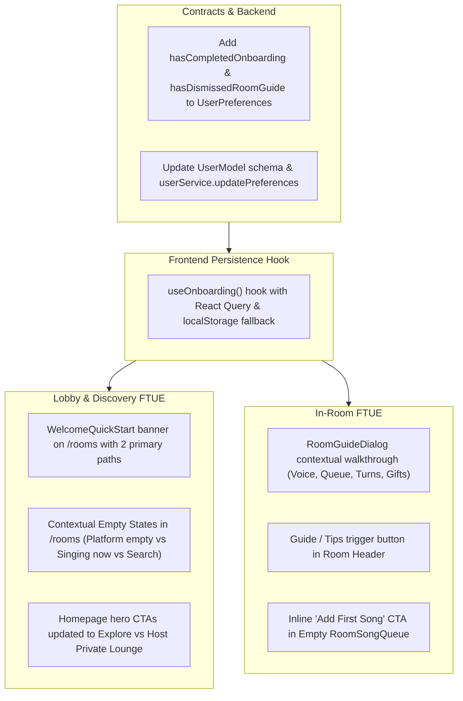

# KTVOnline — Sprint 5.1: Source Audit & FTUE Mapping

## 1. Executive Purpose & Baseline

Sprint 5.1 focuses on the **First-Time User Experience (FTUE)** under the platform core positioning:
> *"Your Virtual Hangout. Your Karaoke Night."*

The goal is to eliminate onboarding friction, clarify the journey for new visitors and registered singers, provide intuitive discovery and in-room guidance, and supply actionable empty states across the application without redesigning the core architecture or introducing external dependencies.

### Repository Baseline
- **Git Branch:** `main`
- **Starting HEAD Commit:** `f30804c2069f23874cc9d086b4ae4aaa86eaa8de` (`f30804c`)
- **Database Name:** `test` (preserved strictly)
- **Monorepo Packages:** `@ktv/contracts`, `apps/api`, `apps/web`

---

## 2. Current User Journey & Friction Point Audit

### 2.1 The New User Journey Today
1. **Landing Page (`/`):**
   - The landing page presents hero text *"Your Virtual Hangout. Your Karaoke Night."*
   - **Friction Point 1:** The top pill contained engineering release notes (`Sprint 0 Architecture Foundation Live Next.js 15 &bull; Express &bull; Mongoose`) rather than product-facing value propositions.
   - **Friction Point 2:** The secondary hero CTA linked to `/profile` ("Studio Profile") rather than providing a direct path to host/create a private lounge with friends.
2. **Post-Authentication Landing (`/rooms`):**
   - Upon logging in or registering, users are routed directly to `/rooms` (the room discovery lobby).
   - **Friction Point 3:** The user is immediately dropped into a dense filter and search grid with no welcoming explanation of how public vs. private lounges work or how to preview before joining.
   - **Friction Point 4:** No onboarding state was tracked or persisted. Users received no initial orientation.
3. **Empty States in Room Discovery:**
   - **Friction Point 5:** When `rooms.length === 0`, a single generic message appeared: *"No Lounges Found — We couldn't find any rooms matching your search and filter criteria"*.
   - It did not differentiate between:
     - A completely empty platform (zero rooms exist).
     - Filtering by "Singing Now" when rooms exist but are currently in queue/idle mode.
     - A search query with typos or no matching genres.
4. **First-Time Room Experience (`/rooms/[roomId]`):**
   - When entering a karaoke room for the first time, users were presented with the player, queue, voice controls, chat, and participants.
   - **Friction Point 6:** No contextual explanation existed for:
     - Why voice is listen-only until their song turn arrives.
     - How singer handoff operates.
     - How to queue a song or send live reactions.
   - No "Help" or "Lounge Guide" button was present in the room header.
5. **Empty Queue Experience:**
   - When the karaoke queue is empty, `RoomSongQueue.tsx` showed *"The Queue is Empty"*, but required users to look for the separate "Add Song to Queue" button at the bottom instead of offering an instant inline click action.

---

## 3. Existing Persistence Capabilities Audit

1. **User Preferences (`UserModel.preferences`):**
   - The API already persists user preferences under `preferences` in `UserModel` (e.g. `preferredGenres`, `preferredLanguages`, `participationStyle`, `lyricsFontSize`, `visualEffectsIntensity`, `showReactions`, `showGifts`).
   - `packages/contracts/src/preferences.ts` defines `UserPreferencesDtoSchema` and `UpdateUserPreferencesSchema`.
   - `apps/web/src/hooks/queries/use-user-preferences.ts` provides `useUserPreferences()` and `useUpdateUserPreferences()`.
2. **Minimal Schema Extension:**
   - By adding two boolean flags to `UserPreferencesDto`:
     - `hasCompletedOnboarding: boolean` (default `false`)
     - `hasDismissedRoomGuide: boolean` (default `false`)
   - We gain robust, server-persisted onboarding tracking for authenticated accounts without creating new database collections or running destructive migrations.
3. **Client-Side Fallback:**
   - For guest/unauthenticated users, `localStorage` provides lightweight persistence (`ktv_ftue_welcome_dismissed`), cleared upon logout to prevent cross-account state leakage.

---

## 4. Reusable Components & Design Tokens

- **Design Language:** Glassmorphic dark panels (`glass-panel`), `#090b12` root background, `#0e121e` surface cards, subtle neon borders (`border-white/10`, `border-violet-500/25`), and Tailwind CSS v4 utilities.
- **Shared Components:**
  - `apps/web/src/components/shared/empty-state.tsx`: Standardized empty state card with icon, title, description, and primary CTA.
  - `apps/web/src/components/layout/page-container.tsx`: Responsive container enforcing padding and max-widths.
  - `apps/web/src/components/shared/user-avatar.tsx`: Multi-size avatar with status indicators.
  - `ATMOSPHERE_PRESETS`: Curated visual styling presets for karaoke rooms.

---

## 5. Implementation Plan

1. **Step 1:** Extend `packages/contracts/src/preferences.ts` and `apps/api/src/modules/users/user.model.ts` with `hasCompletedOnboarding` and `hasDismissedRoomGuide`.
2. **Step 2:** Build `apps/web/src/hooks/use-onboarding.ts`.
3. **Step 3:** Build `apps/web/src/components/onboarding/welcome-quick-start.tsx` and integrate it into `/rooms`.
4. **Step 4:** Build `apps/web/src/components/rooms/room-guide-dialog.tsx` and integrate into `/rooms/[roomId]`.
5. **Step 5:** Enhance empty states in `apps/web/src/app/(platform)/rooms/page.tsx` and `RoomSongQueue.tsx`.
6. **Step 6:** Polish homepage hero CTAs in `apps/web/src/app/page.tsx`.
7. **Step 7:** Verify with `pnpm typecheck` and `pnpm lint`.
