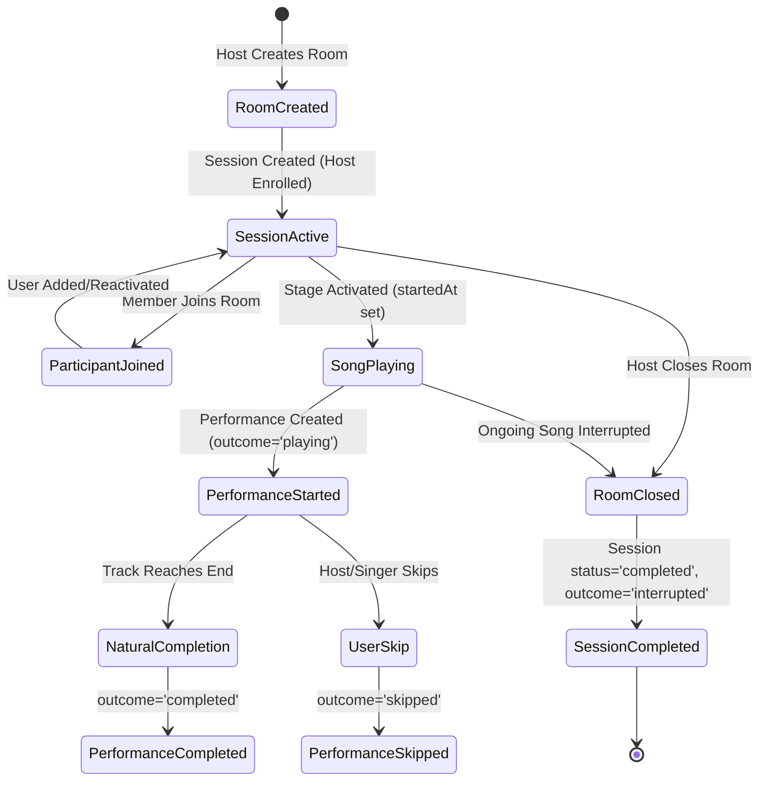

# KTVOnline — Sprint 5.3: Data Model & Lifecycle Design

## 1. Architecture Overview & Model Strategy

To balance query efficiency, bounded document size, and ACID consistency without unbounded arrays, Sprint 5.3 introduces a **Two-Model Architecture**:

1. **`KaraokeSessionModel` (`karaoke_sessions` collection):**
   - Represents a persistent room karaoke session from room creation to closure.
   - Contains immutable snapshots of room identity, host details, atmosphere preset, visibility, session timestamps, and aggregated statistics (`totalSongsPlayed`, `totalParticipantsCount`).
   - Contains an embedded array of participant subdocuments bounded by the room's maximum capacity (50 participants).
2. **`KaraokePerformanceModel` (`karaoke_performances` collection):**
   - Represents an individual song performance actually commenced on the room stage.
   - Separate collection to avoid document size explosion during extended marathon sessions.
   - Referenced to `sessionId` and `roomId`.
   - Indexed uniquely on `queueItemId` to guarantee idempotency.

---

## 2. Model Schemas

### 2.1 `KaraokeSessionModel` Schema
```typescript
interface ISessionParticipant {
  userId: Types.ObjectId;
  username: string;
  displayName: string | null;
  avatar: string | null;
  role: 'host' | 'moderator' | 'member';
  joinedAt: Date;
  leftAt: Date | null;
  songsPerformedCount: number;
}

interface IKaraokeSession {
  roomId: Types.ObjectId;
  roomName: string; // Snapshot
  hostId: Types.ObjectId;
  hostUsername: string; // Snapshot
  hostDisplayName: string | null;
  visibility: 'public' | 'private';
  roomType: string;
  atmospherePreset: string;
  startedAt: Date;
  endedAt: Date | null;
  status: 'active' | 'completed';
  endedReason?: 'host_closed' | 'room_abandoned' | 'manual' | null;
  totalSongsPlayed: number;
  totalParticipantsCount: number;
  durationMs: number | null;
  participants: ISessionParticipant[];
}
```

#### Key Indexes on `KaraokeSessionModel`:
- `{ roomId: 1, status: 1 }`: For active session lookup and closure.
- `{ 'participants.userId': 1, startedAt: -1 }`: For user session history queries.
- `{ hostId: 1, startedAt: -1 }`: For host session archives.
- `{ visibility: 1, status: 1, startedAt: -1 }`: For public lounge recap discovery.

---

### 2.2 `KaraokePerformanceModel` Schema
```typescript
interface IKaraokePerformance {
  sessionId: Types.ObjectId;
  roomId: Types.ObjectId;
  queueItemId: Types.ObjectId; // UNIQUE IDEMPOTENCY KEY
  songId: Types.ObjectId;
  songTitle: string; // Snapshot
  artist: string; // Snapshot
  thumbnailUrl: string | null; // Snapshot
  genre: string; // Snapshot
  language: string; // Snapshot
  durationMs: number;
  singerId: Types.ObjectId;
  singerUsername: string; // Snapshot
  singerDisplayName: string | null; // Snapshot
  singerAvatar: string | null; // Snapshot
  requestedById: Types.ObjectId;
  roomName: string; // Snapshot
  startedAt: Date;
  completedAt: Date | null;
  durationPerformedMs: number;
  outcome: 'playing' | 'completed' | 'skipped' | 'failed' | 'interrupted';
}
```

#### Key Indexes on `KaraokePerformanceModel`:
- `{ queueItemId: 1 }` with `{ unique: true }`: Prevents duplicate records for the same queue item.
- `{ singerId: 1, startedAt: -1 }`: For user "Recently Sung" and history feeds.
- `{ sessionId: 1, startedAt: 1 }`: For session recap song listing.
- `{ roomId: 1, startedAt: -1 }`: For room performance archives.

---

## 3. Lifecycle Transitions & State Synchronization



---

## 4. Idempotency & Concurrency Strategy

1. **Unique Index Guard:**
   - The unique index on `queueItemId` in `KaraokePerformanceModel` guarantees that even if a worker lease triggers concurrent retries or duplicate outbox messages, MongoDB rejects the duplicate write immediately with code 11000.
2. **Participant Upsert Isolation:**
   - In `KaraokeSessionModel`, participant updates check `participants.userId`. If the user already exists, their `leftAt` is cleared (on rejoin) or updated (on leave), avoiding duplicate participant entries.
3. **Bounded Document Growth:**
   - By embedding only participant summaries and referencing performances as separate documents, the session document remains compact (< 25 KB even with 50 participants).
