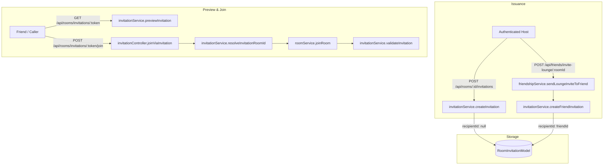

# Sprint 5.6.1.3: Invitation Security & Token Isolation Audit

## 1. Scope & Call Graph Inspection

This audit inspected the complete invitation lifecycle across creation, issuance, preview, validation, and redemption.



---

## 2. Authorization Verification (Phase 1)

### 2.1 Host Ownership Enforcement
- **`createInvitation` (`invitation.service.ts#L54-L57`):**
  ```typescript
  if (room.ownerId.toString() !== hostUserId) {
    return { success: false, error: 'FORBIDDEN_NOT_HOST' };
  }
  ```
- **`createFriendInvitation` (`invitation.service.ts#L125-L128`):**
  ```typescript
  if (room.ownerId.toString() !== hostUserId) {
    return { success: false, error: 'FORBIDDEN_NOT_HOST' };
  }
  ```
- **`sendLoungeInviteToFriend` (`friendship.service.ts#L642-L645`):**
  ```typescript
  if (room.ownerId.toString() !== userId) {
    return { success: false, error: 'FORBIDDEN_NOT_HOST' };
  }
  ```
- **Actor Identity Consistency:**
  - In `invitation.controller.ts#L21`: `req.user.id` is derived from verified JWT middleware.
  - In `friendship.controller.ts#L267`: `req.user.id` is derived from verified JWT middleware.
  - No client-supplied owner ID or impersonation parameter is accepted anywhere in the call graph.

### 2.2 Room Eligibility & Pre-Authorization
- Closed rooms (`room.status === 'closed'`) are rejected before any token creation or revocation side effect:
  - `invitation.service.ts#L50`
  - `invitation.service.ts#L121`
  - `friendship.service.ts#L638`
- Locked rooms (`room.isLocked`) and kicked users (`kickedAt !== null`) are enforced at the join boundary (`room.service.ts#L377`, `#L389`).

---

## 3. Recipient Identity Enforcement (Phase 2)

### 3.1 Preview Guard (`invitation.service.ts#L267-L276`)
```typescript
if (invitation.recipientId) {
  if (!requestingUserId || invitation.recipientId.toString() !== requestingUserId) {
    return {
      success: true,
      data: {
        invitation: { status: 'invalid' },
      },
    };
  }
}
```
- **Missing Identity:** When unauthenticated (`requestingUserId === undefined`), fails closed returning generic `{ status: 'invalid' }`.
- **Mismatched Identity:** When authenticated as another user, fails closed returning generic `{ status: 'invalid' }`.
- **Metadata Protection:** Private room name, description, category, and host profile are completely withheld from unauthorized callers.
- **Public Link Preservation:** If `recipientId === null`, the condition is skipped, allowing public bearer link previews.

### 3.2 Join Boundary Enforcement (`invitation.service.ts#L405-L410` & `#L441-L446`)
- In `validateInvitation`:
  ```typescript
  if (invitation.recipientId) {
    if (!requestingUserId || invitation.recipientId.toString() !== requestingUserId) {
      return { valid: false, error: 'INVITATION_RECIPIENT_MISMATCH' };
    }
  }
  ```
- In `resolveInvitationRoomId`:
  ```typescript
  if (invitation.recipientId) {
    if (!requestingUserId || invitation.recipientId.toString() !== requestingUserId) {
      return { success: false, error: 'INVITATION_RECIPIENT_MISMATCH' };
    }
  }
  ```
- In `invitation.controller.ts#L161` & `room.controller.ts#L157`:
  `INVITATION_RECIPIENT_MISMATCH` is mapped to HTTP 403 Forbidden (`'This invitation was issued to another user'`).

---

## 4. Token Storage & Lifecycle (Phase 3)

1. **Hash-Only Persistence:**
   Tokens are generated via `crypto.randomBytes(32).toString('hex')` and hashed via SHA-256 (`createHash('sha256').update(rawToken.trim()).digest('hex')`). Only `tokenHash` is persisted. Raw tokens are never logged.
2. **Multi-Friend Token Isolation:**
   When inviting Friend B, `createFriendInvitation` executes:
   ```typescript
   await RoomInvitationModel.updateMany(
     { roomId: roomObjectId, recipientId: friendObjectId, status: 'active', revokedAt: null },
     { $set: { status: 'revoked', revokedAt: new Date() } }
   ).exec();
   ```
   Only Friend B's previous active tokens are revoked. Friend A's active tokens (`recipientId: friendA_id`) remain untouched and valid.
3. **Capacity Concurrency:**
   Room capacity is reserved via atomic MongoDB conditional update (`$inc: { currentParticipantsCount: 1 }` with `$expr: { $lt: ['$currentParticipantsCount', '$capacity'] }`). Concurrent redemptions cannot exceed room limits.

---

## 5. Audit Conclusion
All invitation authorization, recipient identity enforcement, token isolation, and redemption controls are **fully verified**. Zero defects identified.
