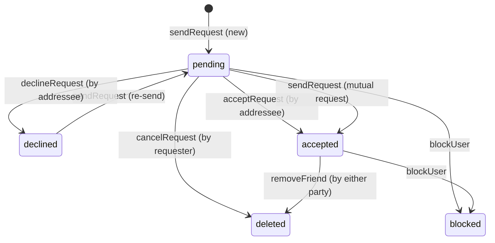

# Sprint 5.6 Friendship Model Review

**Sprint:** 5.6  
**Document:** Friendship Model & Relational Consistency Review  
**Milestone:** Social Presence & Friendship Experience  
**Date:** November 2026  

---

## 1. Executive Summary

In Sprint 5.6, KTVOnline introduced a bidirectional friendship model to anchor its social karaoke positioning (*"Your Virtual Hangout. Your Karaoke Night."*). Rather than adopting a unidirectional social media follower model (such as Twitter or Instagram), KTVOnline requires explicit mutual consent for friendship. This document provides an architectural and data-integrity review of the schema, uniqueness guarantees, state transition semantics, and query execution characteristics.

---

## 2. Schema Specification & Canonical Ordering

The friendship relationship is persisted in the `friendships` collection in MongoDB (`FriendshipModel`).

```typescript
export interface IFriendship {
  requesterId: Types.ObjectId;
  addresseeId: Types.ObjectId;
  pairKey: string;
  status: 'pending' | 'accepted' | 'declined' | 'blocked';
  blockedBy?: Types.ObjectId | null;
  createdAt: Date;
  updatedAt: Date;
}
```

### 2.1. Canonical Pair Key (`pairKey`)

A persistent problem in bidirectional relational modeling on document databases is preventing concurrent duplicate requests between two users $A$ and $B$. If user $A$ sends a request to user $B$ while user $B$ simultaneously sends a request to user $A$, two distinct documents can be created without strict uniqueness guards.

KTVOnline enforces a deterministic canonical pair key:

$$\text{pairKey} = \min(A_{\text{str}}, B_{\text{str}}) + \text{":"} + \max(A_{\text{str}}, B_{\text{str}})$$

```typescript
export function computePairKey(userA: string | Types.ObjectId, userB: string | Types.ObjectId): string {
  const strA = userA.toString();
  const strB = userB.toString();
  return strA < strB ? `${strA}:${strB}` : `${strB}:${strA}`;
}
```

A unique index is applied on `pairKey`:
```typescript
FriendshipSchema.index({ pairKey: 1 }, { unique: true });
```

### 2.2. Guarantees Provided by `pairKey`
1. **Single Document per User Pair:** Exactly one document can ever exist between any pair of users, regardless of who initiated the interaction.
2. **Race Condition Prevention:** Simultaneous requests from both users immediately serialize on the unique constraint in MongoDB; one request wins or detects the existing pending request.
3. **Mutual Request Auto-Acceptance:** If user $B$ sends a request to user $A$ while $A$ already has an active pending request to $B$, the system detects this scenario and transitions the status directly to `accepted`, delivering a pleasant UX without deadlock.

---

## 3. State Machine & Transition Rules



### 3.1. Verification of Role Enforcements
- **Accept Request:** Only the document's `addresseeId` can invoke `acceptRequest`. If the requester attempts to accept their own request, `FORBIDDEN_NOT_ADDRESSEE` (HTTP 403) is returned.
- **Decline Request:** Only the document's `addresseeId` can decline.
- **Cancel Request:** Only the document's `requesterId` can cancel.
- **Remove Friend:** Either participant in an `accepted` friendship can terminate the friendship.

---

## 4. Query Performance & Index Strategy

The `friendships` collection defines the following targeted indexes:

| Index Fields | Type | Purpose |
|---|---|---|
| `{ pairKey: 1 }` | Unique | Enforces 1 relation per pair; $O(1)$ relationship lookups. |
| `{ requesterId: 1, status: 1 }` | Compound | Fast querying of outgoing requests (`getOutgoingRequests`). |
| `{ addresseeId: 1, status: 1 }` | Compound | Fast querying of incoming requests (`getIncomingRequests`). |
| `{ status: 1, updatedAt: -1 }` | Compound | Fast sorting for accepted friends queries with pagination. |

### 4.1. Friends Query Optimization
When fetching a user's friends:
```typescript
const filter = {
  $or: [
    { requesterId: new Types.ObjectId(userId) },
    { addresseeId: new Types.ObjectId(userId) },
  ],
  status: 'accepted',
};
```
MongoDB's query planner uses index intersection or `$or` index union across `{ requesterId: 1, status: 1 }` and `{ addresseeId: 1, status: 1 }`, ensuring sub-millisecond query execution even as user volume scales.

---

## 5. Architectural Verdict

The friendship model conforms to strict ACID document safety, prevents orphaned states, avoids unbounded array growth (by storing one document per relationship rather than embedded friend lists inside user documents), and provides deterministic consistency.
