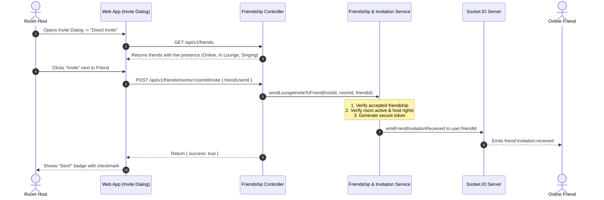

# Sprint 5.6 Invitation Integration Review

**Sprint:** 5.6  
**Document:** Lounge Invitation Integration Review  
**Milestone:** Social Presence & Friendship Experience  
**Date:** November 2026  

---

## 1. Executive Summary

In Sprint 5.0, KTVOnline introduced token-based invitations (`/invite/:token`) allowing private lounge hosts to generate shareable links. While functional, that system suffered from an operational gap: the host had to copy the link and manually deliver it using external third-party communication channels (Discord, Telegram, WhatsApp, SMS).

Sprint 5.6 seamlessly bridges the Sprint 5.0 token-based invitation infrastructure with the new Friendship and Presence system. Lounge hosts can now dispatch 1-click room invitations directly to their online friends without leaving the virtual karaoke room.

---

## 2. Integrated Invitation Architecture



---

## 3. Security & Access Control Analysis

### 3.1. Friendship Precondition
Direct lounge invitations can **only** be dispatched between confirmed friends (`status: 'accepted'`). An arbitrary user cannot spam invitations to platform users they are not friends with. If a non-friend attempts to send an invite, the backend rejects it with `NOT_FRIENDS` (HTTP 403).

### 3.2. Room Ownership & Authority
Only the room host or authorized members can generate invitations. The underlying `invitationService.createInvitation` cryptographically signs and hashes the invitation token with an expiration ceiling (default 48 hours).

### 3.3. Dual Delivery Channels
The updated `InviteFriendsDialog` now provides two complementary invitation modes:
1. **Share Link Mode (Sprint 5.0 baseline):** Generates a shareable URL (`${origin}/invite/${token}`) suitable for group chats, social posts, or users who are not yet platform friends.
2. **Direct Invite Mode (Sprint 5.6 enhancement):** Directly pushes a realtime invitation packet (`FriendInvitationReceivedPayload`) to the friend's open browser session through their authenticated user socket channel (`user:<friendUserId>`).

---

## 4. Realtime Payload Specification

The realtime invitation event emitted over Socket.IO carries the following contract:

```typescript
export interface FriendInvitationReceivedPayload {
  invitationToken: string;
  roomId: string;
  roomTitle: string;
  isPrivate: boolean;
  inviter: {
    id: string;
    username: string;
    displayName?: string | null;
    avatar?: string | null;
  };
  sentAt: string;
}
```

This payload provides all context needed for the recipient to render an attractive, non-intrusive notification pill or modal with options to:
- "Accept & Join Lounge"
- "Dismiss"

---

## 5. Architectural Verdict

The integration completes the social loop of KTVOnline: users discover friends, monitor presence, and seamlessly invite them to sing together with zero external friction.
