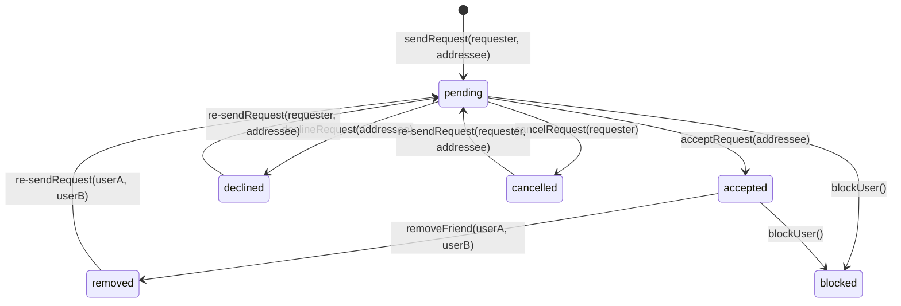
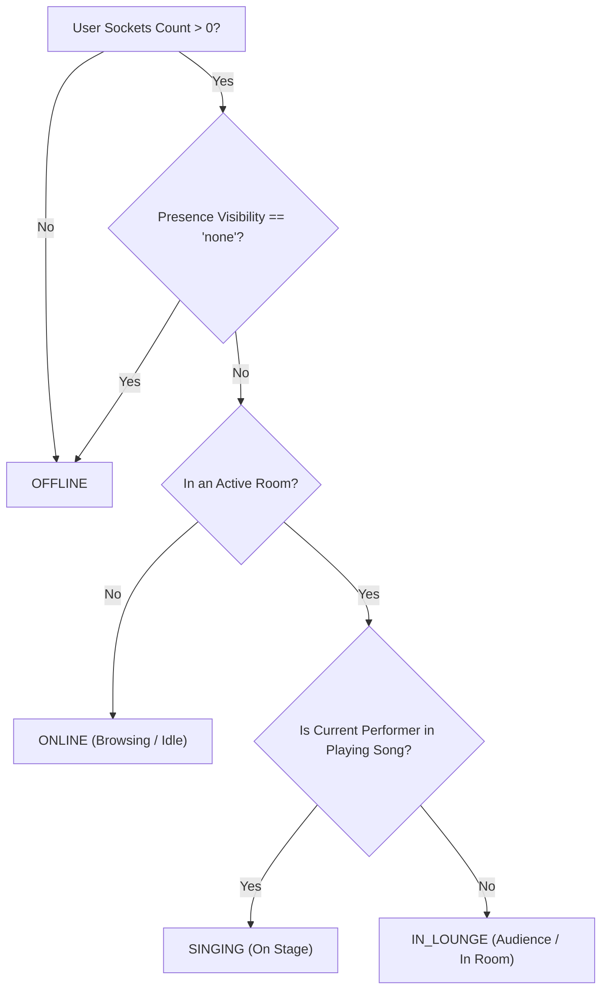
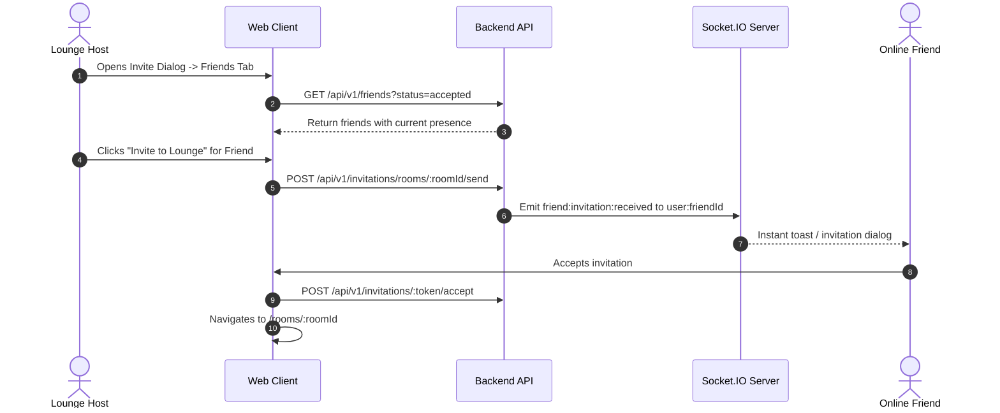

# Sprint 5.6 Social Architecture: Friendship, Presence & Invitations

**Milestone:** Sprint 5.6 Social Presence & Friendship Experience  
**Status:** Architecture Specification  
**Product Positioning:** *"Your Virtual Hangout. Your Karaoke Night."*  

---

## 1. Architectural Overview

KTVOnline is designed as a virtual karaoke hangout. The social layer connects users across sessions so they can discover other karaoke enthusiasts, establish mutual friendships, see who is currently available to sing, and invite friends directly into their rooms.

The architecture comprises three core pillars:
1. **Bidirectional Friendship Model:** A persistent MongoDB relation handling friend requests, acceptances, rejections, cancellations, and friend removal with deduplication guarantees.
2. **Global Realtime Presence System:** An in-memory presence tracking layer that combines authenticated Socket.IO connections with active room memberships and live karaoke playback states to report accurate presence badges (`offline`, `online`, `in_lounge`, `singing`).
3. **Privacy-Preserving Presence & Room Invitations:** Strict privacy boundaries ensuring users can hide their online status (`presenceVisibility: 'none'`), restrict visibility to friends (`presenceVisibility: 'friends'`), and ensure private lounge identifiers are masked from non-members.

---

## 2. Friendship Lifecycle Architecture

A friendship begins as a directional friend request (`requester` -> `addressee`) and transitions to an accepted bidirectional friendship once approved.

### 2.1. State Machine

### 2.2. Pair Canonicalization & Uniqueness

To prevent duplicate requests between two users $A$ and $B$, the system stores:
- `requesterId`: The user initiating the action.
- `addresseeId`: The recipient user.
- `status`: `'pending' | 'accepted' | 'declined' | 'blocked'`.
- `pairKey`: A canonical string `${min(A, B)}:${max(A, B)}` backed by a unique index for active friendships or pending requests. This prevents race conditions where both users send simultaneous friend requests to each other.

---

## 3. Global Presence Architecture

### 3.1. Presence State Hierarchy

Presence is computed dynamically based on real-time platform signals:

### 3.2. Privacy Masking Matrix

When user $X$ queries the presence of user $Y$:

| $Y$'s Privacy Setting | Viewer Relationship | Actual State | Reported Status | Room Details Exposed |
|---|---|---|---|---|
| `none` | Any | Any | `offline` | None |
| `friends` | Not Friends | Any | `offline` | None |
| `friends` | Friends | `online` | `online` | None |
| `friends` | Friends | `in_lounge` (Public Room) | `in_lounge` | `roomId`, `roomTitle` |
| `friends` | Friends | `in_lounge` (Private Room) | `in_lounge` | `roomTitle: "Private Lounge"`, `roomId: null` |
| `friends` | Friends | `singing` (Public Room) | `singing` | `roomId`, `roomTitle`, `songTitle` |
| `friends` | Friends | `singing` (Private Room) | `singing` | `roomTitle: "Private Lounge"`, `roomId: null` |
| `everyone` | Any | In Room (Private) | `in_lounge` | Masked (`roomId: null`) |

> [!IMPORTANT]
> Private room identifiers and passcodes are never leaked through presence. Non-members only see that the friend is in a "Private Lounge" unless they possess a valid invitation token.

---

## 4. Realtime Event Architecture

### 4.1. Sockets & Channels
1. **User Channel (`user:<userId>`):** Every authenticated socket automatically joins `user:<userId>` upon connection. This enables direct messaging to all connected devices/tabs for that specific user.
2. **Presence Broadcasts:** When a user's presence state transitions (e.g. connects, disconnects, enters lounge, starts singing), a `friend:presence:updated` event is pushed to their online friends.
3. **Friend Request Notifications:** Realtime notifications `friend:request:received` and `friend:request:accepted` are emitted to `user:<targetUserId>`.

### 4.2. Invitation Flow

---

## 5. API Endpoints Specification

| Method | Endpoint | Description | Auth Required |
|---|---|---|---|
| `GET` | `/api/v1/friends` | List accepted friends with dynamic presence | Yes |
| `GET` | `/api/v1/friends/requests/incoming` | List pending incoming requests | Yes |
| `GET` | `/api/v1/friends/requests/outgoing` | List pending outgoing requests | Yes |
| `POST` | `/api/v1/friends/request` | Send a friend request | Yes |
| `POST` | `/api/v1/friends/request/:id/accept` | Accept a pending request | Yes |
| `POST` | `/api/v1/friends/request/:id/decline`| Decline a pending request | Yes |
| `POST` | `/api/v1/friends/request/:id/cancel` | Cancel an outgoing request | Yes |
| `DELETE`| `/api/v1/friends/:friendUserId` | Unfriend a user | Yes |
| `GET` | `/api/v1/friends/search` | Search users by username / displayName | Yes |
| `POST` | `/api/v1/invitations/rooms/:roomId/send-to-friend` | Direct lounge invite to friend | Yes |

---

## 6. Single-Node In-Memory Presence Considerations

In accordance with Sprint 5.6 engineering constraints, no external Redis cache is introduced.
- Global presence uses an in-memory `GlobalPresenceManager` storing active socket sets per user (`Map<userId, Set<socketId>>`).
- Room presence leverages the existing `RoomPresenceManager`.
- If the single backend node restarts, active sockets automatically reconnect and re-establish their online presence.
- Distributed multi-node presence synchronization is recognized as technical debt (HIST-03).
