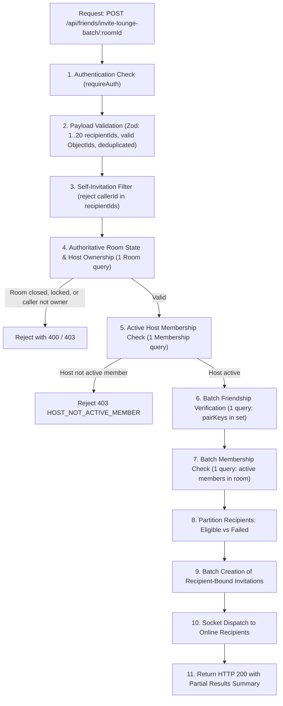

# KTVOnline — Sprint 5.7.1: Pre-Implementation Architecture Clarifications
## Friend Activity & Social Karaoke Sessions

**Document Version:** 1.0.0  
**Status:** Architecture Clarification & Pre-Implementation Baseline  
**Scope:** Planning Clarification & Deep Source Verification Only (No Application Source Changes)  
**Database Name:** `test` (Preserved)  
**Baseline Commits:** `1cf0537` (Sprint 5.6.1.3), `ed74b67` (Sprint 5.7 Planning Baseline), `8ac7ab2` (Contracts Resolution Fix)

---

## 1. Executive Summary

During the Product Discovery review of **Sprint 5.7: Friend Activity & Social Karaoke Sessions**, five implementation-critical architectural gaps and potential risk areas were identified:

1. **Offline Invitation Delivery:** Reconciling one-way SHA-256 token hashing with post-login invitation discovery and redemption.
2. **Batch Invitation API Integrity:** Designing the authorization, rate-limiting, and validation pipeline for multi-friend invitations without N+1 query proliferation or race conditions.
3. **Host Disconnection & Session Lifecycle:** Clarifying host disconnect boundaries, room persistence, and preventing misleading session recaps under canonical technical debt **HIST-01**.
4. **Friend Activity Snapshot & Reconnect Recovery:** Specifying initial snapshot hydration, privacy masking, reconnect resynchronization, and multi-tab consistency using verified Socket.IO infrastructure without new event sprawl.
5. **Product Terminology Alignment:** Eliminating misleading livestream terminology ("Watch Live") in favor of authentic WebRTC social karaoke phrasing ("Join Lounge", "Singing Now").

This document provides definitive, source-verified specifications and architectural decisions for each gap prior to Phase 1 implementation.

---

## 2. Topic 1 — Offline Invitation Delivery

### 2.1 Actual Source References
- **Model:** [apps/api/src/modules/rooms/invitation.model.ts](file:///Users/mac/Documents/workspace/workspace_coding/ktvonline/apps/api/src/modules/rooms/invitation.model.ts#L4-L81)
- **Service:** [apps/api/src/modules/rooms/invitation.service.ts](file:///Users/mac/Documents/workspace/workspace_coding/ktvonline/apps/api/src/modules/rooms/invitation.service.ts#L98-L163) (`createFriendInvitation`), [L237-L371](file:///Users/mac/Documents/workspace/workspace_coding/ktvonline/apps/api/src/modules/rooms/invitation.service.ts#L237-L371) (`previewInvitation`), [L376-L412](file:///Users/mac/Documents/workspace/workspace_coding/ktvonline/apps/api/src/modules/rooms/invitation.service.ts#L376-L412) (`validateInvitation`)
- **Friendship Dispatch:** [apps/api/src/modules/friends/friendship.service.ts](file:///Users/mac/Documents/workspace/workspace_coding/ktvonline/apps/api/src/modules/friends/friendship.service.ts#L660-L684) (`sendLoungeInviteToFriend`)
- **Frontend Realtime Listener:** [apps/web/src/features/friends/components/invitation-notification-listener.tsx](file:///Users/mac/Documents/workspace/workspace_coding/ktvonline/apps/web/src/features/friends/components/invitation-notification-listener.tsx#L11-L40)
- **Auth Initializer:** [apps/web/src/components/auth/auth-initializer.tsx](file:///Users/mac/Documents/workspace/workspace_coding/ktvonline/apps/web/src/components/auth/auth-initializer.tsx#L1-L35)
- **Room Join Validation:** [apps/api/src/modules/rooms/room.service.ts](file:///Users/mac/Documents/workspace/workspace_coding/ktvonline/apps/api/src/modules/rooms/room.service.ts#L394-L414)

### 2.2 Confirmed Existing Behavior
1. `RoomInvitationModel` stores a cryptographic hash of the invitation token (`tokenHash = createHash('sha256').update(rawToken).digest('hex')`), with `unique: true`.
2. The raw 192-bit bearer token (`rawToken`) is generated in memory in `createFriendInvitation` and returned to `friendship.service.ts`, where it is sent over Socket.IO via `emitFriendInvitationReceived(io, friendUserId, payload)`.
3. The raw token is **never stored in the database** (only `tokenHash` exists).
4. `RoomInvitationSchema` explicitly includes `recipientId: { type: Schema.Types.ObjectId, ref: 'User', default: null, index: true }`.
5. If the recipient is offline at the moment of dispatch:
   - The Socket.IO message (`friend:invitation_received`) is routed to `user:${friendUserId}`, which has zero active sockets. The event is lost.
   - When the recipient later logs in, `AuthInitializer` mounts `InvitationNotificationListener`, but no HTTP request is made to discover pending invitations.
   - Because SHA-256 is an irreversible one-way hash, the server cannot re-derive or return `rawToken` to the client.

### 2.3 Architectural Gap
Because the existing room-join authorization pipeline in `room.service.ts:399` (`validateInvitation`) strictly requires the caller to supply `inviteToken` (the raw unhashed string), an offline recipient who logs in has no mechanism to:
1. Discover that they were invited to a lounge while offline.
2. Join a private lounge without the raw token.

### 2.4 Recommended Decision: Dual-Credential Room Join & Authenticated Pending Invitations Inbox

#### Core Security Principle
Direct friend invitations are **identity-bound** (`recipientId` is explicitly set to the friend's user ID). As verified in Sprint 5.6.1.2 audit `AUD-INV-01`, recipient-bound invitations already enforce fail-closed recipient identity verification:
```typescript
if (invitation.recipientId) {
  if (!requestingUserId || invitation.recipientId.toString() !== requestingUserId) {
    return { valid: false, error: 'INVITATION_RECIPIENT_MISMATCH' };
  }
}
```
Because the recipient is strongly authenticated via their session JWT (`req.user.id`), they do **not** need an unguessable 192-bit bearer token once they are logged in. The database primary key `invitation._id` combined with `req.user.id` is cryptographically and authoritatively secure.

#### Specification Details

1. **New REST Endpoint — Pending Invitations Inbox:**
   - **Method/Route:** `GET /api/friends/invitations/pending`
   - **Middleware:** `requireAuth`
   - **Query Execution:**
     ```typescript
     const pending = await RoomInvitationModel.find({
       recipientId: new Types.ObjectId(req.user.id),
       status: 'active',
       revokedAt: null,
       expiresAt: { $gt: new Date() },
     })
       .sort({ createdAt: -1 })
       .populate({
         path: 'roomId',
         select: 'name category visibility capacity currentParticipantsCount status atmospherePreset ownerId',
         populate: { path: 'ownerId', select: 'username displayName avatar' },
       })
       .populate('createdBy', 'username displayName avatar')
       .limit(20)
       .lean()
       .exec();
     ```
   - **Filter Logic:** Discards invitations where `roomId.status === 'closed'`.
   - **Response Payload:** Returns array of pending invitation objects containing `id` (`invitation._id`), `roomId`, `room` summary, `inviter` summary, `expiresAt`, `createdAt`. **Zero token exposure.**

2. **Invitation Dismissal Endpoint:**
   - **Method/Route:** `POST /api/friends/invitations/:id/dismiss`
   - **Middleware:** `requireAuth`
   - **Logic:**
     ```typescript
     const updated = await RoomInvitationModel.findOneAndUpdate(
       { _id: new Types.ObjectId(req.params.id), recipientId: new Types.ObjectId(req.user.id), status: 'active' },
       { $set: { status: 'revoked', revokedAt: new Date() } },
       { new: true }
     );
     ```

3. **Dual-Credential Join Authorization in `room.service.ts`:**
   Extend `joinRoom(roomId, userId, credentials)`:
   - Accepts either `inviteToken?: string` OR `invitationId?: string`.
   - For private rooms:
     - If `invitationId` is provided:
       Call `invitationService.validateRecipientInvitationById(invitationId, roomId, userId)`:
       1. Lookup `RoomInvitationModel.findById(invitationId)`.
       2. Verify `invitation.roomId.toString() === roomId`.
       3. Verify `invitation.recipientId?.toString() === userId` (fail-closed caller identity check).
       4. Verify `invitation.status === 'active' && !invitation.revokedAt && invitation.expiresAt > new Date()`.
       5. If all pass, access is granted.
     - If `inviteToken` is provided:
       Call existing `validateInvitation(inviteToken, roomId, userId)` via token hash lookup.

4. **Multi-Tab & Reconnect Consistency:**
   - On frontend: TanStack Query hook `usePendingFriendInvitations()` fetches `/api/friends/invitations/pending`.
   - Enabled when `isAuthenticated === true`.
   - Reactivity:
     - Realtime socket event `friend:invitation_received` calls `queryClient.invalidateQueries({ queryKey: ['pending-invitations'] })`.
     - Accepting or dismissing an invitation invalidates `['pending-invitations']` across all tabs via standard query invalidation.
     - Browser reconnect / window focus automatically refetches pending invitations.

5. **Schema & Migration Implications:**
   - `RoomInvitationSchema` already has `recipientId` indexed.
   - Recommended compound index for optimized inbox polling:
     ```typescript
     RoomInvitationSchema.index({ recipientId: 1, status: 1, expiresAt: 1 });
     ```
   - **No data migration required.** Existing active invitations are immediately queryable.

---

## 3. Topic 2 — Batch Invitation API Integrity

### 3.1 Actual Source References
- **Single Invitation Endpoint:** `POST /api/friends/rooms/:roomId/invite` in [apps/api/src/modules/friends/friendship.routes.ts](file:///Users/mac/Documents/workspace/workspace_coding/ktvonline/apps/api/src/modules/friends/friendship.routes.ts#L52)
- **Single Invitation Controller:** [apps/api/src/modules/friends/friendship.controller.ts](file:///Users/mac/Documents/workspace/workspace_coding/ktvonline/apps/api/src/modules/friends/friendship.controller.ts#L250-L295)
- **Single Invitation Service:** [apps/api/src/modules/friends/friendship.service.ts](file:///Users/mac/Documents/workspace/workspace_coding/ktvonline/apps/api/src/modules/friends/friendship.service.ts#L626-L684) (`sendLoungeInviteToFriend`)
- **Friendship Model & Pair Key:** [apps/api/src/modules/friends/friendship.model.ts](file:///Users/mac/Documents/workspace/workspace_coding/ktvonline/apps/api/src/modules/friends/friendship.model.ts#L10-L40)

### 3.2 Evaluation of `Promise.allSettled`
- **Verdict: A naive `Promise.allSettled` wrapping the existing `sendLoungeInviteToFriend` function is INSUFFICIENT and REJECTED.**
- **Reasons:**
  1. **N+1 Database Query Explosion:**
     For a batch of 20 friends, executing 20 separate calls to `sendLoungeInviteToFriend` results in:
     - 20x `RoomModel.findById(roomId)`
     - 20x `UserModel.findById(userId)`
     - 20x `FriendshipModel.findOne({ pairKey })`
     - 20x `invitationService.createFriendInvitation` (which itself performs another `RoomModel.findById`)
     - 20x `RoomInvitationModel.updateMany`
     - 20x `RoomInvitationModel.create`
     - **Total: Over 120 database operations** for a single user action.
  2. **Race Conditions on Duplicate Target:**
     If a host accidentally or maliciously submits the same recipient ID multiple times in one batch, parallel `createFriendInvitation` calls race between `updateMany` and `create`, potentially creating duplicate active invitations.
  3. **Lack of Coordinated Rate Limiting:**
     Single calls bypass batch throttling and spam Socket.IO channels.

### 3.3 Complete Authorization & Validation Pipeline for `POST /api/friends/invite-lounge-batch/:roomId`



#### Step-by-Step Specification:

1. **Authentication:**
   - `req.user.id` verified via JWT. Must be a valid ObjectId.
2. **Payload Validation (`BatchInviteFriendsSchema`):**
   - `roomId`: Valid ObjectId param.
   - `recipientIds`: Array of MongoDB ObjectId strings.
   - Constraints: `min(1)`, `max(20)`.
   - Deduplication: In-memory set deduplication (`const uniqueRecipients = Array.from(new Set(body.recipientIds))`).
   - Self-Invitation: If `uniqueRecipients.includes(req.user.id)`, immediately reject or filter with error code `CANNOT_INVITE_SELF`.
3. **Authoritative Room & Host Ownership (Single Query):**
   - Query: `RoomModel.findById(roomId).lean()`.
   - Validation:
     - `!room`: 404 `ROOM_NOT_FOUND`.
     - `room.status === 'closed'`: 400 `ROOM_CLOSED`.
     - `room.isLocked`: 400 `ROOM_LOCKED`.
     - `room.ownerId.toString() !== req.user.id`: 403 `FORBIDDEN_NOT_HOST`.
4. **Active Host Membership Check (Single Query):**
   - Query: `RoomMembershipModel.findOne({ roomId: room._id, userId: req.user.id, status: 'active' }).lean()`.
   - Validation: If host is not currently in the room, reject 403 `HOST_NOT_ACTIVE_MEMBER`. Host must be present in the lounge to invite others.
5. **Batch Friendship Verification (Single Query):**
   - Compute `pairKey` for all unique recipients.
   - Query:
     ```typescript
     const friendships = await FriendshipModel.find({
       pairKey: { $in: pairKeys },
       status: 'accepted',
     }).select('pairKey').lean();
     ```
   - Build a set of verified friend IDs. Any recipient not in this set is marked as failed with `NOT_FRIENDS`.
6. **Batch Membership Check (Single Query):**
   - Query:
     ```typescript
     const activeMembers = await RoomMembershipModel.find({
       roomId: room._id,
       userId: { $in: verifiedFriendObjectIds },
       status: 'active',
     }).select('userId').lean();
     ```
   - Any friend already in the room is marked as failed with `ALREADY_IN_ROOM`.
7. **Rate Limiting:**
   - Host rate limit: 1 batch request per 5 seconds per host; maximum 60 total invitations sent per 10 minutes.
8. **Invitation Creation & Idempotency:**
   - For each eligible recipient:
     - Revoke any prior active invitation for `(roomId, recipientId)`:
       ```typescript
       await RoomInvitationModel.updateMany(
         { roomId: room._id, recipientId: friendId, status: 'active', revokedAt: null },
         { $set: { status: 'revoked', revokedAt: new Date() } }
       );
       ```
     - Generate secure raw token + SHA-256 hash.
     - Insert `RoomInvitationModel.create(...)`.
9. **Realtime Socket Notification:**
   - For each successfully created invitation:
     - If the friend has active sockets, dispatch `friend:invitation_received` to `user:${friendId}`.
     - Payload includes both `invitationId` and `invitationToken`.
10. **Partial Failure Semantics (HTTP 200 OK):**
    ```typescript
    interface BatchInviteResultDto {
      success: boolean;
      summary: {
        total: number;
        sent: number;
        failed: number;
      };
      results: Array<{
        recipientId: string;
        status: 'sent' | 'failed';
        invitationId?: string;
        error?: 'NOT_FRIENDS' | 'ALREADY_IN_ROOM' | 'CANNOT_INVITE_SELF' | 'CREATION_FAILED';
      }>;
    }
    ```
11. **Capacity Expectations:**
    - Sending invitations does **not** decrement available room capacity or reserve seats.
    - Capacity is strictly checked and reserved atomically at `joinRoom` time.
    - If `room.currentParticipantsCount >= room.capacity`, the batch endpoint returns a warning flag in the response metadata (`roomCurrentlyFull: true`), but allows invitation dispatch so friends can queue or join when slots free up.

---

## 4. Topic 3 — Host Disconnect & Session Lifecycle

### 4.1 Actual Source References
- **Presence Manager:** [apps/api/src/realtime/presence.manager.ts](file:///Users/mac/Documents/workspace/workspace_coding/ktvonline/apps/api/src/realtime/presence.manager.ts#L177-L245) (`handleDisconnect`)
- **Room Events:** [apps/api/src/realtime/room.events.ts](file:///Users/mac/Documents/workspace/workspace_coding/ktvonline/apps/api/src/realtime/room.events.ts#L337-L383)
- **Host Transfer:** [apps/api/src/modules/rooms/room.service.ts](file:///Users/mac/Documents/workspace/workspace_coding/ktvonline/apps/api/src/modules/rooms/room.service.ts#L1308-L1365) (`transferHost`)
- **Room Closure:** [apps/api/src/modules/rooms/room.service.ts](file:///Users/mac/Documents/workspace/workspace_coding/ktvonline/apps/api/src/modules/rooms/room.service.ts#L278-L340) (`closeRoom`)
- **History & Session Service:** [apps/api/src/modules/history/history.service.ts](file:///Users/mac/Documents/workspace/workspace_coding/ktvonline/apps/api/src/modules/history/history.service.ts#L215-L250) (`recordSessionClosed`)
- **Canonical Debt Register:** [docs/SPRINT_5_6_1_3_TECHNICAL_DEBT_RECONCILIATION.md](file:///Users/mac/Documents/workspace/workspace_coding/ktvonline/docs/SPRINT_5_6_1_3_TECHNICAL_DEBT_RECONCILIATION.md#L34-L48) (Items `HIST-01` through `HIST-07`)

### 4.2 Confirmed Existing Behavior vs Supported Lifecycle Boundaries

| Lifecycle Event | Currently Supported Behavior in Code | Unimplemented / Future Scope |
| :--- | :--- | :--- |
| **Host Socket Disconnect** | Starts 10s grace timer with generation fencing (`presenceManager.ts:221`). | No automatic room closure on disconnect. |
| **Host Disconnect Expiration** | Emits `member:left` into room channel. Host presence marked offline. | Room remains `status: 'open'` in MongoDB indefinitely. |
| **Host Ownership Transfer** | `transferHost` strictly requires caller to be `room.ownerId` (`room.service.ts:1342`). | **Attendees cannot claim or transfer host ownership.** |
| **Room Closure** | Explicit `DELETE /api/rooms/:id` (`closeRoom`) by host concludes memberships, cleans queue, and calls `recordSessionClosed(id, 'host_closed')`. | No automated TTL or background worker sweeps abandoned rooms (**HIST-01**). |
| **Karaoke Session Completion** | `KaraokeSessionModel` only transitions from `active` to `completed` when `recordSessionClosed` is invoked. | Abandoned rooms leave `KaraokeSessionModel` in `status: 'active'` indefinitely. |

### 4.3 Preservation of Technical Debt `HIST-01`
- **Canonical Item HIST-01:** *"Stale / abandoned room session closure policy (Background worker or TTL sweep for abandoned rooms)."*
- **Explicit Sprint 5.7 Constraint:** Sprint 5.7 **must not** silently expand into an infrastructure rewrite of the room lifecycle (e.g., implementing distributed node heartbeats, background worker sweeps, or automatic host election). `HIST-01` remains an open, documented technical debt.

### 4.4 Preventing Misleading Session Recaps in Sprint 5.7
Because an abandoned room's session is never closed by `recordSessionClosed`, displaying an in-progress or abandoned session as a "Session Recap" would show incorrect metrics (e.g. infinite duration, lingering open participant intervals).

**Sprint 5.7 Session Recap Rules:**
1. **Completed Sessions Only:** Session recaps (`SessionSummaryDto`) must **only** be rendered for rooms where `KaraokeSessionModel.status === 'completed'`.
2. **Authoritative Duration:** Total session duration must be strictly derived from `session.durationMs` (calculated at closure as `endedAt - startedAt`). Never calculate duration using `Date.now() - session.startedAt` for a closed or abandoned session.
3. **Active/Host-Away Display:** If a user views a room where the host is disconnected, the UI displays an informational badge: `"Host is currently away"`. The session remains open for active attendees, but does not present a completed session recap until the host explicitly closes the room.

---

## 5. Topic 4 — Friend Activity Snapshot & Reconnect

### 5.1 Actual Source References
- **Global Presence Manager:** [apps/api/src/realtime/global-presence.manager.ts](file:///Users/mac/Documents/workspace/workspace_coding/ktvonline/apps/api/src/realtime/global-presence.manager.ts#L9-L288)
- **Friend Realtime Events:** [apps/api/src/realtime/friend.events.ts](file:///Users/mac/Documents/workspace/workspace_coding/ktvonline/apps/api/src/realtime/friend.events.ts#L95-L136) (`broadcastUserPresenceToFriends`)
- **Friendship List & Presence Hydration:** [apps/api/src/modules/friends/friendship.service.ts](file:///Users/mac/Documents/workspace/workspace_coding/ktvonline/apps/api/src/modules/friends/friendship.service.ts#L394-L455) (`getFriends`)

### 5.2 Realtime Architecture Specification

#### 1. Initial Activity Snapshot
- **Hydration Channel:** REST API `GET /api/friends`.
- **Existing Implementation:** `friendship.service.ts:433` already calls:
  ```typescript
  const presence = await globalPresenceManager.getUserPresence(friendId, userId);
  ```
- **Guarantees:**
  - Presence is evaluated **relative to the viewing user** (`userId`).
  - Privacy visibility (`presenceVisibility: 'none' | 'friends'`) is enforced.
  - Private lounge masking is applied: if the friend is in a private room and the viewer is not in that room, `roomId` is `null`, `roomTitle` is `"Private Lounge"`, and `songTitle` is `null`.

#### 2. Realtime Event Subscription (Zero New Event Sprawl)
- **Source Inspection Verdict: Existing Socket.IO event `friend:presence_updated` (`SOCKET_EVENTS.SERVER.FRIEND_PRESENCE_UPDATED`) is 100% sufficient. NO new event name should be added.**
- **Dispatch Mechanism:** `broadcastUserPresenceToFriends(io, userId)` in `friend.events.ts:95`.
- **Triggers:**
  1. User connects first socket or disconnects last socket (after 10s grace).
  2. User enters or leaves a karaoke room (`room:joined`, `member:left`).
  3. User begins or finishes singing a song (`karaokeService.startSong`, `nextTrack`).
  4. User changes privacy preferences in profile (`presenceVisibility`).
- **Payload Schema (`FriendPresenceUpdatedPayload`):**
  ```typescript
  export interface FriendPresenceUpdatedPayload {
    userId: string;
    username: string;
    status: 'offline' | 'online' | 'in_lounge' | 'singing';
    roomId: string | null;
    roomTitle: string | null;
    isPrivateLounge: boolean;
    songTitle: string | null;
    updatedAt: string;
  }
  ```

#### 3. Reconnect Recovery & Stale Activity Prevention
- **Client Cache Synchronization:**
  - Frontend uses TanStack Query (`useFriendsList()`).
  - Upon Socket.IO `connect` or `reconnect` event:
    `queryClient.invalidateQueries({ queryKey: ['friends'] })` triggers an immediate background refetch, resynchronizing any presence transitions missed during network disconnection.
- **Timestamp Ordering:**
  - Every presence payload includes `updatedAt: string` (ISO timestamp).
  - The client store compares `new Date(payload.updatedAt) > new Date(current.updatedAt)` before updating local state, preventing out-of-order socket packet degradation.

#### 4. Presence Invalidation on Privacy Change
- When a user updates `preferences.presenceVisibility` (via `PATCH /api/users/profile` or preferences endpoint):
  Immediately invoke `broadcastUserPresenceToFriends(getSocketServer(), userId)`.
- If the user switches to `'none'`, all friends immediately receive a `friend:presence_updated` payload with `status: 'offline'`, instantly dropping them into the offline swimlane without page reload.

#### 5. Multiple-Tab Consistency
- `globalPresenceManager` tracks `userSockets: Map<string, Set<string>>()`.
- When user opens multiple tabs, all sockets join `user:${userId}`.
- Every tab receives identical presence updates and dispatches identical state changes.
- Disconnecting one tab does not trigger offline presence as long as another tab remains open (`sockets.size > 0`).

---

## 6. Topic 5 — Product Terminology Alignment

### 6.1 Prohibited Terms
- **"Watch Live" is STRICTLY PROHIBITED.**
  - *Technical Reason:* KTVOnline is a multi-party WebRTC karaoke platform built on LiveKit room tracks. It does **not** feature an asynchronous, one-way broadcast livestreaming architecture (HLS/DASH/RTMP).
  - *UX Reason:* Phrasing an action as "Watch Live" misleads users into expecting a Twitch/YouTube video broadcast viewer rather than joining a shared karaoke lounge.

### 6.2 Standardized Product Terminology Dictionary

| Canonical Term | UI Location | Definition & Context |
| :--- | :--- | :--- |
| **Join Lounge** | Primary CTA Button | Action to enter an active karaoke lounge where friends are singing or socializing. |
| **Singing Now** | Activity Badge & Swimlane | Status of a friend who is authoritatively performing the currently playing track in a lounge. |
| **In a Lounge** | Activity Badge & Swimlane | Status of a friend who is an active attendee in a room (in queue or audience), but not actively singing. |
| **Available Online** | Activity Badge & Swimlane | Status of a friend who is connected to KTVOnline but not currently in any lounge. |
| **Private Lounge** | Masked Display Name | Display label used when a friend is in a room with `visibility: 'private'`, hiding the actual room name and song title from non-members. |
| **Start Session with Friends** | Action Button / Dialog | Launcher modal allowing a host to create a lounge and invite multiple friends in a single action. |

---

## 7. Updated Definition of Done (DoD) for Sprint 5.7

Sprint 5.7 Phase 1 implementation may only proceed against the following verified criteria:

1. **Offline & Realtime Invitation Parity:**
   - [ ] `GET /api/friends/invitations/pending` securely returns active, unexpired recipient-bound invitations for the caller without exposing raw tokens.
   - [ ] `POST /api/friends/invitations/:id/dismiss` allows a recipient to dismiss a pending invitation.
   - [ ] `joinRoom` supports `invitationId` authentication for private rooms as a dual-credential alongside `inviteToken`.
   - [ ] `InvitationNotificationListener` hydrates pending invitations on login/mount and displays a floating actionable toast.

2. **Batch Invitation Integrity:**
   - [ ] `POST /api/friends/invite-lounge-batch/:roomId` validates host ownership, active host membership, lock state, and friendship via batched queries (no N+1 loops).
   - [ ] Self-invitations and duplicate recipient IDs are rejected.
   - [ ] Rejects batch sizes exceeding 20 recipients.
   - [ ] Host-level rate limiting enforced.
   - [ ] Returns HTTP 200 with structured partial failure results.

3. **Friend Activity Dashboard:**
   - [ ] `/friends` renders four distinct swimlanes: **Singing Now**, **In a Lounge**, **Available Online**, and **Offline**.
   - [ ] All action buttons use **"Join Lounge"** (zero occurrences of "Watch Live").
   - [ ] Realtime presence changes update via `friend:presence_updated` without adding new Socket.IO event names.
   - [ ] Privacy visibility rules and private lounge masking verified without data leakage.

4. **Lifecycle & Session Recap Accuracy:**
   - [ ] Session recaps are only rendered for completed sessions (`status === 'completed'`).
   - [ ] Host-disconnected rooms display `"Host is currently away"` and do not generate premature session recaps.
   - [ ] Canonical debt `HIST-01` preserved without implementing out-of-scope background sweep daemons.

---

## 8. Remaining Risks & Mitigations

| Risk ID | Description | Severity | Mitigation Strategy |
| :--- | :--- | :--- | :--- |
| **RSK-5.7-01** | Rapid multi-tab join race on private lounges using `invitationId` | Medium | Concurrency-safe atomic participant increment in `RoomModel.findOneAndUpdate` ensures capacity cannot be breached regardless of credential type. |
| **RSK-5.7-02** | Host disconnects immediately after batch invite dispatch | Low | Invitations remain valid for the lounge until host explicitly closes room or expires after 48h; attendees entering see active lounge or "Host away" notice. |
| **RSK-5.7-03** | Frequent presence broadcasts under heavy room turnover | Low | In-memory `globalPresenceManager` generation fencing absorbs rapid disconnect/reconnect jitter (10s grace window). |
| **RSK-5.7-04** | Abandoned lounges accumulating over days (**HIST-01**) | Medium | Documented as known operational technical debt. Addressed in future operations sprint via scheduled TTL sweep worker. |

---

## 9. Final Pre-Implementation Verdict

**Verdict:**
### **READY FOR PHASE 1 WITH DOCUMENTED LIMITATIONS**

**Summary of Limitations:**
1. Single-node in-memory presence tracking is retained (Redis is deliberately omitted under HIST-03).
2. Abandoned room sweeps remain unautomated (retained under HIST-01); session recaps are strictly restricted to explicitly completed sessions.
3. Offline invitation delivery is handled via the authenticated `GET /api/friends/invitations/pending` inbox and dual-credential room join, fully avoiding plaintext raw token persistence.
