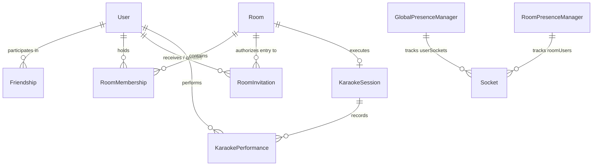

# KTVOnline — Sprint 5.7: Current Architecture Audit

## 1. Objective
Audit the current KTVOnline system architecture to identify exactly how existing models, services, and realtime channels relate, and determine how they can power Friend Activity & Social Karaoke Sessions without architectural duplication.

---

## 2. Entity Relationship & System Architecture Map

### Detailed Component Roles:

1. **`User` (`UserModel` / `apps/api/src/modules/users/user.model.ts`):**
   - Core identity, authentication credentials, preferences (`presenceVisibility: 'all' | 'friends' | 'none'`).
2. **`Friendship` (`FriendshipModel` / `apps/api/src/modules/friends/friendship.model.ts`):**
   - Stores bilateral relationship using canonical `pairKey: computePairKey(userA, userB)`.
   - Statuses: `'pending' | 'accepted' | 'declined' | 'blocked'`.
3. **`GlobalPresenceManager` (`apps/api/src/realtime/global-presence.manager.ts`):**
   - In-memory tracker of connected user sockets with 10-second generation-fenced disconnect grace period.
   - Evaluates dynamic presence: `status` (`'online' | 'in_lounge' | 'singing' | 'offline'`), `roomId`, `roomTitle`, `isPrivateLounge`, `songTitle`.
   - Enforces privacy masking (stealth mode and private room masking for outsiders).
4. **`RoomPresenceManager` (`apps/api/src/realtime/presence.manager.ts`):**
   - In-memory tracker of active participants inside specific rooms.
   - Manages room channel occupancy, roles (`host | member | viewer`), and room switching eviction.
5. **`Room` (`RoomModel` / `apps/api/src/modules/rooms/room.model.ts`):**
   - Represents the physical/virtual lounge.
   - Fields: `name`, `ownerId`, `visibility` (`'public' | 'private'`), `status` (`'open' | 'closed'`), `capacity`, `currentParticipantsCount`.
6. **`RoomInvitation` (`RoomInvitationModel` / `apps/api/src/modules/rooms/invitation.model.ts`):**
   - Option B architecture: supports both general links (`recipientId: null`) and friend-bound tokens (`recipientId: ObjectId`).
   - Secure SHA-256 token hashing, expiration, and revocation.
7. **`Karaoke Queue & Playback` (`KaraokeService` / `apps/api/src/modules/karaoke/karaoke.service.ts`):**
   - In-memory and persisted queue items (`RoomQueueSnapshotDto`).
   - Tracks current item, performer (`singerId`), requester (`requestedById`), playback timing, and lyrics sync.
8. **`Karaoke Session History` (`KaraokeSessionModel` / `apps/api/src/modules/history/session.model.ts`):**
   - Records session lifecycle: `hostId`, `startedAt`, `endedAt`, `durationSeconds`, `totalSongsPlayed`, `totalParticipantsCount`, and participant telemetry.

---

## 3. Realtime Channel Architecture

| Channel Namespace | Scope | Membership | Events Broadcast |
| :--- | :--- | :--- | :--- |
| **`user:${userId}`** | Private Per-User | Sockets belonging to `userId` | `friend:presence:updated`, `friend:request:received`, `friend:request:accepted`, `friend:invitation:received` |
| **`room:${roomId}`** | Room Occupants | Sockets joined to `roomId` channel | `room:member:joined`, `room:member:left`, `room:closed`, `karaoke:queue:updated`, `karaoke:playback:updated`, `stage:reaction:created` |

---

## 4. Architectural Gaps & Opportunities for Sprint 5.7

1. **Friend Activity Aggregation:**
   - Currently, `/friends` fetches friends with live presence via `useFriends()`, but does not organize them into actionable activity categories (e.g. "Friends Singing Now", "Friends in Public Lounges", "Available Online Friends").
   - *Opportunity:* Provide a unified frontend selector and view layer that groups friends by activity without creating new backend state.
2. **Multi-Friend Lounge Invitation:**
   - Currently, a host can invite a friend via `POST /api/friends/invite-lounge/:roomId` one by one.
   - *Opportunity:* Provide a batch invitation endpoint `POST /api/friends/invite-lounge-batch/:roomId` accepting `friendUserIds: string[]` to dispatch multiple friend invites in a single atomic transaction/call.
3. **"Start Session with Friends" Flow:**
   - Currently, a user must first create a room (`/rooms/create`), enter it, open the invite modal, and invite friends individually.
   - *Opportunity:* Provide a seamless dialog from the Friends page: "Start Karaoke Lounge", pre-select friends, create the room, auto-invite, and redirect host directly into the stage.
