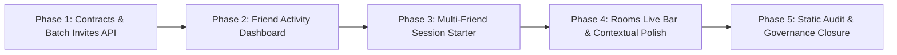

# KTVOnline — Sprint 5.7: Phased Implementation Roadmap

## 1. Roadmap Strategy

The implementation is broken down into 5 focused, incremental phases. Each phase is independently testable via static checks and manual verification:

---

## 2. Phase Breakdown

### Phase 1: Shared Contracts & Batch Invitation API
- **Scope:**
  - Add `BatchLoungeInviteSchema` and `BatchLoungeInviteResultDto` to `packages/contracts/src/friendship.ts`.
  - Rebuild `@ktv/contracts`.
  - In `apps/api`: implement `friendshipService.sendBatchLoungeInvites(userId, roomId, friendUserIds)`.
  - In `apps/api`: implement `friendshipController.sendBatchLoungeInvites` and register `POST /api/friends/invite-lounge-batch/:roomId` in `friendship.routes.ts`.
  - Enforce authoritative host ownership, friendship verification, and Option B token generation.
- **Verification:** `pnpm --filter @ktv/contracts build`, `pnpm --filter api typecheck && pnpm --filter api lint`.

---

### Phase 2: Friend Activity UI & Activity Selector
- **Scope:**
  - In `apps/web/src/features/friends/hooks/use-friends.ts`: add `useFriendActivity()` selector hook grouping friends into `singing`, `inLounge`, `available`, `offline`.
  - In `apps/web/src/features/friends/components/`:
    - Create `friend-activity-section.tsx`: visual dashboard grouping friends by activity state.
    - Active cards render direct "Watch Live", "Join Lounge", or "Invite" CTAs.
  - In `apps/web/src/app/(platform)/friends/page.tsx`:
    - Integrate `FriendActivitySection` as a primary hero panel above or inside the friends tab.
- **Verification:** `pnpm --filter web typecheck && pnpm --filter web lint`.

---

### Phase 3: Multi-Friend Session Starter ("Start Karaoke with Friends")
- **Scope:**
  - In `apps/web/src/features/friends/components/start-social-session-dialog.tsx`:
    - Build dialog for multi-selecting online/available friends.
    - Simple room setup (Room Name, Privacy toggle, Atmosphere vibe preset).
    - Submits room creation and batch friend invitations in sequence.
    - Redirects host immediately into `/rooms/${newRoomId}`.
  - In `apps/web/src/app/(platform)/friends/page.tsx`:
    - Add prominent "Start Session with Friends" header CTA.
- **Verification:** `pnpm --filter web typecheck && pnpm --filter web lint`.

---

### Phase 4: Room Contextual Friends Bar & Recap Polish
- **Scope:**
  - In `apps/web/src/features/rooms/components/friends-live-bar.tsx`:
    - Compact carousel strip on `/rooms` displaying public lounges with friends singing.
    - Clicking a friend card opens `RoomPreviewDialog`.
  - Contextual updates to `apps/web/src/components/rooms/invite-friends-dialog.tsx`:
    - Multi-friend selection checkbox mode.
  - Review session recap link from room departure to `/profile?tab=history`.
- **Verification:** `pnpm --filter web typecheck && pnpm --filter web lint`.

---

### Phase 5: Verification & Governance Audit
- **Scope:**
  - Execute full repository `pnpm typecheck` and `pnpm lint`.
  - Verify that MongoDB database name remains `test`.
  - Verify no test file or database migrations were introduced.
  - Verify that all Social Integrity guarantees from Sprint 5.6.1.3 remain intact.
  - Generate final sprint reports and manual QA checklists.
- **Verification:** Strict code-only compliance.

---

## 3. Estimated Work Effort & Complexity

| Phase | Files Touched / Created | Complexity | Risk Profile |
| :--- | :---: | :---: | :--- |
| **Phase 1: Contracts & API** | 4 files | Low-Medium | Low (reuses Option B tokens) |
| **Phase 2: Activity UI** | 3 files | Medium | Low (pure UI presentation) |
| **Phase 3: Session Starter** | 2 files | Medium | Low (reuses room create & batch invite) |
| **Phase 4: Rooms Live Bar** | 3 files | Low-Medium | Low (companion widget) |
| **Phase 5: Verification** | Docs | Low | Low (static typecheck & lint) |
