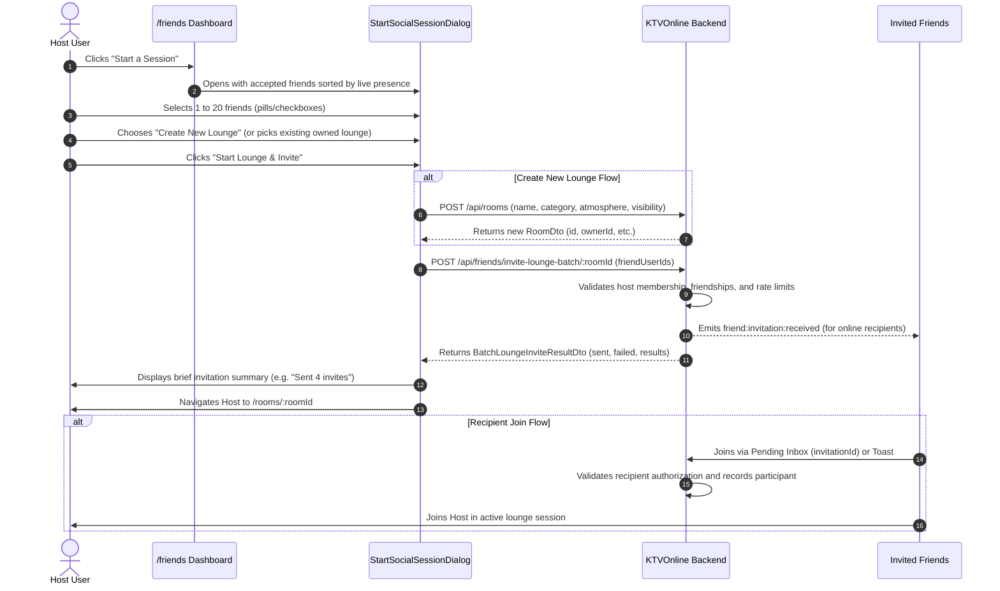

# KTVOnline — Sprint 5.7, Phase 3: Social Session Starter Architecture & Implementation Plan

## 1. Executive Summary

Sprint 5.7 transforms KTVOnline from isolated friendship connections into shared karaoke experiences.
- **Phase 1 (Completed):** Established the backend foundation for batch lounge invitations, authenticated pending invitation inboxes, recipient-only dismissal, and dual-credential room joining (`inviteToken` or `invitationId`).
- **Phase 2 (Completed & Verified):** Implemented the Friend Activity Dashboard on `/friends`, partitioning friends by live presence (`Singing Now`, `In a Lounge`, `Available Online`, `Offline`), with real-time socket updates, robust query cache isolation, and zero obsolete "Watch Live" terminology.
- **Phase 3 Objective:** Implement the **Social Session Starter**, allowing users to multi-select accepted friends, create a new karaoke lounge (or select an existing owned lounge), dispatch batch invitations, and seamlessly enter the shared karaoke session.

This document delivers the read-only architectural readiness assessment and step-by-step implementation plan for Phase 3.

---

## 2. Repository State & Commit Ancestry

- **Target Branch:** `main`
- **Current HEAD:** `e3a1bcb783be4d80773b389cd33a73eb7ec078a1`
- **Ancestry Chain:**
  1. `7f12209`: Sprint 5.7 Phase 1 implementation (contracts & backend invitation foundation).
  2. `61eec7d`: Sprint 5.7.1.1 Phase 1 independent security audit.
  3. `eb47cad`: Sprint 5.7 Phase 2 Friend Activity Dashboard implementation.
  4. `1b1f775`: Sprint 5.7.2 Phase 2 independent source audit (identified findings AUD-ACT-01..03).
  5. `cbe4a43`: Sprint 5.7.2.1 Phase 2 remediation (resolved AUD-ACT-01..03).
  6. `e3a1bcb`: Sprint 5.7.2.2 final independent remediation verification (**PHASE 3 APPROVED**).
- **Working Tree:** Clean (`nothing to commit, working tree clean`).
- **Database:** `test` (zero mutations, zero migrations executed).

---

## 3. Current Architecture & Reusable Assets

The system already possesses all required backend domain logic, database models, and realtime emitters. **Zero new database models, migrations, or external infrastructure (such as Redis) are required.**

| Architectural Subsystem | Existing Component | Reusability in Phase 3 |
| :--- | :--- | :--- |
| **Friendship Data** | `FriendshipModel`, `friendsApi.getFriends` | Reused directly; provides authoritative list of `accepted` friends. |
| **Friend Presence** | `GlobalPresenceManager`, `useFriends`, `useFriendActivity` | Reused directly; provides live presence status for sorting friends by availability. |
| **Batch Invitation API** | `POST /api/friends/invite-lounge-batch/:roomId` | Reused directly; handles up to 20 recipients, rate limiting, and deduplication. |
| **Rate Limiter** | `HostBatchInviteRateLimiter` | Reused directly; enforces 1 batch / 5s and max 60 invites / 10m per host. |
| **Room Creation** | `roomApi.createRoom`, `useCreateRoom` | Reused directly; creates room with `ownerId` and active host membership. |
| **Owned Rooms Discovery** | `roomApi.getMyRooms`, `useMyRooms` | Reused directly; allows host to pick an existing active lounge. |
| **Session Lifecycle** | `KaraokeSessionModel`, `KaraokeHistoryService` | Reused directly; automatically initializes session on room creation and tracks participants on join. |
| **Dual-Credential Join** | `roomApi.joinRoom`, `useJoinRoom` | Reused directly; recipients join securely via `invitationId` from pending inbox or toast. |
| **Realtime Notifications** | `SOCKET_EVENTS.SERVER.FRIEND_INVITATION_RECEIVED` | Reused directly; delivers instant toasts to online recipients. |

---

## 4. End-to-End User Experience & Flow



---

## 5. Architectural Clarifications

### 5.1. Friend Selection
1. **Multi-Select Mechanics:**
   - Checkbox-enabled friend list sorted by live engagement:
     1. Available Online (green pulse)
     2. In a Lounge (cyan radio)
     3. Singing on Stage (fuchsia mic)
     4. Offline (gray circle)
   - Dynamic counter: `Selected ({count}/20)`. When 20 is reached, unselected checkboxes are disabled with a clear notice.
   - Convenience buttons: `"Select All Online"` and `"Clear"`.
2. **Eligibility & Filtering:**
   - Only `accepted` friends are returned by `getFriends()`. Pending requests and blocked users are automatically excluded.
   - Offline friends **can be selected**: they receive a persistent, authenticated invitation in their pending inbox (`GET /api/friends/invitations/pending`).
   - If an existing lounge is selected, friends who are **already active members in that lounge** display an `"Already in lounge"` tag and have their checkbox disabled.
3. **State Persistence:**
   - Stored in React local component state within `StartSocialSessionDialog`. If dismissed without submitting, state resets without side effects.

### 5.2. Lounge Selection: New vs. Existing
- **Mode A: Create New Lounge (Default)**
  - Configurable parameters with sensible defaults:
    - Lounge Name: Default `"[User]'s Karaoke Hangout"`
    - Category: Default `'general'`
    - Visibility: Toggle between `'private'` (default) and `'public'`
    - Atmosphere Preset: Default `'midnight_lounge'`
  - Flow: Executes `useCreateRoom()` -> returns `roomId` -> dispatches batch invitations -> redirects host to room.
- **Mode B: Use Existing Lounge**
  - Consumes `useMyRooms()` to retrieve user's owned rooms.
  - Strict Eligibility Validation:
    1. Must be owned by current user (`room.ownerId === currentUser.id`).
    2. Must be open (`room.status !== 'closed'`).
    3. Must not be locked (`!room.isLocked`).
    4. Host must be an active occupant (`hostMembership.status === 'active'`).
    5. Capacity check (`currentParticipantsCount < capacity`).

### 5.3. Batch Invitation Pipeline Verification
- **API Endpoint:** `POST /api/friends/invite-lounge-batch/:roomId` (implemented in Sprint 5.7 Phase 1).
- **Security Boundaries:**
  - `recipientId` bound to specific friend; raw invitation tokens are never transmitted over Socket.IO or stored in plaintext.
  - Rate limiting enforced server-side by `HostBatchInviteRateLimiter` (1 batch/5s, max 60/10m per host).
  - Deduplication performed server-side.
  - Self-invitation strictly rejected (`CANNOT_INVITE_SELF`).
- **Partial Success Handling:**
  - Returns `BatchLoungeInviteResultDto` detailing individual status (`sent` vs `failed`) with specific error codes (`ALREADY_IN_ROOM`, `NOT_FRIENDS`, `CREATION_FAILED`).
  - Dialog surfaces a clean summary (e.g., *"4 invitations sent, 1 skipped (already in lounge)"*).

### 5.4. Session Lifecycle & Historical Technical Debt Alignment
- **Is `KaraokeSessionModel` sufficient?**
  - **YES.** In KTVOnline, a social karaoke session is 1:1 bound to an active room.
  - When `POST /api/rooms` creates a room, `KaraokeHistoryService.recordSessionStarted` initializes an active `KaraokeSessionModel` record.
  - When invited friends join via `POST /api/rooms/:id/join`, `KaraokeHistoryService.recordParticipantJoined` appends them to `session.participants`.
  - Unaccepted invitations remain in `RoomInvitationModel` until expiration (48 hours) or dismissal; they never pollute `KaraokeSessionModel`.
  - When the host closes the room, `recordSessionClosed` marks `status: 'completed'` and generates session recap data.
- **Technical Debt Preservation:**
  - `HIST-01`: Abandoned room closure remains unautomated. Host-disconnected rooms remain idle without generating invalid recaps.
  - `HIST-03`: Single-node in-memory presence and rate limiting operate without Redis.
  - `HIST-01` through `HIST-07` remain documented and open.

---

## 6. Proposed Frontend Component Breakdown

```
apps/web/src/features/friends/
├── components/
│   ├── start-social-session-dialog.tsx   <-- [NEW] Core dialog component
│   ├── friend-activity-section.tsx       <-- [MODIFY] Add "Start a Session" CTA in header
│   ├── friend-activity-card.tsx          <-- [REUSE] Existing presence cards
│   └── pending-invitations-inbox.tsx     <-- [REUSE] Existing inbox component
├── hooks/
│   ├── use-social-session-starter.ts     <-- [NEW] State management & composite mutations
│   ├── use-friends.ts                    <-- [REUSE] Friend queries & realtime presence
│   └── use-friend-activity.ts            <-- [REUSE] Categorized presence buckets
└── api/
    └── friends-api.ts                    <-- [MODIFY] Add inviteLoungeBatch() method
```

### Component Details:
1. **`friendsApi.inviteLoungeBatch`:**
   Adds typed method calling `POST /friends/invite-lounge-batch/${roomId}` with `{ friendUserIds }`.
2. **`useSocialSessionStarter` Hook:**
   - Manages dialog open/close state.
   - Manages selected friend ID set (`Set<string>`) with `max 20` enforcement.
   - Manages lounge mode (`'new'` vs `'existing'`).
   - Executes composite submission: creates room (if new) -> calls batch invite -> navigates host to lounge.
   - Surfaces loading state and batch result summaries.
3. **`StartSocialSessionDialog` Component:**
   - Header with title: *"Start a Karaoke Session"* and subtitle.
   - Friend selection tab/list with presence status badges, avatar, and selection checkboxes.
   - Lounge settings toggle:
     - New lounge inputs: Room Name, Atmosphere preset, Visibility (Public/Private).
     - Existing lounge selector: Dropdown of active owned rooms.
   - Footer action: Primary button showing dynamic label:
     `"Create Lounge & Invite (X)"` or `"Invite Friends (X)"`.
   - Accessible keyboard controls (Escape to close, Tab trapping), min 44px mobile touch targets, dark mode theme consistency.
4. **Header Integration in `FriendActivitySection`:**
   - Add a primary CTA button: `<Sparkles className="w-4 h-4" /> <span>Start a Session</span>` in Section A header next to aggregate badges.

---

## 7. Implementation Steps for Phase 3

| Step | Action | Files | Verification |
| :---: | :--- | :--- | :--- |
| **1** | Add `inviteLoungeBatch` to `friendsApi` | `apps/web/src/features/friends/api/friends-api.ts` | Typecheck against `BatchLoungeInviteResultDto` |
| **2** | Implement `useSocialSessionStarter` hook | `apps/web/src/features/friends/hooks/use-social-session-starter.ts` | Verify state transitions and mutation orchestration |
| **3** | Implement `StartSocialSessionDialog` UI | `apps/web/src/features/friends/components/start-social-session-dialog.tsx` | Accessibility, 20-recipient limit, responsive layout |
| **4** | Integrate dialog trigger into `FriendActivitySection` | `apps/web/src/features/friends/components/friend-activity-section.tsx` | Trigger opens dialog with clean state |
| **5** | Export components through feature index | `apps/web/src/features/friends/index.ts` | Clean exports |
| **6** | Static verification & linting | Entire monorepo | `pnpm typecheck` (0 errors), `pnpm lint` (0 errors) |
| **7** | Documentation & Reporting | `docs/SPRINT_5_7_PHASE_3_IMPLEMENTATION_REPORT.md` | Verification report and planning update |

---

## 8. Risks & Mitigations

| Risk ID | Risk Description | Severity | Mitigation Strategy |
| :--- | :--- | :---: | :--- |
| **RSK-5.7-06** | Host rapid clicking triggers duplicate batch submissions | Medium | Disable submit button and show spinner while mutation is pending (`isPending`). |
| **RSK-5.7-07** | Host creates room but batch invite fails due to rate limit | Medium | The room is still created successfully. Surface rate limit notification with retry button on the room page rather than discarding room. |
| **RSK-5.7-08** | Host selects more than 20 friends | Low | Enforce `max 20` directly in the UI checklist by disabling unselected checkboxes once 20 is reached. |
| **RSK-5.7-09** | Reusing a closed or locked room | Low | Filter `useMyRooms()` results to `status !== 'closed' && !isLocked`. |

---

## 9. Acceptance Criteria for Phase 3

1. Host can click *"Start a Session"* from the `/friends` Friend Activity Dashboard.
2. Dialog presents accepted friends ordered by live presence status.
3. Host can multi-select up to 20 friends with interactive count indicator.
4. Host can configure and create a new lounge (or choose an active owned lounge).
5. Submitting executes room creation and batch invitation in a cohesive, unified flow.
6. Batch invitation results are processed with clear partial-success feedback.
7. Host is automatically transitioned to `/rooms/[roomId]`.
8. Invited friends receive instant realtime toasts (if online) and pending invitations in their inbox (if offline).
9. Code-Only Development Policy strictly observed: zero test runners modified/run, zero production builds, zero database writes/migrations, MongoDB database remains `test`.
10. `pnpm typecheck` and `pnpm lint` pass with zero errors.

---

## 10. Explicit Implementation Readiness Verdict

**READY FOR PHASE 3 IMPLEMENTATION**
