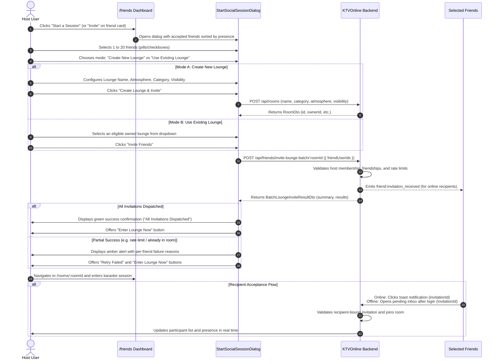

# KTVOnline — Sprint 5.7, Phase 3: Social Session Starter Architecture & Implementation Plan

## 1. Executive Summary

Sprint 5.7 transforms KTVOnline from isolated friendship connections into shared karaoke experiences.
- **Phase 1 (Completed):** Established the backend foundation for batch lounge invitations, authenticated pending invitation inboxes, recipient-only dismissal, and dual-credential room joining (`inviteToken` or `invitationId`).
- **Phase 2 (Completed & Verified):** Implemented the Friend Activity Dashboard on `/friends`, partitioning friends by live presence (`Singing Now`, `In a Lounge`, `Available Online`, `Offline`), with real-time socket updates, robust query cache isolation, and zero obsolete "Watch Live" terminology.
- **Phase 3 Objective:** Deliver a detailed architecture readiness assessment and implementation plan for the **Social Session Starter**, enabling users on `/friends` to select multiple accepted friends (up to 20), choose to create a new lounge or select an eligible active lounge, dispatch batch invitations, and enter the shared karaoke session.

This document serves as the authoritative, read-only architectural readiness assessment and implementation roadmap for Phase 3.

---

## 2. Repository State & Commit Ancestry

- **Target Branch:** `main`
- **Current HEAD:** `f4e171c`
- **Verified Commit Ancestry:**
  1. `7f12209`: feat(social): implement Sprint 5.7 Phase 1 Shared Contracts & Social Invitation Foundation
  2. `61eec7d`: docs(audit): complete Sprint 5.7.1.1 Phase 1 independent security audit
  3. `eb47cad`: feat(friends): implement Sprint 5.7 Phase 2 Friend Activity Dashboard
  4. `1b1f775`: docs(audit): complete Sprint 5.7.2 Phase 2 independent source audit (identified AUD-ACT-01..03)
  5. `cbe4a43`: fix(friends): remediate Sprint 5.7.2 audit findings AUD-ACT-01, AUD-ACT-02, AUD-ACT-03
  6. `e3a1bcb`: docs(audit): complete Sprint 5.7.2.2 final independent remediation verification (`FINAL VERIFICATION PASSED — PHASE 3 APPROVED`)
  7. `bf31037`: docs(planning): create Sprint 5.7 Phase 3 Social Session Starter architecture and implementation plan
  8. `f4e171c`: feat(friends): implement Sprint 5.7 Phase 3 Social Session Starter
- **Working Tree State:** Clean (`nothing to commit, working tree clean`).
- **Database Status:** Target database remains `test`; zero database writes, mutations, or migrations executed.

---

## 3. Current Architecture & Reusable Assets

A comprehensive audit of the repository confirms that all core domain models, persistence tables, authorization mechanisms, and Socket.IO events necessary for Phase 3 already exist in the codebase. **Zero new database models, migrations, or external infrastructure (such as Redis) are required.**

| Architectural Subsystem | Source Component | Implementation Details & Phase 3 Reusability |
| :--- | :--- | :--- |
| **Friendship Model & APIs** | `FriendshipModel`<br>`friendship.service.ts` | Reused directly. `getFriends()` queries `FriendshipModel` where `status: 'accepted'`. Only verified friendships are returned. Pending, rejected, or blocked relationships are excluded. |
| **Friend Presence Pipeline** | `GlobalPresenceManager`<br>`useFriends.ts`<br>`useFriendActivity.ts` | Reused directly. Presence cache updater listens to `SOCKET_EVENTS.SERVER.FRIEND_PRESENCE_UPDATED` with isolated cache keys (`['friends', 'list']`), providing live availability for sorting. |
| **Batch Invitation API** | `POST /api/friends/invite-lounge-batch/:roomId`<br>`friendship.controller.ts`<br>`friendship.service.ts` | Reused directly. Accepts `{ friendUserIds: string[] }` (up to 20). Validates host identity, room state, room ownership, active host membership, and pairwise accepted friendships. |
| **Host Batch Rate Limiter** | `HostBatchInviteRateLimiter`<br>`friendship.service.ts` | Reused directly. Enforces in-memory sliding window: 1 batch per 5 seconds, max 60 recipients per 10 minutes per host. |
| **Recipient-Bound Isolation** | `RoomInvitationModel`<br>`invitation.service.ts` | Reused directly. Each batch recipient receives a dedicated `RoomInvitationModel` record with unique SHA-256 `tokenHash` and `recipientId`. Raw tokens are never stored in plaintext. |
| **Dual-Credential Room Join** | `room.service.ts`<br>`room.controller.ts` | Reused directly. `joinRoom` accepts either `invitationId` (authenticated recipient lookup) or `inviteToken` (SHA-256 token lookup) with fail-closed recipient checking. |
| **Room Creation & Discovery** | `RoomModel`<br>`room.service.ts`<br>`roomApi.createRoom`<br>`roomApi.getMyRooms` | Reused directly. `createRoom` immediately establishes `ownerId`, creates active host membership in `RoomMembershipModel`, and initializes `KaraokeSessionModel`. `getMyRooms` returns existing owned rooms. |
| **Session Lifecycle Model** | `KaraokeSessionModel`<br>`history.service.ts` | Reused directly. Session is 1:1 bound to active room. `recordSessionStarted` initializes session on room creation; `recordParticipantJoined` appends participants on join. |
| **Realtime Notifications** | `SOCKET_EVENTS.SERVER.FRIEND_INVITATION_RECEIVED`<br>`events.gateway.ts` | Reused directly. Emits targeted socket event to online recipients containing `invitationId`, `roomTitle`, `isPrivate`, and `inviter` metadata. |

---

## 4. End-to-End User Experience & Flow



---

## 5. Architectural Planning Clarifications

### 5.1. Friend Selection
1. **Multi-Select Mechanics:**
   - Checklist of accepted friends ordered dynamically by live engagement:
     1. `Online` (green pulse)
     2. `In a Lounge` (cyan radio)
     3. `Singing Now` (fuchsia mic)
     4. `Offline` (gray circle)
   - Dynamic counter: `Selected ({count}/20)`. Once 20 friends are selected, remaining unselected checkboxes are disabled with a clear limit message.
   - Batch selection convenience helpers: `"Select All Online"` (capped at 20) and `"Clear"`.
   - Real-time text search filtering by display name and `@username`.
2. **Eligibility & Filtering:**
   - Only friendships with `status: 'accepted'` are displayed. Blocked, rejected, or pending users are automatically excluded by `FriendshipModel` queries.
   - Offline friends **can be selected**: they receive a persistent, authenticated invitation in their pending inbox (`GET /api/friends/invitations/pending`).
   - If an existing lounge is selected, friends who are **already active members in that lounge** display an `"Already in lounge"` tag and have their checkbox disabled to prevent redundant invitations.
3. **State Persistence:**
   - Selection state is maintained in local component state. If the user closes or dismisses the dialog without submitting, selection is cleanly reset without persistent side effects.

### 5.2. Lounge Selection: New vs. Existing
A rigorous comparison between creating a new lounge versus reusing an existing lounge:

| Criterion | Mode A: Create New Lounge | Mode B: Use Existing Lounge |
| :--- | :--- | :--- |
| **Primary Use Case** | Spontaneous group hangout or party starting from scratch. | Host is already hosting or has configured an open lounge and wants to pull friends in. |
| **Host Authorization** | The creating user is automatically assigned `ownerId` and active host membership. | Must verify `room.ownerId === currentUser.id`. Outsiders or non-host members are prohibited. |
| **Room Status Guard** | Newly created room has `status: 'idle'`. | Must verify `room.status !== 'closed'`. Closed rooms cannot be reused. |
| **Lock Guard** | Newly created room is unlocked (`isLocked: false`). | Must verify `!room.isLocked`. Locked rooms reject batch invitations. |
| **Capacity Guard** | Standard default capacity is 10 (configurable 2-50). | Must verify `currentParticipantsCount < capacity`. |
| **Active Membership** | Creator automatically receives active `RoomMembershipModel`. | Host must currently have `status: 'active'` in `RoomMembershipModel` for that room. |
| **Visibility Handling** | Configurable: `private` (default, friends-only) or `public`. | Supports both public and private rooms. Private room invitations grant recipient-bound access. |

### 5.3. Batch Invitation Pipeline Verification
- **API Endpoint:** `POST /api/friends/invite-lounge-batch/:roomId`
- **Security & Authorization Checks:**
  1. `hostUserId` extracted strictly from validated JWT session (`req.user.id`).
  2. Room existence, ownership (`room.ownerId === hostUserId`), and active host membership verified.
  3. Pairwise friendships verified via batch query against `FriendshipModel` using canonical `pairKey`.
  4. Self-invitation strictly rejected (`CANNOT_INVITE_SELF`).
  5. Maximum 20 recipients enforced via `BatchLoungeInviteSchema`.
- **Rate Limiting:**
  - Enforced by `HostBatchInviteRateLimiter` (1 batch / 5s, max 60 recipients / 10m).
  - Rate limit counters are incremented post-execution based on actual `sentCount`.
- **Partial Success Semantics:**
  - The endpoint returns `BatchLoungeInviteResultDto` with an itemized result list (`results: [{ friendUserId, status: 'sent' | 'failed', error?: string }]`).
  - Possible per-recipient error codes: `ALREADY_IN_ROOM`, `NOT_FRIENDS`, `CREATION_FAILED`.
  - The UI presents partial success with granular reasons and a `"Retry Failed"` button targeting only failed IDs.
- **Idempotency & Duplicate Prevention:**
  - Duplicate recipient IDs in the request array are deduplicated before processing.
  - If an active invitation already exists for a recipient in that room, `createFriendInvitation` revokes the prior active invitation and issues a fresh one, ensuring exactly one active token per recipient.

### 5.4. Session Lifecycle & Historical Technical Debt Alignment
- **Does `KaraokeSessionModel` represent the required social session?**
  - **YES.** In KTVOnline architecture, a karaoke session is 1:1 bound to an active room.
  - When `POST /api/rooms` creates a room, `KaraokeHistoryService.recordSessionStarted` automatically initializes an active `KaraokeSessionModel` document with `status: 'active'`.
  - When invited friends join via `POST /api/rooms/:id/join`, `KaraokeHistoryService.recordParticipantJoined` appends them to `session.participants`.
  - Unaccepted invitations remain in `RoomInvitationModel` for 48 hours or until dismissed; they never pollute `KaraokeSessionModel`.
  - When the host explicitly closes the room, `recordSessionClosed` marks `status: 'completed'` and compiles the session recap.
- **Impact of Historical Technical Debt (`HIST-01` through `HIST-07`):**
  - `HIST-01` (Abandoned room cleanup worker unautomated): If a host closes their browser without clicking "Close Room", the room remains open and idle. Under Phase 3, this behavior is preserved: session recaps are strictly restricted to explicitly completed sessions (`status === 'completed'`).
  - `HIST-03` (Single-node in-memory state): `GlobalPresenceManager` and `HostBatchInviteRateLimiter` operate in process memory without Redis. Phase 3 maintains this design.
  - All canonical debt items `HIST-01` through `HIST-07` remain documented and preserved.

---

## 6. Frontend UX & UI Component Breakdown

The Social Session Starter is designed as a single, focused modal dialog rather than an over-engineered multi-step wizard:

```
apps/web/src/features/friends/
├── components/
│   ├── start-social-session-dialog.tsx   <-- Core dialog component
│   ├── friend-activity-section.tsx       <-- "Start a Session" CTA in Section A header
│   ├── friend-activity-card.tsx          <-- "Invite" action button on online cards
│   └── pending-invitations-inbox.tsx     <-- Reused pending inbox
├── hooks/
│   ├── use-social-session-starter.ts     <-- State orchestration, validation & mutations
│   ├── use-friends.ts                    <-- Query hook & realtime presence updater
│   └── use-friend-activity.ts            <-- Presence buckets & statistics
└── api/
    └── friends-api.ts                    <-- friendsApi.inviteLoungeBatch()
```

### Component Breakdown
1. **`useSocialSessionStarter` Hook:**
   - Controls dialog open/close state.
   - Manages selected friend IDs (`string[]`, capped at 20).
   - Manages mode (`'new'` vs `'existing'`) and room creation inputs (name, atmosphere, category, visibility).
   - Queries `useMyRooms()` and filters eligible rooms.
   - Executes composite submission: `createRoom` (if new) -> `inviteLoungeBatch` -> navigation.
   - Handles partial success and retry of failed recipients (`retryFailedInvitations`).
2. **`StartSocialSessionDialog`:**
   - **Header:** Title *"Start a Karaoke Session"* and close button.
   - **Friends Checklist:** Live presence sorting, search filter, selection count (`Selected X/20`), "Select All Online", and "Clear".
   - **Lounge Configuration Pane:**
     - Segmented mode switch: "Create New Lounge" vs "Use Existing Lounge".
     - Atmosphere selector (`Midnight Lounge`, `Neon Stage`, `Cozy Acoustic`, `Classic Karaoke`, `Minimal Studio`).
     - Visibility toggle (`Private (Friends Only)` vs `Public Lounge`).
     - Existing room dropdown with participant count and status.
   - **Post-Submission Summary View:**
     - Displays full-success green banner or partial-success amber alert.
     - Per-recipient result list.
     - "Retry Failed" and "Enter Lounge Now" action buttons.
3. **Integration Points:**
   - Header CTA in `FriendActivitySection`: Primary gradient button with sparkles icon.
   - Card CTA in `FriendActivityCard`: "Invite" button on online friend cards that opens the starter pre-populated with that friend.

---

## 7. API and Contract Changes

- **Backend API & Contracts:** **ZERO changes required.**
  - `BatchLoungeInviteSchema` and `BatchLoungeInviteResultDto` in `@ktv/contracts` are fully defined.
  - `POST /api/friends/invite-lounge-batch/:roomId` in `apps/api` is fully operational.
- **Frontend API Client:**
  - Added `inviteLoungeBatch(roomId: string, friendUserIds: string[])` to `friendsApi` in `apps/web/src/features/friends/api/friends-api.ts`.

---

## 8. Model and Database Changes

- **Database Models:** **ZERO changes required.**
  - No new Mongoose schemas, collections, indexes, or migrations.
  - MongoDB database name strictly remains `test`.

---

## 9. Implementation Phases and Dependencies

| Phase | Scope | Dependencies | Verification |
| :---: | :--- | :--- | :--- |
| **Phase 3.1** | API Client & State Hook (`friendsApi.inviteLoungeBatch`, `useSocialSessionStarter`) | `@ktv/contracts`, `useCreateRoom`, `useMyRooms` | TypeScript check, state transition validation |
| **Phase 3.2** | UI Components & Dashboard Integration (`StartSocialSessionDialog`, `FriendActivitySection`, `FriendActivityCard`) | `useSocialSessionStarter`, `UserAvatar`, `PresenceStatusBadge` | Linter, responsive layout, modal accessibility |
| **Phase 3.3** | Static Verification & Documentation | Monorepo root | `pnpm typecheck` (0 errors), `pnpm lint` (0 errors), Next.js HTTP 200 check |

---

## 10. Risks and Mitigations

| Risk ID | Description | Severity | Mitigation Strategy |
| :--- | :--- | :---: | :--- |
| **RSK-5.7-10** | Double-submission on slow network connections | Medium | Disable submit button and render animated spinner while `isSubmitting` is true (`creating_room` or `sending_invitations`). |
| **RSK-5.7-11** | Batch invite fails (e.g. rate limit) after room is created | Medium | Do not destroy the created room. Transition to partial/failed state, display clear error message, and provide both "Retry" and "Enter Lounge Now" buttons. |
| **RSK-5.7-12** | Host selects more than 20 friends | Low | Enforce cap in UI (`toggleFriend` and `selectAllOnline` prevent selection exceeding 20); server-side schema validates `max(20)`. |
| **RSK-5.7-13** | Reusing a closed, locked, or full room | Low | Filter `useMyRooms()` to only include rooms where `status !== 'closed' && !isLocked && currentParticipantsCount < capacity`. |
| **RSK-5.7-14** | Terminology regression ("Watch Live") | High | Zero occurrences of "Watch Live" across entire repository. Verified by static text search. |

---

## 11. Acceptance Criteria

1. Host can launch the session starter from the `/friends` Friend Activity Dashboard via the "Start a Session" button or friend card "Invite" button.
2. Dialog lists accepted friends sorted by presence status (`Online` > `In Lounge` > `Singing` > `Offline`).
3. Multi-select supports up to 20 friends with live count indicator and search filter.
4. Host can configure a new lounge (name, atmosphere, category, visibility) or choose an eligible existing lounge.
5. Submitting triggers room creation (if new) and dispatches batch invitations via `POST /api/friends/invite-lounge-batch/:roomId`.
6. Batch invitation results are processed with clear partial-success feedback and retry capability for failed recipients.
7. Host can transition directly to `/rooms/:roomId`.
8. Online recipients receive realtime toasts; offline recipients find invitations in their pending inbox upon logging in.
9. Code-Only Development Policy strictly observed: zero test runners modified/run, zero production builds, zero database writes/migrations, MongoDB database remains `test`.
10. `pnpm typecheck` and `pnpm lint` pass with zero errors across all workspace packages.

---

## 12. Explicit Implementation Readiness Verdict

```text
READY FOR PHASE 3 IMPLEMENTATION
```
