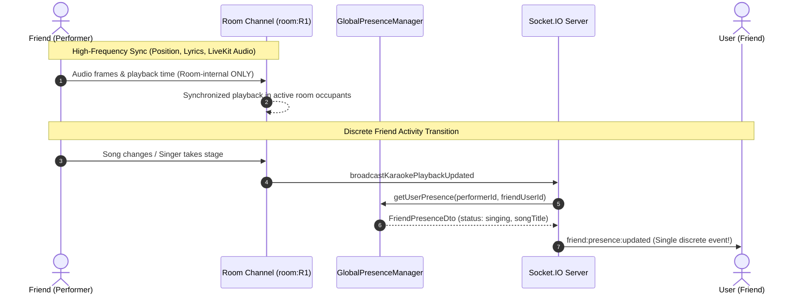

# KTVOnline — Sprint 5.7: Realtime Event Design

## 1. Principles of Realtime Event Architecture

1. **Zero High-Frequency Leaks:** Realtime playback clock synchronization and lyrics ticks belong strictly to the active WebRTC/Socket room channel (`room:${roomId}`). They must NEVER be broadcast into social channels.
2. **State Transition Driven:** Friend activity broadcasts fire only on discrete, authoritative state transitions (connect, disconnect grace expired, room join, room exit, singer transition, privacy toggle).
3. **Strict Recipient Scoping:** Social events target exclusively authorized recipients using private user channels (`user:${userId}`).
4. **Idempotence & Deduplication:** Clients must handle out-of-order or duplicate deliveries cleanly using immutable entity IDs or tokens.

---

## 2. Realtime Event Inventory

Sprint 5.7 reuses existing contracts and events without introducing new Socket.IO event names:

### Event 1: `friend:presence:updated`
- **Direction:** Server -> Client
- **Contract Constant:** `SOCKET_EVENTS.SERVER.FRIEND_PRESENCE_UPDATED`
- **Recipient Scope:** Unicast to targeted user channels (`user:${friendUserId}`) for accepted friends only.
- **Payload Schema (`FriendPresenceUpdatedPayload`):**
  ```typescript
  {
    userId: string;
    username: string;
    status: 'online' | 'in_lounge' | 'singing' | 'offline';
    roomId?: string | null;
    roomTitle?: string | null;
    isPrivateLounge?: boolean;
    songTitle?: string | null;
    updatedAt: string;
  }
  ```
- **Trigger Conditions:**
  1. Socket connects (first connection for user) -> emits `status: 'online'`.
  2. Disconnect grace expires (10s elapsed with 0 sockets) -> emits `status: 'offline'`.
  3. Room join first socket -> emits `status: 'in_lounge'` or `'singing'`.
  4. Room exit last socket -> emits `status: 'online'`.
  5. Karaoke singer change (`broadcastKaraokePlaybackUpdated`) -> emits `status: 'singing'` with `songTitle` for current performer, and reverts previous performer to `status: 'in_lounge'`.
  6. Privacy preference change (`userController.updatePreferences`) -> re-evaluates visibility immediately.
- **Privacy Enforcement:**
  - If `visibility === 'none'` -> always emits `status: 'offline'` (stealth mode).
  - If `room.visibility === 'private'` and recipient is not inside the room -> `roomId: null`, `roomTitle: 'Private Lounge'`, `songTitle: null`, `isPrivateLounge: true`.
- **Client Handling:**
  TanStack Query updates cached `FriendshipDto` in `queryKeys.friends.all`, dynamically re-rendering friend cards and activity lists without HTTP polling.

---

### Event 2: `friend:invitation:received`
- **Direction:** Server -> Client
- **Contract Constant:** `SOCKET_EVENTS.SERVER.FRIEND_INVITATION_RECEIVED`
- **Recipient Scope:** Unicast to `user:${friendUserId}` for each invited friend.
- **Payload Schema (`FriendInvitationReceivedPayload`):**
  ```typescript
  {
    invitationToken: string;
    roomId: string;
    roomTitle: string;
    isPrivate: boolean;
    inviter: {
      id: string;
      username: string;
      displayName?: string | null;
      avatar?: string | null;
    };
    sentAt: string;
  }
  ```
- **Trigger Condition:**
  Dispatched when room host invokes `POST /api/friends/invite-lounge/:roomId` or batch `POST /api/friends/invite-lounge-batch/:roomId`.
- **Authorization:** Authoritative host ownership (`room.ownerId === hostUserId`).
- **Deduplication:**
  Frontend `<InvitationNotificationListener />` checks `prev.some(i => i.invitationToken === payload.invitationToken)`.
- **Dismissal & Acceptance:**
  - Dismissing removes toast from local state without contacting backend.
  - Accepting routes to `/invite/${token}`, triggering verified recipient redemption.

---

## 3. High-Frequency Avoidance Guarantee



- Position updates (every 250ms) are strictly constrained to `room:${roomId}`.
- Friend activity receives exactly **one event** when a song starts or ends.
- Zero network amplification to the broader friend graph.
