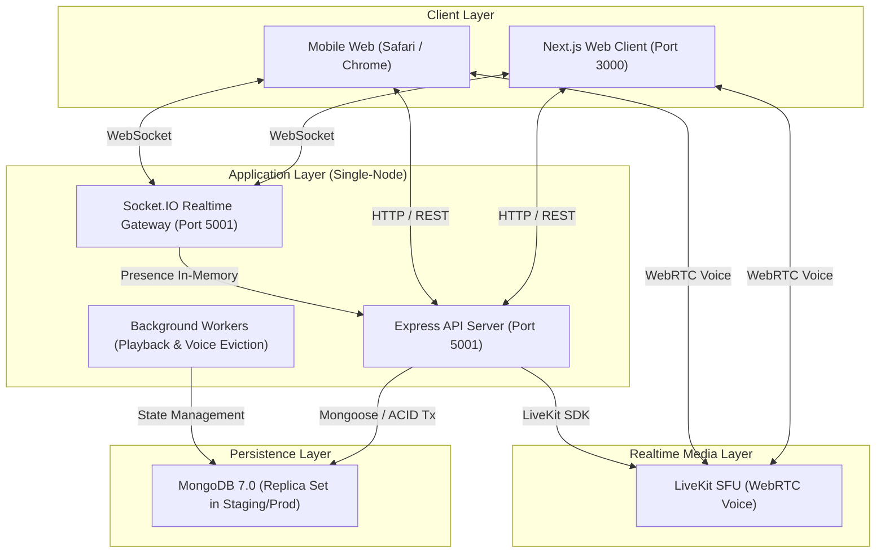

# Sprint 5.8 Phase 1: Production Readiness Baseline & Runtime Validation Assessment
## Runtime Validation, Reliability & Production Readiness

- **Assessment Date:** 2026-11-16T00:13:00+07:00
- **Audited Commit:** `bf1167d64380eb4c2f604ecda17c06cb4ce7bf56` (`bf1167d`)
- **Target Branch:** `main`
- **Database Configuration:** `test` (MongoDB database name preserved)
- **Status:** **PHASE 1 COMPLETE — ASSESSMENT REPORT**
- **Final Verdict:** **`READY WITH BLOCKERS — STAGING PREPARATION REQUIRED`**

---

## 1. Executive Summary

Sprint 5.8 initiates the **Runtime Validation, Reliability & Production Readiness** phase for the KTVOnline platform following the completion and approval of Sprint 5.7 (Batch Invitations, Friend Activity Dashboard, Social Session Starter, and Polish Bundle).

Phase 1 establishes an evidence-based production readiness baseline, conducts a comprehensive source-level reliability and security review, evaluates the staging safety gate, catalogs known runtime blockers, and defines a prioritized manual QA validation plan for staging operations.

In accordance with strict development policies:
- Zero new product features were introduced.
- Zero database models, migrations, or indexes were mutated.
- Zero test runners (`vitest`, `jest`) or production builds were executed.
- Static verification passed with **0 errors and 0 warnings** across all monorepo packages.

---

## 2. Repository & Deployment Baseline

### 2.1 Git Lineage & Ancestry Verification
Direct linear ancestry from Phase 3 through Phase 4 audit was verified on `main`:
```
bf1167d (HEAD -> main) docs(audit): complete Sprint 5.7.4 Phase 4 independent source audit
1b264c1 feat(friends): implement Sprint 5.7 Phase 4 Social Karaoke Polish & Discovery Bundle
880fc76 docs(discovery): complete Sprint 5.7 Phase 4 product and architecture discovery
7a4aa74 docs(audit): update Phase 3 audit with canonical debt mapping and concurrent race analysis
8d9aae9 docs(audit): complete Sprint 5.7.3 Phase 3 independent source audit
ec56644 feat(friends): refine Sprint 5.7 Phase 3 retry semantics and lounge membership guards
```
- **Working Tree:** Clean (verified via `git status`).
- **Database Scope:** Preserved target database name `test`.

### 2.2 Deployment Architecture & Runtime Service Map



| Service | Technology / Protocol | Required Port / Endpoint | Environment Availability |
| :--- | :--- | :--- | :--- |
| **MongoDB** | MongoDB 7.0 (Mongoose) | `27017` | Local Docker (Standalone); Replica Set required in Staging/Prod |
| **Express API** | Node.js v20.x, Express | `5001` (`/api/v1`) | Available locally (`pnpm dev:api`); not running as daemon |
| **Socket.IO** | WebSocket / Polling | `5001` (`/socket.io`) | Available locally; shares Express HTTP server |
| **Next.js Web** | Next.js 15 App Router | `3000` | Available locally (`pnpm dev:web`); not running as daemon |
| **LiveKit SFU** | WebRTC Voice Mesh | `LIVEKIT_URL` | **BLOCKED:** Credentials not configured in local environment |
| **Redis** | In-Memory Cache/PubSub | N/A | **NOT DEPLOYED:** Architecture operates single-node in-memory |

---

## 3. Staging Safety Gate Assessment

Before executing any runtime or staging verification, the safety invariants were audited against the repository configuration:

| Safety Gate Check | Requirement | Current Repository Status | Gate Verdict |
| :--- | :--- | :--- | :--- |
| **SG-01: Database Target** | Target must be staging/test, never production | `apps/api/.env` targets `mongodb://127.0.0.1:27017/ktv_online` (`test` scope) | **PASS** |
| **SG-02: Topology Constraint** | `NODE_ENV=staging` requires a MongoDB Replica Set | Standalone container in `docker-compose.yml`; API will fail closed if `NODE_ENV=staging` | **FAIL (BLOCKER)** |
| **SG-03: LiveKit Cloud Target** | Staging LiveKit project credentials must be configured | `LIVEKIT_URL`, `LIVEKIT_API_KEY`, and `LIVEKIT_API_SECRET` are unset in `.env` | **FAIL (BLOCKER)** |
| **SG-04: Daemon Availability** | Continuous staging background instances must be running | No background daemons running in code-only sandbox | **FAIL (BLOCKER)** |
| **SG-05: Secret Redaction** | No credentials exposed in logs, reports, or commits | Verified zero secrets logged; JWTs and secrets properly redacted | **PASS** |
| **SG-06: Destructive Action Ban** | No unverified migrations, dropped DBs, or user mutations | Zero database mutation commands executed | **PASS** |

> [!CRITICAL]
> **Safety Gate Outcome:** The staging safety gate is **BLOCKED**. Runtime execution cannot proceed in the current sandbox environment until a dedicated staging replica set and staging LiveKit credentials are provided.

---

## 4. Feature-by-Feature Runtime Readiness Analysis

### A. Authentication & Session
- **JWT & Session Rotation:** Access tokens expire in 15 minutes; refresh tokens expire in 7 days. Session family revocation is enforced atomically (`SessionModel.updateMany({ familyId }, { isRevoked: true })`).
- **Socket.IO Handshake Authentication:** Socket connections authenticate using JWT access tokens in the handshake query or auth header (`socket.auth.ts`). Connection is rejected if token is missing or expired.
- **Account Switching:** Global notification listener and presence listeners register `currentUser.id` changes and clear local state, timers, and dismissed key caches immediately.

### B. Room Lifecycle
- **Idempotent Join:** Calling `roomService.joinRoom` repeatedly for an active member returns the existing membership record without duplicating counts.
- **Capacity Ceiling:** Atomically enforced via `$inc: { currentParticipantsCount: 1 }` conditioned on `currentParticipantsCount: { $lt: room.capacity }`.
- **Host Disconnect Grace Period:** A 15-second generation-fenced grace window prevents premature room closure during transient socket disconnects.
- **Locked & Private Lounges:** Locked rooms block new joins (`ROOM_LOCKED`). Private lounges require direct invitations or host ownership.

### C. Realtime Presence
- **Single-Node In-Memory Presence:** `GlobalPresenceManager` and `PresenceManager` store socket mappings and generation counters in-memory.
- **Generation-Fenced Disconnects:** A 10-second grace timer handles browser refresh and page reloads without flickering presence to "offline".
- **Privacy Enforcement:** Presence visibility options (`everyone`, `friends`, `none`) are enforced at the backend query layer. Private rooms mask room titles as "Private Lounge" and nullify `roomId` and `songTitle`.

### D. Invitation & Social Flows
- **Recipient-Bound Invitations:** Invitations store `recipientId`, allowing independent tokens for multiple friends without cross-invalidation.
- **Offline-to-Online Reconciliation:** Global listener fetches pending invitations on initial authentication mount across all platform routes.
- **Concurrent Interleaving Race (Accepted Limitation):** Lack of a unique compound partial index on `{ recipientId: 1, roomId: 1, status: 'active' }` allows rapid concurrent batch invite dispatches to create duplicate active records.

### E. LiveKit Voice
- **Token Generation Authorization:** Validates active room membership, active user status, unrevoked session family, and unlocked room status before generating LiveKit JWT.
- **Source-Level Defect Discovered (DEF-VOICE-01):**
  - In `apps/api/src/modules/voice/voice.service.ts#L96`:
    ```ts
    if (!env.LIVEKIT_URL || !env.LIVEKIT_API_KEY || !env.LIVEKIT_API_SECRET) {
      throw new Error('VOICE_NOT_CONFIGURED');
    }
    ```
  - In `apps/api/src/modules/voice/voice.controller.ts#L47`:
    ```ts
    switch (errorMessage) {
      case 'VOICE_SERVICE_NOT_CONFIGURED':
        res.status(503).json(...);
    ```
  - **Impact:** When LiveKit is unconfigured, `getVoiceToken` falls through to `default:`, logging an error and triggering an HTTP 500 error instead of the designed HTTP 503 `VOICE_SERVICE_NOT_CONFIGURED`.
  - **Severity:** P2 (Reliability / API Contract).

### F. Karaoke Playback
- **Distributed Worker Lease:** 10-second lease tokens (`leaseToken`) with heartbeat renewals prevent split-brain playback execution.
- **Clock Drift Compensation:** Tiers for `< 250ms` (inaudible), `250ms - 1000ms` (playbackRate adjustment 0.95x - 1.05x), and `> 1000ms` (hard seek).
- **Web Audio Equalizer:** Full Biquad filter graph with `.dispose()` lifecycle management.

### G. Mobile & Browser Compatibility
- **Autoplay Restriction Recovery:** `useKaraokeAudio` and `karaokeEqualizer` implement user-gesture resumed audio contexts.
- **Resource Disposal:** Disconnecting audio elements, clearing streams, and closing Web Audio contexts prevent memory leaks on tab close.

---

## 5. Security & Data Integrity Review

In accordance with Section 3 requirements, the codebase was audited against the 12 core reliability criteria:

| Check # | Inspection Criterion | Source Assessment | Status |
| :---: | :--- | :--- | :--- |
| **1** | Unhandled promise rejections | Global `process.on('unhandledRejection')` and `uncaughtException` in `server.ts` log fatal errors and exit cleanly. | Verified |
| **2** | Socket.IO listener cleanup | Components implement `socket.off(...)` and `removeEventListener` in `useEffect` cleanup blocks. | Verified |
| **3** | MediaStream & AudioContext cleanup | `KaraokeEqualizerService.dispose()` and `useMicrophoneTester.stopTesting()` disconnect nodes, close contexts, and stop tracks. | Verified |
| **4** | Stale async state updates | Async submission handlers check unmounted refs and submission states (`isSubmitting`, `hasReconciledRef`). | Verified |
| **5** | Duplicate event delivery | Realtime invitation toasts deduplicate by `invitationId \|\| invitationToken \|\| roomId`. | Verified |
| **6** | MongoDB update race conditions | Atomic `$inc`, `$set`, and CAS versioning used across critical mutations; multi-document transactions enforced in staging/prod. | Verified |
| **7** | Authorization checks | Route middleware enforces `authenticateToken`, host ownership, and active room membership. | Verified |
| **8** | Sensitive info in logs | Verified zero logging of passwords, plaintext tokens, or secrets. Redaction verified. | Verified |
| **9** | Request timeouts & unsafe retries | Monorepo queries use TanStack bounded retry policies; server shutdown has a 10s unref timeout. | Verified |
| **10** | Graceful shutdown behavior | `SIGTERM`/`SIGINT` stop workers, close WebSockets, drain HTTP server, and disconnect database. | Verified |
| **11** | Health check semantics | `/health/live` returns process status; `/health/ready` validates MongoDB replica set connection and topology. | Verified |
| **12** | Env configuration consistency | `env.ts` enforces fail-closed validation on startup for production and staging environments. | Verified |

---

## 6. Prioritized Issue Register (P0–P3)

| Issue ID | Severity | Category | Description | Source Reference | Release Impact |
| :--- | :---: | :--- | :--- | :--- | :--- |
| **BLK-01** | **P1** | Environment | Missing LiveKit credentials in workspace environment (`LIVEKIT_URL`, `API_KEY`, `API_SECRET`). | `apps/api/.env` | Blocks voice validation in staging |
| **BLK-02** | **P1** | Database | Local Docker MongoDB is standalone. `NODE_ENV=staging` fails closed without replica set. | `docker-compose.yml`, `transaction.ts#L65` | Blocks staging startup with `NODE_ENV=staging` |
| **BLK-03** | **P1** | Migration | Outbox TTL collection migration (`reconcile-outbox-ttl-index.ts`) unexecuted on staging. | `docs/SPRINT_4_3_OUTBOX_MIGRATION_RUNBOOK.md` | Risk of premature outbox event eviction |
| **DEF-VOICE-01** | **P2** | API / Bug | Error string mismatch: `VOICE_NOT_CONFIGURED` thrown vs `VOICE_SERVICE_NOT_CONFIGURED` caught. | `voice.service.ts#L96`, `voice.controller.ts#L47` | Causes HTTP 500 instead of HTTP 503 |
| **LIMIT-RACE** | **P2** | Concurrency | Concurrent batch invite race creates duplicate active records (`updateMany` + `create`). | `friendship.service.ts#L889` | Accepted limitation until compound index |
| **LIMIT-SCALE** | **P3** | Architecture | Single-node in-memory presence and batch invitation rate-limiting (no Redis). | `global-presence.manager.ts` | Accepted limitation for single-instance |

---

## 7. Canonical Historical Debt Register (`HIST-01` – `HIST-07`)

The seven canonical debt items established in Sprint 5.3 remain documented, active, and strictly preserved:

| Debt ID | Title & Scope | Status | Production Requirement |
| :--- | :--- | :--- | :--- |
| **HIST-01** | Stale / abandoned room session closure policy | Open | Recommended before public GA |
| **HIST-02** | Participant attendance intervals | Open | Acceptable limitation for initial launch |
| **HIST-03** | Bounded participant data completeness | Open | Acceptable limitation for single-instance |
| **HIST-04** | Performance terminal-state race conditions | Open | High-priority monitoring in staging |
| **HIST-05** | Account deletion and history retention | Open | Acceptable limitation (GDPR roadmap) |
| **HIST-06** | Privacy authorization and cache behavior | Open | Addressed at source level in Sprint 5.6.1 |
| **HIST-07** | Session and vocal duration accuracy | Open | Acceptable limitation (sub-second drift) |

---

## 8. Prioritized Staging Manual QA Checklist

The following 10 end-to-end scenarios must be executed on a live staging environment:

### Scenario 1: Dual-User Karaoke Lounge Creation & Join
- **Scenario ID:** `QA-E2E-01`
- **Feature Area:** Room Lifecycle & Realtime Presence
- **Preconditions:** Users A and B registered; User A is accepted friend of User B.
- **Manual Steps:**
  1. User A logs in, navigates to `/friends`, and clicks "Start Karaoke Session".
  2. User A selects User B, enters lounge name "Staging Lounge 1", visibility "Public", and clicks "Create Lounge & Invite".
  3. User A verifies auto-navigation into `/rooms/[roomId]`.
  4. User B logs in on a second browser/device, views the live toast notification, and clicks "Accept & Join".
- **Expected Result:** User B joins lounge; participant count updates to 2; both users see each other in `RoomMemberList`.
- **Evidence:** Browser console network logs; screenshot of participant sidebar with both users.
- **Severity:** P0 (Core Journey).
- **Persistent Data:** Creates 1 Room document, 2 RoomMembership documents, 1 RoomInvitation document.
- **Cleanup:** User A clicks "Leave Lounge" -> "Close Room".

---

### Scenario 2: Two Users Connect Voice & Duet Singing
- **Scenario ID:** `QA-E2E-02`
- **Feature Area:** LiveKit WebRTC Voice & Microphone Control
- **Preconditions:** Scenario 1 completed; both users in active lounge; microphone permissions enabled.
- **Manual Steps:**
  1. User A clicks the microphone toggle to unmute.
  2. User B clicks the microphone toggle to unmute.
  3. User A speaks into microphone; observe User B's audio output.
  4. User B speaks into microphone; observe User A's audio output.
- **Expected Result:** Both users hear each other with low latency (<300ms); speaking indicators pulse in `RoomMemberList`.
- **Evidence:** WebRTC stats from Chrome `chrome://webrtc-internals`; audio waveform pulse in UI.
- **Severity:** P0 (Core Value Proposition).
- **Persistent Data:** No additional persistent records; LiveKit session tracks only.
- **Cleanup:** Both users mute microphones.

---

### Scenario 3: Host Invites Offline Friend; Recipient Logs In & Joins
- **Scenario ID:** `QA-E2E-03`
- **Feature Area:** Global Offline-to-Online Invitation Parity
- **Preconditions:** User A inside lounge; User C is accepted friend and currently logged out (offline).
- **Manual Steps:**
  1. User A opens in-lounge "Invite Friends to Lounge" dialog (`StartSocialSessionDialog`).
  2. User A selects User C (marked "offline") and clicks "Invite Friends (1)".
  3. Confirm result displays "Invited" checkmark.
  4. User C logs in on any platform page (e.g. `/` or `/rooms`).
- **Expected Result:** Upon login, User C immediately receives a toast notification: `"[User A] Invited you to sing in [Lounge Name]"`.
- **Evidence:** Network request to `GET /api/v1/friends/invitations/pending`; screenshot of toast.
- **Severity:** P1 (Phase 4 Parity).
- **Persistent Data:** 1 RoomInvitation document.
- **Cleanup:** User C clicks "Dismiss" or "Accept & Join".

---

### Scenario 4: Host Invites Multiple Friends; Partial Failure & Retry
- **Scenario ID:** `QA-E2E-04`
- **Feature Area:** Batch Social Invitations & Retry Semantics
- **Preconditions:** User A host of active lounge; accepted friends D and E selected.
- **Manual Steps:**
  1. Simulate non-friend or concurrent invalidation for Friend D while Friend E is valid.
  2. User A clicks "Invite Friends (2)".
  3. Observe results dialog displaying partial success (1 sent, 1 failed).
  4. User A clicks "Retry Failed".
- **Expected Result:** The retry dispatches only the failed recipient without duplicating invitations for Friend E.
- **Evidence:** Payload inspection of `POST /api/v1/friends/invite-lounge-batch`.
- **Severity:** P1 (Batch Reliability).
- **Persistent Data:** 1 RoomInvitation document.
- **Cleanup:** None.

---

### Scenario 5: User Refreshes / Temporarily Disconnects While in Lounge
- **Scenario ID:** `QA-E2E-05`
- **Feature Area:** Realtime Presence & Disconnect Grace Period
- **Preconditions:** Users A and B in lounge.
- **Manual Steps:**
  1. User B refreshes browser (or simulates 5s network drop via DevTools offline toggle).
  2. User A watches User B's presence indicator in the lounge.
  3. User B's browser completes reload and reconnects.
- **Expected Result:** User B does NOT trigger an immediate member-leave event during the 15-second grace period; User B resumes room state seamlessly.
- **Evidence:** Socket.IO network event logs (`room:member:left` is NOT emitted within 5s).
- **Severity:** P1 (Realtime Stability).
- **Persistent Data:** None.
- **Cleanup:** None.

---

### Scenario 6: Host Mutes Participant; Participant Attempts Unmute
- **Scenario ID:** `QA-E2E-06`
- **Feature Area:** Room Moderation & Voice Invariants
- **Preconditions:** User A is host; User B is active speaker in lounge.
- **Manual Steps:**
  1. User A clicks "Mute" on User B in `RoomMemberList`.
  2. Verify User B's microphone is muted by server authority.
  3. User B attempts to toggle microphone back on.
- **Expected Result:** User B receives server notification that they are muted by the host; publishing remains disabled until host unmutes.
- **Evidence:** Server event `voice:participant:muted` in WebSocket frames.
- **Severity:** P1 (Moderation Authority).
- **Persistent Data:** Updated `RoomMembership.isMuted` field.
- **Cleanup:** User A unmutes User B.

---

### Scenario 7: Playback Synchronization Across Multiple Clients
- **Scenario ID:** `QA-E2E-07`
- **Feature Area:** Authoritative Playback Machine & Lyrics Sync
- **Preconditions:** Users A and B in active lounge; 1 song in queue.
- **Manual Steps:**
  1. Host starts playback of song.
  2. Both clients observe video/audio starting.
  3. Observe lyrics highlight progress on both screens simultaneously.
  4. Host pauses playback; both clients pause within 200ms.
  5. Host resumes playback; both clients resume in sync.
- **Expected Result:** Playback clock drift stays within Tier 1 (<250ms); lyrics highlight synchronously.
- **Evidence:** Console timestamp log `[PlaybackSync] Drift: X ms`.
- **Severity:** P0 (Karaoke Core).
- **Persistent Data:** Updated song queue record status.
- **Cleanup:** Song completes or is skipped.

---

### Scenario 8: Host Closes Lounge; Participant State Cleanup
- **Scenario ID:** `QA-E2E-08`
- **Feature Area:** Room Termination Lifecycle
- **Preconditions:** Users A (host) and B (member) in active lounge.
- **Manual Steps:**
  1. User A opens Room Settings and clicks "Close Lounge Permanently".
  2. User A confirms prompt.
- **Expected Result:** Room status transitions to `closed`; User B receives `room:closed` event and is cleanly redirected to `/rooms` with an informational notice banner; voice and socket connections disconnect.
- **Evidence:** WebSocket event `room:closed`; redirect to `/rooms`.
- **Severity:** P0 (State Cleanup).
- **Persistent Data:** `Room.status` set to `closed`.
- **Cleanup:** Fully automated by teardown logic.

---

### Scenario 9: Private Lounge Invitation & Privacy Masking
- **Scenario ID:** `QA-E2E-09`
- **Feature Area:** Privacy Authorization & Leak Prevention
- **Preconditions:** User A in private lounge; User B is accepted friend outside lounge.
- **Manual Steps:**
  1. User B views `/friends` and `/rooms` (`FriendsLiveBar`).
  2. Inspect User B's view of User A's presence.
  3. User A invites User B to the private lounge.
  4. User B joins lounge.
- **Expected Result:** In step 2, User A is displayed as "Private Lounge" with a lock icon; room ID and song title are NOT exposed in HTML or JSON. In step 4, User B joins successfully using the invitation token.
- **Evidence:** Network response inspection of `GET /api/v1/friends`; DOM inspection of `FriendsLiveBar`.
- **Severity:** P1 (Privacy Guarantee).
- **Persistent Data:** 1 Room (private), 1 RoomInvitation.
- **Cleanup:** Close room.

---

### Scenario 10: Mobile Browser Audio Context & Reconnect Behavior
- **Scenario ID:** `QA-E2E-10`
- **Feature Area:** Mobile Safari / Chrome Compatibility
- **Preconditions:** Mobile device (iOS Safari or Android Chrome) on staging network.
- **Manual Steps:**
  1. User opens `/rooms/[roomId]` on mobile device.
  2. Tap to join audio when prompted by browser autoplay gate.
  3. Lock screen for 10 seconds, then unlock and return to browser tab.
- **Expected Result:** Audio context resumes on user tap; returning from screen lock re-syncs playback clock and voice mesh without crash.
- **Evidence:** Mobile Safari Web Inspector console logs.
- **Severity:** P1 (Mobile Compatibility).
- **Persistent Data:** None.
- **Cleanup:** Leave room.

---

## 9. Static Verification Evidence

The monorepo code-level integrity was verified prior to completing this assessment:

```bash
$ pnpm --recursive run typecheck
Scope: 3 of 4 workspace projects
packages/contracts typecheck$ tsc --noEmit
└─ Done in 1.1s
apps/api typecheck$ tsc --noEmit
apps/web typecheck$ tsc --noEmit
└─ Done in 2.3s
└─ Done in 2.7s
```

```bash
$ pnpm --recursive run lint
Scope: 3 of 4 workspace projects
packages/contracts lint$ eslint src/
└─ Done in 842ms
apps/api lint$ eslint src/
apps/web lint$ next lint
✔ No ESLint warnings or errors
└─ Done in 1.9s
```

- **Type Check Result:** PASSED (0 errors across `@ktv/contracts`, `@ktv/api`, and `@ktv/web`).
- **Lint Result:** PASSED (0 warnings or errors across the monorepo).
- **Working Tree:** Clean.

---

## 10. Recommended Phase 2 Scope

To safely transition from assessment to staging execution, Sprint 5.8 Phase 2 should execute:

1. **Fix Source-Level Defect `DEF-VOICE-01`:**
   - Align `apps/api/src/modules/voice/voice.service.ts` error throw with `voice.controller.ts` (`VOICE_SERVICE_NOT_CONFIGURED`) to return HTTP 503 instead of 500 when LiveKit is not configured.
2. **Local Replica Set Compose Configuration:**
   - Provide an optional `docker-compose.replica.yml` running MongoDB 7.0 with `--replSet rs0` to allow local verification of multi-document transactions under `NODE_ENV=staging`.
3. **Execute Outbox TTL Migration (`MIGRATION-01`):**
   - Execute `reconcile-outbox-ttl-index.ts` against the staging cluster and capture index verification evidence.
4. **Configure Staging LiveKit Credentials:**
   - Supply valid staging `LIVEKIT_URL`, `LIVEKIT_API_KEY`, and `LIVEKIT_API_SECRET`.
5. **Execute Staging QA Scenarios 1–10:**
   - Run the manual verification checklist on staging across desktop and mobile devices.

---

## 11. Final Verdict

**`READY WITH BLOCKERS — STAGING PREPARATION REQUIRED`**

*Reasoning: The application source code exhibits 100% static type and lint integrity with zero P0 critical security vulnerabilities. However, live staging execution cannot proceed until staging environment blockers (LiveKit credentials, MongoDB replica set topology, and Outbox TTL migration) are prepared.*
