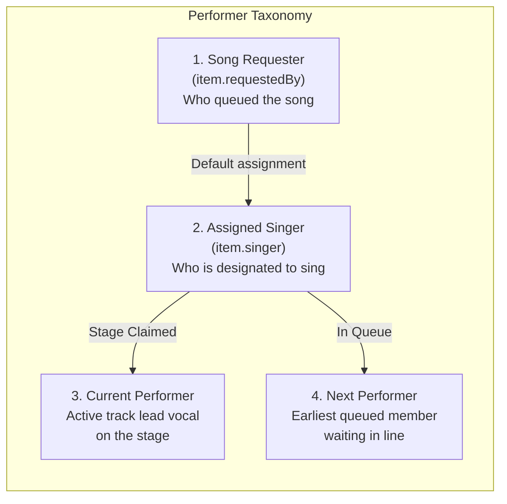
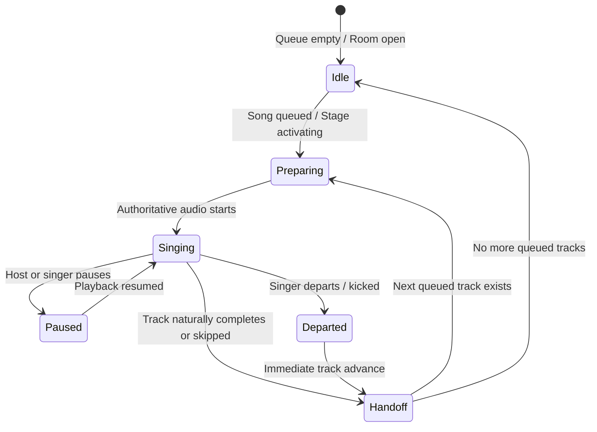

# KTVOnline — Stage & Singer Experience Architecture

**Product Principle**: *"Every song is a performance. Every singer gets their moment."*  
**Sprint**: 3.1  
**Status**: `CODE COMPLETE — NOT RUNTIME VERIFIED`

---

## 1. Overview & Experience Goals

The Stage & Singer Experience evolves KTVOnline from a functional virtual karaoke player into a live performance atmosphere.
Participants in the room instantly understand:
1. **Who is singing right now?**
   - The Stage Spotlight prominently features the current performer's avatar, display name, and live voice indicator.
2. **Which song is being performed?**
   - High-contrast, glowing song titles and synchronized lyrics anchor the main stage.
3. **Who is singing next?**
   - The "Up Next" teaser displays the upcoming performer and track, counting down to their turn.
4. **When will the next singer take over?**
   - Natural progression with clear handoff animations when tracks complete, skip, or transition.
5. **How can I join the singing queue?**
   - Prominent "Add Song" calls-to-action on the stage, sidebar queue, and mobile bottom bar, with instant position feedback (e.g., "Will be #3 in queue").
6. **What happens when the current singer finishes, skips, or leaves?**
   - Server-authoritative transitions automatically clean up queue items, advance playback to the next active member, or return gracefully to an inviting idle lounge stage.

---

## 2. Singer Role & Domain Taxonomy

To avoid confusion between who paid for / selected a track versus who is actually performing it, the system explicitly distinguishes four performer concepts:

1. **Song Requester** (`item.requestedBy`):
   - The room member who found the song in the catalog and submitted it to the queue.
   - Retains permission to remove or cancel their queued track.
2. **Assigned Singer** (`item.singer`):
   - The room member designated to perform the song.
   - Defaults automatically to the `requestedBy` user when not explicitly assigned to a duet partner or another lounge member.
3. **Current Performer**:
   - The assigned singer of the currently playing track (`playback.currentItem.singer || playback.currentItem.requestedBy`).
   - Spotlighted on the main stage screen with microphone status and live audio wave.
4. **Next Performer**:
   - The assigned singer of the earliest upcoming item in queue (`nextUpItem.singer || nextUpItem.requestedBy`).
   - Receives the "You are Up Next!" alert when their moment approaches.

---

## 3. Singer Performance Lifecycle

The performer moves through five deterministic states:

### State Definitions

| State | Playback / Queue Status | UI Representation | Microphone / Audio State |
| :--- | :--- | :--- | :--- |
| **Idle** | `status === 'idle'` | Empty stage banner: "Stage is open! Pick a song to take the spotlight." | Voice room active; mic muted or open chat |
| **Preparing** | `status === 'loading' \|\| status === 'buffering'` | Cyan spinner badge: "Preparing backing audio..." | Audio decoding; LiveKit ready |
| **Singing** | `status === 'playing'` | Glowing spotlight card, "Lead Vocal" badge, live soundwave | LiveKit `isSpeaking` triggers green live wave pulse |
| **Paused** | `status === 'paused'` | Amber pause banner: "Performance is paused. Resume when ready." | Audio element paused at anchor position |
| **Handoff** | Server transition tick | Smooth cross-fade to upcoming performer teaser | Authoritative timer triggers next track |

---

## 4. Voice Activity & LiveKit Integration

### The LiveKit Authoritative Principle
- **Authoritative Speaking**: Voice activity is derived strictly from LiveKit's `participant.isSpeaking` event or property.
- **Microphone Unmuted $\neq$ Speaking**: An unmuted microphone is NOT marked as speaking. This prevents phantom voice ripples when room background noise is present.
- **Backing Track Isolation**: The karaoke instrumental audio is played exclusively via browser `HTMLAudioElement` synchronizing with the server clock. It NEVER routes through the LiveKit voice publisher. This prevents acoustic distortion, echo cancellation suppression, and bandwidth saturation.

---

## 5. Audience Experience & Stage Reactions

To foster a communal lounge environment without creating unnecessary server load or database collections:
- **Audience Views**:
  - Clear label showing who is performing and who queued the track.
  - Dedicated "Up Next" preview showing the next artist in line.
- **Stage Cheer & Emoji Reactions**:
  - Interactive reaction bar featuring 👏, 🔥, ❤️, 🎉, and 🎤.
  - Clicking any cheer button generates floating, GPU-accelerated animated particles that gently drift upwards over the stage and dissolve (`animate-float-fade`).
  - Completely client-side, zero database persistence overhead, zero layout shifts.

---

## 6. Singer Handoff & Edge Case Handling

1. **Natural Track Completion**:
   - In-memory precision scheduler fires at `anchorStartedAt + durationMs`.
   - Polling fallback worker (`NaturalCompletionWorker`) provides resilience against node event loop drift.
   - Atomically completes active track and advances to next queued track.
2. **Host / Singer Skip or Stop**:
   - Host or singer issues authenticated playback command.
   - Version-fenced conditional write marks track `'skipped'` and advances stage.
3. **Singer Departure or Kick**:
   - If a member disconnects, leaves, or is kicked:
     - `handleMemberDeparted` immediately cancels any songs where they were the requester or designated singer.
     - If they were currently performing on stage, `advanceToNextTrack(roomId, { reason: 'singer_departed' })` immediately claims the next track or returns the stage cleanly to idle.
4. **Queue Reordering**:
   - Host can promote or demote upcoming queued tracks using monotonic version-checked reordering (`ReorderQueueDto`).
