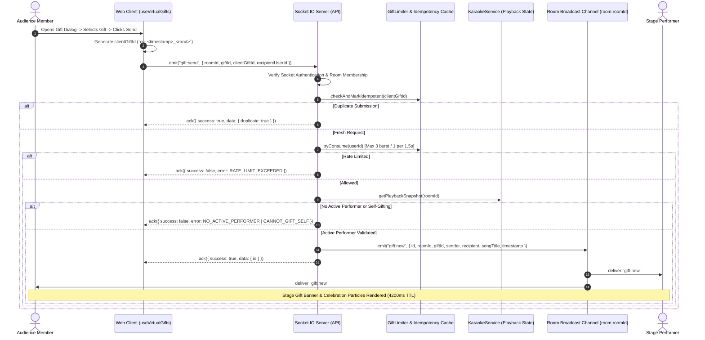

# KTVOnline — Virtual Gifts & Performer Appreciation Architecture

**Version:** 1.0.0  
**Sprint:** 3.4  
**Status:** Approved Architecture  

---

## 1. Executive Summary & Product Vision

Virtual Gifts in KTVOnline represent a deeper, shared expression of appreciation from audience members to the active stage performer.

### Core Product Principles:
1. **Appreciation Over Transaction (Non-Monetized):** All gifts are 100% free, shared, and ephemeral. No currency, balances, wallets, paid tiers, or financial transactions exist.
2. **Authoritative Recipient Resolution:** The recipient is always derived from the server's authoritative playback state (`playback.currentItem.singer ?? playback.currentItem.requestedBy`). The client cannot arbitrary target any user or gift themselves while performing.
3. **Zero Database Persistence:** Gifts are purely live ephemeral Socket.IO broadcasts; no MongoDB records are created.
4. **Resilience & Performance Isolation:** Celebratory gift animations operate strictly within hardware-accelerated CSS boundaries without impacting 10 Hz lyrics timing, WebRTC voice communication, or room state versioning.

---

## 2. Gift Catalog Structure

The catalog is defined as a maintainable, static, type-safe registry in `@ktv/contracts/src/gift.ts`.

| ID | Name | Icon | Category | Accent Color | Description |
|---|---|---|---|---|---|
| `rose` | Rose of Appreciation | 🌹 | Appreciation | `#f43f5e` | A fragrant rose honoring an elegant performance |
| `star` | Sparkling Star | ⭐ | Recognition | `#eab308` | A shining star for a stellar vocalist |
| `microphone` | Golden Microphone | 🎤 | Vocal | `#a855f7` | Celebrating exceptional vocal talent and range |
| `heart` | Heartfelt Cheer | 💖 | Affection | `#ec4899` | Sending warmth, affection, and genuine love |
| `crown` | Royal Crown | 👑 | Prestige | `#f59e0b` | Crowning an outstanding, showstopping performance |
| `fireworks` | Celebration Fireworks | 🎆 | Celebration | `#06b6d4` | Lighting up the stage with explosive applause |
| `music_note` | Melodic Notes | 🎵 | Melody | `#3b82f6` | Harmonious appreciation for musical rhythm |
| `trophy` | Champion Trophy | 🏆 | Honor | `#fbbf24` | Awarding mastery and stage presence of a champion |

---

## 3. Real-Time Event Architecture & Sequence Flow

---

## 4. Server Authorization & Idempotency Semantics

### 4.1 Multi-Layered Validation
1. **Socket Handshake Authentication:** User identity is strictly derived from `socket.data.user.id`.
2. **Active Room Membership Authorization:** Kicked users or users outside the room are rejected with `FORBIDDEN_NOT_MEMBER`.
3. **Room Status Check:** Closed rooms reject gift events with `ROOM_CLOSED`.
4. **Authoritative Performer Validation:**
   - Evaluated via `karaokeService.getPlaybackSnapshot(roomId)`.
   - Playback status must be `'playing'` or `'paused'`.
   - `currentItem` must be non-null.
   - Performer resolved from `currentItem.singer || currentItem.requestedBy`.
   - If `sender.id === performer.id`, rejected with `CANNOT_GIFT_SELF`.
   - If `recipientUserId` passed by client differs from active performer, rejected with `PERFORMER_CHANGED`.

### 4.2 Idempotency Cache
- Key: `clientGiftId`.
- Window: 30 seconds.
- Storage: In-memory bounded Map with automatic 60-second garbage collection.
- Purpose: Network retries or rapid double-taps on the "Send" button resolve cleanly without broadcasting duplicate stage animations.

### 4.3 User-Based Rate Limiting
- Key: `userId` (multi-tab protected).
- Capacity: 3 tokens.
- Refill Rate: 1 token per 1500ms (3 tokens / 4500ms window).
- Over-limit requests are rejected immediately without room broadcast.

---

## 5. Animation Architecture & Accessibility

### 5.1 Stage Celebration Layout
- **Banner Placement:** Centered at the top of the virtual stage surface (`data-testid="karaoke-stage-surface"`), styled with the gift's accent color and ambient glow.
- **Visual Personality:** Displays sender avatar, gift icon/name, and performer avatar with song title context.
- **Particle Layer:** 6 hardware-accelerated floating particles (`animate-gift-particle`) staggered across the stage width (`15% - 85%`) with 3.5s duration.
- **Isolation:** Placed inside a `pointer-events-none` container. Uses CSS `transform` and `opacity` properties, causing zero layout reflows on the 10 Hz lyrics renderer.

### 5.2 Accessibility & Reduced Motion
- Media query `@media (prefers-reduced-motion: reduce)`:
  - Disables upward vertical translations and rotations.
  - Automatically switches banner and particles to a stationary, smooth opacity fade (`animate-pulse-fade`).
- Screen reader announcements:
  - An `aria-live="polite"` region alerts assistive devices: `"{Sender} sent {Gift Name} to {Performer}!"`.
- Mobile ergonomics:
  - Touch targets on toolbar buttons are sized to $\ge 44 \times 44$px.
  - Bottom sheet dialog features safe-area padding (`pb-[max(1rem,env(safe-area-inset-bottom))]`).

---

## 6. Multi-Instance Deployment Limitations

In the current architecture, rate limiting and idempotency caching are implemented in-memory (`apps/api/src/realtime/gift.limiter.ts`):
- **Single-Node Deployment:** Fully deterministic and memory-safe.
- **Multi-Node Cluster Deployment:** Requires a distributed store (such as Redis) for cross-node token buckets and idempotency locks. The in-memory limiter is designed with modular interfaces to allow straightforward transition to a Redis adapter in Sprint 5.
