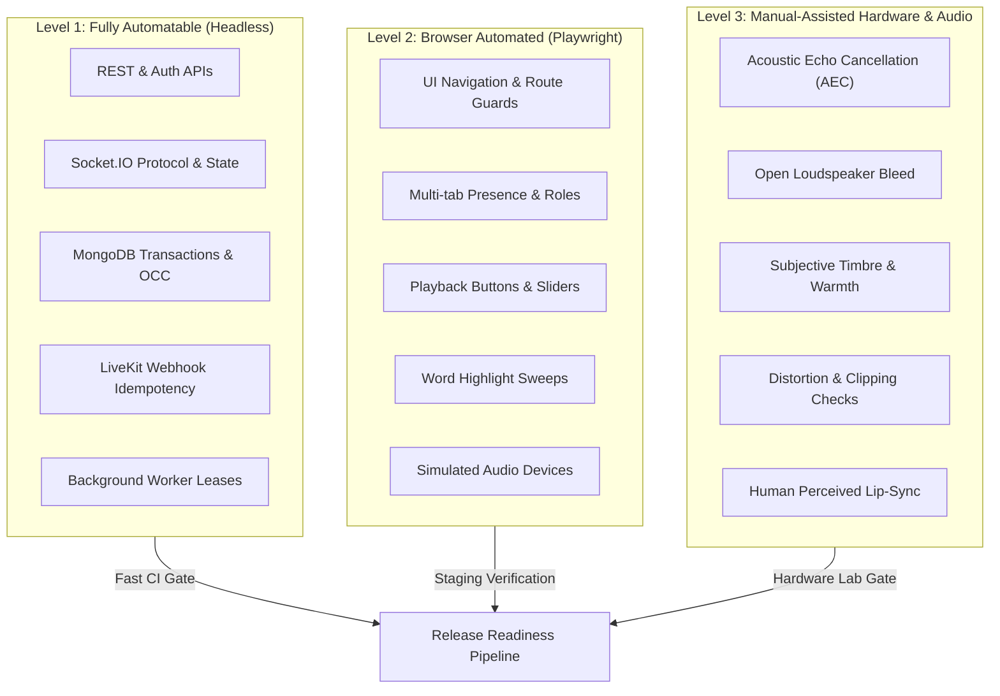

# KTVOnline — Runtime Verification Runbook & Architecture Specification (RV-00)

## Document Control
- **Monorepo**: `ktv-online-monorepo` (v0.1.0)
- **Baseline Git Commit**: `fce831c` (Sprint 2.6.4 Code Complete)
- **Status**: **`DOCUMENTATION & ARCHITECTURE READY — HARNESS NOT YET IMPLEMENTED — NO RUNTIME VERIFICATION PERFORMED`**
- **Date**: November 2026

---

## 1. Executive Summary & Purpose

Following the completion of **Sprint 2.6.4** (*Lyrics Performance & Advanced Audio UX*), KTVOnline encompasses complex, distributed real-time sub-systems:
- Multi-document MongoDB transactional state machines with optimistic concurrency control (OCC).
- State-synchronized Socket.IO room presence, chat, and queue moderation.
- LiveKit WebRTC low-latency voice loungers with token-bound authorization, dynamic mute, and automated server-side eviction.
- Server-authoritative karaoke playback synchronized across clients with sub-second drift correction and precision background workers.
- Dynamic word-level lyric highlighting ($O(1)$ per-tick updates) and a 3-band parametric backing track equalizer isolated from voice streams.

While code completeness and static type soundness (`pnpm typecheck`, `pnpm lint`) have been verified, **software correctness under concurrent real-world runtime conditions requires rigorous, deterministic verification**.

This Runbook establishes the **RV-00 Specification**: a structured, reproducible verification framework designed to support both:
1. **Automated Runtime Verification**: Headless API, database, Socket.IO, and browser orchestration (L1 and L2).
2. **Manual-Assisted Hardware & Audio Verification**: Real-world acoustic, peripheral, and subjective quality evaluation (L3).

> [!IMPORTANT]
> **Constraint & Readiness Notice**:
> In accordance with the RV-00 scope, **this deliverable provides the architecture, operational runbooks, and scenario specifications only**. The automated test harness runner has **NOT** yet been executed or implemented, and no test runs have been scored as `PASS`. All scenarios reflect specifications ready for execution once the test runner harness is deployed.

---

## 2. Monorepo Repository Audit (Verified Repository Facts)

All procedures and specifications in this runbook are built exclusively on verified repository capabilities:

| Domain | Verified Repository Fact | Source / Configuration |
| :--- | :--- | :--- |
| **Workspace & Tooling** | Monorepo managed via `pnpm` (v12.16.1), Node.js `>=20.0.0`. Workspace projects: `apps/api`, `apps/web`, `packages/contracts`. | `package.json`, `pnpm-workspace.yaml` |
| **API Framework** | Express 4.21, TypeScript 5.8, Node ES Modules (`"type": "module"`). Port `5001`. | `apps/api/package.json`, `apps/api/src/server.ts` |
| **Web Framework** | Next.js 15.2 (React 19), Tailwind CSS 4, Zustand 5, TanStack Query 5. Port `3000`. | `apps/web/package.json`, `apps/web/src/app` |
| **Database Topology** | MongoDB 7.0 via Mongoose 8.10. Multi-document transactions require a replica set. Standalone mode allowed only in `development` and `test` with CAS best-effort fallback; fails closed in `production`/`staging`. | `apps/api/src/database/transaction.ts`, `docker-compose.yml` |
| **Health Probes** | Consolidated: `GET /api/v1/health` Liveness: `GET /api/v1/health/live` Readiness: `GET /api/v1/health/ready` (checks DB, shutdown state, and replica-set transaction capability). | `apps/api/src/routes/health.routes.ts` |
| **Realtime Engine** | Socket.IO 4.8 attached to HTTP server. Handshake auth via JWT access token in `socket.handshake.auth.token` or `headers.authorization`. Heartbeat: pingInterval 25s, pingTimeout 20s. Max payload 1MB. | `apps/api/src/realtime/socket.server.ts`, `socket.auth.ts` |
| **Voice Engine** | LiveKit Cloud / Server via `livekit-server-sdk` (v2.19) and `livekit-client` (v2.23). Short-lived tokens issued at `POST /api/v1/rooms/:roomId/voice/token`. Background worker (`VoiceEvictionWorker`) polls every 10s. | `apps/api/src/modules/voice/`, `apps/web/src/features/voice/` |
| **Webhooks** | Webhook endpoint: `POST /api/v1/voice/webhook`. Signed verification using `WebhookReceiver.receive()`. Deduplication and atomic lease in MongoDB (`VoiceWebhookEventModel`), monotonic per-participant ordering (`assertMonotonicEventOrder`). | `apps/api/src/modules/voice/voice-webhook.controller.ts` |
| **Karaoke Playback** | Authoritative playback worker (`KaraokePlaybackWorker`) polls every 2s with in-memory precision timers. Invariant reconciliation on startup and recovery via `KaraokeReconciliationService`. | `apps/api/src/modules/karaoke/karaoke-playback.worker.ts`, `karaoke-reconciliation.service.ts` |
| **Clock & Drift** | Client synchronization via `ClockSyncService` (HTTP/Socket RTT measurement). Audio drift corrected via 3 tiers: deadband (<250ms), tempo nudge 1.04x/0.96x (250ms-1500ms), hard seek (>1500ms). | `apps/web/src/features/karaoke/services/clock-sync.service.ts`, `use-karaoke-audio.ts` |
| **Lyrics & EQ** | Word-level timing (`TimedLyricWord`) + line fallback. Memoized `LyricLineRow`. Manual scroll pause (4000ms cooldown). Local 3-band Web Audio equalizer (`flat`, `bass_boost`, `vocal_clarity`, `treble_boost`) isolated to backing track. | `apps/web/src/features/karaoke/services/karaoke-equalizer.ts`, `LyricsStage.tsx` |

---

## 3. Classification of Verification Levels (L1 / L2 / L3)

To ensure high automation throughput without making unscientific claims regarding physical audio physics, tests are classified into three distinct tiers:

- **L1 — Fully Automatable (Headless)**: Executed against APIs, Socket.IO clients, and MongoDB directly. Extremely fast, deterministic, and runnable in CI.
- **L2 — Browser Automated (Playwright)**: Executed in headless/headed browsers with mock media streams (`--use-fake-device-for-media-stream`). Validates DOM rendering, state binding, and user interaction flows.
- **L3 — Manual-Assisted Hardware & Audio**: Executed by human test engineers using the [Test Device Matrix](file:///Users/mac/Documents/workspace/workspace_coding/ktvonline/docs/runtime-verification/TEST_DEVICE_MATRIX.md). Verifies subjective sound quality, hardware mic switches, physical acoustic feedback, and perceived synchronization.

---

## 4. Runbook Documentation Suite Index

The runtime verification specifications are partitioned into dedicated workstreams:

| Document | Workstream | Primary Scope | Primary Level |
| :--- | :--- | :--- | :--- |
| [ENVIRONMENT_SETUP.md](file:///Users/mac/Documents/workspace/workspace_coding/ktvonline/docs/runtime-verification/ENVIRONMENT_SETUP.md) | **Setup & Preflight** | Node/pnpm setup, replica set config, environment variables, test isolation, database seeding. | All |
| [TEST_DEVICE_MATRIX.md](file:///Users/mac/Documents/workspace/workspace_coding/ktvonline/docs/runtime-verification/TEST_DEVICE_MATRIX.md) | **Device & Hardware** | Operating systems, browsers, audio peripherals, permission states, Web Audio compatibility. | L2, L3 |
| [VERIFICATION_ARCHITECTURE.md](file:///Users/mac/Documents/workspace/workspace_coding/ktvonline/docs/runtime-verification/VERIFICATION_ARCHITECTURE.md) | **Runner Design** | Architecture for the future `verify:runtime` CLI runner, test adapters, failure isolation. | Runner Arch |
| [RV_01_INFRASTRUCTURE.md](file:///Users/mac/Documents/workspace/workspace_coding/ktvonline/docs/runtime-verification/RV_01_INFRASTRUCTURE.md) | **RV-01 Infrastructure** | DB readiness, replica set transactions, health probes, CORS, Socket.IO auth, LiveKit credentials, secrets. | L1 |
| [RV_02_ROOM_REALTIME.md](file:///Users/mac/Documents/workspace/workspace_coding/ktvonline/docs/runtime-verification/RV_02_ROOM_REALTIME.md) | **RV-02 Room & Realtime** | Creation, access controls, multi-tab presence, member kick/leave, room close, stateVersion recovery. | L1, L2 |
| [RV_03_LIVEKIT_VOICE.md](file:///Users/mac/Documents/workspace/workspace_coding/ktvonline/docs/runtime-verification/RV_03_LIVEKIT_VOICE.md) | **RV-03 Voice (LiveKit)** | Token gating, mute, mic/speaker switching, token renewal, session eviction, webhook idempotency. | L1, L2, L3 |
| [RV_04_KARAOKE_PLAYBACK.md](file:///Users/mac/Documents/workspace/workspace_coding/ktvonline/docs/runtime-verification/RV_04_KARAOKE_PLAYBACK.md) | **RV-04 Playback & Queue** | Queue operations, CAS updates, natural track completion, clock sync, 3-tier drift compensation. | L1, L2 |
| [RV_05_LYRICS_AUDIO_UX.md](file:///Users/mac/Documents/workspace/workspace_coding/ktvonline/docs/runtime-verification/RV_05_LYRICS_AUDIO_UX.md) | **RV-05 Lyrics & Audio UX** | Word timing sweep, memoized $O(1)$ rendering, scroll cooldown, 3-band EQ presets, CORS fallback. | L2, L3 |
| [RV_06_RECOVERY_SECURITY.md](file:///Users/mac/Documents/workspace/workspace_coding/ktvonline/docs/runtime-verification/RV_06_RECOVERY_SECURITY.md) | **RV-06 Recovery & Sec** | Server crashes, DB drops, token family replay attacks, user suspension, out-of-order webhooks. | L1, L2 |
| [RV_07_ENDURANCE.md](file:///Users/mac/Documents/workspace/workspace_coding/ktvonline/docs/runtime-verification/RV_07_ENDURANCE.md) | **RV-07 Endurance** | 30m / 60m multi-user soak tests, memory leak checks, AudioContext leaks, drift stability over time. | L1, L2, L3 |
| [BUG_REGISTER.md](file:///Users/mac/Documents/workspace/workspace_coding/ktvonline/docs/runtime-verification/BUG_REGISTER.md) | **Defect Ledger** | Structured defect tracking register for issues identified during verification passes. | All |
| [RELEASE_READINESS_REPORT.md](file:///Users/mac/Documents/workspace/workspace_coding/ktvonline/docs/runtime-verification/RELEASE_READINESS_REPORT.md) | **Release Assessment** | Executive release gate scorecard, verification status, and production sign-off criteria. | Gate Review |

---

## 5. Execution Rules & Safety Guidelines

When executing any verification scenario detailed in this runbook:
1. **Never Target Production**: Runtime verification must execute strictly against dedicated `test` or `staging` environments. Destructive operations (fault injection, DB drops, token revocations) must refuse execution if `NODE_ENV === 'production'`.
2. **Namespace Isolation**: All test entities (users, rooms, queue items) must use prefix `rv_test_` or `rv_fixture_` to permit automated post-test sweeping.
3. **Correlation ID Tracking**: Every HTTP request and Socket.IO command must provide an `x-correlation-id` header/payload for end-to-end log aggregation.
4. **Credential Redaction**: Raw JWT access/refresh tokens, LiveKit API secrets, and MongoDB passwords must never be recorded in verification logs or artifact reports.
5. **No Assumed PASS**: Every test starts with status `NOT RUN`. A test cannot transition to `PASS` without explicit, collected evidence meeting all criteria.

