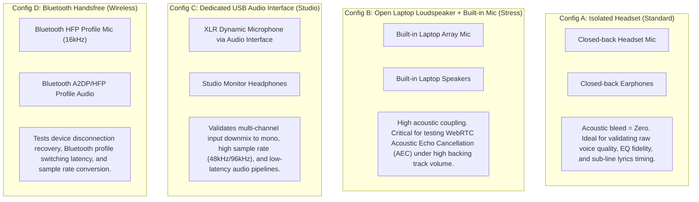

# Runtime Verification — Test Device & Hardware Matrix

## 1. Objective & Scope

This document specifies the supported hardware configurations, operating systems, browser environments, and physical acoustic scenarios required for **Level 2 (Browser Automated)** and **Level 3 (Manual-Assisted Hardware & Audio)** runtime verification.

Because KTVOnline combines WebRTC voice streams (via LiveKit) and Web Audio backing track processing (via HTMLAudioElement and 3-band BiquadFilterNodes), physical audio behavior is inherently constrained by host OS hardware abstraction layers, audio drivers, and browser security policies.

---

## 2. Operating System & Browser Compatibility Matrix

| Tier | OS Platform | Browser & Engine | AudioContext Constraints | `setSinkId` Output Routing | LiveKit WebRTC Support | Automation Target |
| :--- | :--- | :--- | :--- | :--- | :--- | :--- |
| **Tier 1 (Primary)** | macOS 14+ (Sonoma/Sequoia) | Google Chrome 120+ (Blink) | Unrestricted with user gesture | Full Support (`HTMLMediaElement.setSinkId`) | Full Support (VP8, Opus) | Automated (Playwright) & Manual |
| **Tier 1 (Primary)** | macOS 14+ | Apple Safari 17.4+ (WebKit) | Strict Autoplay Policy | Limited (Supported on macOS 17+) | Full Support | Manual & Browser Automated |
| **Tier 1 (Primary)** | Windows 11 | Google Chrome 120+ / MS Edge (Blink) | Unrestricted with user gesture | Full Support | Full Support | Automated & Manual |
| **Tier 2 (Secondary)**| macOS / Windows | Mozilla Firefox 124+ (Gecko) | Requires user interaction | Limited / Pref-dependent | Full Support | Manual Verification |
| **Tier 3 (Mobile)** | iOS 17+ | Mobile Safari (WebKit) | Strict Autoplay + Background Mute | No (`setSinkId` not supported on iOS) | Full Support | Manual Verification |
| **Tier 3 (Mobile)** | Android 13+ | Chrome Mobile (Blink) | Strict Autoplay | Partial (Device dependent) | Full Support | Manual Verification |

---

## 3. Audio Peripheral Hardware Configurations

Verification scenarios must cover four distinct physical peripheral archetypes to validate hardware abstraction and isolation:

### Hardware Configuration Matrix

| ID | Description | Microphone Type | Audio Output Device | Target Verification Scope |
| :--- | :--- | :--- | :--- | :--- |
| **HW-CONF-01** | Standard Headset | 3.5mm / USB Gaming Headset | Headphone Drivers | Baseline audio quality, voice clarity, EQ presets |
| **HW-CONF-02** | Acoustic Stress | Built-in Laptop Array | Built-in Laptop Speakers | Acoustic Echo Cancellation (AEC), AGC, feedback suppression |
| **HW-CONF-03** | Studio Hardware | External USB Interface (e.g. Focusrite) | Studio Headphones | Hardware switching, sample-rate stability (48kHz) |
| **HW-CONF-04** | Wireless BT | Bluetooth Earbuds (AirPods / Pixel Buds) | Bluetooth Earbuds | Reconnect on disconnect, audio latency drift |

---

## 4. Web Audio & Media Constraints Matrix

### 1. Browser Autoplay Policies
- **Problem**: Modern browsers block `AudioContext.resume()` and `HTMLAudioElement.play()` until an explicit user gesture (click, touch, keypress) occurs in the window.
- **KTVOnline Implementation**:
  - The `useKaraokeAudio` hook wraps play promises and exposes `unlockAutoplay()`.
  - The `AudioDeviceSettingsModal` triggers `karaokeEqualizer.resume()` upon modal engagement.
- **Verification Rule**: Tests must verify that audio gracefully transitions from `suspended` to `running` upon user interaction, displaying an informative banner if blocked.

### 2. CORS & MediaElementSourceNode Restrictions
- **Problem**: If the backing track audio stream is served from an origin lacking `Access-Control-Allow-Origin: *` or explicit origin matching, `AudioContext.createMediaElementSource(audio)` will mute the audio output entirely to protect against cross-origin data exfiltration.
- **KTVOnline Implementation**:
  - `HTMLAudioElement` is created with `crossOrigin = "anonymous"`.
  - `apps/api` serves fixture audio with full CORS headers.
  - A fallback `try-catch` in `KaraokeEqualizerService.attachElement()` catches security errors and falls back to un-equalized native playback without muting audio.
- **Verification Rule**: Verify both CORS success (EQ active) and forced CORS error (native audio fallback without silence).

### 3. Output Device Selection (`setSinkId`) Support
- **Chrome / Edge**: Full support. Both LiveKit voice audio and `HTMLAudioElement` / `AudioContext` destination route to the selected device.
- **Safari / Mobile Safari**: No or partial support. The UI must detect `'setSinkId' in HTMLMediaElement.prototype` and gracefully disable the physical output dropdown when unsupported without throwing unhandled exceptions.

---

## 5. Microphone Permission State Matrix

The UI must gracefully handle all WebRTC permission states:

| Permission State | Browser Behavior | Application State | UI Expected Rendering |
| :--- | :--- | :--- | :--- |
| **`prompt`** | Browser prompts user on first mic access | `requesting_permission` | "Requesting microphone permissions..." spinner |
| **`granted`** | Device list populated; track acquired | `connecting` $\rightarrow$ `connected` | Voice lounge active; mic indicator glowing green |
| **`denied`** | `NotAllowedError` thrown | `failed` | Error banner: *"Microphone permission was denied. Please allow in browser settings."* |
| **Device Missing** | `NotFoundError` / `DevicesNotFoundError` | `failed` | Error banner: *"Selected audio device was not found or has been disconnected."* |
| **Device Busy** | `NotReadableError` (Mic locked by Zoom/Teams) | `failed` | Error banner: *"Microphone is currently unavailable (used by another app)."* |
| **Overconstrained** | Constraints cannot be satisfied | `failed` | Error banner: *"Audio device constraints could not be satisfied by hardware."* |

---

## 6. Physical Acoustic Verification Conditions (L3)

For all **Level 3** manual-assisted audio tests, human evaluators must record observations under two controlled ambient environments:

1. **Quiet Environment**: Ambient sound level $<40\text{ dBA}$ (Private room, doors closed). Used for EQ timbre, clipping, and distortion checks.
2. **Noisy / Room Environment**: Ambient sound level $55\text{--}65\text{ dBA}$ (Background music or office chatter). Used for Noise Suppression and Auto Gain Control (AGC) evaluation.

